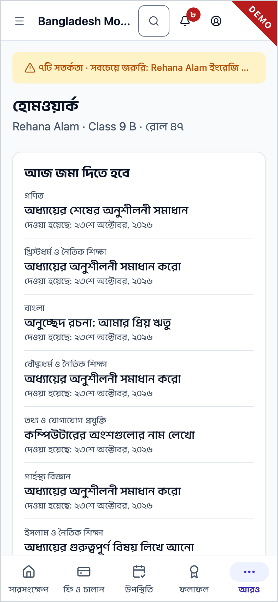

<!-- guide:meta
feature: portal.homework
title: হোমওয়ার্ক (অভিভাবক ও শিক্ষার্থী)
summary: আপনার সন্তানকে আজ ও সামনে যে হোমওয়ার্ক জমা দিতে হবে, ফোনে দেখুন; জমার দিন অনুযায়ী ভাগ করা, বিষয়, কাজ আর কবে দেওয়া হয়েছে সহ। এই পাতা শুধু দেখার; এখানে কিছু বদলানো বা জমা দেওয়া যায় না।
roles: [PARENT, STUDENT]
sources:
  - client-admin/src/routes/portal.tsx
  - client-admin/src/routes/portal/homework.tsx
  - client-admin/src/routes/portal/-use-family-homework.ts
  - client-admin/src/routes/portal/-homework-card.tsx
  - server/src/modules/homework/homework.controller.ts
  - server/src/modules/homework/homework.service.ts
labels: [portal:homework.*, portal:homeworkCard.*, portal:empty.*, portal:children.*, nav:items.portalHomework, nav:items.more]
helpIds: [portal.homework]
devices: [phone]
entry: [sidebar, palette]
keywords: [হোমওয়ার্ক, বাড়ির কাজ, জমার দিন, আজকের হোমওয়ার্ক, homework, due today, due tomorrow]
appVersion: 0.1.0 (fb209bd7c)
owner: tareq89
lastVerified: 2026-10-25
knownIssues: []
-->

# হোমওয়ার্ক (অভিভাবক ও শিক্ষার্থী)

আজ ও সামনে কোন হোমওয়ার্ক জমা দিতে হবে, দেখুন।

**যেতে হবে:** ফোনে নিচের বারের **আরও** → **হোমওয়ার্ক**। কম্পিউটারে বাম মেনুর **হোমওয়ার্ক**।
**শুরুর আগে:** শিক্ষার্থী কোনো শ্রেণিতে যুক্ত থাকতে হবে। শিক্ষক শ্রেণির শাখাকে বা শিক্ষার্থীকে হোমওয়ার্ক দিয়ে থাকতে হবে।

এই পাতা শুধু দেখার। এখানে হোমওয়ার্ক জমা দেওয়া যায় না।

[এক নজরে দেখুন](#task-main) · [একাধিক সন্তান](#task-child) · [সমস্যা ও সমাধান](#trouble)

**এই পাতায় যা আছে**

- [এই পাতায় যেভাবে আসবেন](#arrive)
- [এক নজরে দেখুন](#task-main)
- [ঠিক পাতায় আছেন কি না বুঝবেন যেভাবে](#confirm)
- [অন্য পরিস্থিতিতে](#other)
  - [একাধিক সন্তান](#task-child)
  - [প্রথম পাতা থেকে](#task-card)
- [সমস্যা ও সমাধান](#trouble)
- [কে কী করতে পারেন](#roles)
- [আরও জানুন](#more)

---

## এই পাতায় যেভাবে আসবেন 

**ফোনে:** নিচের বারের **আরও** → **হোমওয়ার্ক**।

**কম্পিউটারে:** বাম মেনুর **হোমওয়ার্ক**।

**খোঁজ দিয়ে:** ওপরের খোঁজার বোতাম চাপুন, "হোমওয়ার্ক" লিখুন।

**প্রথম পাতা থেকে:** **আজকের হোমওয়ার্ক** কার্ডের **সব হোমওয়ার্ক**।

---

## এক নজরে দেখুন 

1. **হোমওয়ার্ক** পাতা খুলুন।

   → ওপরে শিক্ষার্থীর নাম, শ্রেণি আর রোল।

2. প্রথম কার্ডটি দেখুন।

   → এর শিরোনাম সবচেয়ে কাছের জমার দিন: **আজ জমা দিতে হবে**, **কাল জমা দিতে হবে**, বা একটি তারিখের পাশে **জমা**।

3. কার্ডের প্রতিটি কাজ পড়ুন।

   → প্রথমে বিষয়, তারপর মোটা অক্ষরে কাজের শিরোনাম, শিক্ষকের কোনো লেখা থাকলে সেটি, তারপর **দেওয়া হয়েছে** আর তারিখ।

4. পরের জমার দিনগুলো দেখতে নিচে নামুন। প্রতিটি দিনের আলাদা কার্ড।

> **মনে রাখুন:** "আজ" মানে স্কুলের দিন, আপনার ফোনের নয়। জমার দিন পার হলে হোমওয়ার্ক এই পাতা থেকে সরে যায়।

---

## ঠিক পাতায় আছেন কি না বুঝবেন যেভাবে 

ওপরে শিক্ষার্থীর নাম, শ্রেণি আর রোল, তারপর প্রতিটি জমার দিনের একটি কার্ড, কাছেরটা আগে। ওপরের নামটি আপনার সন্তানের হলে আপনি ঠিক পাতায় আছেন। একাধিক সন্তান থাকলে কাজ পড়ার আগে নামটি দেখে নিন।

---

## অন্য পরিস্থিতিতে 

### একাধিক সন্তান 

একাধিক সন্তান যুক্ত থাকলে ওপরে **একজন শিক্ষার্থী বেছে নিন** আসে। যে সন্তানের হোমওয়ার্ক দেখতে চান, তার নাম চাপুন। একজন সন্তান থাকলে এই অংশ আসে না।

### প্রথম পাতা থেকে 

[**সারসংক্ষেপ**](overview.md) পাতায় **আজকের হোমওয়ার্ক** কার্ডে সব সন্তানের সামনের কয়েকটি কাজ একসঙ্গে দেখায়। এই পাতা খুলতে **সব হোমওয়ার্ক** চাপুন।

### হোমওয়ার্কের এসএমএস 

স্কুল হোমওয়ার্কের এসএমএস চালু রাখলে, সন্তানকে নতুন হোমওয়ার্ক দিলে আপনি এসএমএস পান। শিক্ষক শেষ তারিখ সরালে, অথবা কাজটি বাতিল করলে বা অন্য শাখা বা শিক্ষার্থীকে দিলেও এসএমএস পান। বাতিল হওয়া কাজ এই পাতা থেকে সরে যায়, জমা দিতে হয় না। শিক্ষক আবার চালু করলে শেষ তারিখসহ এসএমএস পান, আর কাজটি এখানে আবার দেখায়। পাতায় সবসময় সর্বশেষ শেষ তারিখ দেখায়।

---

## সমস্যা ও সমাধান 

| আপনি যা দেখছেন                                     | কী করবেন                                                                            | কে সাহায্য করতে পারেন |
| -------------------------------------------------- | ----------------------------------------------------------------------------------- | --------------------- |
| **জমা দেওয়ার মতো হোমওয়ার্ক নেই**                 | আজ বা সামনে কিছু জমা দিতে হবে না। শিক্ষকেরা হোমওয়ার্ক দিলে এখানে দেখা যাবে।        | বিষয় শিক্ষক          |
| **হোমওয়ার্ক লোড হয়নি।**                          | ইন্টারনেট দেখুন, তারপর **আবার চেষ্টা করুন** চাপুন।                                  | —                     |
| **আপনার সঙ্গে এখনও কোনো শিক্ষার্থী যুক্ত নেই**     | আপনার অ্যাকাউন্টে কোনো সন্তান যুক্ত নেই। স্কুলকে জানান, তারপর **আবার দেখুন** চাপুন। | স্কুল অ্যাডমিন        |
| পরের কোনো দিনের জন্য দেওয়া হোমওয়ার্ক দেখাচ্ছে না | যেদিন দেওয়া হয়, সেদিন থেকে দেখায়।                                                | —                     |
| পুরনো হোমওয়ার্ক নেই                               | জমার দিন পার হলে হোমওয়ার্ক এই পাতা থেকে সরে যায়।                                  | —                     |

---

## কে কী করতে পারেন 

| রোল        | যা দেখেন                          | বদলাতে পারেন |
| ---------- | --------------------------------- | ------------ |
| অভিভাবক    | যুক্ত প্রতিটি সন্তানের হোমওয়ার্ক | না           |
| শিক্ষার্থী | নিজের হোমওয়ার্ক                  | না           |

শিক্ষকেরা হোমওয়ার্ক দেন [**বাড়ির কাজ দেওয়া**](../academics/homework.md) পাতায়।

---

## আরও জানুন 

<strong>হোমওয়ার্ক কখন এখানে দেখায়</strong>

<figure>
  
</figure>

- পুরো শাখাকে দেওয়া হোমওয়ার্ক আর শুধু এই শিক্ষার্থীকে দেওয়া হোমওয়ার্ক, দুটোই দেখায়।
- সবচেয়ে বেশি ৫০টি কাজ দেখায়, যেটা আগে জমা দিতে হবে সেটা আগে।

**সম্পর্কিত পাতা**

- [**বাড়ির কাজ দেওয়া**](../academics/homework.md) — স্কুলের দিক থেকে হোমওয়ার্ক।
- [**সারসংক্ষেপ**](overview.md) — প্রথম পাতা, **আজকের হোমওয়ার্ক** কার্ডসহ।
- [**সিলেবাস (অভিভাবক ও শিক্ষার্থী)**](syllabus.md) — বিষয় ধরে কী পড়ানো হচ্ছে।

---

_সংস্করণ ০.১.০ · শেষ যাচাই ২০২৬-১০-২৫_
