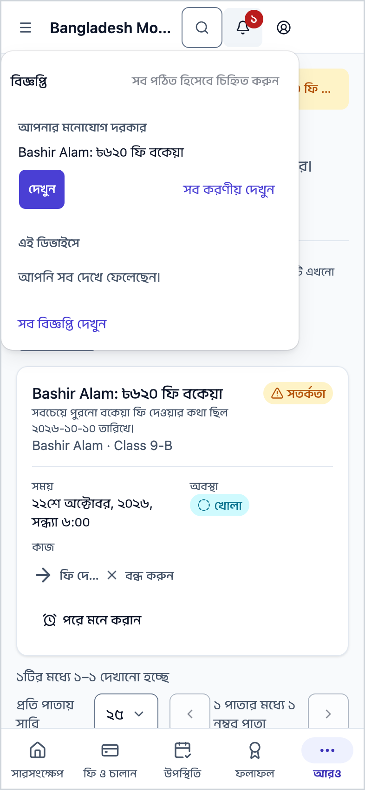
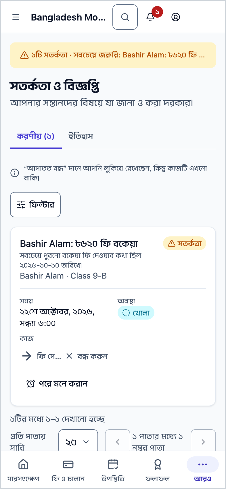

<!-- guide:meta
feature: portal.notifications
title: সতর্কতা ও বিজ্ঞপ্তি (অভিভাবক ও শিক্ষার্থী)
summary: সন্তানের অনুপস্থিতি, বকেয়া ফি, কালকের পরীক্ষা, ফল প্রকাশ, বাড়ির কাজ আর জরিপের খবর এক জায়গায় দেখুন। কাজ হয়ে গেলে সতর্কতা নিজে থেকে সরে যায়।
roles: [PARENT, STUDENT]
sources:
  - client-admin/src/routes/portal.tsx
  - client-admin/src/routes/portal/notifications.tsx
  - client-admin/src/features/attention/attention-worklist.tsx
  - shared/src/attention/rule-catalogue.ts
labels: [attention:worklist.*, attention:item.*, attention:state.*, attention:severity.*, attention:snooze.*, nav:notifications.*]
helpIds: [portal.notifications]
devices: [phone]
entry: [bell]
keywords: [বিজ্ঞপ্তি, সতর্কতা, ঘণ্টা, করণীয়, রিমাইন্ডার, notification, alert, bell, reminder]
appVersion: 0.1.0 (cba7dfad7)
owner: tareq89
lastVerified: 2026-10-25
knownIssues: []
-->

# সতর্কতা ও বিজ্ঞপ্তি (অভিভাবক ও শিক্ষার্থী)

সন্তানের বিষয়ে যা জানা ও করা দরকার, তা এক জায়গায় দেখুন।

**যেতে হবে:** উপরে ডান দিকের **বিজ্ঞপ্তি** ঘণ্টা → **সব করণীয় দেখুন**। মেনুতে এই পাতা নেই।
**শুরুর আগে:** কিছু লাগে না। অভিভাবকের অ্যাকাউন্টে সন্তান যুক্ত থাকলে তার খবর আসে।

স্কুলের সিস্টেম নিজে থেকে সতর্কতা তৈরি করে। যেমন সন্তান আজ স্কুলে আসেনি, বা ফি বকেয়া। কাজ হয়ে গেলে (ফি দিলেন, পরীক্ষা হয়ে গেল) সতর্কতা নিজে থেকে **ঠিক হয়েছে** হয়ে **ইতিহাস**-এ চলে যায়।

[ঘণ্টা থেকে খুলুন](#task-main) · [একটি সতর্কতা বন্ধ করুন](#task-close) · [সমস্যা ও সমাধান](#trouble)

**এই পাতায় যা আছে**

- [এই পাতায় যেভাবে আসবেন](#arrive)
- [করণীয় দেখুন আর কাজটি করুন](#task-main)
- [কাজ হয়েছে কি না বুঝবেন কীভাবে](#confirm)
- [অন্য পরিস্থিতিতে](#other)
  - [একটি সতর্কতা বন্ধ করুন](#task-close)
  - [পরে মনে করান](#task-snooze)
  - [একটি সন্তানের খবর দেখুন](#task-child)
  - [আগের সতর্কতা আর এই ডিভাইসের বার্তা](#task-history)
- [কোন খবর কার কাছে আসে](#which)
- [সমস্যা ও সমাধান](#trouble)
- [কে কী করতে পারেন](#roles)
- [আরও জানুন](#more)

---

## এই পাতায় যেভাবে আসবেন 

**ফোনে আর কম্পিউটারে:** উপরে ডান দিকের **বিজ্ঞপ্তি** ঘণ্টা চাপুন। ঘণ্টায় সংখ্যা থাকলে সেটি আপনার করণীয়ের সংখ্যা। খোলা প্যানেলের নিচে **সব করণীয় দেখুন** চাপুন।

বাম মেনু বা নিচের বারে এই পাতা নেই।

---

## করণীয় দেখুন আর কাজটি করুন 

1. ঘণ্টা চাপুন।

   → ছোট প্যানেল খোলে: **আপনার মনোযোগ দরকার**, নিচে প্রথম কয়েকটি সতর্কতা।

2. **সব করণীয় দেখুন** চাপুন।

   → **সতর্কতা ও বিজ্ঞপ্তি** পাতা খোলে, **করণীয়** ট্যাবে। প্রতিটি সারিতে ধরন (**জরুরি**, **সতর্কতা** বা **রিমাইন্ডার**), বিষয়, কোন সন্তান, আর সময়।

3. সারির কাজের বোতাম চাপুন, যেমন ফি দেখার বোতাম।

   → যে পাতায় কাজটি হয়, সেটি খোলে। কাজ শেষ হলে সতর্কতা নিজে থেকে সরে যায়।

---

## কাজ হয়েছে কি না বুঝবেন কীভাবে 

| অবস্থা         | কীভাবে বুঝবেন                            | এরপর কী                 |
| -------------- | ---------------------------------------- | ----------------------- |
| **খোলা**       | **করণীয়** ট্যাবে আছে।                   | কাজটি করুন।             |
| **আপাতত বন্ধ** | আপনি লুকিয়েছেন বা পরে মনে করাতে বলেছেন। | কাজটি কিন্তু এখনো বাকি। |
| **ঠিক হয়েছে** | **ইতিহাস**-এ আছে, পাশে সময়।             | কাজ শেষ।                |
| **মেয়াদ শেষ** | **ইতিহাস**-এ আছে। সময় পার হয়ে গেছে।    | কিছু করার নেই।          |

**যাচাই করতে চাইলে:** **ইতিহাস** ট্যাব খুলুন। সতর্কতাটি সেখানে **ঠিক হয়েছে** লেখা থাকলে কাজ শেষ।

---

## অন্য পরিস্থিতিতে 

### একটি সতর্কতা বন্ধ করুন 

সারির **বন্ধ করুন** চাপুন। সতর্কতা **আপাতত বন্ধ** হয়ে যায়। কাজটি তবু বাকি থাকে।

**জরুরি** সতর্কতায় **বন্ধ করুন** থাকে না। কাজ শেষ না হলে সেগুলো সরে না।

### পরে মনে করান 

শুধু **সতর্কতা** ধরনের সারিতে এই বোতাম আসে, **রিমাইন্ডার** বা **জরুরি**-তে নয়।

1. সারির **পরে মনে করান** বোতাম চাপুন।
2. বাছুন: **২ ঘণ্টা পরে**, **কাল সকালে**, **পরের কর্মদিবসে**, বা **তারিখ বাছুন…**।

   → সারিতে লেখা হয় কবে পর্যন্ত লুকানো থাকবে। সেই সময়ে আবার **খোলা** হয়।

### একটি সন্তানের খবর দেখুন 

একাধিক সন্তান থাকলে **সন্তান** তালিকা থেকে একজনকে বাছুন। **ধরন** তালিকা থেকে শুধু ফি বা শুধু বাড়ির কাজের খবরও দেখা যায়। সব আবার দেখতে **সব সন্তান** আর **সব ধরন** বাছুন।

### আগের সতর্কতা আর এই ডিভাইসের বার্তা 

**ইতিহাস** ট্যাবে ঠিক হওয়া আর মেয়াদ পার হওয়া সতর্কতা ১২ মাস থাকে।

একই ট্যাবের নিচে **এই ডিভাইসের সাম্প্রতিক বার্তা** অংশ। এখানে অ্যাপের ছোট বার্তা থাকে, যেমন "আবেদন জমা হয়েছে"। এগুলো শুধু এই ফোন বা কম্পিউটারে জমা থাকে; অন্য ডিভাইসে দেখা যায় না। **সব পঠিত করুন** চাপলে সব পড়া হয়ে যায়।

---

## কোন খবর কার কাছে আসে 

| খবর                           | অভিভাবক            | শিক্ষার্থী         |
| ----------------------------- | ------------------ | ------------------ |
| সন্তান আজ অনুপস্থিত           | হ্যাঁ              | না                 |
| ফি জমার দিন কাছে / বকেয়া ফি  | হ্যাঁ              | না                 |
| কাল পরীক্ষা                   | হ্যাঁ              | হ্যাঁ              |
| ফল প্রকাশ হয়েছে              | হ্যাঁ              | হ্যাঁ              |
| আজ রুটিনে পরিবর্তন            | হ্যাঁ              | হ্যাঁ              |
| কাল বাড়ির কাজ জমার দিন       | হ্যাঁ              | হ্যাঁ              |
| আজ বাড়ির কাজ জমার দিন        | না                 | হ্যাঁ              |
| বাড়ির কাজ জমা দেয়নি         | হ্যাঁ              | হ্যাঁ              |
| জরিপের উত্তর বাকি             | হ্যাঁ              | হ্যাঁ              |
| আমার যোগাযোগের তথ্য অসম্পূর্ণ | হ্যাঁ              | না                 |
| পড়ার পরিকল্পনায় পিছিয়ে     | হ্যাঁ              | না                 |
| কাল ছুটি                      | হ্যাঁ              | হ্যাঁ              |
| স্কুলের পাঠানো আলাদা সতর্কতা  | স্কুল যাঁকে পাঠায় | স্কুল যাঁকে পাঠায় |

অভিভাবক শুধু নিজের যুক্ত সন্তানের খবর পান। এক স্কুলের খবর অন্য স্কুলে দেখা যায় না। স্কুল চাইলে কিছু খবর বন্ধ রাখতে পারে, তখন সেগুলো আসে না।

---

## সমস্যা ও সমাধান 

| আপনি যা দেখছেন                         | কী করবেন                                                                    | কে সাহায্য করতে পারেন |
| -------------------------------------- | --------------------------------------------------------------------------- | --------------------- |
| **কোনো করণীয় নেই**                    | এখন কিছু বাকি নেই। নতুন সতর্কতা এলে এখানে আসবে।                             | —                     |
| **সতর্কতা আনা যায়নি।**                | নেট দেখুন, তারপর **আবার চেষ্টা করুন** চাপুন।                                | —                     |
| **কাজটি হয়নি। আবার চেষ্টা করুন।**     | বন্ধ বা পরে মনে করানো কাজ করেনি। একটু পরে আবার চাপুন।                       | —                     |
| বন্ধ করার বোতাম নেই                    | **জরুরি** সতর্কতা কাজ শেষ না হলে সরে না। কাজটি করুন।                        | —                     |
| সন্তানের খবর আসে না                    | সন্তান আপনার অ্যাকাউন্টে যুক্ত আছে কি না দেখুন। না থাকলে স্কুল অফিসকে বলুন। | স্কুল অফিস            |
| অন্য ফোনে "এই ডিভাইসের" বার্তাগুলো নেই | এগুলো শুধু যে ডিভাইসে এসেছিল, সেখানেই থাকে।                                 | —                     |

---

## কে কী করতে পারেন 

| ভূমিকা     | দেখতে পারেন         | বন্ধ বা পরে মনে করাতে পারেন | সন্তান বাছাই |
| ---------- | ------------------- | --------------------------- | ------------ |
| অভিভাবক    | যুক্ত সন্তানদের খবর | হ্যাঁ, যেখানে বোতাম আছে     | হ্যাঁ        |
| শিক্ষার্থী | নিজের খবর           | হ্যাঁ, যেখানে বোতাম আছে     | —            |

কোনো সতর্কতা বন্ধ করলে শুধু আপনার তালিকা থেকে লুকায়। অন্য অভিভাবকের তালিকায় তা থাকে।

---

## আরও জানুন 

<strong>সতর্কতা কীভাবে চলে</strong>

<figure>
  
</figure>

- সতর্কতা আপনি তৈরি করেন না; স্কুলের সিস্টেম নিয়ম মেনে তৈরি করে।
- **জরুরি** সবচেয়ে আগে দেখুন, তারপর **সতর্কতা**, তারপর **রিমাইন্ডার**।
- আবেদনের সিদ্ধান্তের খবর এই তালিকায় আসে না; তা ফোনে আলাদা বিজ্ঞপ্তি হিসেবে যায়। আবেদনের অবস্থা দেখতে [**আবেদন**](applications.md) পাতা খুলুন।

**সম্পর্কিত পাতা**

- [**আবেদন**](applications.md) — আবেদনের অবস্থা আর সিদ্ধান্ত।
- [**জরিপ**](surveys.md) — "জরিপের উত্তর বাকি" সতর্কতা থেকে।
- [**ফি ও চালান**](fees.md) — বকেয়া ফির সতর্কতা থেকে।
- [**সতর্কতা দেখা ও মেটানো**](../dashboard/alerts.md) — স্কুলের কর্মীদের সতর্কতার পাতা।
- [**অ্যাকাউন্ট (অভিভাবক ও শিক্ষার্থী)**](account.md) — আপনার অ্যাকাউন্টের সতর্কতা চালু বা বন্ধ করা।
- [**সারসংক্ষেপ**](overview.md) — প্রথম পাতা, ঘণ্টাসহ।
- [**সতর্কতা পাঠান**](../communications/send-alert.md) — স্কুল যেভাবে হাতে সতর্কতা পাঠায়।

---

_সংস্করণ ০.১.০ · শেষ যাচাই ২০২৬-১০-২৫_
