<!-- guide:meta
feature: portal.overview
title: সারসংক্ষেপ
summary: অভিভাবক বা শিক্ষার্থী হিসেবে ঢুকলে প্রথম যে পাতা খোলে — মোট বকেয়া, এই মাসে কত দিতে হবে, আজ স্কুলে এসেছে কি না, এ মাসের উপস্থিতি, হোমওয়ার্ক, সর্বশেষ ফল আর পরের ছুটি এক জায়গায়।
roles: [PARENT, STUDENT]
sources:
  - client-admin/src/routes/portal.tsx
  - client-admin/src/routes/portal/index.tsx
  - client-admin/src/routes/portal/-due-this-month-card.tsx
  - client-admin/src/routes/portal/-today-strip.tsx
  - client-admin/src/routes/portal/-attendance-heatmap-card.tsx
  - server/src/modules/students/family-access.service.ts
  - server/src/modules/fees/fees.controller.ts
  - server/src/modules/attendance/attendance-summary.controller.ts
labels:
  [
    portal:hero.*,
    portal:children.*,
    portal:actions.*,
    portal:fees.dueThisMonth,
    portal:fees.carriedOver,
    portal:fees.totalToPayThisMonth,
    portal:fees.nothingDueThisMonth,
    portal:fees.fineBadge,
    portal:payments.*,
    portal:today.*,
    portal:heatmap.*,
    portal:homeworkCard.*,
    portal:latestResult.*,
    portal:nextHoliday.*,
    portal:empty.*,
    portal:error.*,
    nav:items.portalOverview,
    nav:items.more,
  ]
helpIds:
  [
    portal.overview,
    portal.overview.action.viewFeeBreakdown,
    portal.overview.action.tellSchool,
  ]
devices: [phone, desktop]
entry: [sidebar]
keywords:
  [সারসংক্ষেপ, পোর্টাল, অভিভাবক, সন্তান, মোট বকেয়া, এই মাসে বাকি, আজ উপস্থিত, portal, overview, guardian, parent, student, home]
appVersion: 0.1.0 (978d9b96a)
owner: tareq89
lastVerified: 2026-10-25
knownIssues: []
-->

# সারসংক্ষেপ

আপনার সন্তানের ফি, আজকের উপস্থিতি আর পড়ালেখার খবর এক পাতায়।

**যেতে হবে:** ফোনে নিচের সারিতে **সারসংক্ষেপ**। কম্পিউটারে বাম মেনুতে **সারসংক্ষেপ**। পোর্টালে ঢুকলে এই পাতাই আগে খোলে।
**শুরুর আগে:** আপনার অ্যাকাউন্ট স্কুলে অভিভাবক বা শিক্ষার্থী হিসেবে খোলা থাকতে হবে, আর স্কুল অফিস আপনাকে সন্তানের সঙ্গে যুক্ত করে থাকবে।

এক সন্তান থাকলে (বা আপনি নিজেই শিক্ষার্থী হলে) পাতার মাথায় তার নাম আর শ্রেণি থাকে। একাধিক সন্তান থাকলে প্রত্যেকের আলাদা কার্ড দেখায়। এখান থেকে কিছু বদলানো যায় না, টাকাও দেওয়া যায় না; শুধু দেখা যায়।

[বকেয়া দেখুন](#task-main) · [আজ স্কুলে](#task-today) · [স্কুলকে জানান](#task-tell) · [সমস্যা ও সমাধান](#trouble)

**এই পাতায় যা আছে**

- [সন্তানের বকেয়া এক নজরে দেখুন](#task-main)
- [ঠিক দেখছেন কি না বুঝবেন কীভাবে](#confirm)
- [অন্য পরিস্থিতিতে](#other)
  - [আজ স্কুলে এসেছে কি না দেখুন](#task-today)
  - [অনুপস্থিতির কথা স্কুলকে জানান](#task-tell)
  - [এ মাসের উপস্থিতি, হোমওয়ার্ক, ফল আর ছুটি](#task-cards)
  - [অন্য পাতায় যান](#task-nav)
- [সমস্যা ও সমাধান](#trouble)
- [কে কী করতে পারেন](#roles)
- [আরও জানুন](#more)

---

## সন্তানের বকেয়া এক নজরে দেখুন 

1. ফোনে নিচের সারিতে **সারসংক্ষেপ** চাপুন।

   → সবার উপরে **মোট বকেয়া** কার্ড। সেখানে বড় অক্ষরে কত টাকা বাকি; কিছু বাকি না থাকলে লেখা **কোনো বকেয়া নেই**।

2. এক সন্তান হলে কার্ডের নিচে **শেষ তারিখ …** আর দেরি হলে **… দিন বিলম্ব** দেখুন। এর নিচে **এই মাসে বাকি** কার্ড।
3. একাধিক সন্তান হলে নিচে নামুন **আপনার সন্তানেরা** অংশে। প্রতিটি কার্ডে নাম, শ্রেণি, শাখা, রোল, বকেয়া, আর একটি অবস্থা (**মেয়াদোত্তীর্ণ**, **আংশিক পরিশোধিত**, **অপেক্ষমাণ** বা **পরিশোধিত**)।
4. বিস্তারিত দেখতে কার্ডের নিচে **ফি-এর বিস্তারিত দেখুন** চাপুন।

   → [**ফি ও চালান**](fees.md) পাতা খোলে, ঐ সন্তান আগে থেকে বাছা।

<!-- image pending: সারসংক্ষেপ, দুই সন্তানের অভিভাবক; ১ · মোট বকেয়া ২ · আজ স্কুলে ৩ · আপনার সন্তানেরা কার্ড ৪ · এ মাসের উপস্থিতি; অভিভাবক, phone -->

> **মনে রাখুন:** একাধিক সন্তান হলে **মোট বকেয়া** শুধু তাদের যোগ করে যাদের কিছু বাকি আছে। নিচে লেখা থাকে, যেমন **৩ জনের মধ্যে ২ জনের**। যার কিছু বাকি নেই, তার কার্ডও থাকে, লেখা **কোনো বকেয়া নেই**।

---

## ঠিক দেখছেন কি না বুঝবেন কীভাবে 

**এই মাসে বাকি** অংশে দুই ধরনের বিল থাকে:

- এই মাসে শেষ তারিখ এমন বাকি বিল, প্রতিটির নাম আর বাকি টাকা।
- **আগের বকেয়া** — আগের মাসের যে বিলের শেষ তারিখ পার হয়েছে, কিন্তু টাকা এখনো বাকি। পাশে মোট টাকা।

সবশেষে **এই মাসে মোট দিতে হবে** = এই মাসের বাকি + আগের বকেয়া। জরিমানার বিলের পাশে লেখা **জরিমানা**, আর স্কুল কারণ লিখে থাকলে নিচে সেটি। কিছু না থাকলে লেখা **এই মাসে কিছু বাকি নেই**।

- **মেয়াদোত্তীর্ণ** দেখায় যখন অন্তত একটি বিলের শেষ তারিখ পার হয়েছে। শেষ তারিখের দিনটি এখনো মেয়াদোত্তীর্ণ নয়।
- একাধিক সন্তান হলে **মোট বকেয়া**-র নিচে **… মেয়াদোত্তীর্ণ** লেখায় শুধু শেষ তারিখ পার হওয়া অংশের টাকা, পুরো বকেয়া নয়।
- এক সন্তান হলে **সাম্প্রতিক পরিশোধ** কার্ডে সর্বশেষ তিনটি পরিশোধ: তারিখ, কীভাবে দেওয়া (যেমন **নগদ টাকা**, **চেক**), আর টাকা। যে পরিশোধ সফল হয়নি (যেমন চেক ফেরত বা এখনো জমা হয়নি), তার পাশে অবস্থা লেখা থাকে। পুরো তালিকা দেখতে **সব পরিশোধ দেখুন** চাপুন।
- কিছু বাকি না থাকলে আর শেষ সফল পরিশোধ থাকলে মোট বকেয়ার নিচে লেখা **সর্বশেষ পরিশোধ …**।

---

## অন্য পরিস্থিতিতে 

### আজ স্কুলে এসেছে কি না দেখুন 

পাতার উপরে **আজ …** তারিখের নিচে প্রতিটি সন্তানের আজকের অবস্থা:

| যা লেখা থাকে                    | মানে                                         |
| ------------------------------- | -------------------------------------------- |
| **আজ স্কুলে উপস্থিত**           | শিক্ষক উপস্থিত দিয়েছেন                      |
| **আজ দেরিতে এসেছে**             | উপস্থিত, তবে দেরিতে                          |
| **আজ অনুপস্থিত**                | শিক্ষক অনুপস্থিত দিয়েছেন                    |
| **আজ ছুটিতে**                   | ছুটি মঞ্জুর আছে                              |
| **এখনো উপস্থিতি নেওয়া হয়নি**    | স্কুলের দিন, কিন্তু শিক্ষক এখনো ডাকেননি       |
| **আজ স্কুল বন্ধ**                | ছুটির দিন বা সাপ্তাহিক বন্ধ                  |

নিচে লেখা থাকে কখন নেওয়া হয়েছে (**…-এ উপস্থিতি নেওয়া হয়েছে**), বা **আজকের উপস্থিতি এখনো নেওয়া হয়নি**।

### অনুপস্থিতির কথা স্কুলকে জানান 

1. আজকের অবস্থা **আজ অনুপস্থিত** বা **এখনো উপস্থিতি নেওয়া হয়নি** হলে পাশে **স্কুলকে জানান** বোতাম আসে।
2. **স্কুলকে জানান** চাপুন।

   → ছুটির আবেদনের ফর্ম খোলে, ঐ সন্তান আগে থেকে বাছা। <!-- link pending: portal/applications -->

বোতামটি তখনই আসে যখন আপনার অ্যাকাউন্টে আবেদন জমা দেওয়ার অনুমতি আছে। স্কুল বন্ধের দিনে আসে না।

### এ মাসের উপস্থিতি, হোমওয়ার্ক, ফল আর ছুটি 

- **এ মাসের উপস্থিতি** — এ মাসে কত দিন উপস্থিত, আর কোন কোন দিন আসেনি। একাধিক সন্তান হলে উপরে নাম চেপে সন্তান বদলান। পুরো হিসাব দেখতে **পুরো উপস্থিতি** চাপুন; [**উপস্থিতি**](attendance.md) পাতা খোলে।
- **আজকের হোমওয়ার্ক** — জমা দেওয়ার মতো হোমওয়ার্ক, কবে জমা দিতে হবে সহ। **সব হোমওয়ার্ক** চাপলে হোমওয়ার্ক পাতা খোলে। <!-- link pending: portal/homework -->
- **সর্বশেষ ফল** — **এ মাসের উপস্থিতি**-তে যে সন্তান বাছা, তার সর্বশেষ প্রকাশিত পরীক্ষার জিপিএ, আর আগের পরীক্ষার চেয়ে ভালো না কম। **পুরো ফল** চাপলে [**ফলাফল**](results.md) পাতা খোলে।
- **পরের ছুটি** — আগামী ছুটির নাম আর কত দিন বাকি। আগামী ৬০ দিনে ছুটি না থাকলে তা-ই লেখা থাকে। **ক্যালেন্ডার দেখুন** চাপলে [**ক্যালেন্ডার**](calendar.md) খোলে।

শিক্ষকদের নিয়ে মতামত দেওয়ার ফরম বাকি থাকলে উপরে একটি জরিপ কার্ডও আসে। <!-- link pending: portal/surveys -->

### অন্য পাতায় যান 

ফোনে নিচের সারিতে চারটি পাতা সরাসরি: **সারসংক্ষেপ**, **ফি ও চালান**, **উপস্থিতি**, **ফলাফল**। বাকিগুলো (**রুটিন**, **ক্যালেন্ডার**, **পরীক্ষার সময়সূচি** ইত্যাদি) পেতে **আরও** চাপুন। উপরের ঘণ্টা চিহ্ন চাপলে বিজ্ঞপ্তি দেখা যায়। <!-- link pending: portal/notifications -->

---

## সমস্যা ও সমাধান 

| আপনি যা দেখছেন                                              | কী করবেন                                                                   | কে সাহায্য করতে পারেন |
| ----------------------------------------------------------- | -------------------------------------------------------------------------- | --------------------- |
| **আপনার সঙ্গে এখনও কোনো শিক্ষার্থী যুক্ত নেই**              | স্কুল অফিসকে আপনার সন্তান যুক্ত করতে বলুন, তারপর **আবার দেখুন** চাপুন।      | স্কুল অফিস            |
| **আপনার পোর্টাল লোড করা যায়নি।** …                          | ইন্টারনেট দেখে **আবার চেষ্টা করুন** চাপুন।                                  | —                     |
| একজন সন্তান তালিকায় নেই                                     | স্কুল অফিস এখনো তাকে আপনার সঙ্গে যুক্ত করেনি। অফিসে জানান।                  | স্কুল অফিস            |
| **সাম্প্রতিক পরিশোধ লোড করা যায়নি।**                         | **আবার চেষ্টা করুন** চাপুন।                                                 | —                     |
| টাকা দিয়েছেন, তবু বকেয়া দেখাচ্ছে                            | স্কুল টাকা রেকর্ড করলে তবেই কমে। রসিদ নিয়ে অফিসে যোগাযোগ করুন।             | হিসাবরক্ষক            |
| **স্কুলকে জানান** বোতাম নেই                                  | আজ অনুপস্থিত বা উপস্থিতি না নেওয়া হলেই আসে; স্কুল বন্ধের দিনে আসে না।        | —                     |

---

## কে কী করতে পারেন 

| ভূমিকা      | যা দেখেন                                           | স্কুলকে জানান |
| ----------- | -------------------------------------------------- | ------------- |
| অভিভাবক     | শুধু নিজের যুক্ত সন্তানদের তথ্য                    | হ্যাঁ, অনুমতি থাকলে |
| শিক্ষার্থী   | শুধু নিজের তথ্য                                    | হ্যাঁ, অনুমতি থাকলে |

**অভিভাবক:** স্কুল অফিস যে সন্তানদের আপনার সঙ্গে যুক্ত করেছে, শুধু তাদেরই দেখেন, আর শুধু এই স্কুলের। অন্য কোনো শিক্ষার্থীর তথ্য সার্ভার দেয় না।

**শিক্ষার্থী:** শুধু নিজের তথ্য দেখেন।

কর্মীরা এই পাতা দেখেন না; তাঁদের জন্য আলাদা [**ড্যাশবোর্ডে আজকের কাজ দেখা**](../dashboard/dashboard.md)।

---

## আরও জানুন 

<strong>পাতার অংশগুলো</strong> — সারসংক্ষেপ

1. **সারসংক্ষেপ** শিরোনাম (এক সন্তান হলে নিচে নাম · শ্রেণি · রোল)।
2. **আজ …** তারিখ আর প্রতি সন্তানের আজকের অবস্থা, দরকারে **স্কুলকে জানান**।
3. **মোট বকেয়া** কার্ড; এক সন্তান হলে **ফি-এর বিস্তারিত দেখুন** বোতাম, **এই মাসে বাকি** আর **সাম্প্রতিক পরিশোধ**; একাধিক হলে **আপনার সন্তানেরা** কার্ডগুলো।
4. **এ মাসের উপস্থিতি**।
5. **আজকের হোমওয়ার্ক**, **সর্বশেষ ফল**, **পরের ছুটি**।

<!-- image pending: সারসংক্ষেপ, এক সন্তান, পাঁচটি অংশ নম্বর দিয়ে চিহ্নিত; শিক্ষার্থী, phone -->

<strong>সারসংক্ষেপ কীভাবে কাজ করে</strong>

<figure>
  
  <figcaption><em>সারসংক্ষেপের পথ, যুক্ত সন্তান থেকে ফি ও চালান</em></figcaption>
</figure>

- **কে কে দেখায়:** স্কুল অফিস যাদের আপনার সঙ্গে যুক্ত করেছে। কারো কোনো বিল বাকি না থাকলেও তার কার্ড থাকে।
- **প্রতি বিলের বাকি:** বিলের মোট − ছাড় − পরিশোধিত। বকেয়া হলো সব বাকি বিলের যোগফল।
- **কোন বিল আসে:** শুধু যা এখনো পুরো শোধ হয়নি (অপেক্ষমাণ বা আংশিক পরিশোধিত)।
- **তারিখ:** "আজ" আর "এই মাস" স্কুলের হিসাবে ধরা হয়।

**সম্পর্কিত পাতা**

- [**ফি ও চালান**](fees.md) — মাসভিত্তিক হিসাব, চালান আর প্রিন্ট।
- [**উপস্থিতি**](attendance.md) — মাসের প্রতিটি দিনের উপস্থিতি।
- [**রুটিন**](routine.md) — আজ আর সামনের দিনের ক্লাস।
- [**ক্যালেন্ডার**](calendar.md) — ছুটি আর স্কুলের অনুষ্ঠান।
- [**পরীক্ষার সময়সূচি**](exam-schedule.md) — পরীক্ষার দিন আর প্রবেশপত্র।
- [**ফলাফল**](results.md) — প্রকাশিত পরীক্ষার ফল।
- [**অভিভাবকের তথ্য দেখা, ঠিক করা ও আমন্ত্রণ পাঠানো**](../people/guardians.md) — স্কুল অফিস যেখানে অভিভাবককে সন্তানের সঙ্গে যুক্ত করে।
