<!-- guide:meta
feature: portal.programs
title: প্রোগ্রাম (অভিভাবক ও শিক্ষার্থী)
summary: হিফজ, কোচিং বা অন্য কোনো প্রোগ্রামে শিক্ষার্থী কতটা এগোল, কোন মাইলফলক অর্জিত আর পরেরটি কী, ফোনে দেখুন। এই পাতা শুধু দেখার।
roles: [PARENT, STUDENT]
sources:
  - client-admin/src/routes/portal.tsx
  - client-admin/src/routes/portal/programs.tsx
  - server/src/modules/programs/program-enrollments.controller.ts
labels: [portal:programs.*, portal:empty.*, portal:fees.pickerLabel, programs:status.*, nav:items.portalPrograms, nav:items.more]
helpIds: [portal.programs]
devices: [phone]
entry: [sidebar, palette]
keywords: [প্রোগ্রাম, মাইলফলক, অগ্রগতি, হিফজ, program, milestone, progress]
appVersion: 0.1.0 (cba7dfad7)
owner: tareq89
lastVerified: 2026-10-25
knownIssues: []
-->

# প্রোগ্রাম (অভিভাবক ও শিক্ষার্থী)

শিক্ষার্থী কোনো প্রোগ্রামে কতটা এগোল, তা দেখুন।

**যেতে হবে:** ফোনে নিচের বারের **আরও** → **প্রোগ্রাম**। কম্পিউটারে বাম মেনুর **প্রোগ্রাম**।
**শুরুর আগে:** স্কুল শিক্ষার্থীকে কোনো প্রোগ্রামে ভর্তি করে থাকতে হবে।

একটি প্রোগ্রামে কয়েকটি মাইলফলক থাকে। যেমন হিফজ প্রোগ্রামে "পারা ১", "পারা ২"। শিক্ষক একটি অর্জিত বলে লিখলে এখানে টিক পড়ে।

[অগ্রগতি দেখুন](#task-main) · [সমস্যা ও সমাধান](#trouble)

**এই পাতায় যা আছে**

- [এই পাতায় যেভাবে আসবেন](#arrive)
- [অগ্রগতি দেখুন](#task-main)
- [অন্য পরিস্থিতিতে](#other)
  - [একাধিক সন্তান](#task-child)
  - [সব মাইলফলক দেখুন](#task-all)
- [সমস্যা ও সমাধান](#trouble)
- [কে কী করতে পারেন](#roles)
- [আরও জানুন](#more)

---

## এই পাতায় যেভাবে আসবেন 

**ফোনে:** নিচের বারের **আরও** → **প্রোগ্রাম**।

**কম্পিউটারে:** বাম মেনুর **প্রোগ্রাম**।

**খোঁজ দিয়ে:** ওপরের খোঁজার বোতাম চাপুন, "প্রোগ্রাম" লিখুন।

---

## অগ্রগতি দেখুন 

1. **প্রোগ্রাম** পাতা খুলুন।

   → প্রতিটি প্রোগ্রামের একটি কার্ড। কার্ডে প্রোগ্রামের নাম আর তার অবস্থা: **সক্রিয়**, **সম্পন্ন** বা **প্রত্যাহৃত**।

2. বারটি দেখুন।

   → যেমন **১০টির মধ্যে ৪টি মাইলফলক অর্জিত**।

<!-- image pending: img/portal-programs-01-card.png (width 300) — ফোনে প্রোগ্রামের কার্ড: ১ নাম ও অবস্থা, ২ অগ্রগতির বার, ৩ "পরবর্তী" ছাপ -->

3. নিচের তালিকা দেখুন।

   → অর্জিত মাইলফলকে সবুজ টিক, পাশে তারিখ আর নম্বর বা গ্রেড (যদি দেওয়া থাকে)। প্রথম যেটি এখনও হয়নি, তার পাশে **পরবর্তী**।

---

## অন্য পরিস্থিতিতে 

### একাধিক সন্তান 

একাধিক সন্তান যুক্ত থাকলে ওপরে সন্তান বাছার অংশ আসে। যার প্রোগ্রাম দেখতে চান, তার নাম চাপুন।

### সব মাইলফলক দেখুন 

৪টির বেশি মাইলফলক থাকলে প্রথমে শুধু শেষ ৩টি অর্জিত আর পরেরটি দেখায়। বাকিগুলো দেখতে **সব ১০টি মাইলফলক দেখুন** চাপুন। গুটিয়ে নিতে **কম দেখান**।

---

## সমস্যা ও সমাধান 

| আপনি যা দেখছেন                    | কী করবেন                                                          | কে সাহায্য করতে পারেন |
| --------------------------------- | ----------------------------------------------------------------- | --------------------- |
| **এখনও কোনো প্রোগ্রাম নেই**      | স্কুল শিক্ষার্থীকে কোনো প্রোগ্রামে ভর্তি করেনি।                   | স্কুলের অ্যাডমিন      |
| **প্রোগ্রামগুলো লোড করা যায়নি।** | নেট দেখুন, তারপর **আবার চেষ্টা করুন** চাপুন।                      | —                     |
| কোনো মাইলফলকে টিক পড়েনি          | শিক্ষক এখনও অর্জিত বলে লেখেননি। ভুল মনে হলে শিক্ষককে জিজ্ঞেস করুন। | প্রোগ্রামের শিক্ষক    |

---

## কে কী করতে পারেন 

| ভূমিকা     | যা দেখেন                           | বদলাতে পারেন |
| ---------- | ---------------------------------- | ------------ |
| অভিভাবক    | যুক্ত প্রতিটি সন্তানের প্রোগ্রাম   | না           |
| শিক্ষার্থী | নিজের প্রোগ্রাম                    | না           |

প্রোগ্রাম তৈরি, ভর্তি আর মাইলফলকে টিক দেওয়া হয় [**প্রোগ্রাম**](../people/programs.md) পাতায়।

---

## আরও জানুন 

<strong>টিক কোথা থেকে আসে</strong>

<figure>
  
</figure>

- প্রোগ্রাম শেষ বা প্রত্যাহার হলেও কার্ডটি থাকে, অবস্থার ছাপ বদলায়।

**সম্পর্কিত পাতা**

- [**প্রোগ্রাম**](../people/programs.md) — স্কুলের দিকে প্রোগ্রাম আর মাইলফলক।
- <!-- link pending: portal/results.md --> **ফলাফল** — পরীক্ষার ফলাফল।
- <!-- link pending: portal/overview.md --> **সারসংক্ষেপ** — প্রথম পাতা।

---

_সংস্করণ ০.১.০ · শেষ যাচাই ২০২৬-১০-২৫_
