<!-- guide:meta
feature: portal.results
title: ফলাফল
summary: স্কুল যে পরীক্ষার ফল প্রকাশ করেছে, তার জিপিএ, গ্রেড, মোট নম্বর, শ্রেণিতে অবস্থান আর বিষয়ভিত্তিক নম্বর দেখুন; ফলাফলপত্র প্রিন্ট করুন।
roles: [PARENT, STUDENT]
sources:
  - client-admin/src/routes/portal/results.tsx
  - server/src/modules/exams/results.controller.ts
  - server/src/modules/exams/results.service.ts
  - server/src/modules/exams/result-rules.ts
  - server/src/modules/students/family-access.service.ts
labels:
  [
    portal:results.*,
    portal:empty.*,
    portal:children.*,
    portal:fees.pickerLabel,
    exams:reportCard.*,
    exams:kind.*,
    nav:items.portalResults,
  ]
helpIds:
  [
    portal.results,
    portal.results.action.showSubjects,
    portal.results.action.printReportCard,
  ]
devices: [phone, desktop]
entry: [sidebar]
keywords:
  [ফলাফল, রেজাল্ট, জিপিএ, গ্রেড, অবস্থান, মেধাক্রম, নম্বর, ফলাফলপত্র, results, gpa, grade, position, marks, report card]
appVersion: 0.1.0 (978d9b96a)
owner: tareq89
lastVerified: 2026-10-25
knownIssues: []
-->

# ফলাফল

প্রকাশিত প্রতিটি পরীক্ষার ফল, বিষয় ধরে নম্বরসহ।

**যেতে হবে:** ফোনে নিচের সারিতে **ফলাফল**। কম্পিউটারে বাম মেনুতে **ফলাফল**। [**সারসংক্ষেপ**](overview.md)-এর **সর্বশেষ ফল** কার্ডে **পুরো ফল** চাপলেও আসে।
**শুরুর আগে:** স্কুল অফিস আপনাকে সন্তানের সঙ্গে যুক্ত করে থাকবে, আর স্কুল পরীক্ষার ফল প্রকাশ করে থাকবে।

এই পাতা শুধু দেখার। নম্বর ভুল মনে হলে স্কুলকে জানান।

[ফল দেখুন](#task-main) · [বিষয়ভিত্তিক নম্বর](#task-subjects) · [প্রিন্ট](#task-print) · [সমস্যা ও সমাধান](#trouble)

**এই পাতায় যা আছে**

- [পরীক্ষার ফল দেখুন](#task-main)
- [ঠিক দেখছেন কি না বুঝবেন কীভাবে](#confirm)
- [অন্য পরিস্থিতিতে](#other)
  - [বিষয়ভিত্তিক নম্বর দেখুন](#task-subjects)
  - [ফলাফলপত্র প্রিন্ট করুন](#task-print)
  - [অন্য সন্তানের ফল দেখুন](#task-pick)
- [সমস্যা ও সমাধান](#trouble)
- [কে কী করতে পারেন](#roles)
- [আরও জানুন](#more)

---

## পরীক্ষার ফল দেখুন 

1. ফোনে নিচের সারিতে **ফলাফল** চাপুন।

   → প্রতিটি প্রকাশিত পরীক্ষার আলাদা কার্ড, সবচেয়ে নতুনটি সবার উপরে।

2. কার্ডের মাথায় পরীক্ষার নাম, পাশে **উত্তীর্ণ** বা **অকৃতকার্য**, নিচে পরীক্ষার ধরন (**টার্ম**, **মাসিক**, **মডেল টেস্ট** বা **অন্যান্য**)।
3. এর নিচে চারটি সংখ্যা: **জিপিএ**, **গ্রেড**, **মোট নম্বর**, **অবস্থান**।

<!-- image pending: ফলাফল, দুটি পরীক্ষা, উপরেরটির বিষয়ভিত্তিক নম্বর খোলা; ১ · উত্তীর্ণ ২ · জিপিএ গ্রেড মোট নম্বর অবস্থান ৩ · বিষয়ের তালিকা; অভিভাবক, phone -->

> **মনে রাখুন:** স্কুল ফল **প্রকাশ** না করা পর্যন্ত কোনো পরীক্ষা এখানে আসে না, নম্বর তোলা হয়ে গেলেও না। প্রকাশের পরেই কার্ড আসে।

---

## ঠিক দেখছেন কি না বুঝবেন কীভাবে 

| যা দেখছেন         | মানে                                                                                   |
| ----------------- | -------------------------------------------------------------------------------------- |
| **জিপিএ**         | পুরো পরীক্ষার জিপিএ, দুই দশমিক ঘর পর্যন্ত                                              |
| **গ্রেড**         | পুরো পরীক্ষার গ্রেড, স্কুলের গ্রেডিং নিয়মে                                            |
| **মোট নম্বর**     | সব বিষয়ের প্রাপ্ত নম্বরের যোগ                                                        |
| **অবস্থান**       | পুরো শ্রেণিতে (সব শাখা মিলিয়ে) মেধাক্রম                                                |

- **অবস্থান** ঠিক হয় আগে জিপিএ, তারপর মোট নম্বর দেখে। দুজনের জিপিএ আর মোট নম্বর দুটোই সমান হলে দুজনের অবস্থানও এক।
- **অকৃতকার্য** হলে অবস্থানের জায়গায় শুধু একটি ড্যাশ (—)। অকৃতকার্যদের মেধাক্রম হয় না।

---

## অন্য পরিস্থিতিতে 

### বিষয়ভিত্তিক নম্বর দেখুন 

1. কার্ডের নিচে **বিষয়ভিত্তিক নম্বর দেখুন** চাপুন। সবচেয়ে নতুন পরীক্ষার তালিকা আগে থেকেই খোলা থাকে।

   → প্রতিটি বিষয়ের নাম, **প্রাপ্ত** নম্বর আর **গ্রেড**। কম্পিউটারে বিষয়ের **জিপিএ**-ও দেখায়।

2. চতুর্থ বিষয়ের নিচে লেখা **চতুর্থ বিষয়**। যে বিষয়ে ফেল, তার গ্রেড লাল রঙে।
3. বন্ধ করতে **বিষয়ভিত্তিক নম্বর লুকান** চাপুন।

### ফলাফলপত্র প্রিন্ট করুন 

1. যে পরীক্ষার ফলাফলপত্র দরকার, তার কার্ডে **প্রিন্ট করুন** চাপুন।

   → ফোন বা কম্পিউটারের প্রিন্টের পর্দা খোলে। স্কুলের নাম আর লোগোসহ পুরো ফলাফলপত্র; প্রিন্ট করুন বা PDF হিসেবে সেভ করুন।

> **মনে রাখুন:** প্রতিটি প্রিন্ট স্কুলের খাতায় লেখা থাকে। সেটা লেখা না গেলে প্রিন্টও হয় না, লেখা আসে **এই প্রিন্টের হিসাব রাখা যায়নি, তাই প্রিন্ট হয়নি। আবার চেষ্টা করুন।**

### অন্য সন্তানের ফল দেখুন 

একাধিক সন্তান হলে উপরের সারিতে নাম চাপুন। এক সন্তান হলে এই সারি আসে না।

---

## সমস্যা ও সমাধান 

| আপনি যা দেখছেন                                                         | কী করবেন                                                              | কে সাহায্য করতে পারেন |
| ---------------------------------------------------------------------- | --------------------------------------------------------------------- | --------------------- |
| **এখনও কোনো ফলাফল প্রকাশিত হয়নি**                                       | স্কুল ফল প্রকাশ করলে আসবে। পরে আবার দেখুন।                            | শ্রেণি শিক্ষক          |
| পরীক্ষা হয়ে গেছে, তবু তার কার্ড নেই                                    | ফল এখনো প্রকাশ হয়নি। স্কুলের ঘোষণার অপেক্ষা করুন।                     | শ্রেণি শিক্ষক          |
| **আপনার ফলাফল লোড করা যায়নি।** …                                        | ইন্টারনেট দেখে **আবার চেষ্টা করুন** চাপুন।                             | —                     |
| **এই পরীক্ষার বিস্তারিত লোড করা যায়নি।**                                 | তালিকা বন্ধ করে আবার খুলুন।                                            | —                     |
| **প্রিন্টের জন্য ফলাফল কার্ড লোড করা যায়নি। আবার চেষ্টা করুন।**            | আবার **প্রিন্ট করুন** চাপুন।                                           | —                     |
| **অবস্থান**-এ ড্যাশ (—)                                                 | অকৃতকার্য হলে অবস্থান দেওয়া হয় না।                                     | শ্রেণি শিক্ষক          |
| কোনো বিষয়ের নম্বর ভুল মনে হচ্ছে                                        | শ্রেণি শিক্ষক বা স্কুল অফিসকে জানান; এখান থেকে বদলানো যায় না।         | শ্রেণি শিক্ষক          |
| **আপনার সঙ্গে এখনও কোনো শিক্ষার্থী যুক্ত নেই**                          | স্কুল অফিসকে সন্তান যুক্ত করতে বলুন, তারপর **আবার দেখুন** চাপুন।        | স্কুল অফিস            |

---

## কে কী করতে পারেন 

| ভূমিকা      | ফল দেখা                              | প্রিন্ট                 |
| ----------- | ------------------------------------ | ----------------------- |
| অভিভাবক     | যুক্ত সন্তানদের, শুধু প্রকাশিত ফল      | শুধু যুক্ত সন্তানদের     |
| শিক্ষার্থী   | নিজের, শুধু প্রকাশিত ফল               | শুধু নিজের              |

**অভিভাবক:** স্কুল অফিস যে সন্তানদের আপনার সঙ্গে যুক্ত করেছে, শুধু তাদের ফল দেখেন, শুধু এই স্কুলে। অন্য কোনো শিক্ষার্থীর ফল চাইলে সার্ভার দেয় না। অপ্রকাশিত ফল সার্ভার পাঠায়ই না।

**শিক্ষার্থী:** শুধু নিজের প্রকাশিত ফল দেখেন।

ফল হিসাব আর প্রকাশ করে স্কুল, [**ফলাফল প্রক্রিয়া ও প্রকাশ**](../exams-results/results.md) পাতা থেকে।

---

## আরও জানুন 

<strong>পাতার অংশগুলো</strong> — ফলাফল

1. **ফলাফল** শিরোনাম, নিচে সন্তানের নাম · শ্রেণি · রোল; একাধিক সন্তান হলে নাম বাছার সারি।
2. প্রতি পরীক্ষার কার্ড: নাম, **উত্তীর্ণ**/**অকৃতকার্য**, ধরন, আর **জিপিএ**, **গ্রেড**, **মোট নম্বর**, **অবস্থান**।
3. **বিষয়ভিত্তিক নম্বর দেখুন** আর **প্রিন্ট করুন** বোতাম।
4. খোলা থাকলে বিষয়ের তালিকা।

<!-- image pending: ফলাফল, চারটি অংশ নম্বর দিয়ে চিহ্নিত; শিক্ষার্থী, desktop -->

<strong>ফলাফল কীভাবে কাজ করে</strong>

<figure>
  
  <figcaption><em>ফলাফলের পথ, নম্বর তোলা থেকে আপনার ফোনে</em></figcaption>
</figure>

- **কোন ফল আসে:** শুধু প্রকাশিত। বিষয়ভিত্তিক নম্বর আর প্রিন্টেও একই নিয়ম।
- **ক্রম:** প্রকাশের তারিখ ধরে, নতুনটি আগে।
- **অবস্থান:** উত্তীর্ণদের মধ্যে, জিপিএ তারপর মোট নম্বর ধরে।

**সম্পর্কিত পাতা**

- [**প্রোগ্রাম (অভিভাবক ও শিক্ষার্থী)**](programs.md) — প্রোগ্রাম ও তার অগ্রগতি।

- [**সারসংক্ষেপ**](overview.md) — সর্বশেষ ফলের জিপিএ, এক নজরে।
- [**ফি ও চালান**](fees.md) — মাসভিত্তিক ফির হিসাব।
- [**উপস্থিতি**](attendance.md) — মাসের প্রতিটি দিনের উপস্থিতি।
- [**রুটিন**](routine.md) — আজ আর সামনের দিনের ক্লাস।
- [**ক্যালেন্ডার**](calendar.md) — ছুটি আর স্কুলের অনুষ্ঠান।
- [**পরীক্ষার সময়সূচি**](exam-schedule.md) — পরীক্ষার দিন আর প্রবেশপত্র।
- [**ফলাফল প্রক্রিয়া ও প্রকাশ**](../exams-results/results.md) — স্কুল যেখানে ফল প্রকাশ করে।
