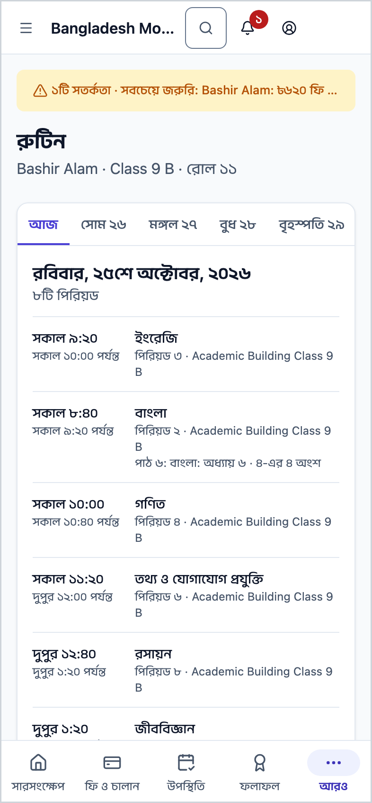
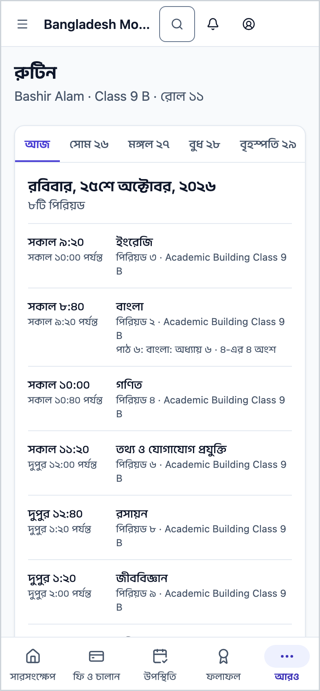

<!-- guide:meta
feature: portal.routine
title: রুটিন
summary: আজ থেকে সামনের সাত দিনের ক্লাস দেখুন — কোন পিরিয়ডে কোন বিষয়, কখন পর্যন্ত, কোন কক্ষে, কোন ক্লাস বাতিল বা বদলি শিক্ষক।
roles: [PARENT, STUDENT]
sources:
  - client-admin/src/routes/portal/routine.tsx
  - server/src/modules/routines/resolve-routine.controller.ts
  - server/src/modules/students/family-access.service.ts
labels:
  [
    portal:routine.*,
    portal:empty.*,
    routines:agenda.*,
    routines:grid.weekday.*,
    nav:items.portalRoutine,
    nav:items.more,
  ]
helpIds:
  [
    portal.routine,
    portal.routine.action.pickDay,
  ]
devices: [phone]
entry: [sidebar]
keywords:
  [রুটিন, ক্লাস, পিরিয়ড, বিষয়, বদলি শিক্ষক, বাতিল, সময়সূচি, routine, timetable, class, period, substitute]
appVersion: 0.1.0 (978d9b96a)
owner: tareq89
lastVerified: 2026-10-25
knownIssues: []
-->

# রুটিন

সন্তানের আজকের আর সামনের ছয় দিনের ক্লাস, দিন ধরে।

**যেতে হবে:** ফোনে নিচের সারিতে **আরও** চাপুন, তারপর **রুটিন**। কম্পিউটারে বাম মেনুতে **রুটিন**।
**শুরুর আগে:** স্কুল অফিস আপনাকে সন্তানের সঙ্গে যুক্ত করে থাকবে, আর স্কুল সন্তানের শিক্ষাবর্ষের রুটিন প্রকাশ করে থাকবে।

রুটিন সন্তানের শ্রেণি আর শাখা থেকে নিজে থেকেই আসে; আপনাকে কিছু বাছতে হয় না। এই পাতা শুধু দেখার।

[আজকের ক্লাস](#task-main) · [অন্য দিন](#task-day) · [সমস্যা ও সমাধান](#trouble)

**এই পাতায় যা আছে**

- [আজকের ক্লাস দেখুন](#task-main)
- [ঠিক দেখছেন কি না বুঝবেন কীভাবে](#confirm)
- [অন্য পরিস্থিতিতে](#other)
  - [অন্য দিনের ক্লাস দেখুন](#task-day)
  - [অন্য সন্তানের রুটিন দেখুন](#task-pick)
- [সমস্যা ও সমাধান](#trouble)
- [কে কী করতে পারেন](#roles)
- [আরও জানুন](#more)

---

## আজকের ক্লাস দেখুন 

1. ফোনে নিচের সারিতে **আরও** চাপুন, তারপর **রুটিন** চাপুন।

   → উপরে সাতটি দিনের ট্যাব, আজ থেকে শুরু। আজকের ট্যাব বাছা থাকে।

2. ট্যাবের নিচে দেখুন কয়টি পিরিয়ড (যেমন **৬টি পিরিয়ড**), তারপর পিরিয়ডের তালিকা।

   → প্রতিটি পিরিয়ডে বিষয়ের নাম, শুরুর সময় আর **… পর্যন্ত**, নিচে **পিরিয়ড …** আর কক্ষ (স্কুল দিয়ে থাকলে)।

> **মনে রাখুন:** বিষয়ের নাম আসে আপনি যে ভাষায় পোর্টাল দেখছেন সেই ভাষায়; সে ভাষায় নাম না থাকলে অন্য ভাষার নামটি দেখায়।

---

## ঠিক দেখছেন কি না বুঝবেন কীভাবে 

| পিরিয়ডের পাশে যা লেখা  | মানে                                                    |
| ---------------------- | ------------------------------------------------------- |
| **বাতিল**              | স্কুল ঐ দিনের ঐ ক্লাস বাতিল করেছে                        |
| **বদলি শিক্ষক**        | ঐ ক্লাস অন্য একজন শিক্ষক নেবেন                           |
| কিছু লেখা নেই          | ক্লাস রুটিন অনুযায়ী হবে                                  |

ছুটির দিনে পিরিয়ডের বদলে লেখা থাকে **ছুটির দিন — …** (ছুটির নাম), আর সাপ্তাহিক বন্ধের দিনে **সাপ্তাহিক ছুটির দিন**।

শিক্ষক পাঠ পরিকল্পনা দিয়ে থাকলে বাছা দিনের পিরিয়ডের নিচে **পাঠ …: …** দেখায়, কোন পাঠ পড়ানো হবে। <!-- unverified: পাঠের লাইন পাঠ পরিকল্পনা (study plan) থেকে আসে; কখন আসে না তার শর্ত পুরো যাচাই হয়নি -->

---

## অন্য পরিস্থিতিতে 

### অন্য দিনের ক্লাস দেখুন 

উপরে যে দিনের ট্যাব চান, চাপুন। আজ থেকে সাত দিন পর্যন্ত দেখা যায়।

### অন্য সন্তানের রুটিন দেখুন 

একাধিক সন্তান হলে উপরে **একজন শিক্ষার্থী নির্বাচন করুন** সারিতে নাম চাপুন। এক সন্তান হলে এই সারি আসে না।

---

## সমস্যা ও সমাধান 

| আপনি যা দেখছেন                                                   | কী করবেন                                                                  | কে সাহায্য করতে পারেন |
| ---------------------------------------------------------------- | ------------------------------------------------------------------------- | --------------------- |
| **রুটিন এখনও প্রকাশিত হয়নি**                                     | স্কুল সন্তানের শিক্ষাবর্ষের রুটিন প্রকাশ করলে দেখাবে।                      | অ্যাডমিন              |
| **এই শিক্ষার্থীর রুটিন লোড করা যায়নি।** …                         | ইন্টারনেট দেখে **আবার চেষ্টা করুন** চাপুন।                                 | —                     |
| একটি দিনে লেখা **কোনো পিরিয়ড নেই।**                              | ঐ দিন সন্তানের শাখার কোনো ক্লাস রুটিনে নেই। স্কুলে জিজ্ঞেস করুন।            | স্কুল অফিস            |
| **আপনার সঙ্গে এখনও কোনো শিক্ষার্থী যুক্ত নেই**                    | স্কুল অফিসকে সন্তান যুক্ত করতে বলুন, তারপর **আবার দেখুন** চাপুন।            | স্কুল অফিস            |

---

## কে কী করতে পারেন 

| ভূমিকা      | রুটিন দেখা                | বদলানো |
| ----------- | ------------------------- | ------ |
| অভিভাবক     | শুধু যুক্ত সন্তানদের       | না     |
| শিক্ষার্থী   | শুধু নিজের                | না     |

**অভিভাবক:** স্কুল অফিস যে সন্তানদের আপনার সঙ্গে যুক্ত করেছে, শুধু তাদের রুটিন দেখেন, শুধু এই স্কুলে। পোর্টাল অন্য কোনো শাখা বা শিক্ষকের রুটিন চাইতে পারে না; সার্ভার শুধু সন্তানের নামে রুটিন দেয়।

**শিক্ষার্থী:** শুধু নিজের রুটিন দেখেন।

রুটিন বানায় স্কুল, [**শ্রেণির সাপ্তাহিক রুটিন সাজানো**](../academics/routine-builder.md) পাতা থেকে।

---

## আরও জানুন 

<strong>পাতার অংশগুলো</strong> — রুটিন

1. **রুটিন** শিরোনাম, নিচে সন্তানের নাম · শ্রেণি · রোল; একাধিক সন্তান হলে **একজন শিক্ষার্থী নির্বাচন করুন**।
2. সাত দিনের ট্যাব, আজ থেকে।
3. বাছা দিনের পিরিয়ড সংখ্যা আর পিরিয়ডের তালিকা।

<strong>রুটিন কীভাবে কাজ করে</strong>

<figure>
  
  <figcaption><em>রুটিনের পথ, প্রকাশিত রুটিন থেকে সন্তানের দিন</em></figcaption>
</figure>

- **শাখা:** সার্ভার সন্তানের বর্তমান ভর্তি দেখে শাখা ঠিক করে।
- **দিন:** আজ থেকে সাত দিন, প্রতিটি দিনের আসল তারিখ ধরে; তাই বাতিল ক্লাস বা বদলি শিক্ষক ঠিক দিনেই দেখায়।
- **ছুটি:** স্কুলের ক্যালেন্ডারের ছুটি আর সাপ্তাহিক বন্ধ থেকে।

**সম্পর্কিত পাতা**

- [**সিলেবাস (অভিভাবক ও শিক্ষার্থী)**](syllabus.md) — প্রতিটি বিষয়ে কী পড়ানো হয়।

- [**সারসংক্ষেপ**](overview.md) — আজ স্কুলে এসেছে কি না, এক নজরে।
- [**ফি ও চালান**](fees.md) — মাসভিত্তিক ফির হিসাব।
- [**উপস্থিতি**](attendance.md) — মাসের প্রতিটি দিনের উপস্থিতি।
- [**ক্যালেন্ডার**](calendar.md) — ছুটি আর স্কুলের অনুষ্ঠান।
- [**পরীক্ষার সময়সূচি**](exam-schedule.md) — পরীক্ষার দিন আর প্রবেশপত্র।
- [**ফলাফল**](results.md) — প্রকাশিত পরীক্ষার ফল।
- [**শ্রেণির সাপ্তাহিক রুটিন সাজানো**](../academics/routine-builder.md) — স্কুল যেখানে রুটিন বানায়।
