<!-- guide:meta
feature: portal.statement
title: হিসাব দেখুন ও প্রিন্ট করুন
summary: সন্তানের কত বিল হয়েছে, কত জমা হয়েছে আর এখন কত বাকি, তারিখ ধরে দেখুন; আর হিসাবটি ডাউনলোড বা প্রিন্ট করুন।
roles: [PARENT, STUDENT]
sources:
  - client-admin/src/routes/portal/statement.tsx
  - client-admin/src/features/statement/statement-shared.tsx
  - client-admin/src/features/statement/statement-print.css
  - server/src/modules/fees/statement/student-statement.controller.ts
  - server/src/modules/fees/statement/student-statement.service.ts
  - server/src/modules/students/family-access.service.ts
labels: [fees:statement.*, nav:items.portalStatement, portal:empty.*]
helpIds: [portal.statement]
devices: [phone, desktop]
entry: [sidebar]
keywords: [হিসাব, বাকি, বিল, জমা, প্রিন্ট, ডাউনলোড, পিডিএফ, statement, account, still owed, print, download]
appVersion: 0.1.0 (a5ac53db0)
owner: tareq89
lastVerified: 2026-10-31
knownIssues: []
-->

# হিসাব দেখুন ও প্রিন্ট করুন

সন্তানের কত বিল হয়েছে, কত জমা হয়েছে আর এখন কত বাকি, এক পাতায় দেখুন; চাইলে হিসাবটি ডাউনলোড বা প্রিন্ট করুন।

**যেতে হবে:** ফোনে নিচের সারির **আরও** চেপে **হিসাব**। কম্পিউটারে বাম মেনুতে **ফি ও চালান**-এর ঠিক নিচে **হিসাব**।
**শুরুর আগে:** স্কুল অফিস আপনার অ্যাকাউন্ট সন্তানের সঙ্গে যুক্ত করে থাকতে হবে।

এই পাতা শুধু দেখার আর রেখে দেওয়ার। এখান থেকে টাকা দেওয়া যায় না; টাকা দিতে হয় স্কুলে। স্কুল টাকা রেকর্ড করলে এখানকার হিসাব নিজে থেকে বদলায়।

[এখন কত বাকি দেখুন](#task-main) · [ডাউনলোড বা প্রিন্ট](#task-print) · [তারিখ বাছুন](#task-dates) · [সন্তান বদলান](#task-pick) · [সমস্যা ও সমাধান](#trouble)

**এই পাতায় যা আছে**

- [এখন কত বাকি দেখুন](#task-main)
- [ঠিক দেখছেন কি না বুঝবেন কীভাবে](#confirm)
- [অন্য পরিস্থিতিতে](#other)
  - [ডাউনলোড বা প্রিন্ট করুন](#task-print)
  - [অন্য সময়ের হিসাব দেখুন](#task-dates)
  - [অন্য সন্তানের হিসাব দেখুন](#task-pick)
  - [আগাম জমা টাকা](#task-wallet)
- [সমস্যা ও সমাধান](#trouble)
- [কে কী করতে পারেন](#roles)
- [আরও জানুন](#more)

---

## এখন কত বাকি দেখুন 

1. ফোনে নিচের সারির **আরও** চাপুন, তারপর **হিসাব** বাছুন।

   → উপরে সন্তানের নাম, শ্রেণি, শাখা আর রোল। তার নিচে বড় অক্ষরে **এখন বাকি: ৳…**। কিছু বাকি না থাকলে লেখা থাকে **সব পরিশোধ হয়েছে**। নিচে ছোট করে **শেষ জমা:** আর তার তারিখ।

2. নিচে নামুন। প্রথমে **শুরুতে বাকি**, তারপর প্রতিটি বিল বা জমার জন্য একটি করে কার্ড, সবার শেষে **শেষে বাকি**।

   → প্রতিটি কার্ডে তারিখ, বিবরণ, **বিল** বা **জমা**-র অঙ্ক, আর সেই লাইনের পরে **এর পরে বাকি**।

> **মনে রাখুন:** **শেষে বাকি** আর উপরের **এখন বাকি** একই অঙ্ক, আর **শেষ তারিখ** না বাছলে স্কুলের হিসাবরক্ষক শিক্ষার্থীর ফি-র পাতায় যে অঙ্ক দেখেন, তা-ও এটাই।

---

## ঠিক দেখছেন কি না বুঝবেন কীভাবে 

| যা লেখা আছে     | মানে                                                                                                 |
| --------------- | ---------------------------------------------------------------------------------------------------- |
| **বিল**         | স্কুল যে টাকা ধার্য করেছে, অথবা আগে নেওয়া জমা যা ফেরত নেওয়া হয়েছে (**জমা ফেরত নেওয়া** লেখা থাকে) |
| **জমা**         | যে টাকা জমা হয়েছে, অথবা যে ছাড় দেওয়া হয়েছে (**ছাড়** লেখা থাকে)                                  |
| **এর পরে বাকি** | এই লাইন পর্যন্ত ধরলে মোট কত বাকি                                                                     |
| **শুরুতে বাকি** | বাছা শুরুর তারিখের আগে পর্যন্ত কত বাকি ছিল                                                           |
| **শেষে বাকি**   | শেষ লাইনের পরে কত বাকি, অর্থাৎ উপরের **এখন বাকি**                                                    |

**শেষ তারিখ** বেছে দিলে উপরের লাইনে লেখা থাকে **… পর্যন্ত বাকি: ৳…**, কারণ তখন "এখন" নয়, সেই তারিখের হিসাব দেখানো হচ্ছে।

---

## অন্য পরিস্থিতিতে 

### ডাউনলোড বা প্রিন্ট করুন 

1. **ডাউনলোড / প্রিন্ট** চাপুন।

   → ব্রাউজারের প্রিন্টের জানালা খোলে। ছাপা পাতায় উপরে স্কুলের নাম, সন্তানের নাম আর তারিখ থাকে; শুধু হিসাবটুকুই ছাপা হয়।

2. কাগজে ছাপতে প্রিন্টার বাছুন। ফাইল হিসেবে রাখতে প্রিন্টারের জায়গায় **পিডিএফ হিসেবে সংরক্ষণ** (Save as PDF) বাছুন।

বোতাম একটাই: ডাউনলোড আর প্রিন্ট একই জানালা থেকে হয়।

### অন্য সময়ের হিসাব দেখুন 

প্রথমে শুরু থেকে আজ পর্যন্ত সব লাইন দেখানো হয়, আর একটি লাইনে সেটা লেখা থাকে। কম দেখতে **শুরুর তারিখ** বা **শেষ তারিখ** চেপে তারিখ বাছুন। তারিখ মুছে দিলে আবার সব দেখায়।

শুরুর তারিখ বদলালে শুধু কোন লাইনগুলো দেখা যাবে তা বদলায়; আগের লাইনগুলো **শুরুতে বাকি**-তে যোগ হয়ে যায়, তাই **শেষে বাকি** একই থাকে।

### অন্য সন্তানের হিসাব দেখুন 

একের বেশি সন্তান থাকলে উপরে **একজন শিক্ষার্থী বাছুন** সারিতে সবার নাম থাকে। যার হিসাব দেখতে চান, তার নামে চাপুন। একজন সন্তান থাকলে এই সারি আসে না।

### আগাম জমা টাকা 

স্কুলে আগাম জমা টাকা থাকলে নিচে **আগাম জমা টাকা** নামে আলাদা একটি অংশ আসে: কত আছে, আর কবে কত **যোগ হয়েছে** বা **কাটা হয়েছে**। এই টাকা বাকির হিসাবে ধরা হয় না; পাতায় সে কথা লেখাও থাকে। না থাকলে অংশটি আসে না।

---

## সমস্যা ও সমাধান 

| যা দেখছেন                                      | কী করবেন                                                         | কে সাহায্য করবে |
| ---------------------------------------------- | ---------------------------------------------------------------- | --------------- |
| **হিসাব আনা যায়নি। আবার চেষ্টা করুন।**        | সংযোগ দেখে আবার চেষ্টা করুন।                                     | —               |
| **এই তারিখগুলোর মধ্যে কোনো বিল বা জমা নেই**    | **শুরুর তারিখ** বা **শেষ তারিখ** মুছে বা বদলে অন্য তারিখ বাছুন।  | —               |
| **আপনার সঙ্গে এখনও কোনো শিক্ষার্থী যুক্ত নেই** | স্কুল অফিসকে সন্তান যুক্ত করতে বলুন, তারপর **আবার দেখুন** চাপুন। | স্কুল অফিস      |
| টাকা দিয়েছেন, কিন্তু বাকি কমেনি               | স্কুল টাকা রেকর্ড করার পরেই কমে। রসিদ নিয়ে অফিসে যান।           | হিসাবরক্ষক      |

---

## কে কী করতে পারেন 

| ভূমিকা     | হিসাব দেখা           | ডাউনলোড / প্রিন্ট | টাকা দেওয়া |
| ---------- | -------------------- | ----------------- | ----------- |
| অভিভাবক    | শুধু যুক্ত সন্তানদের | হ্যাঁ             | না          |
| শিক্ষার্থী | শুধু নিজের           | হ্যাঁ             | না          |

**অভিভাবক:** স্কুল অফিস যে সন্তানদের আপনার সঙ্গে যুক্ত করেছে, শুধু তাদেরই হিসাব দেখবেন। ঠিকানায় অন্য কারও শিক্ষার্থী-আইডি বসালেও সার্ভার কিছু দেয় না।

**শিক্ষার্থী:** শুধু নিজের হিসাব দেখবেন।

---

## আরও জানুন 

<strong>হিসাব কীভাবে তৈরি হয়</strong>

<figure>
  
  <figcaption><em>বিল আর জমা থেকে এখন বাকি</em></figcaption>
</figure>

- **কোন লাইন আসে:** প্রতিটি বিল, প্রতিটি ছাড়, আর প্রতিটি জমা। জমা ফেরত নিলে সেটা আলাদা লাইনে **বিল**-এর ঘরে দেখায়।
- **একই দিনে:** আগে বিল, তারপর ছাড়, তারপর জমা।
- **পাতায় "এখনই টাকা দিন" বোতাম নেই:** অনলাইনে টাকা দেওয়া এখনো চালু হয়নি।

**সম্পর্কিত পাতা**

- [**ফি ও চালান**](fees.md) — মাস ধরে ফি, জরিমানা আর চালান প্রিন্ট।
