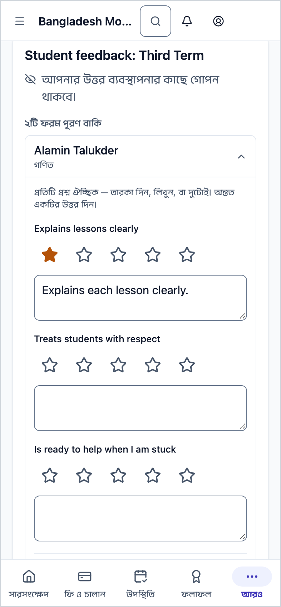

<!-- guide:meta
feature: portal.surveys
title: জরিপ (অভিভাবক ও শিক্ষার্থী)
summary: শিক্ষকদের বিষয়ে স্কুলকে মতামত দিন। প্রতিটি শিক্ষক ও বিষয়ের জন্য একবার তারকা দিন বা লিখুন। গোপন জরিপে স্কুল আপনার নাম দেখে না, আর কম উত্তর এলে ফলাফলও দেখে না।
roles: [PARENT, STUDENT]
sources:
  - client-admin/src/routes/portal.tsx
  - client-admin/src/routes/portal/surveys.tsx
  - server/src/modules/surveys/survey-respond.controller.ts
  - server/src/modules/surveys/survey-respond.service.ts
  - server/src/modules/surveys/survey-results.service.ts
  - server/src/modules/surveys/entities/survey.entity.ts
  - server/src/modules/surveys/dto/survey.dto.ts
labels: [evaluations:portalSurveys.*, portal:surveys.*, nav:items.portalSurveys, nav:items.more]
helpIds: [portal.surveys, portal.surveys.action.submit]
devices: [phone]
entry: [sidebar, palette, bell]
keywords: [জরিপ, মতামত, শিক্ষক মূল্যায়ন, তারকা, গোপন, survey, feedback, teacher evaluation, anonymous]
appVersion: 0.1.0 (cba7dfad7)
owner: tareq89
lastVerified: 2026-10-25
knownIssues: []
-->

# জরিপ (অভিভাবক ও শিক্ষার্থী)

শিক্ষকদের সম্পর্কে স্কুলকে আপনার মতামত জানান।

**যেতে হবে:** ফোনে নিচের বারের **আরও** → **জরিপ**। কম্পিউটারে বাম মেনুর **জরিপ**।
**শুরুর আগে:** স্কুল একটি জরিপ চালু করে থাকতে হবে। আপনার সন্তান (বা আপনি নিজে, শিক্ষার্থী হলে) যে শাখায় পড়ে, সেখানে জরিপের শিক্ষক পড়ান কি না, তা দেখে জরিপ আসে।

একটি জরিপে কয়েকটি প্রশ্ন থাকে। প্রতিটি শিক্ষক আর বিষয়ের জন্য আলাদা একটি ফরম। যেমন "রহিম স্যার · গণিত" একটি ফরম, "রহিম স্যার · বিজ্ঞান" আরেকটি।

[উত্তর পাঠান](#task-main) · [কে আপনার উত্তর দেখে](#privacy) · [সমস্যা ও সমাধান](#trouble)

**এই পাতায় যা আছে**

- [এই পাতায় যেভাবে আসবেন](#arrive)
- [উত্তর পাঠান](#task-main)
- [উত্তর গেছে কি না বুঝবেন কীভাবে](#confirm)
- [অন্য পরিস্থিতিতে](#other)
  - [শুধু তারকা বা শুধু লেখা](#task-partial)
  - [জরিপ কবে শেষ](#task-deadline)
- [কে আপনার উত্তর দেখে](#privacy)
- [সমস্যা ও সমাধান](#trouble)
- [কে কী করতে পারেন](#roles)
- [আরও জানুন](#more)

---

## এই পাতায় যেভাবে আসবেন 

**ফোনে:** নিচের বারের **আরও** → **জরিপ**।

**কম্পিউটারে:** বাম মেনুর **জরিপ**।

**সারসংক্ষেপ থেকে:** উত্তর বাকি থাকলে প্রথম পাতায় **জরিপ** কার্ডে **এখনই উত্তর দিন** চাপুন।

**ঘণ্টা থেকে:** "জরিপের উত্তর বাকি" রিমাইন্ডার চাপুন ([**সতর্কতা ও বিজ্ঞপ্তি**](notifications.md))।

---

## উত্তর পাঠান 

1. **জরিপ** পাতা খুলুন।

   → প্রতিটি জরিপের কার্ড আসে। কার্ডে লেখা থাকে উত্তর গোপন কি না, শেষের তারিখ, আর **৩টি ফরম পূরণ বাকি** ধরনের লাইন।

2. যে শিক্ষকের সারি চান, সেটি চাপুন।

   → সারিটি খুলে প্রশ্নগুলো দেখায়। প্রতিটি প্রশ্নের নিচে তারকা (যদি থাকে) আর লেখার ঘর।

3. তারকা দিন, লিখুন, বা দুটোই। একই তারকা আবার চাপলে মুছে যায়।

4. **উত্তর পাঠান** চাপুন।

   → **ধন্যবাদ। আপনার উত্তর পাঠানো হয়েছে।** সারিটি তালিকা থেকে সরে যায়।

> **মনে রাখুন:** পাঠানোর পর উত্তর আর বদলানো বা তুলে নেওয়া যায় না। প্রতিটি শিক্ষক ও বিষয়ে একজন একবারই উত্তর দিতে পারেন।

---

## উত্তর গেছে কি না বুঝবেন কীভাবে 

| অবস্থা            | কীভাবে বুঝবেন                                       | এরপর কী              |
| ----------------- | --------------------------------------------------- | -------------------- |
| **পাঠানো হয়েছে** | ধন্যবাদের বার্তা আসে, সারিটি তালিকা থেকে সরে যায়।  | পরের সারি পূরণ করুন। |
| **সব শেষ**        | পাতায় লেখা **কিছুই অপেক্ষায় নেই**।                | কাজ শেষ।             |
| **যায়নি**        | লাল লেখা **উত্তর পাঠানো যায়নি। আবার চেষ্টা করুন।** | নেট দেখে আবার পাঠান। |

**যাচাই করতে চাইলে:** পাতাটি রিলোড করুন। যে সারির উত্তর দিয়েছেন, তা আর আসে না।

---

## অন্য পরিস্থিতিতে 

### শুধু তারকা বা শুধু লেখা 

প্রতিটি প্রশ্ন ঐচ্ছিক। কিন্তু অন্তত একটি প্রশ্নে তারকা বা লেখা দিতে হয়। সব ফাঁকা রেখে পাঠালে লেখা আসে **কমপক্ষে একটি প্রশ্নের উত্তর দিন।** তারকা ১ থেকে ৫। লেখা ৪০০০ অক্ষর পর্যন্ত।

কম্পিউটারে তারকার জায়গায় থেকে কিবোর্ডে ১ থেকে ৫ চাপলেও তারকা বসে; ব্যাকস্পেস চাপলে মুছে যায়।

### জরিপ কবে শেষ 

কার্ডে **২০ নভেম্বর তারিখে শেষ হবে** ধরনের লাইন থাকলে তার আগে উত্তর দিন। শেষ হলে জরিপটি পাতা থেকে সরে যায়, আর উত্তর নেওয়া হয় না। লাইন না থাকলে স্কুল জরিপ বন্ধ না করা পর্যন্ত খোলা থাকে।

---

## কে আপনার উত্তর দেখে 

- **গোপন জরিপ** (কার্ডে লেখা **আপনার উত্তর ব্যবস্থাপনার কাছে গোপন থাকবে।**): স্কুলের ফলাফলের পাতায় আপনার নাম আসে না। কবে উত্তর দিয়েছেন, সেই সময়ও আসে না।
- **ন্যূনতম উত্তরের নিয়ম:** একটি শিক্ষক ও বিষয়ের ফলাফল স্কুল দেখে তখনই, যখন জরিপ বন্ধ হয়েছে **আর** অন্তত নির্দিষ্ট সংখ্যক মানুষ উত্তর দিয়েছেন। এই সংখ্যা সাধারণত **৫**; স্কুল এটি বাড়াতে পারে, কিন্তু **৩**-এর কম করতে পারে না। তার আগে স্কুল শুধু দেখে কয়টি উত্তর এসেছে।
- **প্রতিটি প্রশ্নেও একই নিয়ম:** কোনো প্রশ্নে এর চেয়ে কম মানুষ তারকা দিলে সেই প্রশ্নের গড় তারকা দেখায় না।
- **লেখা মন্তব্য** নিয়ম পূরণ হলে হুবহু দেখা যায়, বর্ণের ক্রমে সাজানো। তাই লেখায় নিজের বা সন্তানের নাম লিখবেন না।
- **যিনি দেখেন:** প্রধান শিক্ষক (অ্যাডমিন)। যে শিক্ষকের বিষয়ে জরিপ, তিনি এই ফলাফলের পাতায় নিজের ফলাফল দেখতে পান না।
- **নাম দেখানো জরিপ** (কার্ডে লেখা **আপনার উত্তরের সাথে আপনার নাম দেখানো হবে।**): অ্যাপ নাম দেখানোর কথা বলে, তবে এখন স্কুলের ফলাফলের পাতায় কোনো জরিপেই উত্তরদাতার নাম আসে না। ন্যূনতম উত্তরের নিয়মও একই থাকে।

---

## সমস্যা ও সমাধান 

| আপনি যা দেখছেন                              | কী করবেন                                                                            | কে সাহায্য করতে পারেন |
| ------------------------------------------- | ----------------------------------------------------------------------------------- | --------------------- |
| **কিছুই অপেক্ষায় নেই**                     | হয় সব উত্তর দেওয়া হয়ে গেছে, নয়তো এখন কোনো জরিপ খোলা নেই।                        | —                     |
| **আপনি এটির উত্তর আগেই দিয়েছেন।**          | এই শিক্ষক ও বিষয়ে আপনার উত্তর আগেই গেছে। আবার দেওয়া যায় না।                      | —                     |
| **আপনার জরিপ লোড করা যায়নি।**              | নেট দেখুন, তারপর আবার চেষ্টা করুন।                                                  | —                     |
| কোনো শিক্ষকের সারি নেই                      | জরিপে সেই শিক্ষক নেই, বা তিনি আপনার সন্তানের শাখায় পড়ান না। স্কুলকে জিজ্ঞেস করুন। | স্কুলের অ্যাডমিন      |
| জরিপ শুধু সন্তানের অ্যাকাউন্টে আসে, আমার না | স্কুল জরিপটি শুধু শিক্ষার্থীদের জন্য করেছে। কিছু জরিপ শুধু অভিভাবকের, কিছু দুজনেরই। | স্কুলের অ্যাডমিন      |

---

## কে কী করতে পারেন 

| ভূমিকা     | উত্তর দিতে পারেন                                                  | ফলাফল দেখতে পারেন |
| ---------- | ----------------------------------------------------------------- | ----------------- |
| অভিভাবক    | হ্যাঁ, অভিভাবকদের জন্য করা জরিপে, যুক্ত সন্তানের শিক্ষকদের বিষয়ে | না                |
| শিক্ষার্থী | হ্যাঁ, শিক্ষার্থীদের জন্য করা জরিপে, নিজের শিক্ষকদের বিষয়ে       | না                |

জরিপ তৈরি আর ফলাফল দেখা হয় [**মূল্যায়ন: এসিআর, শিক্ষক জরিপ ও ঘটনা**](../people/evaluations.md) পাতায়।

---

## আরও জানুন 

<strong>উত্তর থেকে ফলাফল পর্যন্ত</strong>

<figure>
  
</figure>

- একাধিক সন্তান একই শিক্ষকের কাছে পড়লেও আপনি সেই শিক্ষক ও বিষয়ে একবারই উত্তর দেন।
- জরিপ খোলার আগে বা শেষ হওয়ার পরে উত্তর পাঠানো যায় না।

**সম্পর্কিত পাতা**

- [**মূল্যায়ন: এসিআর, শিক্ষক জরিপ ও ঘটনা**](../people/evaluations.md) — স্কুলের দিকে জরিপ তৈরি আর ফলাফল।
- [**সতর্কতা ও বিজ্ঞপ্তি**](notifications.md) — "জরিপের উত্তর বাকি" রিমাইন্ডার।
- [**সারসংক্ষেপ**](overview.md) — জরিপের কার্ড।

---

_সংস্করণ ০.১.০ · শেষ যাচাই ২০২৬-১০-২৫_
