<!-- guide:meta
feature: portal.syllabus
title: সিলেবাস (অভিভাবক ও শিক্ষার্থী)
summary: ক্লাসে কোন বিষয়ের কোন পাঠ পর্যন্ত পড়ানো হলো, কোন বিষয় পিছিয়ে আছে, আর সামনের পরীক্ষার সিলেবাসের কতটা শেষ, ফোনে দেখুন। এই পাতা শুধু দেখার, কিছু বদলানো যায় না।
roles: [PARENT, STUDENT]
sources:
  - client-admin/src/routes/portal.tsx
  - client-admin/src/routes/portal/syllabus.tsx
  - client-admin/src/routes/portal/-study-plan-subject.tsx
labels: [portal:syllabus.*, portal:empty.*, portal:children.*, nav:items.portalSyllabus, nav:items.more]
helpIds: [portal.syllabus]
devices: [phone]
entry: [sidebar, palette]
keywords: [সিলেবাস, পাঠ পরিকল্পনা, পিছিয়ে, পরীক্ষার সিলেবাস, টপিক, syllabus, study plan, lessons behind]
appVersion: 0.1.0 (cba7dfad7)
owner: tareq89
lastVerified: 2026-10-25
knownIssues: []
-->

# সিলেবাস (অভিভাবক ও শিক্ষার্থী)

ক্লাস প্রতিটি বিষয়ে কোথায় আছে, তা দেখুন।

**যেতে হবে:** ফোনে নিচের বারের **আরও** → **সিলেবাস**। কম্পিউটারে বাম মেনুর **সিলেবাস**।
**শুরুর আগে:** শিক্ষার্থী কোনো শ্রেণিতে যুক্ত থাকতে হবে। স্কুল পাঠ পরিকল্পনা বা টপিক তালিকা যোগ করে থাকতে হবে।

এই পাতা শুধু দেখার। এখানে কিছু বদলানো যায় না।

[এক নজরে দেখুন](#task-main) · [পিছিয়ে থাকলে](#task-behind) · [সমস্যা ও সমাধান](#trouble)

**এই পাতায় যা আছে**

- [এই পাতায় যেভাবে আসবেন](#arrive)
- [এক নজরে দেখুন](#task-main)
- [অন্য পরিস্থিতিতে](#other)
  - [একাধিক সন্তান](#task-child)
  - [কোনো বিষয় পিছিয়ে](#task-behind)
  - [পাঠ পরিকল্পনা নেই এমন বিষয়](#task-noplan)
- [সমস্যা ও সমাধান](#trouble)
- [কে কী করতে পারেন](#roles)
- [আরও জানুন](#more)

---

## এই পাতায় যেভাবে আসবেন 

**ফোনে:** নিচের বারের **আরও** → **সিলেবাস**।

**কম্পিউটারে:** বাম মেনুর **সিলেবাস**।

**খোঁজ দিয়ে:** ওপরের খোঁজার বোতাম চাপুন, "সিলেবাস" লিখুন।

---

## এক নজরে দেখুন 

1. **সিলেবাস** পাতা খুলুন।

   → ওপরে শিক্ষার্থীর নাম, শ্রেণি, রোল আর চলতি টার্মের নাম।

2. প্রথম কার্ডটি দেখুন: সামনের পরীক্ষা।

   → পরীক্ষার নাম, **২০ নভেম্বর থেকে · সিলেবাসের কতটা পড়ানো হলো**। প্রতিটি বিষয়ের নিচে একটি বার, যেমন **৬/১০টি পাঠ**।

<!-- image pending: img/portal-syllabus-01-overview.png (width 300) — ফোনে সিলেবাস পাতা: ১ পরীক্ষার কার্ড, ২ সবচেয়ে পিছিয়ে থাকা বিষয়, ৩ অন্য বিষয়ের তালিকা -->

3. নিচের খোলা কার্ডটি দেখুন।

   → যে বিষয় সবচেয়ে বেশি পিছিয়ে, সেটি আগে খোলা থাকে। এতে আছে শিক্ষকের নাম, **এখন কোথায়**, পুরো পরিকল্পনা কবে শেষ হওয়ার কথা, আর **পরের ৫টি পাঠ**।

4. **অন্য বিষয়** তালিকার যেকোনো বিষয় চাপুন।

   → বিষয়টি খুলে একই তথ্য দেখায়। আবার চাপলে বন্ধ হয়।

> **মনে রাখুন:** পরের পাঠের তারিখগুলো আনুমানিক। ক্লাস বাতিল হলে বা ছুটি পড়লে পরের দিকে সরে যায়।

---

## অন্য পরিস্থিতিতে 

### একাধিক সন্তান 

একাধিক সন্তান যুক্ত থাকলে ওপরে **একজন শিক্ষার্থী বেছে নিন** আসে। যার সিলেবাস দেখতে চান, তার নাম চাপুন। একজন সন্তান থাকলে এই অংশ আসে না।

### কোনো বিষয় পিছিয়ে 

প্রতিটি বিষয়ের পাশে একটি ছাপ থাকে:

| ছাপ                 | মানে                                                         |
| ------------------- | ------------------------------------------------------------ |
| **সময়মতো**         | রুটিন অনুযায়ী যতটা পড়ানোর কথা, ততটা হয়েছে।                |
| **২ পাঠ পিছিয়ে**   | রুটিন অনুযায়ী এতদিনে আরও ২টি পাঠ এগোনোর কথা ছিল।           |
| **পাঠ পরিকল্পনা নেই** | এই বিষয়ের পরিকল্পনা স্কুল যোগ করেনি। শুধু টপিক তালিকা আছে। |

পিছিয়ে থাকা বিষয় খুললে **কেন পিছিয়ে** অংশে লেখা থাকে কয়টি পিরিয়ড পড়ানো হয়নি। প্রশ্ন থাকলে বিষয়ের শিক্ষক বা স্কুলের সঙ্গে কথা বলুন।

### পাঠ পরিকল্পনা নেই এমন বিষয় 

এমন বিষয়ে লেখা থাকে **শুধু টপিক তালিকা আছে · ১২টির ৫টি সম্পন্ন**। খুললে টপিকগুলো ক্রমে আসে, প্রতিটির পাশে তার অবস্থা।

---

## সমস্যা ও সমাধান 

| আপনি যা দেখছেন                    | কী করবেন                                                         | কে সাহায্য করতে পারেন |
| --------------------------------- | ---------------------------------------------------------------- | --------------------- |
| **এখনও কোনো শ্রেণিতে যুক্ত নয়** | শিক্ষার্থীকে স্কুল এখনও শ্রেণিতে ভর্তি করেনি। স্কুলকে জানান।     | স্কুলের অ্যাডমিন      |
| **এখনও কোনো সিলেবাস নেই**        | এই শ্রেণির পাঠ পরিকল্পনা বা টপিক স্কুল এখনও যোগ করেনি।           | বিষয়ের শিক্ষক        |
| **সিলেবাস লোড করা যায়নি।**       | নেট দেখুন, তারপর **আবার চেষ্টা করুন** চাপুন।                     | —                     |
| পরীক্ষার কার্ড নেই                | সামনে কোনো পরীক্ষার সিলেবাস ঠিক করা নেই। পুরনো পরীক্ষা দেখায় না। | —                     |
| কোনো শিক্ষার্থী নেই               | আপনার অ্যাকাউন্টে কোনো সন্তান যুক্ত নেই। স্কুলকে জানান।         | স্কুলের অ্যাডমিন      |

---

## কে কী করতে পারেন 

| ভূমিকা     | যা দেখেন                         | বদলাতে পারেন |
| ---------- | -------------------------------- | ------------ |
| অভিভাবক    | যুক্ত প্রতিটি সন্তানের শ্রেণির সিলেবাস | না           |
| শিক্ষার্থী | নিজের শ্রেণির সিলেবাস            | না           |

পাঠ পরিকল্পনা আর টপিক যোগ করেন শিক্ষক ও স্কুল, [**সিলেবাস**](../academics/syllabus.md) পাতায়।

---

## আরও জানুন 

<strong>"পিছিয়ে" কীভাবে হিসাব হয়</strong>

<figure>
  
</figure>

- সবচেয়ে বেশি পিছিয়ে থাকা বিষয় তালিকার ওপরে আসে।
- পরীক্ষার কার্ডে আজ বা পরের তারিখের সবচেয়ে কাছের পরীক্ষাটি দেখায়।

**সম্পর্কিত পাতা**

- [**সিলেবাস**](../academics/syllabus.md) — স্কুলের দিকে পাঠ পরিকল্পনা আর টপিক।
- [**রুটিন**](routine.md) — কোন দিন কোন বিষয়ের ক্লাস।
- [**পরীক্ষার সময়সূচি**](exam-schedule.md) — পরীক্ষার তারিখ।
- [**সারসংক্ষেপ**](overview.md) — প্রথম পাতা।

---

_সংস্করণ ০.১.০ · শেষ যাচাই ২০২৬-১০-২৫_
