<!-- guide:meta
feature: reports.alertsReport
title: সতর্কতা প্রতিবেদন
summary: এক মাসে স্কুলের নিয়মগুলো কতগুলো সতর্কতা তুলেছে, কোন শাখায়, কতগুলো মিটেছে ও কত দ্রুত, আর কতগুলো এখনো খোলা, দেখুন; নিয়ম বা শাখা দিয়ে ছাঁকুন, CSV নামান।
roles: [ADMIN, EXECUTIVE]
sources:
  - client-admin/src/routes/_staff/reports/alerts.tsx
  - client-admin/src/features/attention/report/alerts-report-view.tsx
  - client-admin/src/features/attention/report/alerts-report-facts.tsx
  - client-admin/src/features/attention/report/alerts-report-table.tsx
  - server/src/modules/attention/report/alerts-report.controller.ts
  - server/src/modules/attention/report/alerts-report.service.ts
labels: [attention:report.*, attention:rules.*, attention:severity.*, nav:items.alertsReport, nav:groups.reports]
helpIds: [reports.alertsReport]
devices: [desktop, phone]
entry: [sidebar, palette]
keywords: [সতর্কতা প্রতিবেদন, মাসের সতর্কতা, নিয়ম, শাখা, মিটতে সময়, খোলা সতর্কতা, csv, alerts report]
appVersion: 0.1.0 (fb209bd7c)
owner: tareq89
lastVerified: 2026-10-25
knownIssues: []
-->

# সতর্কতা প্রতিবেদন

এক মাসে স্কুলের কোন নিয়ম কোন শাখায় সতর্কতা তুলেছে, আর সেগুলো কত দ্রুত মিটেছে, দেখুন।

**যেতে হবে:** বাম মেনুর **প্রতিবেদন → সতর্কতা প্রতিবেদন**। কম্পিউটার বা ফোন, দুটোতেই চলে।
**শুরুর আগে:** আপনাকে অ্যাডমিন বা একাডেমিক কো-অর্ডিনেটর হতে হবে ([কে কী করতে পারেন](#roles))। এই পাতা শুধু দেখার; এখান থেকে কোনো সতর্কতা বদলায় না।

সতর্কতাগুলো নিজে আছে [**সতর্কতা দেখা ও মেটানো**](../dashboard/alerts.md) পাতায়। [**সতর্কতা পাঠান**](../communications/send-alert.md) থেকে হাতে পাঠানো সতর্কতা এখানে গোনা হয় না।

[এই মাস দেখুন](#task-main) · [অন্য মাস](#task-month) · [CSV নামান](#task-export) · [সমস্যা ও সমাধান](#trouble)

**এই পাতায় যা আছে**

- [এই মাসের সতর্কতা দেখুন](#task-main)
- [ঠিকভাবে পড়ছেন কি না বুঝবেন যেভাবে](#confirm)
- [অন্য পরিস্থিতিতে](#other)
  - [অন্য মাস](#task-month)
  - [একটি নিয়ম বা একটি শাখা](#task-filter)
  - [CSV নামান](#task-export)
- [সমস্যা ও সমাধান](#trouble)
- [কে কী করতে পারেন](#roles)
- [আরও জানুন](#more)

---

## এই মাসের সতর্কতা দেখুন 

1. বাম মেনুতে **প্রতিবেদন** চাপুন, তারপর **সতর্কতা প্রতিবেদন**।

   → **সতর্কতা প্রতিবেদন** পাতা চলতি মাস দিয়ে খোলে।

2. ওপরের চারটি বাক্স পড়ুন।

   | বাক্স               | যা দেখায়                                                                                   |
   | ------------------- | ------------------------------------------------------------------------------------------- |
   | **মোট সতর্কতা**     | এই মাসে ওঠা সতর্কতা, আর নিচে গত মাসের সঙ্গে তফাত, যেমন **সেপ্টেম্বর ২০২৬-এর চেয়ে ৩টি কম**। |
   | **মিটে গেছে**       | কতগুলো মিটেছে, আর কত ভাগ, যেমন **৭৫%**।                                                     |
   | **গড়ে মিটতে সময়** | মিটে যাওয়াগুলোর, মিনিটে বা ঘণ্টায়। একটিও না মিটলে **—**।                                  |
   | **এখনো খোলা**       | কতগুলো এখনো মেটেনি। কিছু জরুরি হলে **জরুরি** চিহ্নের পাশে সংখ্যা দেখায়।                    |

3. নিচের **নিয়ম ও শাখা অনুযায়ী** টেবিল পড়ুন।

   → প্রতিটি নিয়মের একটি সারি, তার **ধরন**, প্রতিটি শাখার একটি ঘর, আর **মোট**। শাখা নেই এমন সতর্কতা **শাখা নেই** ঘরে গোনা হয়।

<!-- image pending: সতর্কতা প্রতিবেদন, চলতি মাস, চারটি বাক্স আর নিয়ম ও শাখা অনুযায়ী টেবিল; অ্যাডমিন, কম্পিউটার -->

> **মনে রাখুন:** সতর্কতা যে মাসে উঠেছে সেই মাসে গোনা হয়, পরে মিটলেও।

---

## ঠিকভাবে পড়ছেন কি না বুঝবেন যেভাবে 

**মাস** ছাঁকনিতে আপনার চাওয়া মাসটি আছে। **নিয়ম** আর **শাখা** সব রাখলে টেবিলের **মোট** ঘরের যোগফল **মোট সতর্কতা**-র সমান হয়। ফোনে শাখার ঘরগুলো লুকানো থাকে; প্রতিটি নিয়মের নামের নিচে যে শাখায় সতর্কতা আছে সেগুলো দেখায়, যেমন **ষষ্ঠ শ্রেণি ক: ৪ · সপ্তম শ্রেণি খ: ২**।

---

## অন্য পরিস্থিতিতে 

### অন্য মাস 

**মাস** খুলে একটি বাছুন। চলতি মাসের আগের ১১ মাস পর্যন্ত পেছনে যাওয়া যায়। এর আগের সতর্কতা রাখা হয় না।

### একটি নিয়ম বা একটি শাখা 

**নিয়ম**-এ একটি নিয়ম, বা **শাখা**-য় একটি শাখা বাছুন। বাক্স আর টেবিল দুটোই ছাঁকনি মেনে চলে। ফিরে যেতে **সব নিয়ম** বা **সব শাখা** বাছুন।

### CSV নামান 

**CSV ডাউনলোড** চাপুন। `alerts-report-2026-10.csv` ধরনের নামে একটি ফাইল নামে, একই মাস আর ছাঁকনিসহ। যে নিয়ম ও শাখায় সতর্কতা আছে, প্রতিটির একটি লাইন: **Rule key**, **Category**, **Severity**, **Section**, **Count**। শিরোনাম আর নিয়মের কোড ইংরেজিতে থাকে, যেমন `class.absent_streak`।

---

## সমস্যা ও সমাধান 

| আপনি যা দেখছেন                            | কী করবেন                                                                                                                       | কে সাহায্য করতে পারেন |
| ----------------------------------------- | ------------------------------------------------------------------------------------------------------------------------------ | --------------------- |
| **অক্টোবর ২০২৬-এ কোনো সতর্কতা নেই**       | সে মাসে কোনো নিয়ম সতর্কতা তোলেনি, বা ছাঁকনির সঙ্গে কোনোটা মেলে না। **সব নিয়ম** বাছুন।                                        | —                     |
| **রিপোর্ট আনা যায়নি।**                   | ইন্টারনেট দেখে **আবার চেষ্টা করুন** চাপুন।                                                                                     | —                     |
| কোনো নিয়মের অনেক সতর্কতা **শাখা নেই**-তে | নিয়মটি কোনো শাখার নাম দেয় না, সাধারণত কারণ এটি পুরো স্কুল নিয়ে।                                                             | —                     |
| হাতে পাঠানো সতর্কতা নেই                   | হাতে পাঠানো সতর্কতা এখানে গোনা হয় না। [**সতর্কতা পাঠান**](../communications/send-alert.md) পাতার **পাঠানো সতর্কতা**-য় দেখুন। | —                     |
| CSV নামেনি                                | কিছু ভুল হয়েছে বলে বার্তা আসে। আবার **CSV ডাউনলোড** চাপুন।                                                                    | —                     |

---

## কে কী করতে পারেন 

| রোল                   | প্রতিবেদন দেখেন | CSV নামান |
| --------------------- | --------------- | --------- |
| অ্যাডমিন              | হ্যাঁ           | হ্যাঁ     |
| একাডেমিক কো-অর্ডিনেটর | হ্যাঁ           | হ্যাঁ     |

অন্য রোলের বাম মেনুতে **সতর্কতা প্রতিবেদন** নেই।

---

## আরও জানুন 

<strong>পাতার অংশগুলো</strong>

1. শিরোনাম আর **CSV ডাউনলোড**।
2. ছাঁকনি: **মাস**, **নিয়ম**, **শাখা**।
3. চারটি বাক্স: **মোট সতর্কতা**, **মিটে গেছে**, **গড়ে মিটতে সময়**, **এখনো খোলা**।
4. **নিয়ম ও শাখা অনুযায়ী**: **নিয়ম**, **ধরন**, প্রতিটি শাখার একটি ঘর, **মোট**।

<!-- image pending: সতর্কতা প্রতিবেদন, চারটি অংশ নম্বর দিয়ে চিহ্নিত; অ্যাডমিন, কম্পিউটার -->

<strong>কী গোনা হয়</strong>

<figure>
  
  <figcaption><em>সতর্কতা থেকে প্রতিবেদন</em></figcaption>
</figure>

- **কোন মাস:** সতর্কতা ওঠার সময়, স্কুলের সময় অনুযায়ী।
- **মিটে গেছে:** নিয়ম দেখেছে সমস্যার সমাধান হয়েছে। অন্যভাবে শেষ হওয়া সতর্কতা, যেমন স্কুল নিয়মটি বন্ধ করলে, **মিটে গেছে**-তেও নেই, **এখনো খোলা**-তেও নেই।
- **কোন শাখা:** নিয়ম যে শাখার নাম দেয়। পুরো স্কুলের নিয়ম **শাখা নেই**-তে গোনা হয়।

**সম্পর্কিত পাতা**

- [**সতর্কতা দেখা ও মেটানো**](../dashboard/alerts.md) — সতর্কতাগুলো নিজে, আর প্রতিটি নিয়মের মানে।
- [**সতর্কতা পাঠান**](../communications/send-alert.md) — হাতে পাঠানো সতর্কতা, যা এই প্রতিবেদনে নেই।
- [**ফি আদায়ের প্রতিবেদন**](collections-report.md) — স্কুলের আরেকটি প্রতিবেদন, আদায় হওয়া টাকা নিয়ে।

---

_সংস্করণ ০.১.০ · শেষ যাচাই ২০২৬-১০-২৫_
