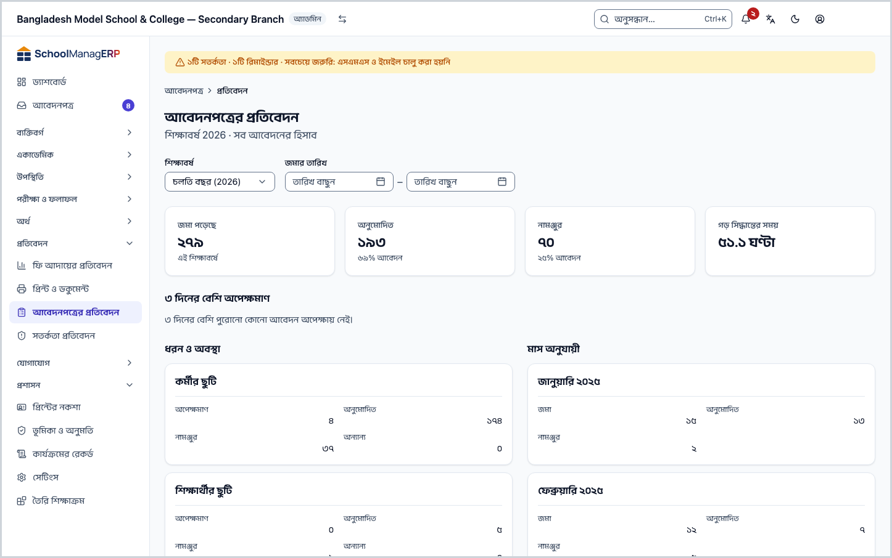

<!-- guide:meta
feature: reports.applications
title: আবেদনপত্রের প্রতিবেদন
summary: কতটি আবেদন জমা পড়ল, কতটি অনুমোদিত বা নামঞ্জুর হলো, সিদ্ধান্তে গড়ে কত সময় লাগল, কোনগুলো ৩ দিনের বেশি পড়ে আছে, আজ কে ছুটিতে আর কোন কর্মী কত দিন ছুটি নিলেন, তা এক পাতায় দেখুন।
roles: [ADMIN, EXECUTIVE, OFFICE_STAFF]
sources:
  - client-admin/src/routes/_staff/applications/reports.tsx
  - client-admin/src/routes/_staff/applications/-reports/applications-reports.tsx
  - client-admin/src/routes/_staff/applications/-reports/report-tables.tsx
  - server/src/modules/applications/application-reports.controller.ts
  - server/src/modules/applications/application-reports.service.ts
labels:
  [
    applicationsReports:*,
    nav:items.applicationsReportsNav,
    nav:groups.reports,
  ]
helpIds:
  [
    reports.applications,
    reports.applications.field.academicYear,
    reports.applications.field.submitted,
  ]
devices: [desktop]
entry: [sidebar, palette]
keywords:
  [আবেদন, আবেদনপত্র, প্রতিবেদন, অপেক্ষমাণ, অনুমোদিত, নামঞ্জুর, ছুটি, আজ ছুটিতে, কর্মীর ছুটি, applications report, pending, approved, rejected, leave, on leave today]
appVersion: 0.1.0 (3f7e424fc)
owner: tareq89
lastVerified: 2026-10-25
knownIssues: []
-->

# আবেদনপত্রের প্রতিবেদন

স্কুলের সব আবেদনের হিসাব আর আজ কে ছুটিতে, তা এক পাতায় দেখুন।

**যেতে হবে:** বাম মেনুতে **প্রতিবেদন → আবেদনপত্রের প্রতিবেদন**। এই পাতা কম্পিউটারে দেখুন।
**শুরুর আগে:** আপনি অ্যাডমিন, একাডেমিক কো-অর্ডিনেটর বা অফিস সহকারী হবেন ([কে কী করতে পারেন](#roles))। এই পাতা শুধু দেখার; আবেদনের সিদ্ধান্ত এখান থেকে হয় না।

এখানে সংখ্যা আসে স্কুলের [আবেদনপত্র](../applications/applications.md) থেকে, যেমন ছুটির আবেদন। কর্মীর ছুটির হিসাব আসে অনুমোদিত ছুটির খাতা থেকে।

[হিসাব দেখুন](#task-main) · [পুরোনো আবেদন খুলুন](#task-stale) · [সময় বদলান](#task-filter) · [সমস্যা ও সমাধান](#trouble)

**এই পাতায় যা আছে**

- [এই বছরের আবেদনের হিসাব দেখুন](#task-main)
- [সংখ্যা ঠিক আছে কি না বুঝবেন কীভাবে](#confirm)
- [অন্য পরিস্থিতিতে](#other)
  - [৩ দিনের বেশি পড়ে থাকা আবেদন খুলুন](#task-stale)
  - [অন্য শিক্ষাবর্ষ বা তারিখ দেখুন](#task-filter)
  - [আজ কে ছুটিতে, কে কত দিন ছুটি নিলেন](#task-leave)
- [সমস্যা ও সমাধান](#trouble)
- [কে কী করতে পারেন](#roles)
- [আরও জানুন](#more)

---

## এই বছরের আবেদনের হিসাব দেখুন 

1. বাম মেনুতে **প্রতিবেদন** চাপুন, তারপর **আবেদনপত্রের প্রতিবেদন** চাপুন।

   → পাতা খোলে। শিরোনামের নিচে লেখা **শিক্ষাবর্ষ … · সব আবেদনের হিসাব**।

2. উপরের চারটি ঘর দেখুন: **জমা পড়েছে**, **অনুমোদিত**, **নামঞ্জুর** আর **গড় সিদ্ধান্তের সময়**।

   → **জমা পড়েছে**-এর নিচে লেখা থাকে **এই শিক্ষাবর্ষে**; শুধু তারিখ দিয়ে ছাঁকলে (শিক্ষাবর্ষ ছাড়া) লেখা থাকে **আপনার বাছা তারিখগুলিতে**। **অনুমোদিত** আর **নামঞ্জুর**-এর নিচে লেখা থাকে মোটের কত ভাগ, যেমন **৬০% আবেদন**। **গড় সিদ্ধান্তের সময়** ঘণ্টায়, যেমন **১২.৫ ঘণ্টা**।

3. নিচে **৩ দিনের বেশি অপেক্ষমাণ** তালিকা দেখুন। এগুলো এখনো কারও সিদ্ধান্তের অপেক্ষায়।
4. **ধরন ও অবস্থা** আর **মাস অনুযায়ী** টেবিল দেখুন।

---

## সংখ্যা ঠিক আছে কি না বুঝবেন কীভাবে 

| অবস্থা                       | কীভাবে বুঝবেন                           | এরপর কী |
| ---------------------------- | --------------------------------------- | ------- |
| **শুধু স্ক্রিনে বাছা**       | ছাঁকনি বদলালে সংখ্যা সাথে সাথে বদলায়   | —       |
| **স্কুলের সিস্টেম থেকে আনা** | চারটি ঘরে সংখ্যা দেখা যায়, ধূসর ঘর নেই | কাজ শেষ |

এই পাতা কিছু ফোন বা কম্পিউটারে আলাদা করে রাখে না, তাই "এই ডিভাইসে সংরক্ষিত" অবস্থা নেই। ছাঁকনি পাতার ঠিকানায় থাকে; লিংক পাঠালে অন্যজন একই হিসাব দেখেন।

---

## অন্য পরিস্থিতিতে 

### ৩ দিনের বেশি পড়ে থাকা আবেদন খুলুন 

**৩ দিনের বেশি অপেক্ষমাণ** তালিকায় প্রতিটি আবেদন এক সারিতে: **নম্বর**, **জমা** (তারিখ · **… দিন ধরে**), **ধরন**, **আবেদনকারী**, **ধাপ**, **অবস্থা**। সবচেয়ে পুরোনোটি আগে, সর্বোচ্চ ৫০টি।

1. সারির **দেখুন — …** চাপুন।

   → আবেদনের নিজের পাতা খোলে। সেখান থেকে সিদ্ধান্ত নিন।

কিছু না থাকলে লেখা থাকে **৩ দিনের বেশি পুরোনো কোনো আবেদন অপেক্ষায় নেই।**

### অন্য শিক্ষাবর্ষ বা তারিখ দেখুন 

1. **শিক্ষাবর্ষ** থেকে একটি বছর বাছুন।
2. দরকার হলে **জমার তারিখ**-এ **শুরু** আর **শেষ** দিন দিন।

   → শিরোনামের নিচে তারিখও যোগ হয়; শুধু একটি তারিখ দিলে লেখা থাকে **{date} থেকে** বা **{date} পর্যন্ত**। কোনো আবেদন না মিললে লেখা থাকে **এই সময়ে কোনো আবেদন নেই**; **সব ফিল্টার মুছুন** চাপলে ছাঁকনি উঠে যায়।

| আপনি যা বাছলেন      | কোন আবেদন গোনা হয়                                      | **শিক্ষাবর্ষ** ঘরে লেখা থাকে |
| ------------------- | ------------------------------------------------------- | ---------------------------- |
| কিছুই না            | চলতি বছরের আবেদন, আর যে আবেদনের কোনো বছর নেই            | **চলতি বছর (…)**             |
| একটি বছর            | শুধু সেই বছরের                                          | বছরের নাম                    |
| শুধু তারিখ, বছর নয় | তারিখের মধ্যে সব বছরের; শিরোনামের নিচে বছর লেখা থাকে না | **সব বছর**                   |

### আজ কে ছুটিতে, কে কত দিন ছুটি নিলেন 

- **আজ ছুটিতে** অংশে দুটি তালিকা: **কর্মী** (নাম, ছুটির ধরন, **… পর্যন্ত**) আর **শিক্ষার্থী** (নাম, শ্রেণি · শাখা, **… পর্যন্ত**)। কেউ না থাকলে **আজ কেউ ছুটিতে নেই।**
- **কর্মীর ছুটির দিন** টেবিলে প্রত্যেক কর্মীর **ধরন অনুযায়ী** দিন আর **মোট দিন**। শুধু অনুমোদিত ছুটি, কর্মদিবস হিসেবে।

**আজ ছুটিতে** কোনো ছাঁকনি মানে না, সবসময় আজকের দিন দেখায়। কর্মীর তালিকা আর **কর্মীর ছুটির দিন** আসে কর্মীর অনুমোদিত ছুটির খাতা থেকে, তাই আবেদন না থাকলেও দেখায়। শিক্ষার্থীর তালিকা আসে অনুমোদিত শিক্ষার্থী-ছুটির আবেদন থেকে।

---

## সমস্যা ও সমাধান 

| আপনি যা দেখছেন                                | কী করবেন                                                                                 | কে সাহায্য করতে পারেন |
| --------------------------------------------- | ---------------------------------------------------------------------------------------- | --------------------- |
| **প্রতিবেদন আনা যায়নি।**                     | **আবার চেষ্টা করুন** চাপুন, না হলে পাতা রিলোড করুন।                                      | অ্যাডমিন              |
| **এই সময়ে কোনো আবেদন নেই**                   | **সব ফিল্টার মুছুন** চাপুন, বা অন্য বছর বাছুন।                                           | —                     |
| **গড় সিদ্ধান্তের সময়** লেখা **—**           | এই সময়ে কোনো আবেদনের সিদ্ধান্ত হয়নি।                                                   | —                     |
| কর্মীর ছুটির দিন শিক্ষাবর্ষ বদলালেও বদলায় না | ছুটির দিন শুধু **জমার তারিখ** দিয়ে ছাঁকা হয়, ছুটি শুরুর দিন ধরে; শিক্ষাবর্ষ দিয়ে নয়। | —                     |
| বাম মেনুতে **আবেদনপত্রের প্রতিবেদন** নেই      | আপনার ভূমিকা এই পাতা দেখতে পারে না। [কে কী করতে পারেন](#roles) দেখুন।                    | অ্যাডমিন              |

---

## কে কী করতে পারেন 

| ভূমিকা                                                       | প্রতিবেদন দেখা |
| ------------------------------------------------------------ | -------------- |
| অ্যাডমিন                                                     | হ্যাঁ          |
| একাডেমিক কো-অর্ডিনেটর                                        | হ্যাঁ          |
| অফিস সহকারী                                                  | হ্যাঁ          |
| হিসাবরক্ষক, শিক্ষক, পরীক্ষা নিয়ন্ত্রক, পরিচালনা পর্ষদ সদস্য | না             |

**অ্যাডমিন, একাডেমিক কো-অর্ডিনেটর ও অফিস সহকারী:** তিনজনেই পুরো স্কুলের একই হিসাব দেখেন; কোড অনুযায়ী কোনো পার্থক্য নেই। নিজের ভাগের আবেদন নয়, সব আবেদন গোনা হয়।

অন্য ভূমিকা আবেদন জমা দিতে পারলেও বাম মেনুতে **আবেদনপত্রের প্রতিবেদন** পান না।

---

## আরও জানুন 

<strong>পাতার অংশগুলো, ওপর থেকে নিচে</strong>

- শিরোনাম আর **শিক্ষাবর্ষ … · সব আবেদনের হিসাব**।
- ছাঁকনি — **শিক্ষাবর্ষ**, **জমার তারিখ** (**শুরু**, **শেষ**)।
- চারটি ঘর — **জমা পড়েছে**, **অনুমোদিত**, **নামঞ্জুর**, **গড় সিদ্ধান্তের সময়**।
- **৩ দিনের বেশি অপেক্ষমাণ**।
- **ধরন ও অবস্থা** (**অপেক্ষমাণ**, **অনুমোদিত**, **নামঞ্জুর**, **অন্যান্য**) আর **মাস অনুযায়ী** (**জমা**, **অনুমোদিত**, **নামঞ্জুর**)।
- **আজ ছুটিতে** আর **কর্মীর ছুটির দিন**।

<strong>ঘরগুলোর অর্থ</strong>

<!-- guide:generated:fields:applicationsReports -->

| ঘর         | কী লিখবেন                                                                                                                    | বাধ্যতামূলক? |
| ---------- | ---------------------------------------------------------------------------------------------------------------------------- | ------------ |
| শিক্ষাবর্ষ | কোন শিক্ষাবর্ষের আবেদন গুনবেন। বাছলে শুধু সেই বছরের আবেদন গোনা হয়।                                                          | না           |
| জমার তারিখ | আবেদন জমা পড়ার দিন ধরে ছাঁকে; শুরু আর শেষ দুই দিনই ধরা হয়। কর্মীর ছুটির দিনও এই তারিখ দিয়ে ছাঁকা হয়, ছুটি শুরুর দিন ধরে। | না           |

<!-- /guide:generated -->

<strong>সংখ্যাগুলো কীভাবে গোনা হয়</strong>

<figure>
  
  <figcaption><em>প্রতিবেদনের দুই উৎস</em></figcaption>
</figure>

- **জমা পড়েছে:** ছাঁকনিতে মেলা সব আবেদন, যেকোনো অবস্থার।
- **ধরন ও অবস্থা:** অপেক্ষমাণ আর বিবেচনাধীন মিলে **অপেক্ষমাণ**; অনুমোদিত আর নামঞ্জুর ছাড়া বাকি সব **অন্যান্য**।
- **গড় সিদ্ধান্তের সময়:** অনুমোদিত বা নামঞ্জুর আবেদনে জমা থেকে সিদ্ধান্ত পর্যন্ত গড় ঘণ্টা, এক ঘর দশমিক পর্যন্ত।
- **৩ দিনের বেশি অপেক্ষমাণ:** অপেক্ষমাণ বা বিবেচনাধীন, জমার পর ৩ দিনের বেশি পার; সর্বোচ্চ ৫০টি।
- **জমার তারিখ:** বাংলাদেশের সময়ে জমার দিন ধরে।
- **কর্মীর ছুটির দিন:** অনুমোদিত ছুটি; একটি ছুটি দুই মাসে পড়লে শুরুর মাসে গোনা হয়।

**সম্পর্কিত পাতা**

- [**আবেদনপত্র**](../applications/applications.md) — ছুটি, ফি মওকুফ, ছাড়পত্র, প্রশংসাপত্র, শাখা বদলসহ স্কুলের আবেদন জমা দিন, অভিভাবকের কাগজের আবেদন অ্যাপে তুলুন।
- [**কর্মীর উপস্থিতি ও ছুটি**](../attendance/staff-attendance.md) — কর্মীর ছুটি

---

_সংস্করণ ০.১.০ · শেষ যাচাই ২০২৬-১০-২৫_
