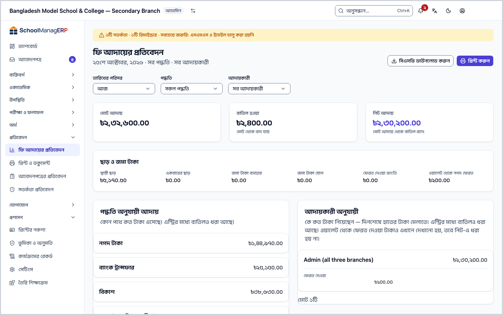

<!-- guide:meta
feature: reports.collectionsReport
title: ফি আদায়ের প্রতিবেদন
summary: একটি দিন, সপ্তাহ, মাস বা নিজের বাছা সময়ে কত টাকা আদায় হলো, কত বাতিল হলো আর হাতে নিট কত, তা পদ্ধতি, আদায়কারী, ফির ধরন আর দিন ধরে দেখুন; প্রিন্ট করুন বা সিএসভি নামান।
roles: [ADMIN, ACCOUNTANT, EXECUTIVE]
sources:
  - client-admin/src/routes/_staff/reports/collections.tsx
  - server/src/modules/reports/reports.controller.ts
  - server/src/modules/reports/collections-report.service.ts
  - server/src/modules/reports/dto/collections-report.dto.ts
labels:
  [
    reports:*,
    nav:items.collectionsReport,
    nav:groups.reports,
  ]
helpIds:
  [
    reports.collectionsReport,
    reports.collectionsReport.action.downloadCsv,
    reports.collectionsReport.action.print,
    reports.collectionsReport.field.preset,
    reports.collectionsReport.field.collector,
    reports.collectionsReport.section.byMethod,
    reports.collectionsReport.section.byCollector,
    reports.collectionsReport.section.byFeeType,
  ]
devices: [desktop, phone]
entry: [sidebar, palette]
keywords:
  [আদায়, ফি আদায়, দিনশেষের হিসাব, ক্যাশ মেলানো, নিট আদায়, বাতিল, আদায়কারী, সিএসভি, collections, cash close, net, reversal, collector, csv]
appVersion: 0.1.0 (3f7e424fc)
owner: tareq89
lastVerified: 2026-10-25
knownIssues: []
-->

# ফি আদায়ের প্রতিবেদন

কোন সময়ে কত টাকা এলো, কে নিলেন আর কোন পথে এলো, তা এক পাতায় দেখুন। দিনশেষে হাতের টাকা মেলাতে এটিই কাজে লাগে।

**যেতে হবে:** বাম মেনুতে **প্রতিবেদন → ফি আদায়ের প্রতিবেদন**। কম্পিউটারে বা ফোনে দেখা যায়।
**শুরুর আগে:** আপনি অ্যাডমিন, হিসাবরক্ষক বা একাডেমিক কো-অর্ডিনেটর হবেন ([কে কী করতে পারেন](#roles))। এই পাতা শুধু দেখার; এখান থেকে কোনো টাকা বদলায় না।

প্রতিবেদনের টাকা আসে নেওয়া [পেমেন্ট](../finance/payments.md) থেকে। পেমেন্ট বাতিল করলে সেটি **বাতিল হওয়া** ঘরে ওঠে আর নিট থেকে বাদ যায়।

[আজকের হিসাব দেখুন](#task-main) · [অন্য তারিখ](#task-range) · [একজন আদায়কারী](#task-collector) · [সমস্যা ও সমাধান](#trouble)

**এই পাতায় যা আছে**

- [আজকের আদায় দেখুন ও মেলান](#task-main)
- [হিসাব ঠিক আছে কি না বুঝবেন কীভাবে](#confirm)
- [অন্য পরিস্থিতিতে](#other)
  - [গতকাল, এই সপ্তাহ, এই মাস বা নিজের বাছা সময়](#task-range)
  - [একজন আদায়কারী বা একটি পদ্ধতির হিসাব](#task-collector)
  - [প্রিন্ট করুন বা সিএসভি নামান](#task-export)
- [সমস্যা ও সমাধান](#trouble)
- [কে কী করতে পারেন](#roles)
- [আরও জানুন](#more)

---

## আজকের আদায় দেখুন ও মেলান 

1. বাম মেনুতে **প্রতিবেদন** চাপুন, তারপর **ফি আদায়ের প্রতিবেদন** চাপুন।

   → **ফি আদায়ের প্রতিবেদন** খোলে। শুরুতে **তারিখের পরিসর** থাকে **আজ**। শিরোনামের নিচে লেখা থাকে তারিখ · **সব পদ্ধতি** · **সব আদায়কারী**।

2. উপরের তিনটি ঘর দেখুন: **মোট আদায়**, **বাতিল হওয়া** আর **নিট আদায়**।

   → **নিট আদায়** = **মোট আদায়** থেকে **বাতিল হওয়া** বাদ। এটিই আজ আসলে কত টাকা এলো।

3. **আদায়কারী অনুযায়ী** টেবিলে প্রত্যেক কর্মীর সারি দেখুন। **নিট** ঘরের টাকা তাঁর হাতের টাকার সাথে মিলিয়ে নিন।

   → **ফেরত দেওয়া** ঘরে থাকে শিক্ষার্থীর জমা টাকা থেকে পরিবারকে নগদ ফেরত দেওয়া টাকা। এটি **নিট**-এ বাদ দেওয়া হয় না, পাশে দেখানো হয়। তাই হাতের নগদ মেলাতে **নিট** থেকে **ফেরত দেওয়া** নিজে বাদ দিন।

4. বাকি টেবিলগুলো দেখুন: **পদ্ধতি অনুযায়ী আদায়** (নগদ, বিকাশ ইত্যাদি), **ফির ধরন অনুযায়ী** আর **দিন অনুযায়ী**।

> **মনে রাখুন:** এখানে শুধু সফল পেমেন্ট গোনা হয়। অপেক্ষমাণ বা ব্যর্থ পেমেন্ট গোনা হয় না। বাতিল করা পেমেন্ট দুবার দেখা যায়: আসল টাকা **মোট আদায়**-এ, আর ফেরত **বাতিল হওয়া**-তে।

---

## হিসাব ঠিক আছে কি না বুঝবেন কীভাবে 

| অবস্থা                       | কীভাবে বুঝবেন                                                   | এরপর কী                            |
| ---------------------------- | --------------------------------------------------------------- | ---------------------------------- |
| **শুধু স্ক্রিনে বাছা**       | ছাঁকনি বদলালে সংখ্যাগুলো সাথে সাথে বদলায়; কিছু জমা করতে হয় না | —                                  |
| **স্কুলের সিস্টেম থেকে আনা** | তিনটি ঘরে টাকা দেখা যায়, ধূসর ঝলক নেই                          | মেলান, দরকার হলে প্রিন্ট বা সিএসভি |

এই পাতা কিছু ফোন বা কম্পিউটারে আলাদা করে রাখে না, তাই "এই ডিভাইসে সংরক্ষিত" অবস্থা নেই। বাছা ছাঁকনি পাতার ঠিকানায় থাকে, তাই রিলোড করলেও একই হিসাব আসে।

**সংখ্যা না মিললে:** একই সময়ে কেউ নতুন পেমেন্ট নিয়ে থাকতে পারেন। পাতা রিলোড করুন। সংখ্যা সবসময় সেই মুহূর্তের।

---

## অন্য পরিস্থিতিতে 

### গতকাল, এই সপ্তাহ, এই মাস বা নিজের বাছা সময় 

1. **তারিখের পরিসর** থেকে **গতকাল**, **এই সপ্তাহ**, **এই মাস** বা **কাস্টম** বাছুন।
2. **কাস্টম** বাছলে **কাস্টম পরিসর** ঘর আসে। **থেকে** আর **পর্যন্ত** তারিখ দিন।

| আপনি বাছলেন   | কোন দিনগুলো                           |
| ------------- | ------------------------------------- |
| **আজ**        | শুধু আজ                               |
| **গতকাল**     | শুধু গতকাল                            |
| **এই সপ্তাহ** | এই সপ্তাহের সোমবার থেকে আজ পর্যন্ত    |
| **এই মাস**    | এই মাসের ১ তারিখ থেকে আজ পর্যন্ত      |
| **কাস্টম**    | **থেকে** আর **পর্যন্ত**, দুই দিনই ধরে |

দিন গোনা হয় বাংলাদেশের সময়ে, পেমেন্ট নেওয়ার তারিখ ধরে।

### একজন আদায়কারী বা একটি পদ্ধতির হিসাব 

- **আদায়কারী** থেকে একজন কর্মী বাছুন। তালিকায় শুধু তাঁরাই থাকেন, যাঁরা এই সময়ে টাকা নিয়েছেন।
- **পদ্ধতি** থেকে একটি বাছুন, যেমন **নগদ টাকা** বা **বিকাশ**।

→ পুরো পাতা, তিনটি ঘর আর সব টেবিল, শুধু সেই কর্মী বা পদ্ধতির হিসাব দেখায়। নগদ ছাড়া অন্য পদ্ধতি বাছলে **ফেরত দেওয়া** শূন্য থাকে, কারণ জমা টাকা ফেরত হয় নগদে।

### প্রিন্ট করুন বা সিএসভি নামান 

- **প্রিন্ট করুন** চাপুন। ব্রাউজারের প্রিন্ট জানালা খোলে। ছাঁকনি আর বোতাম ছাপা হয় না; শিরোনাম, তারিখ আর সব টেবিল ছাপা হয়।
- **সিএসভি ডাউনলোড করুন** চাপুন। `collections-report.csv` নামে একটি ফাইল নামে। এতে প্রতিটি পেমেন্ট এক সারিতে: Date, Invoice No, Student, Method, Reference, Collector, Amount, Discount, Reversal। একই ছাঁকনি খাটে। ফাইল Excel-এ বাংলা নামসহ ঠিকমতো খোলে।

> **মনে রাখুন:** সিএসভিতে শিক্ষার্থীর নাম থাকে। ফাইলটি স্কুলের বাইরে পাঠাবেন না।

---

## সমস্যা ও সমাধান 

| আপনি যা দেখছেন                                     | কী করবেন                                                                                                                                  | কে সাহায্য করতে পারেন |
| -------------------------------------------------- | ----------------------------------------------------------------------------------------------------------------------------------------- | --------------------- |
| **আদায়ের প্রতিবেদন লোড করা যায়নি।**              | **আবার চেষ্টা করুন** চাপুন, না হলে পাতা রিলোড করুন।                                                                                       | অ্যাডমিন              |
| **এই পরিসরে কোনো সারি নেই।**                       | এই সময়ে কোনো পেমেন্ট নেই। অন্য **তারিখের পরিসর** বা ছাঁকনি বাছুন।                                                                        | —                     |
| **সিএসভি ডাউনলোড করা যায়নি। আবার চেষ্টা করুন।**   | কিছুক্ষণ পর আবার চাপুন।                                                                                                                   | অ্যাডমিন              |
| পদ্ধতি টেবিলের যোগফল **মোট আদায়**-এর সাথে মেলে না | পদ্ধতি ও আদায়কারী টেবিলে হাতে আসা টাকা দেখায়: জমা টাকা থেকে কাটা অংশ বাদ, জমায় রাখা অংশ যোগ। নিচে [টাকা কীভাবে গোনা হয়](#more) দেখুন। | হিসাবরক্ষক            |
| **অজানা** নামে একজন আদায়কারী                      | পেমেন্টে কে টাকা নিয়েছেন তা লেখা নেই। পেমেন্টের বিবরণ দেখুন।                                                                             | হিসাবরক্ষক            |
| বাম মেনুতে **ফি আদায়ের প্রতিবেদন** নেই            | আপনার ভূমিকা এই পাতা দেখতে পারে না। [কে কী করতে পারেন](#roles) দেখুন।                                                                     | অ্যাডমিন              |

---

## কে কী করতে পারেন 

| ভূমিকা                                                        | প্রতিবেদন দেখা | প্রিন্ট ও সিএসভি |
| ------------------------------------------------------------- | -------------- | ---------------- |
| অ্যাডমিন                                                      | হ্যাঁ          | হ্যাঁ            |
| হিসাবরক্ষক                                                    | হ্যাঁ          | হ্যাঁ            |
| একাডেমিক কো-অর্ডিনেটর                                         | হ্যাঁ          | হ্যাঁ            |
| শিক্ষক, অফিস সহকারী, পরীক্ষা নিয়ন্ত্রক, পরিচালনা পর্ষদ সদস্য | না             | না               |

**অ্যাডমিন, হিসাবরক্ষক ও একাডেমিক কো-অর্ডিনেটর:** তিনজনেই একই পাতা, একই ছাঁকনি আর একই টেবিল দেখেন; কোড অনুযায়ী কোনো পার্থক্য নেই। **আদায়কারী** তালিকা প্রতিবেদন থেকেই আসে, তাই কর্মী তালিকা দেখার অনুমতি লাগে না।

**পরিচালনা পর্ষদ সদস্য:** এই পাতা পান না, কারণ সিএসভিতে শিক্ষার্থীর নাম থাকে।

অন্য ভূমিকার বাম মেনুতে **ফি আদায়ের প্রতিবেদন** থাকে না।

---

## আরও জানুন 

<strong>পাতার অংশগুলো, ওপর থেকে নিচে</strong>

- শিরোনাম, তারিখ-পদ্ধতি-আদায়কারী লাইন, **সিএসভি ডাউনলোড করুন** আর **প্রিন্ট করুন**।
- ছাঁকনি — **তারিখের পরিসর**, **কাস্টম পরিসর** (শুধু কাস্টমে), **পদ্ধতি**, **আদায়কারী**।
- তিনটি ঘর — **মোট আদায়**, **বাতিল হওয়া**, **নিট আদায়**।
- **ছাড় ও জমা টাকা** — **স্থায়ী ছাড়**, **একবারের ছাড়**, **জমা টাকা ব্যবহার**, **জমা টাকা যোগ**, **ফেরত দেওয়া ভাংতি**, **ওয়ালেট থেকে নগদ ফেরত**।
- চারটি টেবিল — **পদ্ধতি অনুযায়ী আদায়**, **আদায়কারী অনুযায়ী**, **ফির ধরন অনুযায়ী**, **দিন অনুযায়ী** (পুরোনো দিন আগে)।

<strong>ঘরগুলোর অর্থ</strong>

<!-- guide:generated:fields:reports:preset,customRange,method,collector -->

| ঘর            | কী লিখবেন                                                                                            | বাধ্যতামূলক? |
| ------------- | ---------------------------------------------------------------------------------------------------- | ------------ |
| তারিখের পরিসর | কোন দিনগুলোর আদায় দেখবেন। শুরুতে আজ। এই সপ্তাহ শুরু হয় সোমবার থেকে। দিন গোনা হয় বাংলাদেশের সময়ে। | না           |
| কাস্টম পরিসর  | তারিখের পরিসরে কাস্টম বাছলে তবেই আসে। থেকে আর পর্যন্ত দুই দিনই হিসাবে ধরা হয়।                       | না           |
| পদ্ধতি        | শুধু একটি পথে আসা টাকা দেখতে, যেমন নগদ টাকা বা বিকাশ। খালি রাখলে সব পদ্ধতি।                          | না           |
| আদায়কারী     | শুধু একজন কর্মীর নেওয়া টাকা দেখতে। তালিকায় শুধু তাঁরাই থাকেন, যাঁরা এই পরিসরে টাকা নিয়েছেন।       | না           |

<!-- /guide:generated -->

<strong>টাকা কীভাবে গোনা হয়</strong> — কোন পেমেন্ট, কোন দিন, কোন টেবিলে কী

<figure>
  
  <figcaption><em>প্রতিবেদনে কোন টাকা কোথায় যায়</em></figcaption>
</figure>

- **কোন পেমেন্ট:** শুধু এই স্কুলের সফল পেমেন্ট, আর বাতিলের ফেরত। মুছে ফেলা, অপেক্ষমাণ বা ব্যর্থ পেমেন্ট বাদ।
- **কোন দিন:** পেমেন্ট নেওয়ার তারিখ, বাংলাদেশের সময়ে। রাত ১২টার পর নেওয়া টাকা পরের দিনে ওঠে।
- **তিনটি ঘর ও দিন অনুযায়ী টেবিল:** পেমেন্টের পুরো টাকা।
- **পদ্ধতি ও আদায়কারী টেবিল:** হাতে আসা টাকা = পেমেন্টের টাকা − জমা টাকা থেকে কাটা অংশ + জমায় রাখা অংশ। তাই জমা টাকা ব্যবহার হলে এই দুই টেবিলের যোগফল **মোট আদায়**-এর চেয়ে কম হতে পারে।
- **ফির ধরন টেবিল:** কোন ফি বাবদ কত টাকা বসেছে। বাতিল পেমেন্ট এখানে বাদ দেওয়া হয় না, আর **ছাড়** ঘরে দুই রকম ছাড় যোগ হয়।
- **স্থায়ী ছাড়:** বিলের স্থায়ী ছাড়ের যে অংশ এই পেমেন্টে পড়ে, পেমেন্টের ভাগ অনুযায়ী আনুমানিক হিসাব।
- **ওয়ালেট থেকে নগদ ফেরত:** শিক্ষার্থীর জমা টাকা থেকে পরিবারকে দেওয়া নগদ। নিট থেকে বাদ যায় না, আলাদা দেখানো হয়।

**সম্পর্কিত পাতা**

- [**পেমেন্ট**](../finance/payments.md) — পেমেন্ট, রসিদ ও বাতিল
- [**পেমেন্ট রেকর্ড করুন**](../finance/record-payment.md) — পেমেন্ট নিতে
- [**শিক্ষার্থীর বকেয়া**](../finance/dues.md) — কে কত বকেয়া দিয়েছে দেখতে
- [**সতর্কতা প্রতিবেদন**](alerts-report.md) — প্রতি মাসে স্কুলের নিয়ম থেকে ওঠা সতর্কতা

---

_সংস্করণ ০.১.০ · শেষ যাচাই ২০২৬-১০-২৫_
