<!-- guide:meta
feature: reports.hub
title: সব রিপোর্ট
summary: স্কুলের সব রিপোর্ট এক জায়গায় খুঁজে খুলুন, ফল দেখুন, Excel-এ নামান, A4 কাগজে প্রিন্ট করুন, আর মতামত জানান। অ্যাডমিন তালিকাকে রিপোর্ট হিসেবে রাখতেও পারেন।
roles: [ADMIN, ACCOUNTANT, TEACHER, EXECUTIVE, COMMITTEE]
sources:
  - client-admin/src/routes/_staff/reports/index.tsx
  - client-admin/src/routes/_staff/reports/$reportId.tsx
  - client-admin/src/routes/_staff/reports/new.tsx
  - client-admin/src/routes/_staff/reports/$reportId_.edit.tsx
  - client-admin/src/routes/_staff/reports/-designer/start-screen.tsx
  - client-admin/src/routes/_staff/reports/-designer/designer-screen.tsx
  - client-admin/src/routes/_staff/reports/-designer/save-dialog.tsx
  - client-admin/src/routes/_staff/reports/-designer/question-starters.ts
  - ui/src/components/report-view/drill.ts
  - ui/src/components/report-view/format-cell.ts
  - client-admin/src/routes/_staff/reports/-coded-reports.ts
  - ui/src/components/report-prompts.tsx
  - ui/src/components/export-menu.tsx
  - client-admin/src/routes/_staff/print/-document/report-pages.tsx
  - client-admin/src/routes/_staff/-save-as-report/save-as-report-dialog.tsx
  - client-admin/src/routes/_staff/-save-as-report/list-to-definition.ts
  - server/src/modules/reports/report-meta.controller.ts
  - server/src/modules/reports/report-runs.controller.ts
  - server/src/modules/reports/report-definitions.controller.ts
labels:
  [
    reports:hub.*,
    reports:runner.*,
    reports:prompts.*,
    reports:designer.*,
    reportDesigner:*,
    common:export.*,
    common:saveAsReport.*,
    common:reportPrint.*,
    nav:items.allReports,
    nav:groups.reports,
  ]
helpIds: [reports.hub]
devices: [desktop, phone]
entry: [sidebar, palette]
keywords:
  [রিপোর্ট, সব রিপোর্ট, রিপোর্ট খুঁজুন, পছন্দের রিপোর্ট, Excel, CSV, প্রিন্ট, রিপোর্ট হিসেবে রাখুন, মতামত, reports, all reports, catalogue, favourite, keep as report, print, download]
appVersion: 0.1.0 (0d2ba6bc5)
owner: tareq89
lastVerified: 2026-10-31
knownIssues:
  - { id: viewers-cannot-change-choices, checked: 2026-10-31, issue: null }
  - { id: teacher-student-count-card, checked: 2026-10-31, issue: null }
  - { id: keep-as-report-roles, checked: 2026-10-31, issue: null }
-->

# সব রিপোর্ট

এক জায়গা থেকে স্কুলের সব রিপোর্ট খুঁজে খুলুন, ফল দেখুন, Excel-এ নামান, A4 কাগজে প্রিন্ট করুন, আর রিপোর্টটা কাজে লাগল কি না জানান।

**যেতে হবে:** বাম মেনুতে **প্রতিবেদন → সব রিপোর্ট**। কম্পিউটারে বা ফোনে দেখা যায়। A4 প্রিন্টের পাতা শুধু কম্পিউটারে খোলে।
**শুরুর আগে:** আপনি অ্যাডমিন, হিসাবরক্ষক, শিক্ষক, একাডেমিক কো-অর্ডিনেটর বা পরিচালনা পর্ষদ সদস্য হবেন। কে কোন কাজ করতে পারেন, তা [কে কী করতে পারেন](#roles) অংশে আছে। এই পাতা শুধু দেখার; রিপোর্ট দেখলে কোনো তথ্য বদলায় না।

এই পাতায় আপনি **রিপোর্ট**-এর তালিকা দেখেন। তালিকায় দুই রকম রিপোর্ট থাকে। এক রকম **তৈরি রিপোর্ট**: স্কুলের অ্যাডমিন যে রিপোর্ট বানিয়ে রেখেছেন। এগুলো এই পাতার ভেতরেই খোলে, আর খুললেই উত্তর চলে আসে। অন্য রকম হলো নিজের আলাদা পাতাওয়ালা রিপোর্ট, যেমন [ফি আদায়ের প্রতিবেদন](collections-report.md)। এগুলোর কার্ডে চাপলে সেই রিপোর্টের নিজের পাতা খোলে। আপনার ভূমিকা যেগুলো খুলতে পারে, শুধু সেগুলোই দেখা যায়।

[রিপোর্ট খুঁজে খুলুন](#task-main) · [বাছাই বদলান](#task-answer) · [Excel-এ নামান](#task-download) · [প্রিন্ট](#task-print) · [মতামত](#task-feedback) · [রিপোর্ট হিসেবে রাখুন](#task-keep) · [রিপোর্ট বানান](#task-design) · [রং আর লিংক](#task-drill) · [সমস্যা ও সমাধান](#trouble)

**এই পাতায় যা আছে**

- [রিপোর্ট খুঁজে খুলুন](#task-main)
- [ঠিক আছে কি না বুঝবেন কীভাবে](#confirm)
- [অন্য পরিস্থিতিতে](#other)
  - [রিপোর্টের প্রশ্নের উত্তর বদলান](#task-answer)
  - [Excel-এ নামান](#task-download)
  - [A4 কাগজে প্রিন্ট করুন](#task-print)
  - [রিপোর্টটা কাজে লাগল কি না জানান](#task-feedback)
  - [তালিকাকে রিপোর্ট হিসেবে রাখুন](#task-keep)
  - [রিপোর্ট বানান](#task-design)
  - [রিপোর্টে রং আর লিংক](#task-drill)
  - [পছন্দের রিপোর্টে তারা দিন](#task-favourite)
- [সমস্যা ও সমাধান](#trouble)
- [কে কী করতে পারেন](#roles)
- [জানা সমস্যা](#known-issues)
- [আরও জানুন](#more)

---

## রিপোর্ট খুঁজে খুলুন 

1. বাম মেনুতে **প্রতিবেদন** চাপুন, তারপর **সব রিপোর্ট** চাপুন।

   → **সব রিপোর্ট** পাতা খোলে। নিচে লেখা থাকে "রিপোর্ট খুললেই উত্তর সঙ্গে সঙ্গে দেখা যাবে।" প্রতিটি রিপোর্ট একটি কার্ড: ওপরে নাম, নিচে এক লাইনে বিবরণ। কার্ডগুলো ভাগ করা থাকে, যেমন **তৈরি রিপোর্ট**, **ফি ও টাকা**, **উপস্থিতি**।

2. **রিপোর্ট খুঁজুন** ঘরে রিপোর্টের নামের একটি অংশ লিখুন। বাংলা বা ইংরেজি, দুই ভাষাতেই খোঁজা যায়।

   → যেসব কার্ডের নাম মেলে, শুধু সেগুলো থাকে। কিছু না মিললে **কোনো রিপোর্ট মেলেনি** লেখা আসে, সাথে **খোঁজা মুছুন** বোতাম।

3. রিপোর্টের নামে চাপুন।

   → **তৈরি রিপোর্ট** হলে রিপোর্টটি এই পাতাতেই খোলে এবং সাথে সাথে চলে। কোনো ফর্ম ভরতে হয় না; ফল দেখা যায়। অন্য রিপোর্ট হলে সেই রিপোর্টের নিজের পাতা খোলে।

4. ফলের টেবিল পড়ুন। সাধারণ টেবিলে একসাথে ১০০টি সারি দেখা যায়; আরও থাকলে টেবিলের নিচের পাতা বদলের বোতাম দিয়ে পরের পাতায় যান।

   → একটি রিপোর্ট সর্বোচ্চ ১০,০০০টি সারি আনে। এর বেশি হলে ওপরে **শুধু প্রথম …টি সারি দেখানো হচ্ছে। বাকিটা দেখতে বাছাই ছোট করুন।** লেখা আসে।

<figure>
  
  <figcaption><em>সব রিপোর্ট থেকে কে কী করতে পারেন</em></figcaption>
</figure>

> **মনে রাখুন:** রিপোর্ট খুললে ফল সবসময় সেই মুহূর্তের তথ্য থেকে আসে। বাছাই বদলালে আগের ফল ততক্ষণ থাকে, যতক্ষণ আবার **রিপোর্ট দেখান** না চাপেন।

---

## ঠিক আছে কি না বুঝবেন কীভাবে 

| অবস্থা                                             | কীভাবে বুঝবেন                                                                                                              | এরপর কী                                    |
| -------------------------------------------------- | -------------------------------------------------------------------------------------------------------------------------- | ------------------------------------------ |
| **শুধু স্ক্রিনে বদলেছে**                           | বাছাইয়ের ফর্মে উত্তর বদলেছেন, কিন্তু **রিপোর্ট দেখান** চাপেননি। নিচের ফল আগের বাছাইয়ের                                   | **রিপোর্ট দেখান** চাপুন                    |
| **স্কুলের সিস্টেমে পৌঁছেছে**                       | ফলের টেবিল এসেছে। তা সরাসরি স্কুলের সিস্টেম থেকে আনা; ধূসর ঝলক আর নেই                                                      | পড়ুন, দরকারে নামান বা প্রিন্ট করুন        |
| **স্কুলের সিস্টেমে পৌঁছেছে** (রিপোর্ট হিসেবে রাখা) | **রিপোর্টে রাখা হয়েছে** বার্তা এসেছে। যাচাই করতে **সব রিপোর্ট** পাতা খুলুন; নতুন রিপোর্ট **তৈরি রিপোর্ট**-এর নিচে থাকবে   | কার্ডে চাপুন, অথবা বার্তার **খুলুন** চাপুন |
| **এই ডিভাইসে সংরক্ষিত**                            | তারা চিহ্ন দেওয়া পছন্দের রিপোর্ট আর "কাজে লাগল?"-র উত্তর শুধু এই কম্পিউটার বা ফোনের ব্রাউজারে থাকে। অন্য ডিভাইসে মিলবে না | কিছু করতে হবে না                           |

---

## অন্য পরিস্থিতিতে 

### রিপোর্টের প্রশ্নের উত্তর বদলান 

শুধু অ্যাডমিন এটি করতে পারেন। অন্যরা এই লাইন পান না; তাঁরা রিপোর্টটি তার শুরুর বাছাইয়ে দেখেন ([জানা সমস্যা](#known-issues))।

কিছু রিপোর্ট চালানোর সময় প্রশ্ন করে, যেমন কোন শিক্ষাবর্ষ বা কোন শ্রেণি।

1. ফলের ওপরের লাইনটি দেখুন। এতে বর্তমান উত্তরগুলো একসাথে লেখা থাকে, যেমন "২০২৬ · ৬ষ্ঠ শ্রেণি · সব শাখা"। লাইনের শেষে **বদলান** চাপুন।

   → **এই রিপোর্টের বাছাই** ফর্ম খোলে। রিপোর্ট যা জিজ্ঞেস করে, প্রতিটির জন্য একটি ঘর থাকে।

2. ঘরগুলো ভরুন:
   - **শিক্ষাবর্ষ**: একটি বছর বাছুন। শুরুতে চলমান বছর থাকে।
   - **শ্রেণি**: এক বা একাধিক শ্রেণি বাছুন। কিছু না বাছলে **সব শ্রেণি**।
   - **শাখা**: শুধু বাছা শ্রেণির শাখা দেখায়। শ্রেণি বদলালে শাখার বাছাই মুছে যায়। কিছু না বাছলে **সব শাখা**।
   - তারিখ: **শুরুর তারিখ** আর **শেষ তারিখ**।

   → যে ঘর আবশ্যক অথচ খালি, সেখানে চাপলে ঘরের পাশেই লেখা আসে, যেমন **একটি শ্রেণি বেছে নিন**।

3. **রিপোর্ট দেখান** চাপুন, অথবা যেকোনো ঘরে থেকে Enter চাপুন।

   → ফর্ম বন্ধ হয়, ফল নতুন বাছাইয়ে বদলে যায়। বাছাই পাতার ঠিকানায় থাকে, তাই পাতা রিলোড করলে বা ঠিকানাটি পাঠালে একই বাছাই খোলে।

**আবার শুরু থেকে** চাপলে সব উত্তর রিপোর্টের শুরুর উত্তরে ফিরে যায়; তারপর **রিপোর্ট দেখান** চাপতে হয়।

**ফোনে:** ফর্মটি নিচ থেকে ওঠা একটি পাতায় খোলে। কিছু বদলে পাতাটি বন্ধ করলেই রিপোর্ট নতুন বাছাইয়ে চলে।

| আপনি চাপলেন        | কী হবে                                                  | জমা হলো?                |
| ------------------ | ------------------------------------------------------- | ----------------------- |
| **রিপোর্ট দেখান**  | ফর্ম বন্ধ হয়, নতুন বাছাইয়ে ফল আসে, ঠিকানায় বাছাই বসে | না, কিছু সংরক্ষণ হয় না |
| **আবার শুরু থেকে** | উত্তরগুলো শুরুর অবস্থায় ফেরে; ফল আগের বাছাইয়ের থাকে   | না                      |

### Excel-এ নামান 

শুধু অ্যাডমিন ও হিসাবরক্ষক পান। অন্য ভূমিকার জন্য বোতামটি থাকেই না।

1. ফল আসার পর ওপরে ডানে **Excel-এ নামান · …টি** বোতাম চাপুন। সংখ্যাটি হলো এই বাছাইয়ে মোট কতটি সারি আছে।

   → একটি Excel ফাইল নামে। এতে শুধু এই পাতার সারি নয়, এই বাছাইয়ের সব সারি থাকে।

2. অন্য সফটওয়্যারের জন্য CSV চাইলে বোতামের পাশের তীর (**আরও নামানোর উপায়**) চাপুন, তারপর **অন্য সফটওয়্যারের জন্য (CSV)** বাছুন।

   → একটি CSV ফাইল নামে।

৫,০০০টির বেশি সারি হলে ফাইলটি সাথে সাথে নামে না। তখন **ফাইলটি বড়, তাই তৈরি হচ্ছে। তৈরি হলে ঘণ্টার আইকনে দেখতে পাবেন।** বার্তা আসে; তৈরি হলে ঘণ্টার আইকনে ফাইল পাবেন। ফলে একটিও সারি না থাকলে বোতামটি ধূসর থাকে।

> **মনে রাখুন:** ফাইলে শিক্ষার্থী বা কর্মীর নাম থাকতে পারে। ফাইলটি স্কুলের বাইরে পাঠাবেন না।

### A4 কাগজে প্রিন্ট করুন 

শুধু অ্যাডমিন ও হিসাবরক্ষক পান। প্রিন্টের পাতা কম্পিউটারে খোলে।

1. ফল আসার পর ওপরে **প্রিন্ট** চাপুন। ফল না আসা পর্যন্ত বোতামটি ধূসর থাকে।

   → একটি নতুন ট্যাবে প্রিন্টের পাতা খোলে। ওপরে রিপোর্টের নাম আর আপনার বাছাই লেখা থাকে। নিচে **কাগজ তৈরি হচ্ছে…** দেখায়, তারপর A4 কাগজ আসে।

2. কাগজ দেখে নিন। এতে স্কুলের নাম ও ঠিকানা, রিপোর্টের নাম, আপনার বাছাই এক লাইনে, প্রিন্টের তারিখ, আর টেবিল থাকে। একসাথে সব সারি ছাপা হয়, শুধু বর্তমান পাতা নয়।

   → টেবিল চওড়া হলে (সাতটির বেশি কলাম) কাগজ আপনা থেকে আড়াআড়ি হয়। Chrome বা Edge-এ নিচে **পাতা ১ / ৩** ধরনের পাতা-নম্বর ছাপা হয়; অন্য ব্রাউজারে নম্বর ছাড়া ছাপা হয়।

3. ওপরে **প্রিন্ট করুন** চাপুন।

   → ব্রাউজারের প্রিন্ট জানালা খোলে। ওখান থেকে ছাপুন বা PDF করুন।

ছাপার সময় দেখানো ফলের বাছাই ধরা হয়। ফর্মে আপনি যা বদলেছেন কিন্তু চালাননি, তা ছাপা হয় না। ছাপা কাগজে সারি খুব বেশি হলে নিচে **রিপোর্টটি অনেক বড়। প্রথম …টি সারি প্রিন্ট হয়েছে।** লেখা থাকে।

**ফোনে:** প্রিন্টের পাতায় **এটি কম্পিউটারে খুলুন** দেখায়। **লিংক কপি করুন** চেপে লিংকটি কম্পিউটারে খুলুন।

প্রিন্ট শেষে **বন্ধ করুন** চাপলে এই ট্যাবে **সব রিপোর্ট** পাতা খোলে। চাইলে ট্যাবটি বন্ধ করে আগের ট্যাবেই ফিরতে পারেন।

### রিপোর্টটা কাজে লাগল কি না জানান 

সবাই পান, যাঁরা রিপোর্ট দেখতে পারেন। ফলের নিচে একটি ছোট লাইন আসে, কোনো রিপোর্টে প্রথমবার ফল আসার পর।

1. **এই রিপোর্টটা কাজে লাগল?** লেখার পাশে **হ্যাঁ** বা **না** (বুড়ো আঙুলের বোতাম) চাপুন।

   → **হ্যাঁ** চাপলে উত্তর সাথে সাথে যায় আর **ধন্যবাদ।** লেখা আসে। **না** চাপলে **কী পাননি?** ঘর আসে।

2. **না** চাপলে চাইলে ঘরে কী পাননি লিখুন (পাঁচশো অক্ষর পর্যন্ত)। তারপর **পাঠান** চাপুন। ঘর খালি রেখেও পাঠানো যায়।

   → **ধন্যবাদ।** লেখা আসে।

উত্তর দিলে এই ব্রাউজারে সেই রিপোর্টের জন্য প্রশ্নটি আর আসে না। এই লাইন ফলের পথ আটকায় না, ছাপাতেও আসে না। উত্তর না গেলে **আপনার উত্তর পাঠানো যায়নি।** আসে; আবার চাপুন।

### তালিকাকে রিপোর্ট হিসেবে রাখুন 

শুধু অ্যাডমিন পান। এই কাজ **সব রিপোর্ট** পাতায় হয় না; হয় তিনটি তালিকা থেকে: [শিক্ষার্থী](../people/students.md), [শিক্ষার্থীর বকেয়া](../finance/dues.md) আর [পেমেন্ট](../finance/payments.md)। তালিকায় যে বাছাই করা আছে, সেটিই রিপোর্ট হয়ে যায়। রিপোর্টটি পরে **সব রিপোর্ট** পাতায় **তৈরি রিপোর্ট**-এর নিচে পাওয়া যায়।

1. তিনটির যেকোনো একটি তালিকা খুলুন এবং শ্রেণি, শাখা বা অন্য বাছাই ঠিক করুন।

   → তালিকাটি আপনার বাছাইয়ে বদলে যায়।

2. ওপরে **Excel-এ নামান** বোতামের পাশের তীর (**আরও নামানোর উপায়**) চাপুন, তারপর **রিপোর্ট হিসেবে রাখুন** বাছুন।

   → **রিপোর্ট হিসেবে রাখুন** জানালা খোলে। (শুধু দেরি হওয়া বকেয়ার তালিকায় তীর থাকে না; সেখানে **রিপোর্ট হিসেবে রাখুন** নামে আলাদা বোতাম থাকে।)

3. **রিপোর্টের নাম** ঘরে নাম ঠিক করুন। শুরুতে একটি নাম বসানো থাকে: শ্রেণি বাছা থাকলে "শ্রেণির নাম — শিক্ষার্থী", না থাকলে শুধু "শিক্ষার্থী" (বকেয়ায় "বকেয়া", পেমেন্টে "জমা")। নাম খালি রাখলে **রিপোর্টের একটি নাম দিন।** আসে।

4. **কারা দেখতে পারবেন** থেকে বাছুন কোন ভূমিকা রিপোর্টটি দেখবে। অ্যাডমিন সবসময় দেখতে পারেন, তাই সেই ঘর বন্ধ থাকে। শুরুতে আপনার নিজের ভূমিকা বাছা থাকে।

5. **চালানোর সময় জিজ্ঞেস করবেন** অংশ থাকলে প্রতিটি সুইচ দেখুন। শিক্ষার্থীর তালিকায় শিক্ষাবর্ষ, আর পেমেন্টের তালিকায় তারিখের পরিসর এখানে আসে। সুইচ চালু থাকলে রিপোর্ট চালানোর সময় ওই প্রশ্ন করে ("শুরুতে … থাকবে")। বন্ধ করলে রিপোর্টে সেই মানই স্থির থাকে ("এটি … থাকবে")।

6. জানালার নিচের লেখাগুলো পড়ুন। যা রিপোর্টে যাবে না, তা এখানে লেখা থাকে, যেমন **এই ফিল্টারটি রিপোর্টে যাবে না: খোঁজার ঘরে লেখা কথা**।

   → বকেয়া আর পেমেন্টের তালিকা রিপোর্টে **মোট** হয়ে যায়: বকেয়া শ্রেণি ও শাখা অনুযায়ী, পেমেন্ট দিন ও পদ্ধতি অনুযায়ী। প্রতিজন শিক্ষার্থী বা প্রতিটি পেমেন্টের আলাদা সারি থাকে না; সেটিও এখানে লেখা আসে।

7. **রিপোর্টে রাখুন** চাপুন।

   → বোতামে **রাখা হচ্ছে…** দেখায়। শেষ হলে জানালা বন্ধ হয় আর **রিপোর্টে রাখা হয়েছে** বার্তা আসে, সাথে **খুলুন**। **খুলুন** চাপলে রিপোর্টটি চলে।

| আপনি চাপলেন        | কী হবে                                                 | জমা হলো? |
| ------------------ | ------------------------------------------------------ | -------- |
| **রিপোর্টে রাখুন** | রিপোর্ট তৈরি হয়ে চালু হয়; **সব রিপোর্ট**-এ দেখা যায় | হ্যাঁ    |
| **বাতিল করুন**     | কিছুই বদলায় না; তালিকায় ফিরে যান                     | না       |

> **মনে রাখুন:** **রিপোর্টে রাখুন** না চাপা পর্যন্ত কিছু রাখা হয় না। রিপোর্টে তালিকার সেই মুহূর্তের তথ্য থাকে না; থাকে বাছাইয়ের নিয়ম। রিপোর্ট খুললে নতুন তথ্য আসে।

### রিপোর্ট বানান 

এটি শুধু অ্যাডমিন পান। **সব রিপোর্ট** পাতার ওপরে ডানে **নতুন রিপোর্ট** বোতাম আছে; Ctrl+K খোঁজেও **নতুন রিপোর্ট** লিখলে পাওয়া যায়।

1. **নতুন রিপোর্ট** বোতামে চাপুন।

   → শুরুর পাতা খোলে। প্রথমে **একটি তৈরি রিপোর্ট থেকে শুরু করুন**, তাতে প্রতিটি তৈরি রিপোর্টের একটি কার্ড। তারপর **একটি প্রশ্ন দিয়ে শুরু করুন**, তাতে চারটি কার্ড। একদম শেষে ছোট করে **ফাঁকা থেকে শুরু** লেখা।

2. কীভাবে শুরু করবেন বেছে নিন:
   - একটি তৈরি রিপোর্টে চাপুন। তার একটি কপি হয়ে বদলানোর জন্য খোলে। তৈরি রিপোর্টটি যেমন ছিল তেমনই থাকে।
   - অথবা প্রশ্নের কার্ডে তালিকা থেকে বেছে **শুরু করুন** চাপুন। কার্ডগুলো হলো **কতজন …, … অনুযায়ী?**, **কাদের তালিকা, যারা …?**, **মোট কত টাকা …, … অনুযায়ী?** আর **প্রতি মাসে কত …?**। তালিকায় স্কুলের নিজের নামগুলো থাকে, যেমন **শ্রেণি** আর **লিঙ্গ**।
   - অথবা **ফাঁকা থেকে শুরু** চাপুন।

   → ডিজাইনার এক পাতায় খোলে। বাঁ দিকে বাছাইয়ের অংশ, ডান দিকে **ফল**। ফোনে ফল ওপরে থাকে, আর **বদলান** বোতামে চাপলে বাছাইয়ের অংশ নিচ থেকে উঠে আসে।

3. ক্লিক করে রিপোর্ট বদলান:
   - **বিষয়** বলে দেয় রিপোর্ট কীসের, যেমন ছাত্রছাত্রী বা ফি।
   - **দেখাবেন**, **ভাগ করবেন** আর **গুনবেন / যোগ করবেন** তিনটি বাক্স। একটি বিষয়ের নিচে কোনো নামে চাপলে তা বাক্সে যায়। দ্রুত পেতে **খুঁজুন** ঘরে লিখুন।
   - **শুধু যাদের…** রিপোর্টকে ছোট করে, যেমন "শ্রেণি হলো ৬ষ্ঠ শ্রেণি"। **চালানোর সময় জিজ্ঞেস করবেন** চালু করলে শর্তটি প্রতিবার চালানোর সময় প্রশ্ন হয়ে আসে।
   - **কেমন দেখাবে**-তে চারটি ছবি: **তালিকা**, **দলভিত্তিক**, **ছক** আর **চার্ট**। একটি আপনার জন্য আগেই বাছা থাকে, সঙ্গে এক লাইনে কারণ।
   - **আরও**-তে রঙের নিয়ম, যেমন "যদি বাকি বেশি ৫,০০০ হয় তবে লাল"।

   → শেষ ক্লিকের প্রায় আধা সেকেন্ড পরে **ফল** বদলায়, প্রথম ৫০টি সারি দেখায়। নতুন ফল না আসা পর্যন্ত পুরনো ফল একটু ফিকে হয়ে থাকে।

4. দুটি জিনিস একসঙ্গে চলে না হলে, যে অংশ বদলেছেন তার পাশে লাল রঙে একটি বাক্য আসে, যেমন **এই দুটি একসাথে ভাগ করা যায় না: শিক্ষার্থীর নাম আর গুনবেন। একটি সরিয়ে দিন।** একটি সরালে ফল ফিরে আসে।

5. ওপরে **সংরক্ষণ** চাপুন, বা Ctrl+S চাপুন। **রিপোর্টটি সংরক্ষণ করুন** জানালায় **রিপোর্টের নাম** দেখুন (আপনার বাছাই থেকে লেখা থাকে), **কারা দেখতে পাবেন** টিক দিন (অ্যাডমিন সবসময় দেখেন; আপনার নিজের ভূমিকায় টিক দেওয়া থাকে), চাইলে **ফোল্ডার (ইচ্ছামতো)** লিখুন। তারপর চাপুন:
   - **সংরক্ষণ**: রিপোর্ট খসড়া হিসেবে থাকে, শুধু আপনি দেখতে পান।
   - **সবার জন্য চালু**: টিক দেওয়া ভূমিকারা **সব রিপোর্ট** থেকে খুলতে পারেন।

   → একটি বার্তা আসে: **রিপোর্টটি সংরক্ষণ করা হয়েছে। এখন শুধু আপনি দেখতে পাবেন।** বা **রিপোর্টটি সবার জন্য চালু হয়েছে।**, সঙ্গে **রিপোর্ট খুলুন**।

পরে বদলাতে হলে রিপোর্টটি খুলে ওপরে ডানে **বদলান** চাপুন। তৈরি রিপোর্টে বোতামে **কপি করে বদলান** লেখা থাকে: কপিটি বদলায়, তৈরি রিপোর্ট যেমন ছিল তেমনই থাকে।

| চাবি          | কী করে                                                           |
| ------------- | ---------------------------------------------------------------- |
| Tab           | বাক্স থেকে বাক্সে, নাম থেকে নামে যায়                            |
| Enter         | যে নামে আছেন, সেটি তার বাক্সে যোগ করে                            |
| Alt+↑ / Alt+↓ | বাছা নামকে বাক্সের ভেতরে ওপরে বা নিচে সরায়                      |
| Ctrl+S        | সংরক্ষণ করে (আগে সংরক্ষিত রিপোর্ট সঙ্গে সঙ্গে খসড়া হিসেবে থাকে) |

সংরক্ষণ না করা বদল নিয়ে ছেড়ে যেতে চাইলে আগে **সংরক্ষণ না করে ছেড়ে যাবেন?** জিজ্ঞেস করে। **এখানে থাকুন** চাপলে আপনার কাজ থাকে।

| আপনি চাপলে                  | কী হয়                                              | সংরক্ষিত হয়? |
| --------------------------- | --------------------------------------------------- | ------------- |
| **সংরক্ষণ**                 | রিপোর্ট খসড়া হিসেবে থাকে। শুধু আপনি দেখেন          | হ্যাঁ         |
| **সবার জন্য চালু**          | রিপোর্ট রাখা হয় আর টিক দেওয়া ভূমিকারা খুলতে পারেন | হ্যাঁ         |
| **সংরক্ষণ ছাড়া ছেড়ে যান** | আপনি চলে যান আর বদল হারিয়ে যায়                    | না            |

> **মনে রাখুন:** ডিজাইনারে ফল দ্রুত আসার জন্য শুধু প্রথম ৫০টি সারি দেখায়। রাখা রিপোর্ট চললে সব সারিই দেখায়।

### রিপোর্টে রং আর লিংক 

রিপোর্ট সংখ্যায় রং দিতে পারে, আর সংখ্যায় চাপলে সেই মানুষদের তালিকা খুলতে পারে। রং অ্যাডমিন ডিজাইনারের **আরও** অংশে ঠিক করেন।

1. রঙিন একটি সংখ্যা দেখুন। তার পাশে ছোট একটি ছবি থাকে (টিক, ঘড়ি, ত্রিভুজ বা দাঁড়ি), তাই রংই একমাত্র চিহ্ন নয়। স্ক্রিন রিডার সংখ্যার পরে রঙের নামও পড়ে।

   → রিপোর্টের নিচে এক লাইনে লেখা থাকে প্রতিটি রঙের মানে, যেমন **লাল = যদি বাকি বেশি ৫,০০০ হয়**।

2. পাশে ছোট তীর ↗ আছে এমন একটি সংখ্যা খুঁজুন। তার ওপর মাউস নিলে নিচে দাগ পড়ে। সেটিতে চাপুন।

   → সেই মানুষদের তালিকা, বা আরেকটি রিপোর্ট, একই বাছাইসহ (যেমন একই শ্রেণি) খোলে। সেই পাতার ওপরে **ফিরে যান** থাকে।

3. **ফিরে যান**-এ চাপুন।

   → আপনি প্রথম রিপোর্টে তার আগের বাছাইসহ ফিরে আসেন।

গোপনীয়তার জন্য লুকানো সংখ্যা (**—** দেখায়) আর ০ সংখ্যায় কখনো লিংক থাকে না। এখন শুধু অ্যাডমিন রিপোর্টে রং আর লিংক দেখেন, কারণ রিপোর্টের নিজের ছক শুধু অ্যাডমিন পড়তে পারেন ([জানা সমস্যা](#known-issues))।

### পছন্দের রিপোর্টে তারা দিন 

1. কার্ডের ওপরে ডানে তারা চিহ্নে চাপুন (**…পছন্দের তালিকায় রাখুন**)।

   → কার্ডটি সরে **পছন্দের** ভাগে ওপরে চলে যায়। একটি রিপোর্ট দুই জায়গায় দেখায় না।

2. সরাতে আবার তারায় চাপুন (**…পছন্দের তালিকা থেকে সরান**)।

   → কার্ড নিজের আগের ভাগে ফিরে যায়।

পছন্দ শুধু এই ব্রাউজারে থাকে ([এই ডিভাইসে সংরক্ষিত](#confirm))। ব্রাউজার জায়গা জমা রাখতে না দিলে তারা সেই দেখার সময়ই কাজ করে, পরে মনে থাকে না।

---

## সমস্যা ও সমাধান 

| আপনি যা দেখছেন                                                                       | কী করবেন                                                                                                                               | কে সাহায্য করতে পারেন |
| ------------------------------------------------------------------------------------ | -------------------------------------------------------------------------------------------------------------------------------------- | --------------------- |
| **তৈরি রিপোর্টগুলো লোড করা যায়নি।**                                                 | **আবার চেষ্টা করুন** চাপুন। অন্য রিপোর্টের কার্ডগুলো তখনও পাতায় থাকে।                                                                 | অ্যাডমিন              |
| **কোনো রিপোর্ট মেলেনি**                                                              | অন্য শব্দে খুঁজুন, অথবা **খোঁজা মুছুন** চাপুন।                                                                                         | —                     |
| **এই রিপোর্টটি পাওয়া যাচ্ছে না**                                                    | রিপোর্টটি সরানো হয়েছে, অথবা আপনার ভূমিকার জন্য নয়। **সব রিপোর্ট দেখুন** চাপুন।                                                       | অ্যাডমিন              |
| **এই বাছাইয়ে কেউ মেলেনি**                                                           | অন্য শ্রেণি বেছে দেখুন, অথবা ওপরের বাছাই বদলান।                                                                                        | —                     |
| **রিপোর্টটি আসতে বেশি সময় লাগছে। ফিল্টার ছোট করুন, তারপর আবার চেষ্টা করুন।**        | অ্যাডমিনের জন্য বাছাইয়ের ফর্ম নিজে থেকে খোলে। শ্রেণি, শাখা বা তারিখ ছোট করে **রিপোর্ট দেখান** চাপুন। অন্য ভূমিকা অ্যাডমিনকে জানান।    | অ্যাডমিন              |
| **আগে ওপরের প্রশ্নগুলোর উত্তর দিন, তারপর রিপোর্ট দেখান।**                            | অ্যাডমিন ফর্মে উত্তর দিয়ে **রিপোর্ট দেখান** চাপবেন। অন্য ভূমিকা প্রশ্ন দেখে না, তাই অ্যাডমিনকে জানান ([জানা সমস্যা](#known-issues))।  | অ্যাডমিন              |
| **এই রিপোর্টে এখনো দেখানোর মতো কিছু নেই।**                                           | রিপোর্টটি ফাঁকা। অ্যাডমিনকে জানান।                                                                                                     | অ্যাডমিন              |
| **রিপোর্টটি দেখানো যায়নি। আবার চেষ্টা করুন।**                                       | **আবার চেষ্টা করুন** চাপুন। তারপরও না হলে পাতা রিলোড করুন।                                                                             | অ্যাডমিন              |
| **ফাইলটি নামানো যায়নি। আবার চেষ্টা করুন।**                                          | কিছুক্ষণ পর আবার **Excel-এ নামান** চাপুন।                                                                                              | অ্যাডমিন              |
| **কাগজটি আনা যায়নি।**                                                               | প্রিন্টের পাতায় **আবার চেষ্টা করুন** চাপুন।                                                                                           | অ্যাডমিন              |
| **এটি কম্পিউটারে খুলুন**                                                             | প্রিন্টের পাতা ফোনে খোলে না। **লিংক কপি করুন** চেপে কম্পিউটারে খুলুন।                                                                  | —                     |
| **Excel-এ নামান**, **প্রিন্ট**, **বদলান** বা **রিপোর্ট হিসেবে রাখুন** চোখে পড়ছে না  | আপনার ভূমিকা এই কাজ করতে পারে না। [কে কী করতে পারেন](#roles) দেখুন।                                                                    | অ্যাডমিন              |
| **রিপোর্টটি রাখা যায়নি। কিছুই সংরক্ষণ হয়নি — আবার চেষ্টা করুন।**                   | **রিপোর্টে রাখুন** আবার চাপুন।                                                                                                         | অ্যাডমিন              |
| **রিপোর্টটি রাখা হয়েছে, কিন্তু চালু করা যায়নি। আবার চেষ্টা করুন।**                 | রিপোর্ট তৈরি হয়ে গেছে, শুধু চালু হয়নি। জানালার ফর্ম বন্ধ থাকে। **রিপোর্টে রাখুন** আবার চাপলে নতুন রিপোর্ট হয় না, শুধু চালু করা হয়। | অ্যাডমিন              |
| **এটি সেভ হয়েছে কি না নিশ্চিত হওয়া যায়নি। আবার চেষ্টা করার আগে তালিকা দেখে নিন।** | আগে **সব রিপোর্ট** পাতা খুলে দেখুন নতুন রিপোর্ট এসেছে কি না। এসে থাকলে আর রাখবেন না।                                                   | অ্যাডমিন              |
| **আপনার উত্তর পাঠানো যায়নি।**                                                       | **হ্যাঁ** বা **পাঠান** আবার চাপুন।                                                                                                     | —                     |
| **এই দুটি একসাথে ভাগ করা যায় না: … একটি সরিয়ে দিন।**                               | **দেখাবেন**-এর একটি নাম সংখ্যার পাশে গোনা যায় না। সেটি **দেখাবেন** থেকে সরান, নয়তো **গুনবেন / যোগ করবেন** সরান।                      | অ্যাডমিন              |
| **ফল আনা যায়নি। একটু পরে আবার চেষ্টা করুন।**                                        | ডিজাইনার ফল আনতে পারেনি। কিছু বদলান বা একটু অপেক্ষা করুন; পুরনো ফল পর্দায় থাকে।                                                       | অ্যাডমিন              |
| **রিপোর্টটি সংরক্ষণ করা যায়নি। আবার চেষ্টা করুন।**                                  | আবার **সংরক্ষণ** চাপুন। একই রিপোর্ট দুবার হয় না।                                                                                      | অ্যাডমিন              |

---

## কে কী করতে পারেন 

| ভূমিকা                          | রিপোর্ট দেখা               | Excel-এ নামান | প্রিন্ট | বাছাই বদলান ও রিপোর্টের নিজের ছক | রিপোর্ট হিসেবে রাখুন |
| ------------------------------- | -------------------------- | ------------- | ------- | -------------------------------- | -------------------- |
| অ্যাডমিন                        | সব রিপোর্ট                 | হ্যাঁ         | হ্যাঁ   | হ্যাঁ                            | হ্যাঁ                |
| হিসাবরক্ষক                      | যেগুলো দেখতে দেওয়া হয়েছে | হ্যাঁ         | হ্যাঁ   | না                               | না                   |
| শিক্ষক                          | যেগুলো দেখতে দেওয়া হয়েছে | না            | না      | না                               | না                   |
| একাডেমিক কো-অর্ডিনেটর           | যেগুলো দেখতে দেওয়া হয়েছে | না            | না      | না                               | না                   |
| পরিচালনা পর্ষদ সদস্য            | যেগুলো দেখতে দেওয়া হয়েছে | না            | না      | না                               | না                   |
| অফিস সহকারী, পরীক্ষা নিয়ন্ত্রক | না (পাতাই নেই)             | না            | না      | না                               | না                   |

**কোন কার্ড দেখা যায়:** **তৈরি রিপোর্ট** অ্যাডমিন সব দেখেন। অন্যরা শুধু সেগুলো দেখেন, যেগুলো রাখার সময় তাঁদের ভূমিকাকে দেখতে দেওয়া হয়েছে। অন্য রিপোর্টের কার্ড তখনই আসে, যখন আপনার ভূমিকা সেই রিপোর্টের পাতা খুলতে পারে; যেমন ফি আদায়ের প্রতিবেদন অ্যাডমিন, হিসাবরক্ষক ও একাডেমিক কো-অর্ডিনেটরের।

**নতুন রিপোর্ট:** রিপোর্ট বানানো, তৈরি রিপোর্টের কপি করা আর রিপোর্ট বদলানো শুধু অ্যাডমিন পারেন ([রিপোর্ট বানান](#task-design))। অন্য ভূমিকায় বোতামটি দেখা যায় না।

**বাছাই বদলান ও রিপোর্টের নিজের ছক:** রিপোর্টের ছক (দলে ভাগ করা, সংখ্যার ছক, চার্ট) আর তার প্রশ্ন শুধু অ্যাডমিন পান। অন্যরা সাধারণ টেবিলে রিপোর্টটি তার শুরুর বাছাইয়ে দেখেন। প্রিন্টেও একই নিয়ম।

---

## জানা সমস্যা 

সংস্করণ ০.১.০-এ যাচাই করা, ২০২৬-১০-৩১। ঠিক হলে এই অংশ থেকে সরিয়ে দেওয়া হবে।

| সমস্যা                                                                                                                                                                                     | কার, কখন                                   | তথ্য সংরক্ষিত?                     | আপাতত কী করবেন                                                                    |
| ------------------------------------------------------------------------------------------------------------------------------------------------------------------------------------------ | ------------------------------------------ | ---------------------------------- | --------------------------------------------------------------------------------- |
| অ্যাডমিন ছাড়া কেউ রিপোর্টের প্রশ্নের উত্তর বদলাতে পারেন না। কোনো প্রশ্নের উত্তর না থাকলে **আগে ওপরের প্রশ্নগুলোর উত্তর দিন, তারপর রিপোর্ট দেখান।** আসে, অথচ প্রশ্নের ঘরই নেই              | অ্যাডমিন বাদে সবার, **তৈরি রিপোর্ট** খুললে | রিপোর্ট শুধু দেখার; কিছু বদলায় না | অ্যাডমিনকে বলুন বাছাই বদলে ফল দেখাতে, বা অন্য বাছাইয়ের জন্য আলাদা রিপোর্ট বানাতে |
| শিক্ষকের **সব রিপোর্ট**-এ [**ছাত্রসংখ্যা (BANBEIS)**](student-count.md) কার্ড দেখা যায়, কিন্তু খুললে সংখ্যা আসে না ([বিস্তারিত](student-count.md#known-issues))                           | শিক্ষকের, প্রতিবার                         | রিপোর্ট শুধু দেখার; কিছু বদলায় না | কিছু করার নেই; অ্যাডমিন বা কো-অর্ডিনেটর সংখ্যা দেখতে পারেন                        |
| **রিপোর্ট হিসেবে রাখুন** জানালার **কারা দেখতে পারবেন** তালিকায় অফিস সহকারী ও পরীক্ষা নিয়ন্ত্রক আছেন, কিন্তু এই দুই ভূমিকা রিপোর্ট দেখার অনুমতি পান না, তাই বাছলেও তাঁরা রিপোর্ট দেখেন না | অ্যাডমিনের, রিপোর্ট রাখার সময়             | হ্যাঁ, রিপোর্ট ঠিকই রাখা হয়       | তাঁদের বাছার দরকার নেই                                                            |

---

## আরও জানুন 

<strong>পাতার অংশগুলো, ওপর থেকে নিচে</strong>

**সব রিপোর্ট পাতা**

- শিরোনাম আর এক লাইনের বিবরণ।
- **রিপোর্ট খুঁজুন** ঘর (কার্ড থাকলেই আসে)।
- **পছন্দের** ভাগ, যাতে তারা দেওয়া রিপোর্ট থাকে।
- তৈরি রিপোর্টের ভাগ। নাম ছাড়া ভাগটির নাম **তৈরি রিপোর্ট**।
- অন্য রিপোর্টের ভাগ: শিক্ষার্থী, ফি ও টাকা, উপস্থিতি, পরীক্ষা ও ফলাফল, প্রিন্ট ও ডকুমেন্ট, বার্তা ও সতর্কতা, আবেদন। যে ভাগে আপনি কিছু খুলতে পারেন না, তা আসে না।

**রিপোর্ট খোলার পাতা**

- রিপোর্টের নাম।
- (অ্যাডমিন) বর্তমান উত্তরের লাইন আর **বদলান**।
- ওপরে ডানে **প্রিন্ট** আর **Excel-এ নামান** (ভূমিকা অনুযায়ী)।
- (অ্যাডমিন) **এই রিপোর্টের বাছাই** ফর্ম।
- ফল: টেবিল, দলে ভাগ করা তালিকা, সংখ্যার ছক বা চার্ট। সংখ্যার ছকে **ছক হিসেবে দেখুন** আর **তালিকা হিসেবে দেখুন**, চার্টে **চার্ট হিসেবে দেখুন** আর **ছক হিসেবে দেখুন** বদলানো যায়।
- ফলের নিচে **এই রিপোর্টটা কাজে লাগল?**

<strong>রিপোর্ট হিসেবে রাখা তালিকা কী থেকে কী হয়</strong>

| তালিকা             | রিপোর্টে কী যায়                                    | চালানোর সময় প্রশ্ন               |
| ------------------ | --------------------------------------------------- | --------------------------------- |
| শিক্ষার্থী         | বাছাই আর দেখা কলামগুলো; প্রতি শিক্ষার্থীর একটি সারি | শিক্ষাবর্ষ                        |
| শিক্ষার্থীর বকেয়া | শ্রেণি ও শাখা অনুযায়ী মোট                          | নেই                               |
| পেমেন্ট            | দিন ও পদ্ধতি অনুযায়ী মোট                           | তারিখ (তালিকায় তারিখ বাছা থাকলে) |

শ্রেণি আর শাখা নাম ধরে রিপোর্টে বসে, আইডি ধরে নয়। তাই শ্রেণির নাম বদলালে রিপোর্টটিও আবার দেখে নিন।

**সম্পর্কিত পাতা**

- [**ছাত্রসংখ্যা (BANBEIS)**](student-count.md) — শ্রেণি ও লিঙ্গ অনুযায়ী ছাত্রসংখ্যা, নিজের পাতায়

---

_সংস্করণ ০.১.০ · শেষ যাচাই ২০২৬-১০-৩১_
