<!-- guide:meta
feature: reports.printables
title: প্রিন্ট ও ডকুমেন্ট
summary: কী ছাপা হয়েছে, কোন সনদ ইস্যু হয়েছে আর কী ছাপা বাকি, তা তিনটি ট্যাবে দেখুন; দরকার হলে কার্ড আবার ছাপুন, বাতিল করুন বা সনদের তালিকা Excel-এ নামান।
roles: [ADMIN, EXECUTIVE, OFFICE_STAFF, EXAM_CONTROLLER]
sources:
  - client-admin/src/routes/_staff/reports/printables.tsx
  - client-admin/src/components/print/history/printables-tabs.tsx
  - client-admin/src/components/print/history/print-history-page.tsx
  - client-admin/src/components/print/history/certificate-register.tsx
  - client-admin/src/components/print/history/to-print.tsx
  - client-admin/src/components/print/history/to-print-cards.tsx
  - client-admin/src/components/print/history/reprint-dialog.tsx
  - client-admin/src/components/print/history/revoke-dialog.tsx
  - client-admin/src/components/print/history/history-item-dialog.tsx
  - server/src/modules/print/jobs/print-history.controller.ts
  - server/src/modules/print/jobs/certificates.controller.ts
labels:
  [
    printHistory:*,
    nav:items.printables,
    nav:groups.reports,
  ]
helpIds:
  [
    reports.printables,
    reports.printables.action.reprint,
    reports.printables.action.revoke,
    reports.printables.action.printAdmitCards,
    reports.printables.action.printIdCards,
    reports.printables.action.exportRegister,
    reports.printables.field.revokeReason,
    reports.printables.field.validity,
  ]
devices: [desktop]
entry: [sidebar, palette]
keywords:
  [প্রিন্ট, ছাপা, ছাপার ইতিহাস, সনদ, সনদ রেজিস্টার, প্রবেশপত্র, পরিচয়পত্র, আইডি কার্ড, আবার ছাপা, বাতিল, QR, print history, certificate register, reprint, revoke, admit card, id card]
appVersion: 0.1.0 (3f7e424fc)
owner: tareq89
lastVerified: 2026-10-25
knownIssues: []
-->

# প্রিন্ট ও ডকুমেন্ট

স্কুল থেকে যা ছাপা হয়েছে, যে সনদ দেওয়া হয়েছে আর যা এখনো ছাপা বাকি, তা এক জায়গায় দেখুন।

**যেতে হবে:** বাম মেনুতে **প্রতিবেদন → প্রিন্ট ও ডকুমেন্ট**। এই পাতার কাজ কম্পিউটারে করুন।
**শুরুর আগে:** আপনি অ্যাডমিন, একাডেমিক কো-অর্ডিনেটর, অফিস সহকারী বা পরীক্ষা নিয়ন্ত্রক হবেন ([কে কী করতে পারেন](#roles))। আবার ছাপতে একটি প্রিন্টার যোগ করা থাকতে হবে।

পাতায় তিনটি ট্যাব: **ছাপার ইতিহাস**, **সনদ রেজিস্টার** আর **প্রিন্ট বাকি**। প্রতিটি ছাপা কপির নিজের নম্বর আর QR কোড থাকে। কার্ড বা সনদ ছাপার নিয়ম [পরিচয়পত্র ছাপা](../printing/printing-id-cards.md), [সনদ](../printing/certificates.md) আর [পরীক্ষার কাগজ](../printing/exam-documents.md) পাতায় আছে।

[ইতিহাস দেখুন](#task-main) · [আবার ছাপুন](#task-reprint) · [বাতিল করুন](#task-revoke) · [প্রিন্ট বাকি](#task-to-print) · [সমস্যা ও সমাধান](#trouble)

**এই পাতায় যা আছে**

- [কী ছাপা হয়েছে খুঁজে দেখুন](#task-main)
- [ছাপা ঠিকমতো হয়েছে কি না বুঝবেন কীভাবে](#confirm)
- [অন্য পরিস্থিতিতে](#other)
  - [একটি কার্ড বা সনদ আবার ছাপুন](#task-reprint)
  - [একটি কার্ড বা সনদ বাতিল করুন](#task-revoke)
  - [সনদ রেজিস্টার দেখুন ও Excel-এ নামান](#task-register)
  - [যা ছাপা বাকি, তা ছাপুন](#task-to-print)
- [সমস্যা ও সমাধান](#trouble)
- [কে কী করতে পারেন](#roles)
- [আরও জানুন](#more)

---

## কী ছাপা হয়েছে খুঁজে দেখুন 

1. বাম মেনুতে **প্রতিবেদন** চাপুন, তারপর **প্রিন্ট ও ডকুমেন্ট** চাপুন।

   → **ছাপার ইতিহাস** ট্যাব খোলে। প্রতিটি ছাপা এক সারিতে: **ছাপার সময়**, **ব্যক্তি**, **নথি**, **যিনি ছেপেছেন**, **কপি**, **অবস্থা**। নতুনগুলো আগে।

2. **নাম দিয়ে খুঁজুন** ঘরে ব্যক্তির নাম লিখুন।
3. দরকার হলে ছাঁকুন: **নথির ধরন**, **তারিখ**, **ফলাফল** বা **অবস্থা**।

   → তালিকা সাথে সাথে ছোট হয়, প্রথম পাতা থেকে।

4. একটি সারির **দেখুন** চাপুন।

   → **ছাপা কপি** খোলে: সামনে আর পেছনের ছবি, কে কখন ছেপেছেন, কপি নম্বর আর অবস্থা। বাতিল হলে কারণও দেখায়।

<!-- image pending: প্রিন্ট ও ডকুমেন্ট, ছাপার ইতিহাস ট্যাব; ১ · তিনটি ট্যাব ২ · নাম দিয়ে খুঁজুন ও ছাঁকনি ৩ · তালিকা ৪ · সারির দেখুন / আবার ছাপুন / বাতিল করুন ৫ · আইডি কার্ড প্রিন্ট করুন; অ্যাডমিন, desktop -->

> **মনে রাখুন:** **ছাপা কপি**-তে QR কোড দেখায় না, কারণ QR সংরক্ষিত থাকে না। নতুন QR পেতে আবার ছাপুন।

---

## ছাপা ঠিকমতো হয়েছে কি না বুঝবেন কীভাবে 

**অবস্থা** ঘরে প্রতিটি ছাপার একটি চিহ্ন থাকে:

| অবস্থা          | অর্থ                                             | এরপর কী                       |
| --------------- | ------------------------------------------------ | ----------------------------- |
| **ছাপা হয়েছে** | ছাপা শেষ, কার্ড বা সনদ বৈধ                       | কাজ শেষ                       |
| **অপেক্ষায়**   | ছাপা শুরু হয়েছে; **…টি কার্ডই কি ঠিকমতো ছাপা হয়েছে?** প্রশ্নের উত্তর এখনো দেওয়া হয়নি | কাগজ দেখে ছাপার জানালায় ওই প্রশ্নের উত্তর দিন |
| **ছাপা হয়নি**  | ছাপা ব্যর্থ                                      | [আবার ছাপুন](#task-reprint)   |
| **বাতিল করা**   | কেউ বাতিল করেছেন; QR স্ক্যান করলে বৈধ নয় দেখায় | নতুন দরকার হলে নতুন করে ছাপুন |

ছাপার পরে ছাপার জানালা জিজ্ঞেস করে **…টি কার্ডই কি ঠিকমতো ছাপা হয়েছে?** **হ্যাঁ, সব ছাপা হয়েছে** চাপলে সব কপি **ছাপা হয়েছে** হয়। **কিছু ছাপা হয়নি…** চাপলে যেগুলোতে টিক দেন সেগুলো **ছাপা হয়নি**, বাকিগুলো **ছাপা হয়েছে** হয়।

এই পাতা কিছু ফোন বা কম্পিউটারে আলাদা করে রাখে না, তাই "এই ডিভাইসে সংরক্ষিত" অবস্থা নেই। ছাঁকনি পাতার ঠিকানায় থাকে, রিলোড করলেও থাকে।

---

## অন্য পরিস্থিতিতে 

### একটি কার্ড বা সনদ আবার ছাপুন 

1. সারির **আবার ছাপুন** চাপুন।

   → **… আবার ছাপুন** জানালা খোলে: **কার্ডটি আগের মতোই ছাপা হবে, তবে নতুন কপি হিসেবে এবং নিজস্ব QR কোড সহ।**

2. **প্রিন্টার** থেকে একটি প্রিন্টার বাছুন।
3. **প্রিন্ট** চাপুন।

   → ব্রাউজারের প্রিন্ট জানালা খোলে। ইতিহাসে নতুন কপি নম্বরসহ নতুন সারি আসে। আগের কপি বাতিল হয় না; আগেরটি অচল করতে চাইলে সেটি [বাতিল করুন](#task-revoke)।

বাতিল করা সারিতে **আবার ছাপুন** থাকে না।

### একটি কার্ড বা সনদ বাতিল করুন 

কার্ড হারালে বা ভুল ছাপা হলে বাতিল করুন। শুধু অ্যাডমিন পারেন।

1. সারির **বাতিল করুন** চাপুন।

   → **… বাতিল করুন** জানালা খোলে: **এই কার্ডের QR কোড যিনিই স্ক্যান করবেন, দেখবেন এটি আর বৈধ নয়।**

2. **কারণ** লিখুন, যেমন "কার্ড হারিয়ে গেছে"। আবশ্যক, সর্বোচ্চ ২৮০ অক্ষর। শুধু কর্মীরা দেখেন।
3. **কার্ড বাতিল করুন** চাপুন।

   → বার্তা আসে **কার্ড বাতিল হয়েছে**, আর সারির **অবস্থা** হয় **বাতিল করা**।

> **মনে রাখুন:** বাতিল ফেরানোর কোনো বোতাম এই পাতায় নেই। নিশ্চিত হয়ে বাতিল করুন।

### সনদ রেজিস্টার দেখুন ও Excel-এ নামান 

1. **সনদ রেজিস্টার** ট্যাব চাপুন।

   → এ বছরের সনদ দেখায়, যেমন **২০২৬ সালের …টি সনদ**। কলাম: **ক্রমিক**, **ধরন**, **শিক্ষার্থী**, **ইস্যুর তারিখ**, **ইস্যুকারী**, **কপি**, **অবস্থা**। দ্বিতীয় কপি হলে **কপি**-তে লেখা থাকে **… · প্রতিলিপি**।

2. খুঁজতে **নাম বা ক্রমিক নম্বর** লিখুন। সব বছর দেখতে **বছর** থেকে **সব বছর** বাছুন।
3. তালিকা নামাতে **Excel-এ নামান** চাপুন।

   → বাছা ছাঁকনি অনুযায়ী তালিকার ফাইল নামে।

সনদ এখান থেকে ইস্যু হয় না; শিক্ষার্থীর কাগজপত্র ট্যাব থেকে হয় ([শিক্ষার্থী](../people/students.md))।

### যা ছাপা বাকি, তা ছাপুন 

**প্রিন্ট বাকি** ট্যাব শুধু তাঁরা দেখেন, যাঁরা ছাপতে পারেন। ট্যাবের পাশে বাকির সংখ্যা থাকে।

1. **প্রিন্ট বাকি** চাপুন।

   → উপরে লেখা **মোট …টি কাগজ ছাপা বাকি, পরীক্ষার তারিখ যত কাছে তত আগে**। দুই অংশ: **প্রবেশপত্র** আর **পরিচয়পত্র**।

2. **প্রবেশপত্র**-এ প্রতিটি পরীক্ষা ও শ্রেণির কার্ডে **… জন বাকি**। **…টি প্রবেশপত্র প্রিন্ট করুন** চাপুন।

   → বকেয়া থাকা শিক্ষার্থীর প্রবেশপত্রও ছাপা হয়; তালিকায় **বকেয়া আছে** চিহ্ন থাকে।

3. **পরিচয়পত্র**-এ **কখনো পরিচয়পত্র পায়নি** কার্ডে **…টি পরিচয়পত্র প্রিন্ট করুন** চাপুন।

   → যাঁদের ছবি নেই, তাঁরা বাদ যান; লেখা থাকে **… জনের ছবি নেই, তাদের বাদ দিয়ে প্রিন্ট হবে।** ছবি দিতে সারির **যোগ করুন** চাপুন।

**ধরন** আর **শ্রেণি** দিয়ে বাকির তালিকা ছাঁকা যায়।

---

## সমস্যা ও সমাধান 

| আপনি যা দেখছেন                                    | কী করবেন                                                                   | কে সাহায্য করতে পারেন |
| ------------------------------------------------- | -------------------------------------------------------------------------- | --------------------- |
| **ছাপার ইতিহাস আনা যায়নি।**                      | পাতা রিলোড করুন।                                                           | অ্যাডমিন              |
| **আগে সেটিংসে একটি প্রিন্টার যোগ করুন।**          | প্রিন্টার যোগ করুন ([প্রিন্টার](../printing/printers-and-calibration.md))। | অ্যাডমিন              |
| **আপনার ব্রাউজার প্রিন্ট উইন্ডো আটকে দিয়েছে। …** | এই সাইটের জন্য পপ-আপ চালু করে আবার **প্রিন্ট** চাপুন।                      | —                     |
| **প্রিন্ট শুরু করা যায়নি। কিছুই ছাপা হয়নি।**    | আবার চেষ্টা করুন।                                                          | অ্যাডমিন              |
| **কার্ডটি বাতিল করা যায়নি।**                     | পাতা রিলোড করে দেখুন, অন্য কেউ আগেই বাতিল করেছেন কি না।                    | অ্যাডমিন              |
| **একটি কারণ লিখুন।**                              | **কারণ** ঘর খালি। কারণ লিখে আবার চাপুন।                                    | —                     |
| **প্রিন্ট বাকি** ট্যাব নেই, বা **আবার ছাপুন** নেই | আপনার ভূমিকা এগুলো ছাপতে পারে না। [কে কী করতে পারেন](#roles) দেখুন।        | অ্যাডমিন              |
| **নথির ধরন**-এ এসিআর নেই                          | এসিআর গোপনীয়; শুধু যাঁরা এসিআর দেখতে পারেন, তাঁরা দেখেন।                  | অ্যাডমিন              |

---

## কে কী করতে পারেন 

| ভূমিকা                                   | ইতিহাস ও রেজিস্টার দেখা, Excel | আবার ছাপা: পরিচয়পত্র, প্রবেশপত্র | আবার ছাপা: শিক্ষার্থীর সনদ | প্রিন্ট বাকি | বাতিল |
| ---------------------------------------- | ------------------------------ | --------------------------------- | -------------------------- | ------------ | ----- |
| অ্যাডমিন                                 | হ্যাঁ                          | হ্যাঁ                             | হ্যাঁ                      | হ্যাঁ        | হ্যাঁ |
| একাডেমিক কো-অর্ডিনেটর                    | হ্যাঁ                          | না                                | হ্যাঁ                      | না           | না    |
| অফিস সহকারী                              | হ্যাঁ                          | হ্যাঁ                             | হ্যাঁ                      | হ্যাঁ        | না    |
| পরীক্ষা নিয়ন্ত্রক                       | হ্যাঁ                          | হ্যাঁ                             | না                         | হ্যাঁ        | না    |
| হিসাবরক্ষক, শিক্ষক, পরিচালনা পর্ষদ সদস্য | না                             | না                                | না                         | না           | না    |

**অ্যাডমিন:** সব পারেন। শুধু তিনিই **যিনি ছেপেছেন** ছাঁকনি পান, আর শুধু তিনিই বাতিল করতে পারেন। এসিআর-এর ছাপাও তিনিই দেখেন।

**একাডেমিক কো-অর্ডিনেটর:** দেখতে পারেন, শিক্ষার্থীর সনদ আবার ছাপতে পারেন। **নকশা** ছাঁকনি, **আইডি কার্ড প্রিন্ট করুন** আর **প্রিন্ট বাকি** ট্যাব পান না।

**অফিস সহকারী:** বাতিল ছাড়া সব।

**পরীক্ষা নিয়ন্ত্রক:** পরিচয়পত্র ও প্রবেশপত্র ছাপেন, **প্রিন্ট বাকি** পান; শিক্ষার্থীর সনদ আবার ছাপতে পারেন না।

হিসাবরক্ষকের ছাপার অনুমতি থাকলেও ইতিহাস দেখার অনুমতি নেই, তাই বাম মেনুতে **প্রিন্ট ও ডকুমেন্ট** থাকে না।

---

## আরও জানুন 

<strong>পাতার অংশগুলো</strong> — ছাপার ইতিহাস ট্যাব

1. **প্রিন্ট ও ডকুমেন্ট** শিরোনাম আর **আইডি কার্ড প্রিন্ট করুন** বোতাম।
2. তিনটি ট্যাব — **ছাপার ইতিহাস**, **সনদ রেজিস্টার**, **প্রিন্ট বাকি**।
3. ছাঁকনি — **নাম দিয়ে খুঁজুন**, **নথির ধরন**, **নকশা**, **যিনি ছেপেছেন**, **তারিখ**, **ফলাফল**, **অবস্থা**।
4. তালিকা — সারিতে **দেখুন**, **আবার ছাপুন**, **বাতিল করুন**।

<!-- image pending: ছাপার ইতিহাস ট্যাব, চারটি অংশ নম্বর দিয়ে চিহ্নিত, একটি সারি "বাতিল করা"; অ্যাডমিন, desktop -->

<strong>ঘরগুলোর অর্থ</strong>

<!-- guide:generated:fields:printHistory -->
<!-- /guide:generated -->

<strong>ছাপা, আবার ছাপা আর বাতিল কীভাবে কাজ করে</strong>

<figure>
  
  <figcaption><em>একটি কার্ডের কপি ও অবস্থা</em></figcaption>
</figure>

- **কপি নম্বর:** একই ব্যক্তির একই নথি আবার ছাপলে আগের সবচেয়ে বড় কপি নম্বরের চেয়ে এক বেশি নম্বর পায়।
- **আবার ছাপা মানে নতুন কপি:** আগের কপি নিজে থেকে বাতিল হয় না।
- **বাতিল:** শুধু সেই কপি অচল হয়। কারণটি কর্মীরা দেখেন, QR স্ক্যান করা মানুষ নন।
- **সনদ রেজিস্টার:** শুরুতে চলতি বছর দেখায়; **বছর** মুছলে সব বছর।

**সম্পর্কিত পাতা**

- [**শিক্ষার্থী যোগ করা ও তাদের তথ্য দেখা**](../people/students.md) — শিক্ষার্থীর সনদ সেখান থেকে ইস্যু হয়।

<!-- link pending: administration/print-templates.md — প্রিন্টের নকশা (অন্য লেনের) -->

---

_সংস্করণ ০.১.০ · শেষ যাচাই ২০২৬-১০-২৫_
