<!-- guide:meta
feature: reports.studentCount
title: ছাত্রসংখ্যা (BANBEIS)
summary: শ্রেণি ও লিঙ্গ অনুযায়ী ছাত্রসংখ্যা আর শিক্ষক ও কর্মচারীর সংখ্যা দেখুন। BANBEIS বার্ষিক জরিপের জন্য Excel-এ নামান বা প্রিন্ট করুন।
roles: [ADMIN, ACCOUNTANT, TEACHER, EXECUTIVE, COMMITTEE]
sources:
  - client-admin/src/routes/_staff/reports/student-count.tsx
  - server/src/modules/reports/student-count/student-count.controller.ts
  - server/src/modules/reports/student-count/student-count.service.ts
labels:
  [
    reports:studentCount.*,
    reportDesigner:drill.*,
    reportDesigner:back,
    nav:items.studentCount,
    nav:groups.reports,
  ]
helpIds: [reports.studentCount]
devices: [desktop, phone]
entry: [sidebar, palette]
keywords:
  [ছাত্রসংখ্যা, শিক্ষার্থী সংখ্যা, BANBEIS, ব্যানবেইস, বার্ষিক জরিপ, শ্রেণি, লিঙ্গ, ধর্ম, শিক্ষক ও কর্মচারী, student count, head count, enrolment, survey, gender, religion, staff]
appVersion: 0.1.0 (0d2ba6bc5)
owner: tareq89
lastVerified: 2026-10-31
knownIssues:
  - { id: teacher-count-does-not-load, checked: 2026-10-31, issue: null }
  - { id: no-year-change-missing, checked: 2026-10-31, issue: null }
-->

# ছাত্রসংখ্যা (BANBEIS)

একটি শিক্ষাবর্ষে শ্রেণি আর লিঙ্গ অনুযায়ী কত ছাত্রছাত্রী আছে, আর কতজন শিক্ষক ও কর্মচারী আছেন, তা এক পাতায় দেখুন। BANBEIS (বাংলাদেশ শিক্ষা তথ্য ও পরিসংখ্যান ব্যুরো) বার্ষিক জরিপের সংখ্যাগুলো এখান থেকে নিন।

**যেতে হবে:** বাম মেনুতে **প্রতিবেদন → ছাত্রসংখ্যা (BANBEIS)**। অথবা [সব রিপোর্ট](hub.md) পাতায় **ছাত্রসংখ্যা (BANBEIS)** কার্ডে চাপুন। কম্পিউটারে বা ফোনে দেখা যায়।
**শুরুর আগে:** স্কুলে অন্তত একটি **চলমান** শিক্ষাবর্ষ থাকতে হবে। না থাকলে [শিক্ষাবর্ষ](../academics/academic-years.md) পাতায় একটি বছরকে চলমান করুন। অ্যাডমিন, হিসাবরক্ষক, একাডেমিক কো-অর্ডিনেটর বা পরিচালনা পর্ষদ সদস্য হলে সংখ্যা দেখা যায়; [কে কী করতে পারেন](#roles) দেখুন। এই পাতা শুধু দেখার; কোনো তথ্য বদলায় না।

পাতাটি স্কুলের **ছাত্রসংখ্যার ছক** দেখায়: প্রতিটি শ্রেণির ছাত্র, ছাত্রী ও মোট। গোনা হয় সেই বছরে চালু (ACTIVE) ভর্তি আছে এমন শিক্ষার্থী, প্রত্যেককে একবার করে। নিচে শিক্ষক ও কর্মচারীর একটি ছোট ছক থাকে।

[সংখ্যা দেখুন](#task-main) · [অন্য শিক্ষাবর্ষ](#task-year) · [Excel-এ নামান](#task-download) · [প্রিন্ট](#task-print) · [তালিকা খুলুন](#task-list) · [লুকানো সংখ্যা](#task-hidden) · [সমস্যা ও সমাধান](#trouble)

**এই পাতায় যা আছে**

- [ছাত্রসংখ্যা দেখুন](#task-main)
- [সংখ্যা ঠিক আছে কি না বুঝবেন কীভাবে](#confirm)
- [অন্য পরিস্থিতিতে](#other)
  - [অন্য শিক্ষাবর্ষের সংখ্যা দেখুন](#task-year)
  - [Excel-এ নামান](#task-download)
  - [প্রিন্ট করুন](#task-print)
  - [সংখ্যার পেছনের তালিকা খুলুন](#task-list)
  - [পরিচালনা পর্ষদ সদস্যের জন্য লুকানো সংখ্যা](#task-hidden)
- [সমস্যা ও সমাধান](#trouble)
- [কে কী করতে পারেন](#roles)
- [জানা সমস্যা](#known-issues)
- [আরও জানুন](#more)

---

## ছাত্রসংখ্যা দেখুন 

1. বাম মেনুতে **প্রতিবেদন** চাপুন, তারপর **ছাত্রসংখ্যা (BANBEIS)** চাপুন।

   → পাতা খোলে এবং সাথে সাথে চলমান শিক্ষাবর্ষের সংখ্যা আসে। কোনো বোতাম চাপতে হয় না। শিরোনামের নিচে লেখা থাকে "BANBEIS বার্ষিক জরিপের ছাত্রসংখ্যা এখান থেকে নিন।"

2. শিরোনামের নিচের লাইনে বছরটি দেখুন, যেমন **শিক্ষাবর্ষ ২০২৬**।

   → এই বছরের সংখ্যাই নিচের ছকগুলোতে আছে।

3. **শ্রেণি অনুযায়ী ছাত্রসংখ্যা** ছকে প্রতিটি শ্রেণির সারি দেখুন। কলামে **ছাত্র**, **ছাত্রী** আর যা থাকে **অন্যান্য**, শেষে **মোট**।

   → শেষ সারি **মোট** প্রতিটি কলামের যোগফল দেখায়। ডানের নিচের ঘরটি পুরো স্কুলের মোট ছাত্রসংখ্যা। কোনো শিক্ষার্থীর লিঙ্গ লেখা না থাকলে **উল্লেখ নেই** কলাম আসে।

4. স্কুলে একাধিক ধর্ম লেখা থাকলে প্রতিটি লিঙ্গের নিচে ধর্ম অনুযায়ী ভাগ আসে, সাথে সেই লিঙ্গের মোট। একটি ধর্ম থাকলে এই ভাগ আসে না।

5. নিচে **শিক্ষক ও কর্মচারী** ছক দেখুন: **শিক্ষক**, **কর্মচারী**, আর যাঁদের পদ ঠিক করা নেই তাঁরা **উল্লেখ নেই**; শেষে **মোট**।

   → এই ছকে লিঙ্গ নেই, কারণ কর্মীদের লিঙ্গ স্কুলের তথ্যে রাখা হয় না। এই ছকের সংখ্যা সবসময় আজকের হিসাব; শিক্ষাবর্ষ বদলালে এটি বদলায় না।

**ফোনে:** ছকের বদলে প্রতিটি শ্রেণি একটি কার্ড, যেমন "শ্রেণি ৬ — ছাত্র ৪০ · ছাত্রী ৩৮ · মোট ৭৮"। সবার শেষে একটি কার্ডে স্কুলের **মোট** থাকে।

<figure>
  
  <figcaption><em>ছাত্রসংখ্যা কোথা থেকে আসে</em></figcaption>
</figure>

> **মনে রাখুন:** এই পাতা কিছু জমা রাখে না। প্রতিবার খুললে সেই মুহূর্তের ভর্তি আর কর্মীর তথ্য থেকে সংখ্যা আসে।

---

## সংখ্যা ঠিক আছে কি না বুঝবেন কীভাবে 

| অবস্থা                       | কীভাবে বুঝবেন                                                           | এরপর কী                                           |
| ---------------------------- | ----------------------------------------------------------------------- | ------------------------------------------------- |
| **শুধু স্ক্রিনে বাছা**       | শিক্ষাবর্ষ বদলালে সাথে সাথে নতুন বছরের সংখ্যা আসে; কিছু জমা করতে হয় না | —                                                 |
| **স্কুলের সিস্টেম থেকে আনা** | ছকে সংখ্যা এসেছে, ধূসর ঝলক নেই                                          | মিলিয়ে নিন, দরকারে Excel-এ নামান বা প্রিন্ট করুন |

এই পাতা কিছু ফোন বা কম্পিউটারে আলাদা করে রাখে না, তাই "এই ডিভাইসে সংরক্ষিত" অবস্থা নেই। বাছা শিক্ষাবর্ষ পাতার ঠিকানায় থাকে, তাই রিলোড করলেও একই বছর আসে।

**সংখ্যা না মিললে:** একই সময়ে কেউ ভর্তি বা বদলি করে থাকতে পারেন। পাতা রিলোড করুন। শুধু **চালু** ভর্তিই গোনা হয়; চালু নয় এমন ভর্তি বাদ।

---

## অন্য পরিস্থিতিতে 

### অন্য শিক্ষাবর্ষের সংখ্যা দেখুন 

1. শিরোনামের নিচে **শিক্ষাবর্ষ …** লাইনের পাশে **বদলান** চাপুন।

   → স্কুলের শিক্ষাবর্ষগুলোর তালিকা খোলে। বাছা বছরটি চিহ্নিত থাকে।

2. একটি বছর বাছুন।

   → পাতা সেই বছরের সংখ্যায় বদলে যায়। শিক্ষাবর্ষ ঠিকানায় থাকে।

**বদলান** শুধু তখনই আসে, যখন স্কুলে একটির বেশি শিক্ষাবর্ষ আছে।

### Excel-এ নামান 

শুধু অ্যাডমিন ও হিসাবরক্ষক পান। অন্যদের জন্য বোতামটি থাকেই না।

1. সংখ্যা আসার পর ওপরে ডানে **Excel-এ নামান** চাপুন।

   → `student-count` নামে একটি Excel ফাইল নামে। এতে চারটি কলাম থাকে: **শ্রেণি**, **লিঙ্গ**, **ধর্ম**, **শিক্ষার্থী**। প্রতিটি শ্রেণি, লিঙ্গ ও ধর্মের জন্য এক সারি। লিঙ্গের ঘরে MALE, FEMALE বা OTHER লেখা থাকে। ফাইল Excel-এ বাংলা নামসহ ঠিকমতো খোলে।

2. শিক্ষক ও কর্মচারীর ছক নামাতে সেই ছকের পাশে **Excel-এ নামান** চাপুন।

   → `staff-count` নামে আলাদা ফাইল নামে। কলাম দুটি: **ধরন**, **জন**।

ফাইলে সেই শিক্ষাবর্ষের সংখ্যাই যায়, যা এখন পাতায় দেখছেন।

### প্রিন্ট করুন 

সবাই পান। সংখ্যা আসার আগে বোতামটি ধূসর থাকে।

1. ওপরে ডানে **প্রিন্ট** চাপুন।

   → ব্রাউজারের প্রিন্ট জানালা খোলে। বোতাম আর **বদলান** ছাপা হয় না। কাগজের শুরুতে স্কুলের নাম, **ছাত্রসংখ্যা (BANBEIS)**, শিক্ষাবর্ষ আর স্কুলের EIIN থাকে। EIIN তখনই ছাপা হয়, যখন স্কুলের তথ্যে রেজিস্ট্রেশন আইডি দেওয়া আছে।

### সংখ্যার পেছনের তালিকা খুলুন 

যাঁরা [ছাত্রছাত্রী](../people/students.md) তালিকা খুলতে পারেন, যেমন অ্যাডমিন, তাঁরা এটি পান। যে ভূমিকা তালিকা খুলতে পারে না (পরিচালনা পর্ষদ সদস্য), সে সাধারণ সংখ্যা দেখে।

1. **শ্রেণি অনুযায়ী ছাত্রছাত্রী** ছকে পাশে ছোট তীর ↗ আছে এমন একটি সংখ্যা খুঁজুন। তার ওপর মাউস নিলে নিচে দাগ পড়ে। ফোনে শ্রেণির কার্ডে সাধারণ সংখ্যা দেখায়।

2. একটি সংখ্যায় চাপুন, যেমন **ক্লাস ৬**-এর ছাত্রী। স্ক্রিন রিডার পড়ে **তালিকা দেখুন: ক্লাস ৬, ছাত্রী (৩৮)**।

   → ছাত্রছাত্রীর তালিকা খোলে, সেই শ্রেণি আর সেই লিঙ্গ আগে থেকেই বাছা, আর এখন যারা চালু আছে তারাই দেখায়। ওপরে **ফিরে যান** থাকে।

3. **ফিরে যান**-এ চাপুন।

   → আপনি একই শিক্ষাবর্ষের গণনায় ফিরে আসেন।

সংখ্যা লুকানো (**—**), ০, লিঙ্গ বা ধর্ম **উল্লেখ নেই**, অথবা পাতায় চলতি বছর ছাড়া অন্য শিক্ষাবর্ষ দেখালে সংখ্যায় লিংক থাকে না। ছাত্রছাত্রীর তালিকা শুধু চলতি বছর দেখায়, তাই লিংক সংখ্যার সঙ্গে মিলত না।

### পরিচালনা পর্ষদ সদস্যের জন্য লুকানো সংখ্যা 

পরিচালনা পর্ষদ সদস্য হিসেবে ঢুকলে যে ঘরে পাঁচজনের কম আছে, সেখানে সংখ্যার বদলে **—** দেখায় (কখনও **০** নয়)। ঘরের ওপর মাউস নিলে লেখা আসে "গোপনীয়তার জন্য লুকানো (৫ জনের কম)"।

- কোনো সারির বা কলামের মোট বের করতে লুকানো ঘর লাগলে সেই মোটও **—** দেখায়। কারণ দেখানো ঘরগুলো যোগ করলে ভুল কম আসত, আর বিয়োগ করলে লুকানো সংখ্যা ধরা পড়ত।
- স্কুলের মোট ছাত্রসংখ্যা কখনও লুকানো হয় না; সেটি আসল সংখ্যা।
- নিচে লেখা আসে "— মানে সংখ্যাটি লুকানো আছে, কারণ ওই ঘরে ৫ জনের কম ছাত্র।"
- শিক্ষক ও কর্মচারীর ছকেও একই নিয়ম।

অন্য ভূমিকার জন্য কিছু লুকানো হয় না।

---

## সমস্যা ও সমাধান 

| আপনি যা দেখছেন                              | কী করবেন                                                                                                                            | কে সাহায্য করতে পারেন |
| ------------------------------------------- | ----------------------------------------------------------------------------------------------------------------------------------- | --------------------- |
| **ছাত্রসংখ্যা লোড করা যায়নি।**             | **আবার চেষ্টা করুন** চাপুন। শিক্ষক হলে এটি [জানা সমস্যা](#known-issues): আপনার ভূমিকার জন্য সংখ্যা আসে না।                          | অ্যাডমিন              |
| **এখনো কোনো শিক্ষাবর্ষ বাছা হয়নি**         | স্কুলে কোনো বছর চলমান নেই। [শিক্ষাবর্ষ](../academics/academic-years.md) পাতায় একটি বছরকে চলমান করুন ([জানা সমস্যা](#known-issues)) | অ্যাডমিন              |
| **এই শিক্ষাবর্ষে গোনার মতো ছাত্র নেই**      | এই বছরে চালু ভর্তি নেই। একাধিক বছর থাকলে **বদলান** থেকে অন্য বছর বাছুন।                                                             | —                     |
| **ফাইলটি নামানো যায়নি। আবার চেষ্টা করুন।** | কিছুক্ষণ পর আবার **Excel-এ নামান** চাপুন।                                                                                           | অ্যাডমিন              |
| **Excel-এ নামান** বোতাম নেই                 | আপনার ভূমিকা ফাইল নামাতে পারে না। [কে কী করতে পারেন](#roles) দেখুন।                                                                 | অ্যাডমিন              |
| একটি ঘরে **—**                              | আপনি পরিচালনা পর্ষদ সদস্য, আর ঘরে পাঁচজনের কম আছে। [লুকানো সংখ্যা](#task-hidden) দেখুন।                                             | —                     |
| **বদলান** আসছে না                           | স্কুলে একটির বেশি শিক্ষাবর্ষ নেই।                                                                                                   | অ্যাডমিন              |

---

## কে কী করতে পারেন 

| ভূমিকা                          | সংখ্যা দেখা                                                         | Excel-এ নামান | প্রিন্ট |
| ------------------------------- | ------------------------------------------------------------------- | ------------- | ------- |
| অ্যাডমিন                        | হ্যাঁ                                                               | হ্যাঁ         | হ্যাঁ   |
| হিসাবরক্ষক                      | হ্যাঁ                                                               | হ্যাঁ         | হ্যাঁ   |
| একাডেমিক কো-অর্ডিনেটর           | হ্যাঁ                                                               | না            | হ্যাঁ   |
| পরিচালনা পর্ষদ সদস্য            | হ্যাঁ, ৫-এর কম সংখ্যা **—**                                         | না            | হ্যাঁ   |
| শিক্ষক                          | না, মেনুতে থাকে কিন্তু সংখ্যা আসে না ([জানা সমস্যা](#known-issues)) | না            | —       |
| অফিস সহকারী, পরীক্ষা নিয়ন্ত্রক | না (মেনুতে নেই)                                                     | না            | না      |

**শিক্ষক:** স্কুলজোড়া ছাত্রসংখ্যা শুধু সেই ভূমিকা পায়, যার পুরো স্কুলের তথ্য দেখার অধিকার আছে। শিক্ষক শুধু নিজের বরাদ্দ শাখা দেখেন, তাই সার্ভার এই সংখ্যা দেয় না।

---

## জানা সমস্যা 

সংস্করণ ০.১.০-এ যাচাই করা, ২০২৬-১০-৩১। ঠিক হলে এই অংশ থেকে সরিয়ে দেওয়া হবে।

| সমস্যা                                                                                                                                                            | কার, কখন                            | তথ্য সংরক্ষিত?                  | আপাতত কী করবেন                                                                              |
| ----------------------------------------------------------------------------------------------------------------------------------------------------------------- | ----------------------------------- | ------------------------------- | ------------------------------------------------------------------------------------------- |
| শিক্ষকের মেনুতে ও [সব রিপোর্ট](hub.md)-এ **ছাত্রসংখ্যা (BANBEIS)** থাকে, কিন্তু খুললে **ছাত্রসংখ্যা লোড করা যায়নি।** আসে, কারণ শিক্ষক পুরো স্কুলের সংখ্যা পান না | শিক্ষকের, প্রতিবার                  | পাতা শুধু দেখার; কিছু বদলায় না | অ্যাডমিন বা কো-অর্ডিনেটরকে সংখ্যা দেখতে বলুন                                                |
| স্কুলে চলমান শিক্ষাবর্ষ না থাকলে **এখনো কোনো শিক্ষাবর্ষ বাছা হয়নি** লেখা আসে এবং বলে "বদলান" চাপতে, কিন্তু তখন **বদলান** দেখা যায় না                            | সবার, যখন কোনো শিক্ষাবর্ষ চলমান নয় | পাতা শুধু দেখার; কিছু বদলায় না | [শিক্ষাবর্ষ](../academics/academic-years.md) পাতায় একটি বছরকে চলমান করুন, তারপর রিলোড করুন |

---

## আরও জানুন 

<strong>পাতার অংশগুলো, ওপর থেকে নিচে</strong>

- শিরোনাম, এক লাইনের বিবরণ, ওপরে ডানে **Excel-এ নামান** (শুধু অ্যাডমিন ও হিসাবরক্ষক) আর **প্রিন্ট**।
- **শিক্ষাবর্ষ …** লাইন আর **বদলান**।
- **শ্রেণি অনুযায়ী ছাত্রসংখ্যা** ছক: শ্রেণি সারি, লিঙ্গ কলাম (ধর্ম অনুযায়ী ভাগসহ, যদি থাকে), শেষে **মোট** সারি ও কলাম।
- **শিক্ষক ও কর্মচারী** ছক আর তার নিজের **Excel-এ নামান**।
- লুকানো সংখ্যা থাকলে নিচে ব্যাখ্যার লাইন।

<strong>সংখ্যা কীভাবে গোনা হয়</strong>

- **ছাত্রছাত্রী:** বাছা শিক্ষাবর্ষে যাদের ভর্তি **চালু** আছে। মুছে ফেলা শিক্ষার্থী বা শ্রেণি বাদ। একজন একবারই গোনা হয়।
- **শ্রেণির ক্রম:** শ্রেণির নম্বর অনুযায়ী, ছোট থেকে বড়।
- **লিঙ্গ বা ধর্ম লেখা না থাকলে:** **উল্লেখ নেই** নামে আলাদা ভাগ।
- **শিক্ষক ও কর্মচারী:** স্কুলের সব কর্মী-প্রোফাইল, আজকের চলমান পদ অনুযায়ী। পদটি শিক্ষকের কি না তা দিয়ে **শিক্ষক** বা **কর্মচারী** ধরা হয়; পদ না থাকলে **উল্লেখ নেই**। এটি শিক্ষাবর্ষের ওপর নির্ভর করে না।
- **পরিচালনা পর্ষদ সদস্য:** ৫-এর কম সংখ্যা লুকানো; মোট আসল।

**সম্পর্কিত পাতা**

- [**সব রিপোর্ট**](hub.md) — সব রিপোর্ট এক জায়গায় খুঁজে খুলুন

---

_সংস্করণ ০.১.০ · শেষ যাচাই ২০২৬-১০-৩১_
