# হিসাবরক্ষক

স্কুলের ফি, বিল আর টাকা আদায় ঠিকঠাক রাখতে এই ভূমিকা।

আপনি হিসাবরক্ষক হলে আপনার দিন কাটে টাকার হিসাবে। মাসের শুরুতে ফির বিল তৈরি করেন। কেউ টাকা দিলে পেমেন্ট রেকর্ড করেন আর চালান দেন। বকেয়া দেখে অভিভাবকদের রিমাইন্ডার পাঠান। দিনের শেষে আদায়ের প্রতিবেদন মিলিয়ে নেন। এ ছাড়া শিক্ষার্থী ও অভিভাবক যোগ করতে আর তাঁদের তথ্য বদলাতে পারেন।

**একনজরে:** [আপনার প্রথম দিন](#first-day) · [কে কী করে ডায়াগ্রাম](#diagram) · [আপনার ৫টি সাধারণ কাজ](#tasks) · [সব ফিচার](#features) · [যা পারেন না](#cannot) · [ডেস্কের কার্ড](#card)

---

## আপনার প্রথম দিন 

1. [সাইন ইন করুন](../start/sign-in.md#task-main)। ঢুকলেই ড্যাশবোর্ডে আজকের আদায় দেখায়।
2. [ফি কাঠামো ঠিক করুন](../finance/fee-structures.md#task-main)। কোন শ্রেণির কোন ফি কত টাকা, এখানে লেখা থাকে।
3. [ফির বিল তৈরি করুন](../finance/generate-fees.md#task-main)। তৈরি বিল অভিভাবকেরা তাঁদের অ্যাপে দেখেন।
4. কেউ টাকা দিলে [পেমেন্ট রেকর্ড করুন](../finance/record-payment.md#task-main)।
5. দিনের শেষে [ফি আদায়ের প্রতিবেদন দেখুন](../reports/collections-report.md#task-main)।

---

## কে কী করে 

<!-- diagram brief: হিসাবরক্ষক -> পোর্টাল (অভিভাবক, শিক্ষার্থী) : ফির বিল ও চালান (FEE_GENERATE, INVOICE_CREATE -> FEE_READ, INVOICE_READ); অভিভাবক -> হিসাবরক্ষক : টাকা, যা পেমেন্ট হিসেবে রেকর্ড হয় (PAYMENT_RECORD); হিসাবরক্ষক -> অভিভাবক : ফি রিমাইন্ডার ও বার্তা (COMMUNICATION_SEND); হিসাবরক্ষক -> অ্যাডমিন : অনুমোদন ও পেমেন্ট বাতিলের অনুরোধ (FEE_APPROVE, PAYMENT_REVERSE শুধু অ্যাডমিন); হিসাবরক্ষক -> একাডেমিক কো-অর্ডিনেটর : আদায়ের প্রতিবেদন (REPORT_COLLECTIONS_READ) -->

টাকা আর বিল কোন পথে চলে, এক ছবিতে।

---

## আপনার ৫টি সাধারণ কাজ 

1. **[পেমেন্ট রেকর্ড করুন](../finance/record-payment.md#task-main)** — শিক্ষার্থী খুঁজুন, টাকা লিখুন, রসিদ দিন।
2. **[ফির বিল তৈরি করুন](../finance/generate-fees.md#task-main)** — মাস ও শ্রেণি বাছুন, বিল তৈরি করুন।
3. **[বকেয়া দেখুন](../finance/dues.md#task-main)** — কার কত টাকা বাকি, তালিকায় দেখুন।
4. **[ফি রিমাইন্ডার পাঠান](../communications/fee-reminders.md#task-main)** — বকেয়াদের বেছে রিমাইন্ডার পাঠান।
5. **[আদায়ের প্রতিবেদন দেখুন](../reports/collections-report.md#task-main)** — তারিখ বাছুন, আদায় মিলিয়ে নিন।

---

## সব ফিচার 

বাম মেনুর ক্রমে আপনার সব ফিচার। তালিকাটি নিজে থেকে তৈরি হয়।

<!-- guide:generated:roles:accountant -->

- [ড্যাশবোর্ড](../dashboard/dashboard.md) — সাইন ইন করার পর প্রথম পাতায় দেখুন আজ কী আপনার নজর চাইছে, আর এক চাপে সেই কাজের পাতায় যান।
- [আবেদনপত্র](../applications/applications.md) — ছুটি, ফি মওকুফ, ছাড়পত্র, প্রশংসাপত্র, শাখা বদলসহ স্কুলের আবেদন জমা দিন, অভিভাবকের কাগজের আবেদন অ্যাপে তুলুন, আর আপনার সিদ্ধান্তের অপেক্ষায় থাকা আবেদন অনুমোদন বা নামঞ্জুর করুন। শেষ ধাপে অনুমোদন হলে ছুটি বা মওকুফের মতো কাজ নিজে থেকে হয়ে যায়।

**ব্যক্তিবর্গ**

- [শিক্ষার্থী](../people/students.md) — নতুন শিক্ষার্থী যোগ করুন, একসাথে অনেককে আমদানি করুন, আর প্রত্যেকের প্রোফাইল থেকে শ্রেণি, অভিভাবক, ফি, নোট ও স্কুল ছাড়ার তথ্য সামলান।
- [অভিভাবক](../people/guardians.md) — অভিভাবকের তালিকা থেকে একজনকে খুঁজে তাঁর যোগাযোগের তথ্য ঠিক করুন, কোন শিক্ষার্থী তাঁর সঙ্গে যুক্ত তা বদলান, আর সবাইকে একসঙ্গে অ্যাপে ঢোকার আমন্ত্রণ পাঠান।
- [ক্যালেন্ডার](../people/calendar.md) — স্কুলের ছুটি, পরীক্ষা, সভা ও অনুষ্ঠান একটি মাসের ক্যালেন্ডারে দেখুন; অ্যাডমিন এগুলো যোগ করেন, ফাইল থেকে আনেন, আগের বছর থেকে কপি করেন; সবাই নিজের ফোনের ক্যালেন্ডার অ্যাপে সাবস্ক্রাইব করতে পারেন।

**উপস্থিতি**

- [উপস্থিতি](../attendance/attendance.md) — নিজের শাখার শিক্ষার্থীদের হাজিরা নিন, দেরি বা ছুটি চিহ্নিত করুন, এবং ভুল হলে সংশোধন করুন।
- [উপস্থিতি প্রতিবেদন](../attendance/attendance-reports.md) — একটি শাখার মাসের হাজিরার হিসাব দেখুন, কার উপস্থিতি কম তা খুঁজে বের করুন, আর দরকার হলে রিমাইন্ডার পাঠান।
- [উপস্থিতির খাতা](../attendance/attendance-register.md) — একটি শাখার পুরো মাসের হাজিরা কাগজের খাতার মতো দেখুন, প্রিন্ট করুন, আর কম্পিউটারে একসঙ্গে কয়েক দিনের ভুল ঠিক করুন।
- [কর্মীর উপস্থিতি](../attendance/staff-attendance.md) — প্রতিদিন শিক্ষক ও কর্মীদের উপস্থিতি সংরক্ষণ করুন, নিজের ছুটির হিসাব দেখুন, ছুটির আবেদন করুন আর অনুমোদন দিন।

**অর্থ**

- [শিক্ষার্থীর বকেয়া](../finance/dues.md) — কোন শিক্ষার্থীর কত টাকা বাকি তা এক তালিকায় দেখুন, মেয়াদোত্তীর্ণদের আলাদা করুন, তারপর সেখান থেকেই ফি আদায় করুন, রিমাইন্ডার পাঠান বা তালিকা সিএসভি করে নিন।
- [পেমেন্ট রেকর্ড করুন](../finance/record-payment.md) — এক বা একাধিক শিক্ষার্থীর বকেয়া বিলের টাকা নিন — টাকা পুরনো বিল থেকে ভাগ হয়, দরকারে ছাড় দিন, নগদে ফেরত হিসাব করুন বা জমা টাকায় রাখুন, তারপর রসিদ প্রিন্ট করুন বা পাঠান।
- [ফি কাঠামো](../finance/fee-structures.md) — কোন ফি কত টাকা, তা প্রতি শিক্ষাবর্ষের জন্য লিখে রাখুন; পুরো বিদ্যালয়, একটি শ্রেণি বা একটি শাখার জন্য ফি দিন, পরে পরিমাণ বদলান বা অপ্রয়োজনীয় কাঠামো মুছুন।
- [তৈরি হওয়া ফির বিল](../finance/generate-fees.md) — একটি মাস বা সপ্তাহের জন্য বাছাই করা শিক্ষার্থীদের ফির বিল একসাথে তৈরি করুন; একই মেয়াদের বিল আগে থাকলে ঠিক করুন কী হবে, আর আগের বিলের দফা দেখুন, বদলান বা মুছুন।
- [স্বয়ংক্রিয় বিল](../finance/recurring-schedules.md) — প্রতি মাসের বা প্রতি সপ্তাহের নির্দিষ্ট দিনে সক্রিয় শিক্ষার্থীদের ফির বিল নিজে থেকে তৈরি করার নিয়ম দিন; কাউকে বাদ দিন, নিয়ম বন্ধ করুন বা নতুন শিক্ষাবর্ষে কপি করুন।
- [জরিমানা](../finance/fines.md) — শিক্ষার্থীর জরিমানা হাতে যোগ করুন, অনুপস্থিতি বা দেরির নিয়ম থেকে মাস শেষে জরিমানা তৈরি করুন, জরিমানার নিয়ম ঠিক করুন, আর দরকারে জরিমানা পুরো বা আংশিক মওকুফ করুন।
- [পেমেন্ট](../finance/payments.md) — স্কুলে নেওয়া সব পেমেন্ট খুঁজুন, একটি পেমেন্ট খুলে দেখুন টাকা কোন বিলে গেল, রসিদ আবার প্রিন্ট করুন, আর ভুল পেমেন্ট পুরোটা বাতিল করুন।
- [চালান](../finance/invoices.md) — প্রতিটি পেমেন্টের চালান আর ক্রেডিট নোট খুঁজুন, প্রিন্ট করুন, হোয়াটসঅ্যাপ বা এসএমএসে অভিভাবককে পাঠান, আর ৩০ দিনের একটি শেয়ার লিংক দিন যা লগইন ছাড়াই খোলে।

**প্রতিবেদন**

- [ফি আদায়ের প্রতিবেদন](../reports/collections-report.md) — একটি দিন, সপ্তাহ, মাস বা নিজের বাছা সময়ে কত টাকা আদায় হলো, কত বাতিল হলো আর হাতে নিট কত, তা পদ্ধতি, আদায়কারী, ফির ধরন আর দিন ধরে দেখুন; প্রিন্ট করুন বা সিএসভি নামান।

**যোগাযোগ**

- [বার্তা পাঠান](../communications/send-message.md) — একজন শিক্ষার্থীর একজন অভিভাবককে এসএমএস, হোয়াটসঅ্যাপ বা ইমেইলে নিজের লেখা বার্তা পাঠান; পাঠানোর আগে দেখে নিন কয়টি এসএমএস লাগবে, আর পরে দেখুন বার্তা পৌঁছাল কি না।
- [ফি রিমাইন্ডার](../communications/fee-reminders.md) — একজন শিক্ষার্থীর অভিভাবকদের, বা একসাথে সর্বোচ্চ ৫০০ জন শিক্ষার্থীর অভিভাবকদের বকেয়ার কথা মনে করিয়ে দিন; নাম আর টাকা নিজে থেকে বসে, পাঠানোর আগে প্রিভিউতে দেখুন কে পাবেন, কে বাদ আর কয়টি এসএমএস লাগবে।
- [রিমাইন্ডার ইতিহাস](../communications/reminder-history.md) — একসাথে পাঠানো প্রতিটি ফি রিমাইন্ডারের দফা দেখুন, কোন অভিভাবকের কাছে বার্তা গেল আর কার কাছে গেল না, কে আগেই বাদ পড়েছিলেন, আর ব্যর্থদের আবার পাঠান।

<!-- /guide:generated -->

---

## যা পারেন না 

- টাকার ঝুঁকির কাজ অনুমোদন, পেমেন্ট বাতিল বা টাকা ফেরত। কে পারেন: [অ্যাডমিন](./admin.md)।
- শিক্ষার্থী, ফি কাঠামো বা চালান মোছা। কে পারেন: [অ্যাডমিন](./admin.md)।
- শিক্ষার্থীর হাজিরা নেওয়া। আপনি শুধু দেখেন। কে পারেন: [শিক্ষক](./teacher.md)।
- পরীক্ষা, নম্বর বা ফলাফলের কাজ। কে পারেন: [পরীক্ষা নিয়ন্ত্রক](./exam-controller.md)।
- স্কুলের সেটিংস বদলানো। কে পারেন: [অ্যাডমিন](./admin.md)।

---

## ডেস্কের কার্ড 

পাঁচটি সাধারণ কাজ এক পাতায়, ছেপে টেবিলে রাখার জন্য।

[কার্ডটি খুলুন (PDF)](cards/accountant.bn.pdf) · [English card (PDF)](cards/accountant.en.pdf)

---

## আরও জানুন 

**সম্পর্কিত পাতা**

- [ভূমিকা ও অনুমতি](../administration/roles.md) — কোন ভূমিকা কী পারে, পাশাপাশি।
- [সাইন ইন করা](../start/sign-in.md) — প্রথমবার ঢোকা আর পাসওয়ার্ড।
- [চালান](../finance/invoices.md) — বিল দেখা ও ছাপা।
- [স্বয়ংক্রিয় বিলের নিয়ম](../finance/recurring-schedules.md) — প্রতি মাসে নিজে থেকে বিল।
- [সব ভূমিকা](./README.md)
