# অ্যাডমিন

স্কুলটি অ্যাপে সাজানো আর চালু রাখার দায়িত্ব এই ভূমিকার।

আপনি অ্যাডমিন হলে স্কুলের সবকিছু দেখতে ও বদলাতে পারেন। শুরুতে আপনি স্কুল সাজান: শিক্ষাবর্ষ, শ্রেণি, শাখা, কর্মী আর শিক্ষার্থী। তারপর প্রতিদিন ড্যাশবোর্ড দেখেন আর অন্যদের কাজে সাহায্য করেন। টাকার ঝুঁকির কাজ অনুমোদন আর পেমেন্ট বাতিল শুধু আপনিই পারেন।

**একনজরে:** [আপনার প্রথম দিন](#first-day) · [কে কী করে ডায়াগ্রাম](#diagram) · [আপনার ৫টি সাধারণ কাজ](#tasks) · [সব ফিচার](#features) · [যা পারেন না](#cannot) · [ডেস্কের কার্ড](#card)

---

## আপনার প্রথম দিন 

1. [সাইন ইন করুন](../start/sign-in.md#task-main)। নতুন স্কুল হলে ড্যাশবোর্ডে আগে সেটআপের তালিকা দেখায়।
2. পড়ে নিন [স্কুলের সব কিছু কীভাবে জোড়া লাগে](../admin/how-it-works.md)। পাঁচ মিনিটে পুরো ছবিটা বোঝা যায়।
3. [স্কুল সাজানোর ক্রম](../admin/setup-order.md) ধরে এগোন। প্রথমে [শিক্ষাবর্ষ তৈরি করুন](../academics/academic-years.md#task-main)।
4. [শ্রেণি, শাখা ও বিষয় সাজান](../academics/classes.md#task-main)।
5. [কর্মী যোগ করুন](../people/staff.md#task-main) আর [শিক্ষককে শাখা দিন](../people/teaching-assignments.md#task-main)।
6. [শিক্ষার্থী যোগ করুন](../people/students.md#task-main)।

---

## কে কী করে 

<!-- diagram brief: অ্যাডমিন -> সব কর্মী : কর্মী যোগ ও ভূমিকা দেওয়া (USER_CREATE); অ্যাডমিন -> শিক্ষক : শ্রেণি-শাখার দায়িত্ব (CLASS_MANAGE, শিক্ষক নিয়োগ); অ্যাডমিন -> সবাই : রুটিন সাজানো ও প্রকাশ (ROUTINE_MANAGE); হিসাবরক্ষক -> অ্যাডমিন : অনুমোদন চাওয়া ফির কাজ, পেমেন্ট বাতিল (FEE_APPROVE, PAYMENT_REVERSE, PAYMENT_REFUND শুধু অ্যাডমিন); অ্যাডমিন -> অভিভাবক : আমন্ত্রণ (GUARDIAN_CREATE); অ্যাডমিন -> স্কুল : সেটিংস ও ব্যাকআপ (SETTINGS_MANAGE, BACKUP_MANAGE); অ্যাডমিন -> পরীক্ষা নিয়ন্ত্রক : গ্রেডিং পদ্ধতি (GRADING_SCALE_MANAGE) -->

আপনি কাকে কী দেন, আর কে আপনার অনুমোদন চান।

---

## আপনার ৫টি সাধারণ কাজ 

1. **[আজকের কাজ দেখুন](../dashboard/dashboard.md#task-main)** — ড্যাশবোর্ডে হাজিরা, আদায় আর অনুমোদন দেখুন।
2. **[কর্মী যোগ করুন](../people/staff.md#task-main)** — নাম, ফোন আর ভূমিকা দিয়ে কর্মী যোগ করুন।
3. **[শিক্ষার্থী যোগ করুন](../people/students.md#task-main)** — শ্রেণি-শাখা বেছে শিক্ষার্থীর তথ্য সংরক্ষণ করুন।
4. **[শিক্ষককে শাখা দিন](../people/teaching-assignments.md#task-main)** — শিক্ষক বাছুন, শ্রেণি-শাখা ও বিষয় দিন।
5. **[সেটিংস ঠিক করুন](../administration/settings.md#task-main)** — স্কুলের প্রোফাইল ও নিয়ম বদলে সংরক্ষণ করুন।

---

## সব ফিচার 

বাম মেনুর ক্রমে আপনার সব ফিচার। তালিকাটি নিজে থেকে তৈরি হয়।

<!-- guide:generated:roles:admin -->

- [ড্যাশবোর্ড](../dashboard/dashboard.md) — সাইন ইন করার পর প্রথম পাতায় দেখুন আজ কী আপনার নজর চাইছে, আর এক চাপে সেই কাজের পাতায় যান।
- [আবেদনপত্র](../applications/applications.md) — ছুটি, ফি মওকুফ, ছাড়পত্র, প্রশংসাপত্র, শাখা বদলসহ স্কুলের আবেদন জমা দিন, অভিভাবকের কাগজের আবেদন অ্যাপে তুলুন, আর আপনার সিদ্ধান্তের অপেক্ষায় থাকা আবেদন অনুমোদন বা নামঞ্জুর করুন। শেষ ধাপে অনুমোদন হলে ছুটি বা মওকুফের মতো কাজ নিজে থেকে হয়ে যায়।

**ব্যক্তিবর্গ**

- [শিক্ষার্থী](../people/students.md) — নতুন শিক্ষার্থী যোগ করুন, একসাথে অনেককে আমদানি করুন, আর প্রত্যেকের প্রোফাইল থেকে শ্রেণি, অভিভাবক, ফি, নোট ও স্কুল ছাড়ার তথ্য সামলান।
- [অভিভাবক](../people/guardians.md) — অভিভাবকের তালিকা থেকে একজনকে খুঁজে তাঁর যোগাযোগের তথ্য ঠিক করুন, কোন শিক্ষার্থী তাঁর সঙ্গে যুক্ত তা বদলান, আর সবাইকে একসঙ্গে অ্যাপে ঢোকার আমন্ত্রণ পাঠান।
- [ক্যালেন্ডার](../people/calendar.md) — স্কুলের ছুটি, পরীক্ষা, সভা ও অনুষ্ঠান একটি মাসের ক্যালেন্ডারে দেখুন; অ্যাডমিন এগুলো যোগ করেন, ফাইল থেকে আনেন, আগের বছর থেকে কপি করেন; সবাই নিজের ফোনের ক্যালেন্ডার অ্যাপে সাবস্ক্রাইব করতে পারেন।
- [কর্মী](../people/staff.md) — স্কুলের কর্মী যোগ করুন, তাঁদের যোগাযোগ বদলান, আমন্ত্রণ পাঠান, শিক্ষক প্রোফাইল দিন, আর কাউকে স্কুল থেকে সরান বা ফিরিয়ে আনুন।
- [এক্সেল থেকে আমদানি](../people/staff-import.md) — একটি ফাইলে স্কুলের সব শিক্ষক ও কর্মীর নাম লিখে একসঙ্গে যোগ করুন, আর চাইলে সবাইকে আমন্ত্রণ পাঠান।
- [প্রোগ্রাম](../people/programs.md) — হিফজ, ক্লাব বা কোর্সের মতো প্রোগ্রাম যোগ করুন, মাইলস্টোন ঠিক করুন, শিক্ষার্থী তালিকাভুক্ত করুন আর প্রতিটি অর্জন রেকর্ড করে অগ্রগতি দেখুন।
- [ভর্তি পর্ব](../people/admission-intakes.md) — কোন শ্রেণিতে কত আসনে, কবে থেকে কবে পর্যন্ত অনলাইনে আবেদন নেওয়া হবে তা ঠিক করুন; অভিভাবক ফোন থেকে ফর্ম পূরণ করে রেফারেন্স নম্বর পান আর পরে আবেদনের অবস্থা দেখেন।
- [ভর্তি আবেদনকারী](../people/admission-applicants.md) — অনলাইনে জমা পড়া ভর্তির আবেদন খুলে দেখুন, নথি মিলিয়ে নিন, বাছাই তালিকায় রাখুন, তারপর ভর্তি করুন বা প্রত্যাখ্যান করুন।
- [ভর্তি প্রতিবেদন](../people/admission-reports.md) — একটি শিক্ষাবর্ষে কতজন অনলাইনে ভর্তি হলো, কতজনের নাম কাটা হলো বা অন্য স্কুলে গেল, কতজন পাশ করল আর কতজন আবার ভর্তি হলো, তা শ্রেণি ধরে দেখুন।
- [শিক্ষকের দায়িত্ব](../people/teaching-assignments.md) — কোন শাখায় কে শ্রেণি শিক্ষক, কে সহকারী, আর কে কোন বিষয় পড়ান, তা ঠিক করুন; এতেই শিক্ষক নিজের শাখা দেখতে পান।
- [মূল্যায়ন](../people/evaluations.md) — কর্মীর বার্ষিক গোপনীয় প্রতিবেদন (এসিআর) লিখুন, শিক্ষার্থী ও অভিভাবকদের কাছে শিক্ষক জরিপ চালান, আর কর্মীর ঘটনা জানান। এই পাতা সবার জন্য নয়।

**একাডেমিক**

- [শিক্ষাবর্ষ](../academics/academic-years.md) — শিক্ষাবর্ষ যোগ করুন, কোনটি চলমান তা ঠিক করুন, বছরের টার্ম সাজান, আর অব্যবহৃত বছর মুছুন।
- [শ্রেণি](../academics/classes.md) — শিক্ষাবর্ষে শ্রেণি যোগ করুন, শ্রেণিতে শাখা খুলুন, বিষয় যুক্ত করুন আর শাখায় শিক্ষক দিন।
- [রুটিন সেটআপ](../academics/routine-setup.md) — রুটিন সাজানোর আগে স্কুলের শিফট, প্রতিটি শিফটের পিরিয়ড ও বিরতির সময়, কক্ষের তালিকা আর রুটিনের নিয়ম ঠিক করুন।
- [শ্রেণির রুটিন](../academics/routine-builder.md) — প্রতিটি শাখার সাপ্তাহিক রুটিনের ছকে বিষয় ও শিক্ষক বসান, নিয়মের সংঘাত দেখুন, খালি ঘর একসাথে পূরণ করুন আর শিক্ষকের কর্মভার মিলিয়ে নিন।
- [রুটিন পর্যালোচনা](../academics/routine-review.md) — সাজানো রুটিনের সব পিরিয়ড এক তালিকায় দেখুন, শিক্ষকদের দেখার জন্য পর্যালোচনায় পাঠান, প্রকাশ করুন, শিক্ষকের পরিবর্তনের অনুরোধ সামলান, আর রুটিন অন্য শিক্ষাবর্ষে কপি করুন।
- [বদলি শিক্ষক](../academics/routine-substitutions.md) — কোনো শিক্ষক অনুপস্থিত হলে নির্দিষ্ট দিনের নির্দিষ্ট পিরিয়ডে বদলি শিক্ষক দিন বা পিরিয়ডটি বাতিল করুন; সাপ্তাহিক রুটিন বদলায় না। আগের বদলির তালিকা ছেঁকে দেখুন।
- [আমার রুটিন](../academics/my-routine.md) — শিক্ষক আজকের আর পরের দিনগুলোর নিজের পিরিয়ড দেখেন, কার বদলে পড়াচ্ছেন তা দেখেন, আর প্রতিটি পিরিয়ড পড়ানো হলো কি না জানান।
- [বাড়ির কাজ](../academics/homework.md) — শ্রেণি ও বিষয়ের জন্য বাড়ির কাজ তৈরি করে কোনো শাখা বা একজন শিক্ষার্থীকে দিন, একই কাজ আরও শাখায় দিন, দেওয়া কাজ বদলান বা নিষ্ক্রিয় করুন, প্রত্যেক শিক্ষার্থীর কাজ দেখুন, আর অনেক কাজ একসঙ্গে ফাইল থেকে আমদানি করুন।
- [সিলেবাস](../academics/syllabus.md) — শ্রেণি ও বিষয়ের সিলেবাস টপিক ক্রমে সাজান, প্রতিটি শাখার বিষয়ের জন্য পাঠ পরিকল্পনা বানান, আর দেখুন কোন শাখা পিছিয়ে আছে।

**উপস্থিতি**

- [উপস্থিতি](../attendance/attendance.md) — নিজের শাখার শিক্ষার্থীদের হাজিরা নিন, দেরি বা ছুটি চিহ্নিত করুন, এবং ভুল হলে সংশোধন করুন।
- [উপস্থিতি প্রতিবেদন](../attendance/attendance-reports.md) — একটি শাখার মাসের হাজিরার হিসাব দেখুন, কার উপস্থিতি কম তা খুঁজে বের করুন, আর দরকার হলে রিমাইন্ডার পাঠান।
- [উপস্থিতির খাতা](../attendance/attendance-register.md) — একটি শাখার পুরো মাসের হাজিরা কাগজের খাতার মতো দেখুন, প্রিন্ট করুন, আর কম্পিউটারে একসঙ্গে কয়েক দিনের ভুল ঠিক করুন।
- [কর্মীর উপস্থিতি](../attendance/staff-attendance.md) — প্রতিদিন শিক্ষক ও কর্মীদের উপস্থিতি সংরক্ষণ করুন, নিজের ছুটির হিসাব দেখুন, ছুটির আবেদন করুন আর অনুমোদন দিন।

**পরীক্ষা ও ফলাফল**

- [পরীক্ষা](../exams-results/exams.md) — শ্রেণির জন্য পরীক্ষা যোগ করুন, প্রতিটি বিষয়ের অংশ ও নম্বর ঠিক করুন, সময়সূচি দিন, আর নম্বর জমা থেকে ফল প্রকাশ পর্যন্ত পরীক্ষার অবস্থা দেখুন।
- [পরীক্ষার কাঠামো](../exams-results/exam-templates.md) — প্রতিটি শ্রেণি ও বিষয়ের অংশ আর নম্বর একবার কাঠামোতে লিখে রাখুন, তারপর পরীক্ষা যোগ করার সময় কাঠামো বেছে সব অংশ একসঙ্গে পান।
- [নম্বর দেওয়া](../exams-results/marks-entry.md) — পরীক্ষা বেছে নিজের শাখা ও বিষয়ের নম্বর তালিকা খুলুন, প্রতিটি শিক্ষার্থীর নম্বর বা অনুপস্থিত/মওকুফ লিখুন, তারপর তালিকা জমা দিন।
- [সিট প্ল্যান](../exams-results/seat-plans.md) — পরীক্ষার বিষয় আর কক্ষ বেছে কোন শিক্ষার্থী কোন কক্ষে কোন আসনে বসবে তা তৈরি করুন, দরকারে আসন বদলান, কক্ষে পরিদর্শক দিন, তারপর প্রকাশ করুন।
- [গ্রেডিং পদ্ধতি](../exams-results/grading-scales.md) — প্রতি শিক্ষাবর্ষে কত শতাংশ নম্বরে কোন গ্রেড ও জিপিএ, তা ঠিক করুন; NCTB-র গ্রেড দিয়ে শুরু করুন, অন্য শ্রেণি বা বর্ষে কপি করুন, আর বদল সংরক্ষণের আগে দেখে নিন কতজনের ফলাফল আবার হিসাব হবে।
- [ফলাফল](../exams-results/results.md) — জমা দেওয়া নম্বর থেকে পরীক্ষার ফলাফল তৈরি করুন, দেখে প্রকাশ করুন, অভিভাবকদের এসএমএস পাঠান, দরকারে পুনরায় খুলুন, আর প্রতিটি শিক্ষার্থীর ফলাফলপত্র প্রিন্ট করুন।
- [ফলাফল বিশ্লেষণ](../exams-results/analysis.md) — একটি পরীক্ষার মেধা তালিকা, অকৃতকার্য ও অনুপস্থিত শিক্ষার্থী আর বিষয়ভিত্তিক পাস-ফেল দেখুন, শাখা ধরে ছাঁকুন, প্রিন্ট করুন বা CSV নামান।
- [প্রমোশন](../exams-results/promotion.md) — প্রকাশিত ফলাফল দেখে একটি শ্রেণির শিক্ষার্থীদের নতুন শিক্ষাবর্ষে পরের শ্রেণিতে তুলুন, একই শ্রেণিতে রাখুন বা গ্র্যাজুয়েট করুন; আগে খসড়া তালিকা, দেখে চূড়ান্ত।

**অর্থ**

- [শিক্ষার্থীর বকেয়া](../finance/dues.md) — কোন শিক্ষার্থীর কত টাকা বাকি তা এক তালিকায় দেখুন, মেয়াদোত্তীর্ণদের আলাদা করুন, তারপর সেখান থেকেই ফি আদায় করুন, রিমাইন্ডার পাঠান বা তালিকা সিএসভি করে নিন।
- [পেমেন্ট রেকর্ড করুন](../finance/record-payment.md) — এক বা একাধিক শিক্ষার্থীর বকেয়া বিলের টাকা নিন — টাকা পুরনো বিল থেকে ভাগ হয়, দরকারে ছাড় দিন, নগদে ফেরত হিসাব করুন বা জমা টাকায় রাখুন, তারপর রসিদ প্রিন্ট করুন বা পাঠান।
- [ফি কাঠামো](../finance/fee-structures.md) — কোন ফি কত টাকা, তা প্রতি শিক্ষাবর্ষের জন্য লিখে রাখুন; পুরো বিদ্যালয়, একটি শ্রেণি বা একটি শাখার জন্য ফি দিন, পরে পরিমাণ বদলান বা অপ্রয়োজনীয় কাঠামো মুছুন।
- [তৈরি হওয়া ফির বিল](../finance/generate-fees.md) — একটি মাস বা সপ্তাহের জন্য বাছাই করা শিক্ষার্থীদের ফির বিল একসাথে তৈরি করুন; একই মেয়াদের বিল আগে থাকলে ঠিক করুন কী হবে, আর আগের বিলের দফা দেখুন, বদলান বা মুছুন।
- [স্বয়ংক্রিয় বিল](../finance/recurring-schedules.md) — প্রতি মাসের বা প্রতি সপ্তাহের নির্দিষ্ট দিনে সক্রিয় শিক্ষার্থীদের ফির বিল নিজে থেকে তৈরি করার নিয়ম দিন; কাউকে বাদ দিন, নিয়ম বন্ধ করুন বা নতুন শিক্ষাবর্ষে কপি করুন।
- [জরিমানা](../finance/fines.md) — শিক্ষার্থীর জরিমানা হাতে যোগ করুন, অনুপস্থিতি বা দেরির নিয়ম থেকে মাস শেষে জরিমানা তৈরি করুন, জরিমানার নিয়ম ঠিক করুন, আর দরকারে জরিমানা পুরো বা আংশিক মওকুফ করুন।
- [পেমেন্ট](../finance/payments.md) — স্কুলে নেওয়া সব পেমেন্ট খুঁজুন, একটি পেমেন্ট খুলে দেখুন টাকা কোন বিলে গেল, রসিদ আবার প্রিন্ট করুন, আর ভুল পেমেন্ট পুরোটা বাতিল করুন।
- [চালান](../finance/invoices.md) — প্রতিটি পেমেন্টের চালান আর ক্রেডিট নোট খুঁজুন, প্রিন্ট করুন, হোয়াটসঅ্যাপ বা এসএমএসে অভিভাবককে পাঠান, আর ৩০ দিনের একটি শেয়ার লিংক দিন যা লগইন ছাড়াই খোলে।

**প্রতিবেদন**

- সব রিপোর্ট (শীঘ্রই আসছে)
- [ফি আদায়ের প্রতিবেদন](../reports/collections-report.md) — একটি দিন, সপ্তাহ, মাস বা নিজের বাছা সময়ে কত টাকা আদায় হলো, কত বাতিল হলো আর হাতে নিট কত, তা পদ্ধতি, আদায়কারী, ফির ধরন আর দিন ধরে দেখুন; প্রিন্ট করুন বা সিএসভি নামান।
- ছাত্রসংখ্যা (BANBEIS) (শীঘ্রই আসছে)
- [প্রিন্ট ও ডকুমেন্ট](../reports/printables.md) — কী ছাপা হয়েছে, কোন সনদ ইস্যু হয়েছে আর কী ছাপা বাকি, তা তিনটি ট্যাবে দেখুন; দরকার হলে কার্ড আবার ছাপুন, বাতিল করুন বা সনদের তালিকা Excel-এ নামান।
- [আবেদনপত্রের প্রতিবেদন](../reports/applications.md) — কতটি আবেদন জমা পড়ল, কতটি অনুমোদিত বা নামঞ্জুর হলো, সিদ্ধান্তে গড়ে কত সময় লাগল, কোনগুলো ৩ দিনের বেশি পড়ে আছে, আজ কে ছুটিতে আর কোন কর্মী কত দিন ছুটি নিলেন, তা এক পাতায় দেখুন।
- [সতর্কতা প্রতিবেদন](../reports/alerts-report.md) — এক মাসে স্কুলের নিয়মগুলো কতগুলো সতর্কতা তুলেছে, কোন শাখায়, কতগুলো মিটেছে ও কত দ্রুত, আর কতগুলো এখনো খোলা, দেখুন; নিয়ম বা শাখা দিয়ে ছাঁকুন, CSV নামান।

**যোগাযোগ**

- [বার্তা পাঠান](../communications/send-message.md) — একজন শিক্ষার্থীর একজন অভিভাবককে এসএমএস, হোয়াটসঅ্যাপ বা ইমেইলে নিজের লেখা বার্তা পাঠান; পাঠানোর আগে দেখে নিন কয়টি এসএমএস লাগবে, আর পরে দেখুন বার্তা পৌঁছাল কি না।
- [সতর্কতা পাঠান](../communications/send-alert.md) — নিজে একটি ছোট সতর্কতা লিখে বাছাই করা রোল, শাখা, অভিভাবক বা নির্দিষ্ট কর্মীদের পাঠান; মেয়াদ শেষ হওয়া পর্যন্ত এটি তাঁদের ওপরের বারে আর বিজ্ঞপ্তিতে দেখায়, আর চাইলে আগেই ফিরিয়ে নিতে পারেন।
- [ফি রিমাইন্ডার](../communications/fee-reminders.md) — একজন শিক্ষার্থীর অভিভাবকদের, বা একসাথে সর্বোচ্চ ৫০০ জন শিক্ষার্থীর অভিভাবকদের বকেয়ার কথা মনে করিয়ে দিন; নাম আর টাকা নিজে থেকে বসে, পাঠানোর আগে প্রিভিউতে দেখুন কে পাবেন, কে বাদ আর কয়টি এসএমএস লাগবে।
- [রিমাইন্ডার ইতিহাস](../communications/reminder-history.md) — একসাথে পাঠানো প্রতিটি ফি রিমাইন্ডারের দফা দেখুন, কোন অভিভাবকের কাছে বার্তা গেল আর কার কাছে গেল না, কে আগেই বাদ পড়েছিলেন, আর ব্যর্থদের আবার পাঠান।

**প্রশাসন**

- [প্রিন্টের নকশা](../administration/print-templates.md) — তৈরি নকশা থেকে প্রিন্টের নকশা বানান, প্রকাশ করুন আর ডিফল্ট করুন; প্রিভিউ দেখে নিজের প্রিন্টারে ছাপুন; হারানো কার্ড বাতিল করলে তার কিউআর কোড আর বৈধ দেখায় না।
- [ভূমিকা ও অনুমতি](../administration/roles.md) — স্কুলের প্রতিটি কর্মী-ভূমিকা কী দেখতে ও করতে পারে, এক পাতায় পাশাপাশি দেখুন। পাতাটি শুধু দেখার জন্য; এখান থেকে কিছু বদলায় না।
- [কার্যক্রমের রেকর্ড](../administration/audit-logs.md) — স্কুলে কে, কখন, কী তৈরি করেছেন, বদলেছেন বা মুছেছেন, আর কে সাইন ইন করেছেন, তা নতুন থেকে পুরোনো ক্রমে দেখুন; ছেঁকে খুঁজুন আর একটি সারি খুলে আগে-পরে মেলান। রেকর্ড শুধু দেখা যায়, বদলানো যায় না।
- [সেটিংস](../administration/settings.md) — স্কুলের প্রোফাইল, একাডেমিক নিয়ম, ফির নিয়ম, যোগাযোগ, প্রিন্টিং, সাইন-ইন, ব্যাকআপ আর সতর্কতা এক পাতায়, নয়টি বিভাগে ঠিক করুন।
- [তৈরি শিক্ষাক্রম](../administration/curriculum-preset.md) — একেবারে নতুন স্কুলে একটি তৈরি শিক্ষাক্রম বেছে শিক্ষাবর্ষ, শ্রেণি, বিষয়, গ্রেডিং স্কেল আর পরীক্ষার টেমপ্লেট একবারে তৈরি করুন। স্কুলে আগে থেকে শ্রেণি, বিষয়, শিক্ষার্থী বা পরীক্ষা থাকলে যোগ করা যায় না, আর যোগ করলে নিজে ফেরানো যায় না।

<!-- /guide:generated -->

---

## যা পারেন না 

- নতুন ভূমিকা বানানো বা কোনো ভূমিকার অনুমতি বদলানো। স্কুলে সাতটি স্থির কর্মী-ভূমিকা আছে। দেখুন [ভূমিকা ও অনুমতি](../administration/roles.md)।
- অন্য স্কুলের কোনো তথ্য দেখা। সব ভূমিকা শুধু নিজের স্কুল দেখে।
- প্ল্যাটফর্মের কাজ, যেমন স্কুল বন্ধ করা বা সুপার অ্যাডমিন ভূমিকা দেওয়া। এগুলো SchoolManager-এর নিজের দল করে; কোনো স্কুল এই ভূমিকা দিতে পারে না।

---

## ডেস্কের কার্ড 

পাঁচটি সাধারণ কাজ এক পাতায়, ছেপে টেবিলে রাখার জন্য।

[কার্ডটি খুলুন (PDF)](cards/admin.bn.pdf) · [English card (PDF)](cards/admin.en.pdf)

---

## আরও জানুন 

**সম্পর্কিত পাতা**

- [ভূমিকা ও অনুমতি](../administration/roles.md) — কোন ভূমিকা কী পারে, পাশাপাশি।
- [সাইন ইন করা](../start/sign-in.md) — প্রথমবার ঢোকা আর পাসওয়ার্ড।
- [স্কুল সাজানোর ক্রম](../admin/setup-order.md) — কোন কাজ আগে, কোনটা পরে।
- [কার্যক্রমের রেকর্ড](../administration/audit-logs.md) — কে কখন কী বদলেছেন।
- [সব ভূমিকা](./README.md)
