# পরিচালনা পর্ষদ সদস্য

স্কুল কেমন চলছে, মাসে একবার মোট হিসাবে দেখে নিতে এই ভূমিকা।

আপনি পরিচালনা পর্ষদ সদস্য হলে অ্যাপে শুধু দেখেন, কিছু বদলান না। ড্যাশবোর্ডে ভর্তির সংখ্যা, উপস্থিতি, আর্থিক অবস্থা আর পাসের হার মোট হিসাবে দেখায়। মাসিক সভার আগে রিপোর্টটি ছেপে নিতে পারেন। কোনো শিক্ষার্থীর নাম বা ব্যক্তিগত তথ্য আপনি দেখেন না।

**একনজরে:** [আপনার প্রথম দিন](#first-day) · [কে কী করে ডায়াগ্রাম](#diagram) · [আপনার ৫টি সাধারণ কাজ](#tasks) · [সব ফিচার](#features) · [যা পারেন না](#cannot) · [ডেস্কের কার্ড](#card)

---

## আপনার প্রথম দিন 

1. [সাইন ইন করুন](../start/sign-in.md#task-main)। প্রথমবার হলে [কোড দিয়ে সাইন ইন](../start/sign-in.md#task-code) করুন।
2. [আপনার ড্যাশবোর্ড দেখুন](../dashboard/dashboard.md#task-committee)। উপরে মাস আর শিক্ষাবর্ষ, নিচে চারটি মোট হিসাব।
3. [উইজেটগুলোর মানে বুঝে নিন](../dashboard/widgets.md)। প্রতিটি সংখ্যা কী বোঝায়, সেখানে লেখা।
4. সভার আগে [মাসিক সভার রিপোর্ট ছাপুন](../dashboard/customise.md#task-committee-report)।

---

## কে কী করে 

<!-- diagram brief: শিক্ষক -> পরিচালনা পর্ষদ সদস্য : হাজিরা, শুধু মোট হিসাবে (COMMITTEE_REPORT_READ); হিসাবরক্ষক -> পরিচালনা পর্ষদ সদস্য : আদায় ও বকেয়া, শুধু মোট হিসাবে (COMMITTEE_REPORT_READ); পরীক্ষা নিয়ন্ত্রক -> পরিচালনা পর্ষদ সদস্য : পাসের হার (COMMITTEE_REPORT_READ); অ্যাডমিন -> পরিচালনা পর্ষদ সদস্য : কর্মী মূল্যায়ন / এসিআর, শুধু দেখা (ACR_WRITE -> ACR_READ); স্কুল -> পরিচালনা পর্ষদ সদস্য : ক্যালেন্ডারের প্রকাশিত ইভেন্ট (CALENDAR_READ); পরিচালনা পর্ষদ সদস্য -> কেউ না : কোনো লেখার অনুমতি নেই -->

স্কুলের খবর কীভাবে মোট হিসাব হয়ে আপনার কাছে আসে।

---

## আপনার ৫টি সাধারণ কাজ 

1. **[ড্যাশবোর্ড দেখুন](../dashboard/dashboard.md#task-committee)** — মাসের ভর্তি, উপস্থিতি, আদায় আর পাসের হার দেখুন।
2. **[সভার রিপোর্ট ছাপুন](../dashboard/customise.md#task-committee-report)** — রিপোর্ট প্রিন্ট বোতাম চেপে ছেপে নিন।
3. **[উইজেটের মানে বুঝুন](../dashboard/widgets.md)** — কোন সংখ্যা কী বোঝায়, পড়ে নিন।
4. **[কর্মী মূল্যায়ন দেখুন](../people/evaluations.md#arrive)** — এসিআর, শিক্ষক জরিপ আর ঘটনা শুধু দেখুন।
5. **[ক্যালেন্ডার দেখুন](../people/calendar.md#task-main)** — সামনের ছুটি আর অনুষ্ঠান দেখে নিন।

---

## সব ফিচার 

বাম মেনুর ক্রমে আপনার সব ফিচার। তালিকাটি নিজে থেকে তৈরি হয়।

<!-- guide:generated:roles:committee -->

- [ড্যাশবোর্ড](../dashboard/dashboard.md) — সাইন ইন করার পর প্রথম পাতায় দেখুন আজ কী আপনার নজর চাইছে, আর এক চাপে সেই কাজের পাতায় যান।

**ব্যক্তিবর্গ**

- [ক্যালেন্ডার](../people/calendar.md) — স্কুলের ছুটি, পরীক্ষা, সভা ও অনুষ্ঠান একটি মাসের ক্যালেন্ডারে দেখুন; অ্যাডমিন এগুলো যোগ করেন, ফাইল থেকে আনেন, আগের বছর থেকে কপি করেন; সবাই নিজের ফোনের ক্যালেন্ডার অ্যাপে সাবস্ক্রাইব করতে পারেন।
- [মূল্যায়ন](../people/evaluations.md) — কর্মীর বার্ষিক গোপনীয় প্রতিবেদন (এসিআর) লিখুন, শিক্ষার্থী ও অভিভাবকদের কাছে শিক্ষক জরিপ চালান, আর কর্মীর ঘটনা জানান। এই পাতা সবার জন্য নয়।

<!-- /guide:generated -->

---

## যা পারেন না 

- কোনো শিক্ষার্থী বা অভিভাবকের নাম, ফোন বা অন্য ব্যক্তিগত তথ্য দেখা। আপনি শুধু মোট হিসাব দেখেন।
- কোনো কিছু বদলানো, যোগ করা বা মোছা। আপনার সব অনুমতি শুধু দেখার।
- কর্মী মূল্যায়ন লেখা। কে পারেন: [অ্যাডমিন](./admin.md)।
- নিজের হাজিরা দেওয়া বা আবেদন করা। এটি অন্য সব কর্মী-ভূমিকা পারেন, আপনি পারেন না।
- টাকা, পরীক্ষা বা ফলাফলের বিস্তারিত। কে দেখেন: [হিসাবরক্ষক](./accountant.md), [পরীক্ষা নিয়ন্ত্রক](./exam-controller.md)।

---

## ডেস্কের কার্ড 

পাঁচটি সাধারণ কাজ এক পাতায়, ছেপে টেবিলে রাখার জন্য।

[কার্ডটি খুলুন (PDF)](cards/committee.bn.pdf) · [English card (PDF)](cards/committee.en.pdf)

---

## আরও জানুন 

**সম্পর্কিত পাতা**

- [ভূমিকা ও অনুমতি](../administration/roles.md) — কোন ভূমিকা কী পারে, পাশাপাশি।
- [সাইন ইন করা](../start/sign-in.md) — প্রথমবার ঢোকা আর পাসওয়ার্ড।
- [ড্যাশবোর্ডে আজকের কাজ দেখা](../dashboard/dashboard.md) — আপনার ড্যাশবোর্ডের অংশগুলো।
- [মূল্যায়ন: এসিআর, শিক্ষক জরিপ ও ঘটনা](../people/evaluations.md) — কর্মী মূল্যায়ন।
- [সব ভূমিকা](./README.md)
