# পরীক্ষা নিয়ন্ত্রক

পুরো স্কুলের পরীক্ষা সাজানো থেকে ফলাফল প্রকাশ পর্যন্ত সব এক হাতে রাখতে এই ভূমিকা।

আপনি পরীক্ষা নিয়ন্ত্রক হলে পরীক্ষার মৌসুমে আপনার ব্যস্ততা সবচেয়ে বেশি। আগে পরীক্ষা তৈরি করেন, সিট প্ল্যান বানান, পরীক্ষার কাগজপত্র ছাপেন। শিক্ষকেরা নম্বর জমা দিলে আপনি কে বাকি তা দেখেন। সব নম্বর এলে ফলাফল তৈরি করে প্রকাশ করেন। প্রকাশের পরে অভিভাবক ও শিক্ষার্থী তাঁদের অ্যাপে ফল দেখেন।

**একনজরে:** [আপনার প্রথম দিন](#first-day) · [কে কী করে ডায়াগ্রাম](#diagram) · [আপনার ৫টি সাধারণ কাজ](#tasks) · [সব ফিচার](#features) · [যা পারেন না](#cannot) · [ডেস্কের কার্ড](#card)

---

## আপনার প্রথম দিন 

1. [সাইন ইন করুন](../start/sign-in.md#task-main)। ঢুকলেই ড্যাশবোর্ডে মার্ক জমা আর ফলাফলের অবস্থা দেখায়।
2. [পরীক্ষার কাঠামো বানান](../exams-results/exam-templates.md#task-main)। কোন বিষয়ে কত নম্বর, একবার ঠিক করলে বারবার কাজে লাগে।
3. [পরীক্ষা তৈরি করুন](../exams-results/exams.md#task-main)।
4. [সিট প্ল্যান তৈরি করুন](../exams-results/seat-plans.md#task-main)।
5. [নম্বর জমার অবস্থা দেখুন](../exams-results/marks-entry.md#task-main)। কোন শিক্ষক এখনো জমা দেননি, বোঝা যায়।

---

## কে কী করে 

<!-- diagram brief: শিক্ষক -> পরীক্ষা নিয়ন্ত্রক : জমা দেওয়া নম্বর (MARK_ENTER -> MARK_VIEW); অ্যাডমিন -> পরীক্ষা নিয়ন্ত্রক : গ্রেডিং পদ্ধতি (GRADING_SCALE_MANAGE শুধু অ্যাডমিন); পরীক্ষা নিয়ন্ত্রক -> পোর্টাল (অভিভাবক, শিক্ষার্থী) : প্রকাশিত ফলাফল (RESULT_PUBLISH -> RESULT_READ); পরীক্ষা নিয়ন্ত্রক -> শিক্ষার্থী : সিট প্ল্যান ও পরীক্ষার কাগজপত্র (SEAT_PLAN_MANAGE, DOCUMENT_PRINT); পরীক্ষা নিয়ন্ত্রক -> একাডেমিক কো-অর্ডিনেটর : ফলাফল ও বিশ্লেষণ (RESULT_READ); পরীক্ষা নিয়ন্ত্রক -> অ্যাডমিন : প্রমোশনের জন্য ফলাফল (PROMOTION_MANAGE শুধু অ্যাডমিন) -->

নম্বর কোথা থেকে আসে, আর ফলাফল কোথায় যায়।

---

## আপনার ৫টি সাধারণ কাজ 

1. **[পরীক্ষা তৈরি করুন](../exams-results/exams.md#task-main)** — নাম, শ্রেণি আর কাঠামো বেছে পরীক্ষা তৈরি করুন।
2. **[সিট প্ল্যান তৈরি করুন](../exams-results/seat-plans.md#task-main)** — পরীক্ষা ও কক্ষ বাছুন, প্ল্যান প্রকাশ করুন।
3. **[কাগজপত্র ছাপুন](../administration/print-templates/exam-documents.md#task-main)** — প্রবেশপত্র বা হাজিরা শিট বাছুন, ছাপুন।
4. **[নম্বর জমা দেখুন](../exams-results/marks-entry.md#task-main)** — কোন বিষয়ের নম্বর বাকি, দেখে মনে করিয়ে দিন।
5. **[ফলাফল প্রকাশ করুন](../exams-results/results.md#task-main)** — ফলাফল তৈরি করুন, মিলিয়ে প্রকাশ করুন।

---

## সব ফিচার 

বাম মেনুর ক্রমে আপনার সব ফিচার। তালিকাটি নিজে থেকে তৈরি হয়।

<!-- guide:generated:roles:exam-controller -->

- [ড্যাশবোর্ড](../dashboard/dashboard.md) — সাইন ইন করার পর প্রথম পাতায় দেখুন আজ কী আপনার নজর চাইছে, আর এক চাপে সেই কাজের পাতায় যান।
- [আবেদনপত্র](../applications/applications.md) — ছুটি, ফি মওকুফ, ছাড়পত্র, প্রশংসাপত্র, শাখা বদলসহ স্কুলের আবেদন জমা দিন, অভিভাবকের কাগজের আবেদন অ্যাপে তুলুন, আর আপনার সিদ্ধান্তের অপেক্ষায় থাকা আবেদন অনুমোদন বা নামঞ্জুর করুন। শেষ ধাপে অনুমোদন হলে ছুটি বা মওকুফের মতো কাজ নিজে থেকে হয়ে যায়।

**ব্যক্তিবর্গ**

- [শিক্ষার্থী](../people/students.md) — নতুন শিক্ষার্থী যোগ করুন, একসাথে অনেককে আমদানি করুন, আর প্রত্যেকের প্রোফাইল থেকে শ্রেণি, অভিভাবক, ফি, নোট ও স্কুল ছাড়ার তথ্য সামলান।
- [ক্যালেন্ডার](../people/calendar.md) — স্কুলের ছুটি, পরীক্ষা, সভা ও অনুষ্ঠান একটি মাসের ক্যালেন্ডারে দেখুন; অ্যাডমিন এগুলো যোগ করেন, ফাইল থেকে আনেন, আগের বছর থেকে কপি করেন; সবাই নিজের ফোনের ক্যালেন্ডার অ্যাপে সাবস্ক্রাইব করতে পারেন।

**একাডেমিক**

- [রুটিন পর্যালোচনা](../academics/routine-review.md) — সাজানো রুটিনের সব পিরিয়ড এক তালিকায় দেখুন, শিক্ষকদের দেখার জন্য পর্যালোচনায় পাঠান, প্রকাশ করুন, শিক্ষকের পরিবর্তনের অনুরোধ সামলান, আর রুটিন অন্য শিক্ষাবর্ষে কপি করুন।
- [আমার রুটিন](../academics/my-routine.md) — শিক্ষক আজকের আর পরের দিনগুলোর নিজের পিরিয়ড দেখেন, কার বদলে পড়াচ্ছেন তা দেখেন, আর প্রতিটি পিরিয়ড পড়ানো হলো কি না জানান।

**উপস্থিতি**

- [উপস্থিতি](../attendance/attendance.md) — নিজের শাখার শিক্ষার্থীদের হাজিরা নিন, দেরি বা ছুটি চিহ্নিত করুন, এবং ভুল হলে সংশোধন করুন।
- [উপস্থিতি প্রতিবেদন](../attendance/attendance-reports.md) — একটি শাখার মাসের হাজিরার হিসাব দেখুন, কার উপস্থিতি কম তা খুঁজে বের করুন, আর দরকার হলে রিমাইন্ডার পাঠান।
- [উপস্থিতির খাতা](../attendance/attendance-register.md) — একটি শাখার পুরো মাসের হাজিরা কাগজের খাতার মতো দেখুন, প্রিন্ট করুন, আর কম্পিউটারে একসঙ্গে কয়েক দিনের ভুল ঠিক করুন।
- [কর্মীর উপস্থিতি](../attendance/staff-attendance.md) — প্রতিদিন শিক্ষক ও কর্মীদের উপস্থিতি সংরক্ষণ করুন, নিজের ছুটির হিসাব দেখুন, ছুটির আবেদন করুন আর অনুমোদন দিন।

**পরীক্ষা ও ফলাফল**

- [পরীক্ষা](../exams-results/exams.md) — শ্রেণির জন্য পরীক্ষা যোগ করুন, প্রতিটি বিষয়ের অংশ ও নম্বর ঠিক করুন, সময়সূচি দিন, আর নম্বর জমা থেকে ফল প্রকাশ পর্যন্ত পরীক্ষার অবস্থা দেখুন।
- [পরীক্ষার কাঠামো](../exams-results/exam-templates.md) — প্রতিটি শ্রেণি ও বিষয়ের অংশ আর নম্বর একবার কাঠামোতে লিখে রাখুন, তারপর পরীক্ষা যোগ করার সময় কাঠামো বেছে সব অংশ একসঙ্গে পান।
- [নম্বর দেওয়া](../exams-results/marks-entry.md) — পরীক্ষা বেছে নিজের শাখা ও বিষয়ের নম্বর তালিকা খুলুন, প্রতিটি শিক্ষার্থীর নম্বর বা অনুপস্থিত/মওকুফ লিখুন, তারপর তালিকা জমা দিন।
- [সিট প্ল্যান](../exams-results/seat-plans.md) — পরীক্ষার বিষয় আর কক্ষ বেছে কোন শিক্ষার্থী কোন কক্ষে কোন আসনে বসবে তা তৈরি করুন, দরকারে আসন বদলান, কক্ষে পরিদর্শক দিন, তারপর প্রকাশ করুন।
- [ফলাফল](../exams-results/results.md) — জমা দেওয়া নম্বর থেকে পরীক্ষার ফলাফল তৈরি করুন, দেখে প্রকাশ করুন, অভিভাবকদের এসএমএস পাঠান, দরকারে পুনরায় খুলুন, আর প্রতিটি শিক্ষার্থীর ফলাফলপত্র প্রিন্ট করুন।
- [ফলাফল বিশ্লেষণ](../exams-results/analysis.md) — একটি পরীক্ষার মেধা তালিকা, অকৃতকার্য ও অনুপস্থিত শিক্ষার্থী আর বিষয়ভিত্তিক পাস-ফেল দেখুন, শাখা ধরে ছাঁকুন, প্রিন্ট করুন বা CSV নামান।

**প্রতিবেদন**

- [প্রিন্ট ও ডকুমেন্ট](../reports/printables.md) — কী ছাপা হয়েছে, কোন সনদ ইস্যু হয়েছে আর কী ছাপা বাকি, তা তিনটি ট্যাবে দেখুন; দরকার হলে কার্ড আবার ছাপুন, বাতিল করুন বা সনদের তালিকা Excel-এ নামান।

<!-- /guide:generated -->

---

## যা পারেন না 

- নম্বর দেওয়া বা বদলানো। আপনি নম্বর শুধু দেখেন। কে পারেন: [শিক্ষক](./teacher.md)।
- গ্রেডিং পদ্ধতি ঠিক করা আর শিক্ষার্থীদের প্রমোশন। কে পারেন: [অ্যাডমিন](./admin.md)।
- সনদ দেওয়া। কে পারেন: [একাডেমিক কো-অর্ডিনেটর](./headmaster.md) বা [অফিস সহকারী](./office-staff.md)।
- শিক্ষার্থী যোগ বা তথ্য বদলানো। কে পারেন: [অফিস সহকারী](./office-staff.md)।
- টাকা, ফি বা চালানের কোনো কাজ। কে পারেন: [হিসাবরক্ষক](./accountant.md)।
- শিক্ষার্থীর হাজিরা নেওয়া। কে পারেন: [শিক্ষক](./teacher.md)।

---

## ডেস্কের কার্ড 

পাঁচটি সাধারণ কাজ এক পাতায়, ছেপে টেবিলে রাখার জন্য।

[কার্ডটি খুলুন (PDF)](cards/exam-controller.bn.pdf) · [English card (PDF)](cards/exam-controller.en.pdf)

---

## আরও জানুন 

**সম্পর্কিত পাতা**

- [ভূমিকা ও অনুমতি](../administration/roles.md) — কোন ভূমিকা কী পারে, পাশাপাশি।
- [সাইন ইন করা](../start/sign-in.md) — প্রথমবার ঢোকা আর পাসওয়ার্ড।
- [মেধা তালিকা ও ফলাফল বিশ্লেষণ](../exams-results/analysis.md) — প্রকাশের পরে ফল বোঝা।
- [গ্রেডিং পদ্ধতি ঠিক করা](../exams-results/grading-scales.md) — নম্বর থেকে গ্রেড কীভাবে আসে।
- [সব ভূমিকা](./README.md)
