# অভিভাবক

সন্তানের ফি, হাজিরা, রুটিন আর ফলাফল ফোনেই দেখতে এই ভূমিকা।

আপনি অভিভাবক হলে স্কুলের ঠিকানাতেই সাইন ইন করেন; ঢুকলে কর্মীদের ড্যাশবোর্ডের বদলে আপনার জন্য আলাদা পাতা, **পোর্টাল**, খোলে। সেখানে আজ সন্তান স্কুলে এসেছে কি না, কত টাকা বাকি, কী বাড়ির কাজ আছে, সব দেখা যায়। আপনি শুধু নিজের সন্তানের তথ্য দেখেন, অন্য কারও নয়। একাধিক সন্তান থাকলে প্রত্যেকের আলাদা কার্ড দেখায়।

**একনজরে:** [আপনার প্রথম দিন](#first-day) · [কে কী করে ডায়াগ্রাম](#diagram) · [আপনার ৫টি সাধারণ কাজ](#tasks) · [সব ফিচার](#features) · [যা পারেন না](#cannot) · [ডেস্কের কার্ড](#card)

---

## আপনার প্রথম দিন 

1. স্কুল থেকে পাওয়া লিংক বা কোড দিয়ে [প্রথমবার সাইন ইন করুন](../start/sign-in.md#task-code)। চাইলে [ফোনে অ্যাপ হিসেবে ইনস্টল](../start/phone.md#task-main) করুন।
2. [সারসংক্ষেপ দেখুন](../portal/overview.md#task-main)। মোট বকেয়া আর আজকের হাজিরা উপরে থাকে।
3. [ফি ও চালান দেখুন](../portal/fees.md#task-main)। কোন মাসের কত টাকা বাকি, দেখা যায়।
4. [সন্তানের উপস্থিতি দেখুন](../portal/attendance.md#task-main)।
5. ফল প্রকাশ হলে [ফলাফল দেখুন](../portal/results.md#task-main)।

---

## কে কী করে 

<!-- diagram brief: শিক্ষক -> অভিভাবক (পোর্টাল) : হাজিরা ও বাড়ির কাজ (ATTENDANCE_MARK, HOMEWORK_ASSIGN -> ATTENDANCE_READ, HOMEWORK_READ); হিসাবরক্ষক -> অভিভাবক (পোর্টাল) : ফির বিল ও চালান (FEE_GENERATE, INVOICE_CREATE -> FEE_READ, INVOICE_READ); পরীক্ষা নিয়ন্ত্রক -> অভিভাবক (পোর্টাল) : প্রকাশিত ফলাফল (RESULT_PUBLISH -> RESULT_READ); অ্যাডমিন -> অভিভাবক (পোর্টাল) : প্রকাশিত রুটিন (ROUTINE_MANAGE -> ROUTINE_READ); অভিভাবক -> শিক্ষক / একাডেমিক কো-অর্ডিনেটর / অফিস : আবেদন (APPLICATION_SUBMIT); অফিস সহকারী -> অভিভাবক : আমন্ত্রণ (GUARDIAN_CREATE) -->

স্কুলের কোন খবর কে আপনার কাছে পাঠান।

---

## আপনার ৫টি সাধারণ কাজ 

1. **[সারসংক্ষেপ দেখুন](../portal/overview.md#task-main)** — সন্তানের বকেয়া আর আজকের হাজিরা এক নজরে দেখুন।
2. **[ফি দেখুন](../portal/fees.md#task-main)** — কোন বিলের কত টাকা বাকি, চালান দেখুন।
3. **[উপস্থিতি দেখুন](../portal/attendance.md#task-main)** — মাস বেছে কোন দিন অনুপস্থিত, দেখুন।
4. **[ফলাফল দেখুন](../portal/results.md#task-main)** — পরীক্ষা বেছে সন্তানের নম্বর ও গ্রেড দেখুন।
5. **[আবেদন করুন](../portal/applications.md#task-main)** — ধরন বেছে কারণ লিখে স্কুলে আবেদন পাঠান।

---

## সব ফিচার 

বাম মেনুর ক্রমে আপনার সব ফিচার। তালিকাটি নিজে থেকে তৈরি হয়।

<!-- guide:generated:roles:parent -->
<!-- /guide:generated -->

---

## যা পারেন না 

- অন্য কোনো শিক্ষার্থীর তথ্য দেখা। আপনি শুধু নিজের সন্তানের তথ্য দেখেন।
- অ্যাপ থেকে ফির টাকা দেওয়া। পোর্টাল শুধু দেখায়; টাকা নেন স্কুলের [হিসাবরক্ষক](./accountant.md)।
- হাজিরা, নম্বর বা ফলাফল বদলানো। ভুল মনে হলে স্কুলে জানান। কে পারেন: [শিক্ষক](./teacher.md), [পরীক্ষা নিয়ন্ত্রক](./exam-controller.md)।
- নিজের সন্তানকে নিজে যুক্ত করা। স্কুল অফিস আপনাকে সন্তানের সঙ্গে যুক্ত করে। কে পারেন: [অফিস সহকারী](./office-staff.md)।

---

## ডেস্কের কার্ড 

পাঁচটি সাধারণ কাজ এক পাতায়, ছেপে ফ্রিজে বা টেবিলে রাখার জন্য।

[কার্ডটি খুলুন (PDF)](cards/guardian.bn.pdf) · [English card (PDF)](cards/guardian.en.pdf)

---

## আরও জানুন 

**সম্পর্কিত পাতা**

- [সাইন ইন করা](../start/sign-in.md) — প্রথমবার ঢোকা আর পাসওয়ার্ড।
- [অ্যাকাউন্ট (অভিভাবক ও শিক্ষার্থী)](../portal/account.md) — ফোন নম্বর, পাসওয়ার্ড আর ভাষা।
- [সতর্কতা ও বিজ্ঞপ্তি (অভিভাবক ও শিক্ষার্থী)](../portal/notifications.md) — স্কুলের বার্তা ও সতর্কতা।
- [রুটিন](../portal/routine.md) — সন্তানের সাপ্তাহিক রুটিন।
- [সব ভূমিকা](./README.md)
