# একাডেমিক কো-অর্ডিনেটর

পুরো স্কুলের পড়ালেখা, হাজিরা আর ফলাফলের ওপর এক নজর রাখতে এই ভূমিকা।

স্কুলের প্রধান (প্রধান শিক্ষক বা অধ্যক্ষ) সাধারণত অ্যাপে এই ভূমিকা পান। অ্যাপে ভূমিকাটির নাম **একাডেমিক কো-অর্ডিনেটর**। আপনার দিন শুরু হয় ড্যাশবোর্ডে আজকের হাজিরা আর অপেক্ষায় থাকা অনুমোদন দেখে। আপনি কর্মীদের ছুটি ও আবেদনে সিদ্ধান্ত দেন, ফলাফল ও প্রতিবেদন দেখেন, সনদ দেন। টাকা নেওয়া বা নম্বর দেওয়া আপনার কাজ নয়।

**একনজরে:** [আপনার প্রথম দিন](#first-day) · [কে কী করে ডায়াগ্রাম](#diagram) · [আপনার ৫টি সাধারণ কাজ](#tasks) · [সব ফিচার](#features) · [যা পারেন না](#cannot) · [ডেস্কের কার্ড](#card)

---

## আপনার প্রথম দিন 

1. [সাইন ইন করুন](../start/sign-in.md#task-main)। ঢুকলেই ড্যাশবোর্ড খোলে।
2. [ড্যাশবোর্ডে আজকের কাজ দেখুন](../dashboard/dashboard.md#task-main)। আজ কত শতাংশ শিক্ষার্থী এসেছে, কে ছুটিতে, কী অনুমোদন বাকি।
3. [সতর্কতা দেখুন](../dashboard/alerts.md#task-main)। যেমন কোনো শাখায় অনেক দেরিতেও হাজিরা না নেওয়া।
4. [অপেক্ষায় থাকা আবেদন দেখুন](../applications/applications.md#task-main) আর সিদ্ধান্ত দিন।
5. [উপস্থিতি প্রতিবেদন দেখুন](../attendance/attendance-reports.md#task-main)। কোন শাখা পিছিয়ে, মাসের হিসাবে বোঝা যায়।

---

## কে কী করে 

<!-- diagram brief: শিক্ষক/কর্মী -> একাডেমিক কো-অর্ডিনেটর : আবেদন ও ছুটি (APPLICATION_SUBMIT -> APPLICATION_MANAGE, LEAVE_APPROVE); শিক্ষক -> একাডেমিক কো-অর্ডিনেটর : হাজিরা ও নম্বর, যা তিনি দেখেন (ATTENDANCE_READ, MARK_VIEW); পরীক্ষা নিয়ন্ত্রক -> একাডেমিক কো-অর্ডিনেটর : প্রকাশিত ফলাফল ও বিশ্লেষণ (RESULT_READ); হিসাবরক্ষক -> একাডেমিক কো-অর্ডিনেটর : আদায়ের প্রতিবেদন (REPORT_COLLECTIONS_READ); একাডেমিক কো-অর্ডিনেটর -> অভিভাবক : সতর্কবার্তা (ALERT_SEND); একাডেমিক কো-অর্ডিনেটর -> শিক্ষার্থী : সনদ (CERTIFICATE_ISSUE); একাডেমিক কো-অর্ডিনেটর -> শিক্ষক : প্রোগ্রাম চালানো (PROGRAM_MANAGE) -->

আপনার কাছে কী আসে, আর আপনি কাকে কী দেন।

---

## আপনার ৫টি সাধারণ কাজ 

1. **[আজকের কাজ দেখুন](../dashboard/dashboard.md#task-main)** — ড্যাশবোর্ডে হাজিরা, ছুটি আর অনুমোদন দেখুন।
2. **[আবেদনে সিদ্ধান্ত দিন](../applications/applications.md#task-main)** — আবেদন খুলুন, পড়ে মঞ্জুর বা নামঞ্জুর করুন।
3. **[কর্মীর হাজিরা ও ছুটি দেখুন](../attendance/staff-attendance.md#task-main)** — কর্মীদের আজকের হাজিরা আর ছুটি দেখুন।
4. **[ফলাফল বিশ্লেষণ দেখুন](../exams-results/analysis.md#task-main)** — পরীক্ষা বাছুন, মেধা তালিকা ও ফল দেখুন।
5. **[সনদ দিন](../administration/print-templates/certificates.md#task-main)** — শিক্ষার্থী ও সনদ বাছুন, ছেপে দিন।

---

## সব ফিচার 

বাম মেনুর ক্রমে আপনার সব ফিচার। তালিকাটি নিজে থেকে তৈরি হয়।

<!-- guide:generated:roles:executive -->

- [ড্যাশবোর্ড](../dashboard/dashboard.md) — সাইন ইন করার পর প্রথম পাতায় দেখুন আজ কী আপনার নজর চাইছে, আর এক চাপে সেই কাজের পাতায় যান।
- [আবেদনপত্র](../applications/applications.md) — ছুটি, ফি মওকুফ, ছাড়পত্র, প্রশংসাপত্র, শাখা বদলসহ স্কুলের আবেদন জমা দিন, অভিভাবকের কাগজের আবেদন অ্যাপে তুলুন, আর আপনার সিদ্ধান্তের অপেক্ষায় থাকা আবেদন অনুমোদন বা নামঞ্জুর করুন। শেষ ধাপে অনুমোদন হলে ছুটি বা মওকুফের মতো কাজ নিজে থেকে হয়ে যায়।

**ব্যক্তিবর্গ**

- [শিক্ষার্থী](../people/students.md) — নতুন শিক্ষার্থী যোগ করুন, একসাথে অনেককে আমদানি করুন, আর প্রত্যেকের প্রোফাইল থেকে শ্রেণি, অভিভাবক, ফি, নোট ও স্কুল ছাড়ার তথ্য সামলান।
- [ক্যালেন্ডার](../people/calendar.md) — স্কুলের ছুটি, পরীক্ষা, সভা ও অনুষ্ঠান একটি মাসের ক্যালেন্ডারে দেখুন; অ্যাডমিন এগুলো যোগ করেন, ফাইল থেকে আনেন, আগের বছর থেকে কপি করেন; সবাই নিজের ফোনের ক্যালেন্ডার অ্যাপে সাবস্ক্রাইব করতে পারেন।
- [প্রোগ্রাম](../people/programs.md) — হিফজ, ক্লাব বা কোর্সের মতো প্রোগ্রাম যোগ করুন, মাইলস্টোন ঠিক করুন, শিক্ষার্থী তালিকাভুক্ত করুন আর প্রতিটি অর্জন রেকর্ড করে অগ্রগতি দেখুন।
- [ভর্তি প্রতিবেদন](../people/admission-reports.md) — একটি শিক্ষাবর্ষে কতজন অনলাইনে ভর্তি হলো, কতজনের নাম কাটা হলো বা অন্য স্কুলে গেল, কতজন পাশ করল আর কতজন আবার ভর্তি হলো, তা শ্রেণি ধরে দেখুন।

**একাডেমিক**

- [রুটিন পর্যালোচনা](../academics/routine-review.md) — সাজানো রুটিনের সব পিরিয়ড এক তালিকায় দেখুন, শিক্ষকদের দেখার জন্য পর্যালোচনায় পাঠান, প্রকাশ করুন, শিক্ষকের পরিবর্তনের অনুরোধ সামলান, আর রুটিন অন্য শিক্ষাবর্ষে কপি করুন।
- [আমার রুটিন](../academics/my-routine.md) — শিক্ষক আজকের আর পরের দিনগুলোর নিজের পিরিয়ড দেখেন, কার বদলে পড়াচ্ছেন তা দেখেন, আর প্রতিটি পিরিয়ড পড়ানো হলো কি না জানান।
- [সিলেবাস](../academics/syllabus.md) — শ্রেণি ও বিষয়ের সিলেবাস টপিক ক্রমে সাজান, প্রতিটি শাখার বিষয়ের জন্য পাঠ পরিকল্পনা বানান, আর দেখুন কোন শাখা পিছিয়ে আছে।

**উপস্থিতি**

- [উপস্থিতি](../attendance/attendance.md) — নিজের শাখার শিক্ষার্থীদের হাজিরা নিন, দেরি বা ছুটি চিহ্নিত করুন, এবং ভুল হলে সংশোধন করুন।
- [উপস্থিতি প্রতিবেদন](../attendance/attendance-reports.md) — একটি শাখার মাসের হাজিরার হিসাব দেখুন, কার উপস্থিতি কম তা খুঁজে বের করুন, আর দরকার হলে রিমাইন্ডার পাঠান।
- [উপস্থিতির খাতা](../attendance/attendance-register.md) — একটি শাখার পুরো মাসের হাজিরা কাগজের খাতার মতো দেখুন, প্রিন্ট করুন, আর কম্পিউটারে একসঙ্গে কয়েক দিনের ভুল ঠিক করুন।
- [কর্মীর উপস্থিতি](../attendance/staff-attendance.md) — প্রতিদিন শিক্ষক ও কর্মীদের উপস্থিতি সংরক্ষণ করুন, নিজের ছুটির হিসাব দেখুন, ছুটির আবেদন করুন আর অনুমোদন দিন।

**পরীক্ষা ও ফলাফল**

- [নম্বর দেওয়া](../exams-results/marks-entry.md) — পরীক্ষা বেছে নিজের শাখা ও বিষয়ের নম্বর তালিকা খুলুন, প্রতিটি শিক্ষার্থীর নম্বর বা অনুপস্থিত/মওকুফ লিখুন, তারপর তালিকা জমা দিন।
- [ফলাফল বিশ্লেষণ](../exams-results/analysis.md) — একটি পরীক্ষার মেধা তালিকা, অকৃতকার্য ও অনুপস্থিত শিক্ষার্থী আর বিষয়ভিত্তিক পাস-ফেল দেখুন, শাখা ধরে ছাঁকুন, প্রিন্ট করুন বা CSV নামান।

**অর্থ**

- [জরিমানা](../finance/fines.md) — শিক্ষার্থীর জরিমানা হাতে যোগ করুন, অনুপস্থিতি বা দেরির নিয়ম থেকে মাস শেষে জরিমানা তৈরি করুন, জরিমানার নিয়ম ঠিক করুন, আর দরকারে জরিমানা পুরো বা আংশিক মওকুফ করুন।

**প্রতিবেদন**

- [সব রিপোর্ট](../reports/hub.md) — স্কুলের সব রিপোর্ট এক জায়গায় খুঁজে খুলুন, ফল দেখুন, Excel-এ নামান, A4 কাগজে প্রিন্ট করুন, আর মতামত জানান। অ্যাডমিন তালিকাকে রিপোর্ট হিসেবে রাখতেও পারেন।
- [ফি আদায়ের প্রতিবেদন](../reports/collections-report.md) — একটি দিন, সপ্তাহ, মাস বা নিজের বাছা সময়ে কত টাকা আদায় হলো, কত বাতিল হলো আর হাতে নিট কত, তা পদ্ধতি, আদায়কারী, ফির ধরন আর দিন ধরে দেখুন; প্রিন্ট করুন বা সিএসভি নামান।
- [ছাত্রসংখ্যা (BANBEIS)](../reports/student-count.md) — শ্রেণি ও লিঙ্গ অনুযায়ী ছাত্রসংখ্যা আর শিক্ষক ও কর্মচারীর সংখ্যা দেখুন। BANBEIS বার্ষিক জরিপের জন্য Excel-এ নামান বা প্রিন্ট করুন।
- [প্রিন্ট ও ডকুমেন্ট](../reports/printables.md) — কী ছাপা হয়েছে, কোন সনদ ইস্যু হয়েছে আর কী ছাপা বাকি, তা তিনটি ট্যাবে দেখুন; দরকার হলে কার্ড আবার ছাপুন, বাতিল করুন বা সনদের তালিকা Excel-এ নামান।
- [আবেদনপত্রের প্রতিবেদন](../reports/applications.md) — কতটি আবেদন জমা পড়ল, কতটি অনুমোদিত বা নামঞ্জুর হলো, সিদ্ধান্তে গড়ে কত সময় লাগল, কোনগুলো ৩ দিনের বেশি পড়ে আছে, আজ কে ছুটিতে আর কোন কর্মী কত দিন ছুটি নিলেন, তা এক পাতায় দেখুন।
- [সতর্কতা প্রতিবেদন](../reports/alerts-report.md) — এক মাসে স্কুলের নিয়মগুলো কতগুলো সতর্কতা তুলেছে, কোন শাখায়, কতগুলো মিটেছে ও কত দ্রুত, আর কতগুলো এখনো খোলা, দেখুন; নিয়ম বা শাখা দিয়ে ছাঁকুন, CSV নামান।

**যোগাযোগ**

- [সতর্কতা পাঠান](../communications/send-alert.md) — নিজে একটি ছোট সতর্কতা লিখে বাছাই করা রোল, শাখা, অভিভাবক বা নির্দিষ্ট কর্মীদের পাঠান; মেয়াদ শেষ হওয়া পর্যন্ত এটি তাঁদের ওপরের বারে আর বিজ্ঞপ্তিতে দেখায়, আর চাইলে আগেই ফিরিয়ে নিতে পারেন।

<!-- /guide:generated -->

---

## যা পারেন না 

- টাকা নেওয়া, ফির বিল বা চালান তৈরি। আপনি শুধু ফি দেখেন। কে পারেন: [হিসাবরক্ষক](./accountant.md)।
- নম্বর দেওয়া। আপনি নম্বর শুধু দেখেন। কে পারেন: [শিক্ষক](./teacher.md)।
- পরীক্ষা তৈরি, ফলাফল তৈরি বা প্রকাশ। কে পারেন: [পরীক্ষা নিয়ন্ত্রক](./exam-controller.md)।
- শিক্ষার্থীর হাজিরা নেওয়া। আপনি হাজিরা শুধু দেখেন। কে পারেন: [শিক্ষক](./teacher.md)।
- হাতে একজন করে শিক্ষার্থী যোগ, শিক্ষার্থীর মূল তথ্য বদল, বা অভিভাবক যোগ ও সম্পাদনা। তবে [ফাইল থেকে অনেক শিক্ষার্থী আমদানি](../people/students.md#task-import) করতে পারেন। কে পারেন: [অফিস সহকারী](./office-staff.md)।
- কর্মী যোগ করা, রুটিন সাজানো, স্কুলের সেটিংস বদলানো। কে পারেন: [অ্যাডমিন](./admin.md)।

---

## ডেস্কের কার্ড 

পাঁচটি সাধারণ কাজ এক পাতায়, ছেপে টেবিলে রাখার জন্য।

[কার্ডটি খুলুন (PDF)](cards/headmaster.bn.pdf) · [English card (PDF)](cards/headmaster.en.pdf)

---

## আরও জানুন 

**সম্পর্কিত পাতা**

- [ভূমিকা ও অনুমতি](../administration/roles.md) — কোন ভূমিকা কী পারে, পাশাপাশি।
- [সাইন ইন করা](../start/sign-in.md) — প্রথমবার ঢোকা আর পাসওয়ার্ড।
- [উইজেটগুলোর মানে বোঝা](../dashboard/widgets.md) — ড্যাশবোর্ডের প্রতিটি ঘরের মানে।
- [প্রোগ্রাম ও মাইলস্টোন](../people/programs.md) — প্রোগ্রাম চালানো।
- [সব ভূমিকা](./README.md)
