# অফিস সহকারী

স্কুল অফিসের প্রতিদিনের কাজ, যেমন ভর্তি, শিক্ষার্থীর তথ্য আর কাগজপত্র, সামলাতে এই ভূমিকা।

আপনি অফিস সহকারী হলে অফিসে যিনি আসেন, তাঁর কাজ আপনিই আগে করেন। ভর্তির আবেদন দেখেন, নতুন শিক্ষার্থী আর অভিভাবক যোগ করেন। পরিচয়পত্র ও সনদ ছাপেন, অভিভাবকদের বার্তা পাঠান। ফি আর চালান আপনি দেখতে পারেন, কিন্তু টাকা নেন হিসাবরক্ষক।

**একনজরে:** [আপনার প্রথম দিন](#first-day) · [কে কী করে ডায়াগ্রাম](#diagram) · [আপনার ৫টি সাধারণ কাজ](#tasks) · [সব ফিচার](#features) · [যা পারেন না](#cannot) · [ডেস্কের কার্ড](#card)

---

## আপনার প্রথম দিন 

1. [সাইন ইন করুন](../start/sign-in.md#task-main)। ঢুকলেই ড্যাশবোর্ডে আজকের ভর্তি আর নতুন শিক্ষার্থী দেখায়।
2. [ভর্তির আবেদন যাচাই করুন](../people/admission-applicants.md#task-main)। অনলাইনে আসা আবেদন এখানে জমা হয়।
3. [শিক্ষার্থী যোগ করুন](../people/students.md#task-main)।
4. [অভিভাবকের তথ্য ঠিক করুন](../people/guardians.md#task-main) আর তাঁকে আমন্ত্রণ পাঠান, যাতে তিনি নিজের অ্যাপে ঢুকতে পারেন।
5. [আইডি কার্ড ছাপুন](../administration/print-templates/id-cards.md#task-main)।

---

## কে কী করে 

<!-- diagram brief: আবেদনকারী পরিবার -> অফিস সহকারী : অনলাইন ভর্তির আবেদন (ADMISSION_REVIEW); অফিস সহকারী -> শিক্ষক : নতুন শিক্ষার্থী শাখায় (STUDENT_CREATE); অফিস সহকারী -> অভিভাবক : আমন্ত্রণ ও বার্তা (GUARDIAN_CREATE, COMMUNICATION_SEND); অফিস সহকারী -> শিক্ষার্থী : পরিচয়পত্র ও সনদ (DOCUMENT_PRINT, CERTIFICATE_ISSUE); অভিভাবক -> অফিস সহকারী : আবেদন, নিজের ধাপে সিদ্ধান্ত (APPLICATION_MANAGE); টাকা -> হিসাবরক্ষক, অফিস সহকারী নয় (no PAYMENT_RECORD) -->

অফিসে কী আসে, আর আপনার হাত থেকে কোথায় যায়।

---

## আপনার ৫টি সাধারণ কাজ 

1. **[শিক্ষার্থী যোগ করুন](../people/students.md#task-main)** — শ্রেণি-শাখা বেছে শিক্ষার্থীর তথ্য সংরক্ষণ করুন।
2. **[ভর্তির আবেদন দেখুন](../people/admission-applicants.md#task-main)** — আবেদন খুলে যাচাই করুন, ভর্তি করুন।
3. **[অভিভাবককে আমন্ত্রণ দিন](../people/guardians.md#task-main)** — অভিভাবক খুঁজে তথ্য ঠিক করুন, আমন্ত্রণ পাঠান।
4. **[বার্তা পাঠান](../communications/send-message.md#task-main)** — কাদের পাঠাবেন বাছুন, লিখে পাঠান।
5. **[সনদ দিন](../administration/print-templates/certificates.md#task-main)** — শিক্ষার্থী ও সনদ বাছুন, ছেপে দিন।

---

## সব ফিচার 

বাম মেনুর ক্রমে আপনার সব ফিচার। তালিকাটি নিজে থেকে তৈরি হয়।

<!-- guide:generated:roles:office-staff -->

- [ড্যাশবোর্ড](../dashboard/dashboard.md) — সাইন ইন করার পর প্রথম পাতায় দেখুন আজ কী আপনার নজর চাইছে, আর এক চাপে সেই কাজের পাতায় যান।
- [আবেদনপত্র](../applications/applications.md) — ছুটি, ফি মওকুফ, ছাড়পত্র, প্রশংসাপত্র, শাখা বদলসহ স্কুলের আবেদন জমা দিন, অভিভাবকের কাগজের আবেদন অ্যাপে তুলুন, আর আপনার সিদ্ধান্তের অপেক্ষায় থাকা আবেদন অনুমোদন বা নামঞ্জুর করুন। শেষ ধাপে অনুমোদন হলে ছুটি বা মওকুফের মতো কাজ নিজে থেকে হয়ে যায়।

**ব্যক্তিবর্গ**

- [শিক্ষার্থী](../people/students.md) — নতুন শিক্ষার্থী যোগ করুন, একসাথে অনেককে আমদানি করুন, আর প্রত্যেকের প্রোফাইল থেকে শ্রেণি, অভিভাবক, ফি, নোট ও স্কুল ছাড়ার তথ্য সামলান।
- [অভিভাবক](../people/guardians.md) — অভিভাবকের তালিকা থেকে একজনকে খুঁজে তাঁর যোগাযোগের তথ্য ঠিক করুন, কোন শিক্ষার্থী তাঁর সঙ্গে যুক্ত তা বদলান, আর সবাইকে একসঙ্গে অ্যাপে ঢোকার আমন্ত্রণ পাঠান।
- [ক্যালেন্ডার](../people/calendar.md) — স্কুলের ছুটি, পরীক্ষা, সভা ও অনুষ্ঠান একটি মাসের ক্যালেন্ডারে দেখুন; অ্যাডমিন এগুলো যোগ করেন, ফাইল থেকে আনেন, আগের বছর থেকে কপি করেন; সবাই নিজের ফোনের ক্যালেন্ডার অ্যাপে সাবস্ক্রাইব করতে পারেন।
- [ভর্তি পর্ব](../people/admission-intakes.md) — কোন শ্রেণিতে কত আসনে, কবে থেকে কবে পর্যন্ত অনলাইনে আবেদন নেওয়া হবে তা ঠিক করুন; অভিভাবক ফোন থেকে ফর্ম পূরণ করে রেফারেন্স নম্বর পান আর পরে আবেদনের অবস্থা দেখেন।
- [ভর্তি আবেদনকারী](../people/admission-applicants.md) — অনলাইনে জমা পড়া ভর্তির আবেদন খুলে দেখুন, নথি মিলিয়ে নিন, বাছাই তালিকায় রাখুন, তারপর ভর্তি করুন বা প্রত্যাখ্যান করুন।

**একাডেমিক**

- [রুটিন পর্যালোচনা](../academics/routine-review.md) — সাজানো রুটিনের সব পিরিয়ড এক তালিকায় দেখুন, শিক্ষকদের দেখার জন্য পর্যালোচনায় পাঠান, প্রকাশ করুন, শিক্ষকের পরিবর্তনের অনুরোধ সামলান, আর রুটিন অন্য শিক্ষাবর্ষে কপি করুন।
- [আমার রুটিন](../academics/my-routine.md) — শিক্ষক আজকের আর পরের দিনগুলোর নিজের পিরিয়ড দেখেন, কার বদলে পড়াচ্ছেন তা দেখেন, আর প্রতিটি পিরিয়ড পড়ানো হলো কি না জানান।

**উপস্থিতি**

- [উপস্থিতি](../attendance/attendance.md) — নিজের শাখার শিক্ষার্থীদের হাজিরা নিন, দেরি বা ছুটি চিহ্নিত করুন, এবং ভুল হলে সংশোধন করুন।
- [উপস্থিতি প্রতিবেদন](../attendance/attendance-reports.md) — একটি শাখার মাসের হাজিরার হিসাব দেখুন, কার উপস্থিতি কম তা খুঁজে বের করুন, আর দরকার হলে রিমাইন্ডার পাঠান।
- [উপস্থিতির খাতা](../attendance/attendance-register.md) — একটি শাখার পুরো মাসের হাজিরা কাগজের খাতার মতো দেখুন, প্রিন্ট করুন, আর কম্পিউটারে একসঙ্গে কয়েক দিনের ভুল ঠিক করুন।
- [কর্মীর উপস্থিতি](../attendance/staff-attendance.md) — প্রতিদিন শিক্ষক ও কর্মীদের উপস্থিতি সংরক্ষণ করুন, নিজের ছুটির হিসাব দেখুন, ছুটির আবেদন করুন আর অনুমোদন দিন।

**অর্থ**

- [জরিমানা](../finance/fines.md) — শিক্ষার্থীর জরিমানা হাতে যোগ করুন, অনুপস্থিতি বা দেরির নিয়ম থেকে মাস শেষে জরিমানা তৈরি করুন, জরিমানার নিয়ম ঠিক করুন, আর দরকারে জরিমানা পুরো বা আংশিক মওকুফ করুন।
- [চালান](../finance/invoices.md) — প্রতিটি পেমেন্টের চালান আর ক্রেডিট নোট খুঁজুন, প্রিন্ট করুন, হোয়াটসঅ্যাপ বা এসএমএসে অভিভাবককে পাঠান, আর ৩০ দিনের একটি শেয়ার লিংক দিন যা লগইন ছাড়াই খোলে।

**প্রতিবেদন**

- [প্রিন্ট ও ডকুমেন্ট](../reports/printables.md) — কী ছাপা হয়েছে, কোন সনদ ইস্যু হয়েছে আর কী ছাপা বাকি, তা তিনটি ট্যাবে দেখুন; দরকার হলে কার্ড আবার ছাপুন, বাতিল করুন বা সনদের তালিকা Excel-এ নামান।
- [আবেদনপত্রের প্রতিবেদন](../reports/applications.md) — কতটি আবেদন জমা পড়ল, কতটি অনুমোদিত বা নামঞ্জুর হলো, সিদ্ধান্তে গড়ে কত সময় লাগল, কোনগুলো ৩ দিনের বেশি পড়ে আছে, আজ কে ছুটিতে আর কোন কর্মী কত দিন ছুটি নিলেন, তা এক পাতায় দেখুন।

**যোগাযোগ**

- [বার্তা পাঠান](../communications/send-message.md) — একজন শিক্ষার্থীর একজন অভিভাবককে এসএমএস, হোয়াটসঅ্যাপ বা ইমেইলে নিজের লেখা বার্তা পাঠান; পাঠানোর আগে দেখে নিন কয়টি এসএমএস লাগবে, আর পরে দেখুন বার্তা পৌঁছাল কি না।
- [ফি রিমাইন্ডার](../communications/fee-reminders.md) — একজন শিক্ষার্থীর অভিভাবকদের, বা একসাথে সর্বোচ্চ ৫০০ জন শিক্ষার্থীর অভিভাবকদের বকেয়ার কথা মনে করিয়ে দিন; নাম আর টাকা নিজে থেকে বসে, পাঠানোর আগে প্রিভিউতে দেখুন কে পাবেন, কে বাদ আর কয়টি এসএমএস লাগবে।
- [রিমাইন্ডার ইতিহাস](../communications/reminder-history.md) — একসাথে পাঠানো প্রতিটি ফি রিমাইন্ডারের দফা দেখুন, কোন অভিভাবকের কাছে বার্তা গেল আর কার কাছে গেল না, কে আগেই বাদ পড়েছিলেন, আর ব্যর্থদের আবার পাঠান।
- বার্তার তালিকা (শীঘ্রই আসছে)

<!-- /guide:generated -->

---

## যা পারেন না 

- টাকা নেওয়া, পেমেন্ট রেকর্ড বা ফির বিল তৈরি। আপনি ফি ও চালান শুধু দেখেন। কে পারেন: [হিসাবরক্ষক](./accountant.md)।
- শিক্ষার্থী বা অভিভাবক মোছা। কে পারেন: [অ্যাডমিন](./admin.md)।
- শিক্ষার্থীর হাজিরা নেওয়া বা নম্বর দেওয়া। কে পারেন: [শিক্ষক](./teacher.md)।
- পরীক্ষা তৈরি, ফলাফল তৈরি বা প্রকাশ। আপনি ফলাফল শুধু দেখেন। কে পারেন: [পরীক্ষা নিয়ন্ত্রক](./exam-controller.md)।
- ভর্তি প্রতিবেদন দেখা। কে পারেন: [একাডেমিক কো-অর্ডিনেটর](./headmaster.md)।
- স্কুলের সেটিংস বদলানো। কে পারেন: [অ্যাডমিন](./admin.md)।

---

## ডেস্কের কার্ড 

পাঁচটি সাধারণ কাজ এক পাতায়, ছেপে টেবিলে রাখার জন্য।

[কার্ডটি খুলুন (PDF)](cards/office-staff.bn.pdf) · [English card (PDF)](cards/office-staff.en.pdf)

---

## আরও জানুন 

**সম্পর্কিত পাতা**

- [ভূমিকা ও অনুমতি](../administration/roles.md) — কোন ভূমিকা কী পারে, পাশাপাশি।
- [সাইন ইন করা](../start/sign-in.md) — প্রথমবার ঢোকা আর পাসওয়ার্ড।
- [প্রিন্ট ও ডকুমেন্ট](../reports/printables.md) — তালিকা ও কাগজপত্র ছাপা।
- [ভর্তি পর্ব ও অনলাইন ভর্তির ফর্ম](../people/admission-intakes.md) — আবেদন কোথা থেকে আসে।
- [সব ভূমিকা](./README.md)
