# শিক্ষার্থী

নিজের রুটিন, পরীক্ষার সময়সূচি আর ফলাফল নিজেই দেখতে এই ভূমিকা।

আপনি শিক্ষার্থী হলে স্কুলের ঠিকানাতেই সাইন ইন করেন; ঢুকলে আপনার জন্য আলাদা পাতা, **পোর্টাল**, খোলে। সেখানে আজকের ক্লাস, পরীক্ষার তারিখ, সিলেবাস আর ফল দেখা যায়। আপনি শুধু নিজের তথ্য দেখেন, অন্য কারও নয়। পোর্টাল থেকে স্কুলের রেকর্ড বদলানো যায় না, শুধু দেখা যায়; তবে স্কুলে আবেদন পাঠানো আর স্কুলের জরিপের উত্তর দেওয়া যায়।

**একনজরে:** [আপনার প্রথম দিন](#first-day) · [কে কী করে ডায়াগ্রাম](#diagram) · [আপনার ৫টি সাধারণ কাজ](#tasks) · [সব ফিচার](#features) · [যা পারেন না](#cannot) · [ডেস্কের কার্ড](#card)

---

## আপনার প্রথম দিন 

1. স্কুল থেকে পাওয়া লিংক বা কোড দিয়ে [প্রথমবার সাইন ইন করুন](../start/sign-in.md#task-code)। চাইলে [ফোনে অ্যাপ হিসেবে ইনস্টল](../start/phone.md#task-main) করুন।
2. [সারসংক্ষেপ দেখুন](../portal/overview.md#task-main)। আজকের হাজিরা, বকেয়া আর সবশেষ ফল এক পাতায় থাকে।
3. [রুটিন দেখুন](../portal/routine.md#task-main)। কোন দিন কোন পিরিয়ডে কোন বিষয়, দেখা যায়।
4. [পরীক্ষার সময়সূচি দেখুন](../portal/exam-schedule.md#task-main)।
5. [সিলেবাস দেখুন](../portal/syllabus.md#task-main)। কোন অধ্যায় কবে পড়ানো হবে, বোঝা যায়।

---

## কে কী করে 

<!-- diagram brief: শিক্ষক -> শিক্ষার্থী (পোর্টাল) : হাজিরা, বাড়ির কাজ, সিলেবাস (ATTENDANCE_MARK, HOMEWORK_ASSIGN, SYLLABUS_MANAGE -> *_READ); অ্যাডমিন -> শিক্ষার্থী (পোর্টাল) : প্রকাশিত রুটিন (ROUTINE_MANAGE -> ROUTINE_READ); পরীক্ষা নিয়ন্ত্রক -> শিক্ষার্থী (পোর্টাল) : পরীক্ষার সময়সূচি ও প্রকাশিত ফল (EXAM_MANAGE, RESULT_PUBLISH -> RESULT_READ); হিসাবরক্ষক -> শিক্ষার্থী (পোর্টাল) : ফির বিল (FEE_GENERATE -> FEE_READ); শিক্ষার্থী -> শিক্ষক / একাডেমিক কো-অর্ডিনেটর / অফিস : আবেদন (APPLICATION_SUBMIT) -->

স্কুলের কোন খবর কে আপনার কাছে পাঠান।

---

## আপনার ৫টি সাধারণ কাজ 

1. **[রুটিন দেখুন](../portal/routine.md#task-main)** — দিন বেছে আজকের পিরিয়ডগুলো দেখুন।
2. **[পরীক্ষার সময়সূচি দেখুন](../portal/exam-schedule.md#task-main)** — কোন বিষয়ের পরীক্ষা কবে, দেখে নিন।
3. **[ফলাফল দেখুন](../portal/results.md#task-main)** — পরীক্ষা বেছে নিজের নম্বর ও গ্রেড দেখুন।
4. **[সিলেবাস দেখুন](../portal/syllabus.md#task-main)** — বিষয় বেছে কোন অধ্যায় কবে, দেখুন।
5. **[উপস্থিতি দেখুন](../portal/attendance.md#task-main)** — মাস বেছে নিজের হাজিরা দেখুন।

---

## সব ফিচার 

বাম মেনুর ক্রমে আপনার সব ফিচার। তালিকাটি নিজে থেকে তৈরি হয়।

<!-- guide:generated:roles:student -->

- [সারসংক্ষেপ](../portal/overview.md) — অভিভাবক বা শিক্ষার্থী হিসেবে ঢুকলে প্রথম যে পাতা খোলে — মোট বকেয়া, এই মাসে কত দিতে হবে, আজ স্কুলে এসেছে কি না, এ মাসের উপস্থিতি, হোমওয়ার্ক, সর্বশেষ ফল আর পরের ছুটি এক জায়গায়।
- [ফি ও চালান](../portal/fees.md) — আপনার সন্তানের ফি মাস ধরে দেখুন — কত ধার্য, কত ছাড়, কত পরিশোধিত, কত বকেয়া — সঙ্গে জরিমানা, জমা টাকা, পুনরাবৃত্ত ফি আর চালান প্রিন্ট।
- [হিসাব](../portal/statement.md) — সন্তানের কত বিল হয়েছে, কত জমা হয়েছে আর এখন কত বাকি, তারিখ ধরে দেখুন; আর হিসাবটি ডাউনলোড বা প্রিন্ট করুন।
- [উপস্থিতি](../portal/attendance.md) — সন্তান মাসের কোন দিন স্কুলে এসেছে, কোন দিন আসেনি, দেরি করেছে বা ছুটিতে ছিল, ক্যালেন্ডারে দেখুন; সঙ্গে মাসের উপস্থিতির হার।
- [রুটিন](../portal/routine.md) — আজ থেকে সামনের সাত দিনের ক্লাস দেখুন — কোন পিরিয়ডে কোন বিষয়, কখন পর্যন্ত, কোন কক্ষে, কোন ক্লাস বাতিল বা বদলি শিক্ষক।
- [ক্যালেন্ডার](../portal/calendar.md) — সন্তানের শ্রেণির জন্য স্কুলের ছুটি, পরীক্ষা, অনুষ্ঠান, সভা আর সময়সীমা মাসের ক্যালেন্ডারে দেখুন; একটি দিন চাপলে সেদিনের সব খবর।
- [ফলাফল](../portal/results.md) — স্কুল যে পরীক্ষার ফল প্রকাশ করেছে, তার জিপিএ, গ্রেড, মোট নম্বর, শ্রেণিতে অবস্থান আর বিষয়ভিত্তিক নম্বর দেখুন; ফলাফলপত্র প্রিন্ট করুন।
- [প্রোগ্রাম](../portal/programs.md) — হিফজ, কোচিং বা অন্য কোনো প্রোগ্রামে শিক্ষার্থী কতটা এগোল, কোন মাইলফলক অর্জিত আর পরেরটি কী, ফোনে দেখুন। এই পাতা শুধু দেখার।
- [পরীক্ষার সময়সূচি](../portal/exam-schedule.md) — সন্তানের শ্রেণির প্রতিটি পরীক্ষার দিন, সময়, বিষয় আর স্থান দেখুন; পরের পরীক্ষা আলাদা করে; আর সামনের পরীক্ষার প্রবেশপত্র নিজেই প্রিন্ট করুন।
- [সিলেবাস](../portal/syllabus.md) — ক্লাসে কোন বিষয়ের কোন পাঠ পর্যন্ত পড়ানো হলো, কোন বিষয় পিছিয়ে আছে, আর সামনের পরীক্ষার সিলেবাসের কতটা শেষ, ফোনে দেখুন। এই পাতা শুধু দেখার, কিছু বদলানো যায় না।
- [হোমওয়ার্ক](../portal/homework.md) — আপনার সন্তানকে আজ ও সামনে যে হোমওয়ার্ক জমা দিতে হবে, ফোনে দেখুন; জমার দিন অনুযায়ী ভাগ করা, বিষয়, কাজ আর কবে দেওয়া হয়েছে সহ। এই পাতা শুধু দেখার; এখানে কিছু বদলানো বা জমা দেওয়া যায় না।
- [জরিপ](../portal/surveys.md) — শিক্ষকদের বিষয়ে স্কুলকে মতামত দিন। প্রতিটি শিক্ষক ও বিষয়ের জন্য একবার তারকা দিন বা লিখুন। গোপন জরিপে স্কুল আপনার নাম দেখে না, আর কম উত্তর এলে ফলাফলও দেখে না।
- [আবেদন](../portal/applications.md) — সন্তানের ছুটি, ফি মওকুফ, প্রশংসাপত্র, ছাড়পত্র, পরিচয়পত্র বা সাধারণ চিঠির আবেদন ফোন থেকে জমা দিন, আর আবেদন কোন ধাপে আছে দেখুন। সিদ্ধান্তের আগে নিজের আবেদন তুলে নেওয়া যায়।
- [অ্যাকাউন্ট](../portal/account.md) — নিজের নাম, ফোন, ইমেইল আর পাসওয়ার্ড বদলান, হারানো ফোন থেকে সাইন আউট করুন, ভাষা বদলান। নতুন ফোন বা ইমেইল যাচাই না হওয়া পর্যন্ত পুরনোটাই থাকে।

<!-- /guide:generated -->

---

## যা পারেন না 

- অন্য কোনো শিক্ষার্থীর তথ্য দেখা। আপনি শুধু নিজের তথ্য দেখেন।
- হাজিরা, নম্বর বা ফলাফল বদলানো। ভুল মনে হলে শিক্ষককে জানান। কে পারেন: [শিক্ষক](./teacher.md), [পরীক্ষা নিয়ন্ত্রক](./exam-controller.md)।
- অ্যাপ থেকে ফির টাকা দেওয়া। পোর্টাল শুধু দেখায়; টাকা নেন [হিসাবরক্ষক](./accountant.md)।
- নিজের শ্রেণি, শাখা বা রুটিন বদলানো। কে পারেন: [অ্যাডমিন](./admin.md)।

---

## ডেস্কের কার্ড 

পাঁচটি সাধারণ কাজ এক পাতায়, ছেপে পড়ার টেবিলে রাখার জন্য।

[কার্ডটি খুলুন (PDF)](cards/student.bn.pdf) · [English card (PDF)](cards/student.en.pdf)

---

## আরও জানুন 

**সম্পর্কিত পাতা**

- [সাইন ইন করা](../start/sign-in.md) — প্রথমবার ঢোকা আর পাসওয়ার্ড।
- [অ্যাকাউন্ট (অভিভাবক ও শিক্ষার্থী)](../portal/account.md) — ফোন নম্বর, পাসওয়ার্ড আর ভাষা।
- [আবেদন (অভিভাবক ও শিক্ষার্থী)](../portal/applications.md) — স্কুলে আবেদন পাঠানো।
- [ফি ও চালান](../portal/fees.md) — কত টাকা বাকি।
- [সব ভূমিকা](./README.md)
