# শিক্ষক

ক্লাসের ফাঁকে হাজিরা, বাড়ির কাজ আর নম্বরের কাজ এক জায়গায় সারার ভূমিকা।

আপনি শিক্ষক হলে আপনার দিন শুরু হয় নিজের রুটিন দেখে। প্রতিটি ক্লাসে হাজিরা নেন, বাড়ির কাজ দেন, পরীক্ষার পরে নম্বর দেন। সবকিছু ফোন থেকেই করা যায়। আপনি শুধু সেই শাখাগুলো দেখেন, যেগুলো আপনাকে দেওয়া হয়েছে।

**একনজরে:** [আপনার প্রথম দিন](#first-day) · [কে কী করে ডায়াগ্রাম](#diagram) · [আপনার ৫টি সাধারণ কাজ](#tasks) · [সব ফিচার](#features) · [যা পারেন না](#cannot) · [ডেস্কের কার্ড](#card)

---

## আপনার প্রথম দিন 

1. ফোনে অ্যাপটি খুলে [সাইন ইন করুন](../start/sign-in.md#task-main)। প্রথমবার হলে [কোড দিয়ে সাইন ইন](../start/sign-in.md#task-code) করুন। চাইলে [ফোনে অ্যাপ হিসেবে ইনস্টল](../start/phone.md#task-main) করে নিন।
2. [আজকের রুটিন দেখুন](../academics/my-routine.md#task-main)। আজ কোন ক্লাসে কখন যেতে হবে, পর পর দেখা যায়।
3. প্রথম ক্লাসে [হাজিরা নিন](../attendance/attendance.md#task-main)। জমা দিলে অভিভাবকেরা তাঁদের অ্যাপে দেখতে পান।
4. ক্লাস শেষে [বাড়ির কাজ দিন](../academics/homework.md#task-main)।
5. পরীক্ষার পরে [নম্বর দিন ও জমা দিন](../exams-results/marks-entry.md#task-main)।
6. দিনের শেষে [সতর্কতা দেখুন](../dashboard/alerts.md#task-main), যেমন কোন শাখায় হাজিরা বাকি।

---

## কে কী করে 

<!-- diagram brief: অ্যাডমিন -> শিক্ষক : শ্রেণি-শাখার দায়িত্ব (শিক্ষক নিয়োগ); শিক্ষক -> পরীক্ষা নিয়ন্ত্রক : জমা দেওয়া নম্বর (MARK_ENTER -> RESULT_PROCESS); শিক্ষক -> পোর্টাল (অভিভাবক, শিক্ষার্থী) : হাজিরা (ATTENDANCE_MARK -> ATTENDANCE_READ); শিক্ষক -> পোর্টাল (অভিভাবক, শিক্ষার্থী) : বাড়ির কাজ (HOMEWORK_ASSIGN -> HOMEWORK_READ); পরীক্ষা নিয়ন্ত্রক -> পোর্টাল : প্রকাশিত ফলাফল (RESULT_PUBLISH); শিক্ষক -> একাডেমিক কো-অর্ডিনেটর : নিজের আবেদন, যেমন ছুটি (APPLICATION_SUBMIT -> APPLICATION_MANAGE) -->

আপনি কোথা থেকে কাজ পান, আর আপনার কাজ কার কাছে যায়।

---

## আপনার ৫টি সাধারণ কাজ 

1. **[হাজিরা নিন](../attendance/attendance.md#task-main)** — শাখা বাছুন, অনুপস্থিতদের চিহ্ন দিন, জমা দিন।
2. **[আজকের রুটিন দেখুন](../academics/my-routine.md#task-main)** — আজ কোন পিরিয়ডে কোন ক্লাস, দেখে নিন।
3. **[বাড়ির কাজ দিন](../academics/homework.md#task-main)** — শাখা ও বিষয় বাছুন, কাজ লিখে প্রকাশ করুন।
4. **[নম্বর দিন](../exams-results/marks-entry.md#task-main)** — পরীক্ষা ও বিষয় বাছুন, নম্বর লিখে জমা দিন।
5. **[নিজের শ্রেণি দেখুন](../academics/my-class.md#task-main)** — নিজের শ্রেণির খবর এক পাতায় দেখুন।

---

## সব ফিচার 

বাম মেনুর ক্রমে আপনার সব ফিচার। তালিকাটি নিজে থেকে তৈরি হয়।

<!-- guide:generated:roles:teacher -->

- [ড্যাশবোর্ড](../dashboard/dashboard.md) — সাইন ইন করার পর প্রথম পাতায় দেখুন আজ কী আপনার নজর চাইছে, আর এক চাপে সেই কাজের পাতায় যান।
- [আবেদনপত্র](../applications/applications.md) — ছুটি, ফি মওকুফ, ছাড়পত্র, প্রশংসাপত্র, শাখা বদলসহ স্কুলের আবেদন জমা দিন, অভিভাবকের কাগজের আবেদন অ্যাপে তুলুন, আর আপনার সিদ্ধান্তের অপেক্ষায় থাকা আবেদন অনুমোদন বা নামঞ্জুর করুন। শেষ ধাপে অনুমোদন হলে ছুটি বা মওকুফের মতো কাজ নিজে থেকে হয়ে যায়।

**ব্যক্তিবর্গ**

- [শিক্ষার্থী](../people/students.md) — নতুন শিক্ষার্থী যোগ করুন, একসাথে অনেককে আমদানি করুন, আর প্রত্যেকের প্রোফাইল থেকে শ্রেণি, অভিভাবক, ফি, নোট ও স্কুল ছাড়ার তথ্য সামলান।
- [অভিভাবক](../people/guardians.md) — অভিভাবকের তালিকা থেকে একজনকে খুঁজে তাঁর যোগাযোগের তথ্য ঠিক করুন, কোন শিক্ষার্থী তাঁর সঙ্গে যুক্ত তা বদলান, আর সবাইকে একসঙ্গে অ্যাপে ঢোকার আমন্ত্রণ পাঠান।
- [ক্যালেন্ডার](../people/calendar.md) — স্কুলের ছুটি, পরীক্ষা, সভা ও অনুষ্ঠান একটি মাসের ক্যালেন্ডারে দেখুন; অ্যাডমিন এগুলো যোগ করেন, ফাইল থেকে আনেন, আগের বছর থেকে কপি করেন; সবাই নিজের ফোনের ক্যালেন্ডার অ্যাপে সাবস্ক্রাইব করতে পারেন।
- [প্রোগ্রাম](../people/programs.md) — হিফজ, ক্লাব বা কোর্সের মতো প্রোগ্রাম যোগ করুন, মাইলস্টোন ঠিক করুন, শিক্ষার্থী তালিকাভুক্ত করুন আর প্রতিটি অর্জন রেকর্ড করে অগ্রগতি দেখুন।

**একাডেমিক**

- [রুটিন পর্যালোচনা](../academics/routine-review.md) — সাজানো রুটিনের সব পিরিয়ড এক তালিকায় দেখুন, শিক্ষকদের দেখার জন্য পর্যালোচনায় পাঠান, প্রকাশ করুন, শিক্ষকের পরিবর্তনের অনুরোধ সামলান, আর রুটিন অন্য শিক্ষাবর্ষে কপি করুন।
- [আমার রুটিন](../academics/my-routine.md) — শিক্ষক আজকের আর পরের দিনগুলোর নিজের পিরিয়ড দেখেন, কার বদলে পড়াচ্ছেন তা দেখেন, আর প্রতিটি পিরিয়ড পড়ানো হলো কি না জানান।
- [আমার শ্রেণি](../academics/my-class.md) — যে শাখার আপনি শ্রেণি শিক্ষক, তার আজকের অনুপস্থিত, সতর্কতা, বকেয়া, বাড়ির কাজ, ফলাফল আর শিক্ষার্থীর তালিকা এক জায়গায় দেখুন, আর এক চাপে উপস্থিতি নিন।
- [বাড়ির কাজ](../academics/homework.md) — শ্রেণি ও বিষয়ের জন্য বাড়ির কাজ তৈরি করে কোনো শাখা বা একজন শিক্ষার্থীকে দিন, একই কাজ আরও শাখায় দিন, দেওয়া কাজ বদলান বা নিষ্ক্রিয় করুন, প্রত্যেক শিক্ষার্থীর কাজ দেখুন, আর অনেক কাজ একসঙ্গে ফাইল থেকে আমদানি করুন।
- [সিলেবাস](../academics/syllabus.md) — শ্রেণি ও বিষয়ের সিলেবাস টপিক ক্রমে সাজান, প্রতিটি শাখার বিষয়ের জন্য পাঠ পরিকল্পনা বানান, আর দেখুন কোন শাখা পিছিয়ে আছে।

**উপস্থিতি**

- [উপস্থিতি](../attendance/attendance.md) — নিজের শাখার শিক্ষার্থীদের হাজিরা নিন, দেরি বা ছুটি চিহ্নিত করুন, এবং ভুল হলে সংশোধন করুন।
- [উপস্থিতি প্রতিবেদন](../attendance/attendance-reports.md) — একটি শাখার মাসের হাজিরার হিসাব দেখুন, কার উপস্থিতি কম তা খুঁজে বের করুন, আর দরকার হলে রিমাইন্ডার পাঠান।
- [উপস্থিতির খাতা](../attendance/attendance-register.md) — একটি শাখার পুরো মাসের হাজিরা কাগজের খাতার মতো দেখুন, প্রিন্ট করুন, আর কম্পিউটারে একসঙ্গে কয়েক দিনের ভুল ঠিক করুন।
- [কর্মীর উপস্থিতি](../attendance/staff-attendance.md) — প্রতিদিন শিক্ষক ও কর্মীদের উপস্থিতি সংরক্ষণ করুন, নিজের ছুটির হিসাব দেখুন, ছুটির আবেদন করুন আর অনুমোদন দিন।

**পরীক্ষা ও ফলাফল**

- [নম্বর দেওয়া](../exams-results/marks-entry.md) — পরীক্ষা বেছে নিজের শাখা ও বিষয়ের নম্বর তালিকা খুলুন, প্রতিটি শিক্ষার্থীর নম্বর বা অনুপস্থিত/মওকুফ লিখুন, তারপর তালিকা জমা দিন।
- [ফলাফল বিশ্লেষণ](../exams-results/analysis.md) — একটি পরীক্ষার মেধা তালিকা, অকৃতকার্য ও অনুপস্থিত শিক্ষার্থী আর বিষয়ভিত্তিক পাস-ফেল দেখুন, শাখা ধরে ছাঁকুন, প্রিন্ট করুন বা CSV নামান।

**অর্থ**

- [জরিমানা](../finance/fines.md) — শিক্ষার্থীর জরিমানা হাতে যোগ করুন, অনুপস্থিতি বা দেরির নিয়ম থেকে মাস শেষে জরিমানা তৈরি করুন, জরিমানার নিয়ম ঠিক করুন, আর দরকারে জরিমানা পুরো বা আংশিক মওকুফ করুন।

**প্রতিবেদন**

- সব রিপোর্ট (শীঘ্রই আসছে)
- ছাত্রসংখ্যা (BANBEIS) (শীঘ্রই আসছে)

<!-- /guide:generated -->

---

## যা পারেন না 

- নিজের শাখার বাইরের শিক্ষার্থী, হাজিরা বা নম্বর দেখা। কোনো শাখা দেওয়া না থাকলে তালিকা খালি দেখায়। কে পারেন: [অ্যাডমিন](./admin.md) আপনাকে শাখা দেন।
- টাকা নেওয়া, ফির বিল বা চালান তৈরি। আপনি শুধু নিজের শাখার ফি দেখেন। কে পারেন: [হিসাবরক্ষক](./accountant.md)।
- পরীক্ষা তৈরি, ফলাফল তৈরি বা প্রকাশ। কে পারেন: [পরীক্ষা নিয়ন্ত্রক](./exam-controller.md)।
- শিক্ষার্থী বা অভিভাবক যোগ করা। কে পারেন: [অফিস সহকারী](./office-staff.md)।
- রুটিন সাজানো বা বদলানো। আপনি শুধু দেখেন। কে পারেন: [অ্যাডমিন](./admin.md)।
- কর্মীর ছুটি বা আবেদন মঞ্জুর করা। কে পারেন: [একাডেমিক কো-অর্ডিনেটর](./headmaster.md)।
- স্কুলের সেটিংস বদলানো। কে পারেন: [অ্যাডমিন](./admin.md)।

---

## ডেস্কের কার্ড 

পাঁচটি সাধারণ কাজ এক পাতায়, ছেপে টেবিলে রাখার জন্য।

[কার্ডটি খুলুন (PDF)](cards/teacher.bn.pdf) · [English card (PDF)](cards/teacher.en.pdf)

---

## আরও জানুন 

**সম্পর্কিত পাতা**

- [ভূমিকা ও অনুমতি](../administration/roles.md) — কোন ভূমিকা কী পারে, পাশাপাশি।
- [সাইন ইন করা](../start/sign-in.md) — প্রথমবার ঢোকা আর পাসওয়ার্ড।
- [ফোনে খোলা ও অ্যাপ হিসেবে ইনস্টল](../start/phone.md) — ক্লাসে ফোন থেকে কাজ।
- [শিক্ষককে শ্রেণি-শাখার দায়িত্ব দেওয়া](../people/teaching-assignments.md) — আপনার শাখা কে ঠিক করেন।
- [সব ভূমিকা](./README.md)
