<!-- guide:meta
feature: start.account
title: নিজের অ্যাকাউন্ট
summary: অ্যাকাউন্ট মেনু থেকে সাইন আউট করুন, হারানো ফোন থেকে সাইন আউট করুন, পাসওয়ার্ড ও গুগল-ফেসবুক সামলান, আর স্কুলের পাঠানো যোগাযোগ-পরিবর্তন অনুমোদন করুন।
roles: [ADMIN, EXECUTIVE, TEACHER, ACCOUNTANT, OFFICE_STAFF, EXAM_CONTROLLER, COMMITTEE, PARENT, STUDENT]
sources:
  - client-admin/src/components/staff-user-menu.tsx
  - ui/src/components/user-menu.tsx
  - client-admin/src/routes/_staff/security.tsx
  - client-admin/src/features/sign-in-methods/sign-in-methods-card.tsx
  - client-admin/src/routes/verify-email.tsx
  - client-admin/src/routes/_staff/staff/-edit-user-dialog.tsx
  - server/src/modules/users/users.controller.ts
  - server/src/modules/account-access/first-password.service.ts
labels:
  [
    nav:userMenu.*,
    nav:items.security,
    nav:security.pageDescription,
    nav:tenantBar.*,
    nav:schoolInvites.*,
    nav:installPrompt.menuItem,
    nav:language.groupLabel,
    nav:theme.*,
    auth:sessions.*,
    auth:verifyEmail.*,
    signInMethods:*,
  ]
helpIds: [start.account, start.account.action.signOutDevice, start.account.action.signOutAll]
devices: [desktop, phone]
entry: [notification:contact-change]
keywords: [অ্যাকাউন্ট, সাইন আউট, নিরাপত্তা, হারানো ফোন, পাসওয়ার্ড বদল, ইমেইল বদল, ফোন নম্বর বদল, account, sign out, security, lost phone, change password, change email]
appVersion: 0.1.0 (c08a9eb19)
owner: tareq89
lastVerified: 2026-10-24
knownIssues:
  - { id: cannot-change-existing-password, checked: 2026-10-24, issue: null }
-->

# নিজের অ্যাকাউন্ট

অ্যাকাউন্ট মেনু থেকে সাইন আউট করুন, হারানো ফোন থেকে সাইন আউট করুন, পাসওয়ার্ড ও গুগল-ফেসবুক সামলান, আর স্কুলের পাঠানো যোগাযোগ-পরিবর্তন অনুমোদন করুন।

**যেতে হবে:** উপরে ডান দিকের **অ্যাকাউন্ট মেনু** (মানুষের ছবির গোল বোতাম), কম্পিউটার আর ফোন দুই জায়গাতেই। সেখান থেকে **নিরাপত্তা**।
**শুরুর আগে:** [সাইন ইন করা](sign-in.md)।

**অ্যাকাউন্ট মেনু** হলো আপনার নিজের সব কিছুর জায়গা: নাম, ভূমিকা, ভাষা, স্কুল বদল আর সাইন আউট। **নিরাপত্তা** পাতায় দেখা যায় কোন কোন ফোন বা কম্পিউটারে আপনি সাইন ইন আছেন, আর সেগুলো বন্ধ করা যায়।

[সাইন আউট](#task-main) · [হারানো ফোন থেকে সাইন আউট](#task-lost-phone) · [যোগাযোগ-পরিবর্তন অনুমোদন](#task-contact) · [সমস্যা ও সমাধান](#trouble)

**এই পাতায় যা আছে**

- [এই পাতায় যেভাবে আসবেন](#arrive)
- [সাইন আউট করুন](#task-main)
- [সাইন আউট হয়েছে কি না বুঝবেন কীভাবে](#confirm)
- [অন্য পরিস্থিতিতে](#other)
  - [হারানো ফোন বা অন্যের কম্পিউটার থেকে সাইন আউট](#task-lost-phone)
  - [পাসওয়ার্ড দেওয়া, গুগল বা ফেসবুক যুক্ত করা](#task-methods)
  - [নিজের ফোন নম্বর বা ইমেইল বদলাতে চাইলে](#task-contact)
  - [স্কুল বা ভূমিকা বদলানো](#task-switch)
  - [স্কুলের আমন্ত্রণ](#task-invites)
- [সমস্যা ও সমাধান](#trouble)
- [কে কী করতে পারেন](#roles)
- [জানা সমস্যা](#known-issues)
- [আরও জানুন](#more)

---

## এই পাতায় যেভাবে আসবেন 

**অ্যাকাউন্ট মেনু থেকে:** উপরে ডান দিকের গোল বোতাম চাপুন। নিচের ধাপ ১ থেকে শুরু করুন।

**স্কুলের পাঠানো লিংক থেকে:** অ্যাডমিন আপনার ফোন নম্বর বা ইমেইল বদলালে, আর আপনি অন্য কোনো স্কুলেরও সদস্য হলে, আপনার এখনকার ইমেইল বা ফোনে একটি লিংক আসে। লিংকে চাপলে **(স্কুলের নাম) আপনার যোগাযোগের তথ্য পরিবর্তন করতে চায়** পাতা খোলে। [নিজের ফোন নম্বর বা ইমেইল বদলাতে চাইলে](#task-contact) দেখুন।

---

## সাইন আউট করুন 

1. উপরে ডান দিকের **অ্যাকাউন্ট মেনু** চাপুন।

   → মেনু খোলে। সবার উপরে আপনার নাম, তার নিচে ভূমিকা আর স্কুলের নাম।

<!-- image pending: img/account-01-menu.png — অ্যাকাউন্ট মেনু খোলা: ১ নাম ও ভূমিকা, ২ ভাষা, ৩ থিম, ৪ নিরাপত্তা, ৫ সাইন আউট -->

2. মেনুর সবচেয়ে নিচে **সাইন আউট** চাপুন।

   → **সাইন আউট হচ্ছে…** দেখায়, তারপর **সাইন ইন** পাতা আসে।

**ফোনে** একই দুই ধাপ; **অ্যাকাউন্ট মেনু** উপরের সারির ডান কোণে।

> **মনে রাখুন:** **সাইন আউট** শুধু এই ফোন বা কম্পিউটার থেকে সাইন আউট করে। অন্য ডিভাইসে সাইন ইন থাকলে সেগুলো চালু থাকে; বন্ধ করতে [হারানো ফোন থেকে সাইন আউট](#task-lost-phone) দেখুন।

---

## সাইন আউট হয়েছে কি না বুঝবেন কীভাবে 

সাইন আউট সঙ্গে সঙ্গে স্কুলের সিস্টেমে যায়; এই ফোনে জমা হয়ে থাকার অবস্থা নেই, তাই তিন অবস্থার তালিকা এখানে লাগে না।

- এই ডিভাইসে: **সাইন ইন** পাতা আসে। অ্যাপের কোনো পাতা খুললে আবার সাইন ইন চায়।
- অন্য ডিভাইস বন্ধ করলে: **সেই ডিভাইসটি সাইন আউট করা হয়েছে।** বার্তা আসে, আর ডিভাইসটি **সক্রিয় সেশন** তালিকা থেকে সরে যায়।

**যাচাই করতে চাইলে:** অন্য একটি ডিভাইস থেকে সাইন ইন করে **অ্যাকাউন্ট মেনু** → **নিরাপত্তা** খুলুন। **সক্রিয় সেশন** তালিকায় শুধু যে ডিভাইসগুলো আপনি চালু রাখতে চান, সেগুলো থাকা উচিত।

**বার্তা না এলে:** [সমস্যা ও সমাধান](#trouble) দেখুন। ডিভাইসটি তালিকায় থেকে গেলে সেটি এখনো সাইন ইন অবস্থায় আছে।

---

## অন্য পরিস্থিতিতে 

### হারানো ফোন বা অন্যের কম্পিউটার থেকে সাইন আউট 

1. যেকোনো ফোন বা কম্পিউটারে সাইন ইন করে **অ্যাকাউন্ট মেনু** চাপুন, তারপর **নিরাপত্তা** চাপুন।

   → **নিরাপত্তা** পাতা খোলে। উপরে **সক্রিয় সেশন**: যে ডিভাইসগুলোতে আপনি সাইন ইন আছেন, প্রতিটির ব্রাউজার ও ফোন/কম্পিউটারের ধরন, কখন সাইন ইন করেছেন আর কখন শেষ ব্যবহার করেছেন। আপনি যেটিতে এখন আছেন, তার পাশে **এই ডিভাইস** লেখা।

<!-- image pending: img/account-02-sessions.png — নিরাপত্তা পাতা: ১ সক্রিয় সেশন, ২ এই ডিভাইস, ৩ একটি ডিভাইসের সাইন আউট, ৪ সব জায়গা থেকে সাইন আউট -->

2. যে ডিভাইস বন্ধ করবেন (যেমন হারানো ফোনের ব্রাউজার), তার সারিতে **সাইন আউট** চাপুন।

   → **সেই ডিভাইসটি সাইন আউট করা হয়েছে।** বার্তা আসে। ওই ডিভাইসে আবার সাইন ইন না করা পর্যন্ত কেউ আপনার অ্যাকাউন্টে কাজ করতে পারবে না।

কোন ডিভাইস কোনটি বুঝতে না পারলে **সব জায়গা থেকে সাইন আউট** চাপুন:

| আপনি চাপলেন                                  | কী হবে                                                                                        | সাইন আউট হলো?      |
| -------------------------------------------- | --------------------------------------------------------------------------------------------- | ------------------ |
| **সব জায়গা থেকে সাইন আউট** (প্রশ্নের ভেতরে) | এই ডিভাইসসহ সব ডিভাইস সাইন আউট হয়, আর আপনি **সাইন ইন** পাতায় পৌঁছান। আবার সাইন ইন করতে হবে। | হ্যাঁ, সব জায়গায় |
| **বাতিল**                                    | কিছু বদলায় না।                                                                               | না                 |

ফোন চুরি গেলে বা পাসওয়ার্ড অন্য কেউ জেনে গেছে মনে হলে [সাইন ইন](sign-in.md#task-forgot) পাতার **পাসওয়ার্ড ভুলে গেছেন?** দিয়ে নতুন পাসওয়ার্ডও নিন।

### পাসওয়ার্ড দেওয়া, গুগল বা ফেসবুক যুক্ত করা 

**নিরাপত্তা** পাতার **সাইন ইনের উপায়** অংশে:

- **পাসওয়ার্ড** — অ্যাকাউন্টে এখনো পাসওয়ার্ড না থাকলে **পাসওয়ার্ড দিন বা বদলান** চাপুন, নতুন পাসওয়ার্ড দুবার লিখে **পাসওয়ার্ড দিন** চাপুন। → **আপনার পাসওয়ার্ড দেওয়া হয়েছে।** বার্তা আসে। আগে থেকে পাসওয়ার্ড থাকলে [জানা সমস্যা](#known-issues) দেখুন।
- **এসএমএস বা ইমেইলে কোড** — **সবসময় চালু**। পাসওয়ার্ড ছাড়াও কোড দিয়ে ঢোকা যায়।
- **গুগল** / **ফেসবুক** — স্কুল চালু করলে দেখায়। **যুক্ত করুন** চাপুন, **বর্তমান পাসওয়ার্ড** লিখে **এগিয়ে যান** চাপুন, তারপর গুগল বা ফেসবুকে সাইন ইন করুন। → ফিরে এলে **(গুগল/ফেসবুক) এখন যুক্ত হয়েছে।** বার্তা আসে। এরপর সাইন ইন পাতার **গুগল দিয়ে চালিয়ে যান** বা **ফেসবুক দিয়ে চালিয়ে যান** কাজ করে।

যুক্ত করতে বর্তমান পাসওয়ার্ড লাগে; পাসওয়ার্ড না থাকলে **আগে ওপরে একটি পাসওয়ার্ড দিন, তারপর যুক্ত করুন।** দেখায়। সরাতে **সরিয়ে দিন** চাপুন; ঢোকার অন্য উপায় না থাকলে **আগে একটি পাসওয়ার্ড দিন, যাতে ঢোকার একটি উপায় থাকে।** দেখায়।

### নিজের ফোন নম্বর বা ইমেইল বদলাতে চাইলে 

শিক্ষক ও কর্মীরা নিজের ফোন নম্বর বা ইমেইল নিজে বদলাতে পারেন না। অ্যাডমিনকে বলুন; তিনি **কর্মী** পাতা থেকে বদলান।

- আপনি শুধু এই স্কুলের সদস্য হলে বদল সঙ্গে সঙ্গে হয়।
- আপনি অন্য কোনো স্কুলেরও সদস্য হলে বদল **অপেক্ষায়** থাকে, যতক্ষণ না আপনি নিজে অনুমোদন করেন। কারণ: একই অ্যাকাউন্ট অন্য স্কুলেও ব্যবহার হয়, তাই এক স্কুল একা আপনার সাইন ইনের তথ্য বদলাতে পারে না।

অপেক্ষায় থাকা বদল অনুমোদন করতে:

1. আপনার **এখনকার** ইমেইল বা ফোনে আসা লিংকে চাপুন।

   → **(স্কুলের নাম) আপনার যোগাযোগের তথ্য পরিবর্তন করতে চায়** পাতা খোলে, নতুন ইমেইল বা ফোন সহ। শুধু লিংক খুললে কিছু বদলায় না।

2. বদলটি আপনি চাইলে **অনুমোদন করুন** চাপুন। না চাইলে **প্রত্যাখ্যান করুন** চাপুন।

   → **অনুমোদন করুন** চাপলে **নতুন ঠিকানায় পাঠানো কোডটি দিন** আসে।

3. নতুন ইমেইল বা ফোনে আসা ৬ সংখ্যার কোড লিখে **নিশ্চিত করুন** চাপুন।

   → **আপনার যোগাযোগের তথ্য হালনাগাদ করা হয়েছে।** দেখায়। **সাইন ইন করুন** চেপে নতুন নম্বর বা ইমেইল দিয়ে আবার সাইন ইন করুন।

| আপনি চাপলেন              | কী হবে                                                                                 | বদল হলো?     |
| ------------------------ | -------------------------------------------------------------------------------------- | ------------ |
| **অনুমোদন করুন**         | নতুন ঠিকানায় কোড যায়। কোড দিয়ে **নিশ্চিত করুন** না চাপা পর্যন্ত কিছুই বদলায় না।    | না, এখনো নয় |
| **নিশ্চিত করুন** (কোডসহ) | ফোন নম্বর বা ইমেইল বদলে যায়।                                                          | হ্যাঁ        |
| **প্রত্যাখ্যান করুন**    | **প্রত্যাখ্যান করা হয়েছে। কিছুই পরিবর্তন হয়নি, এবং (স্কুলের নাম)-কে জানানো হয়েছে।** | না           |

কোড না পেলে নতুন ঠিকানাটি ভুল হতে পারে; তখন **প্রত্যাখ্যান করুন** চাপুন আর অ্যাডমিনকে ঠিক ঠিকানা দিন।

### স্কুল বা ভূমিকা বদলানো 

একাধিক স্কুলে বা একই স্কুলে একাধিক ভূমিকায় থাকলে **অ্যাকাউন্ট মেনু**তে **স্কুল বা ভূমিকা পরিবর্তন করুন** থাকে।

1. **স্কুল বা ভূমিকা পরিবর্তন করুন** চাপুন, তারপর **স্কুল পরিবর্তন করুন** বা **এই স্কুলে ভূমিকা পরিবর্তন করুন**-এর নিচে একটি বেছে নিন।

   → প্রশ্ন আসে: এখনকার পাতা বন্ধ হবে আর এই ডিভাইসে রাখা তথ্য মুছে যাবে।

2. **স্কুল পরিবর্তন করুন** বা **ভূমিকা পরিবর্তন করুন** চাপুন। (মন বদলালে **বাতিল**।)

   → **(নাম)-এ পরিবর্তন করা হয়েছে** বার্তা আসে, আর নতুন স্কুল বা ভূমিকার প্রথম পাতা খোলে।

### স্কুলের আমন্ত্রণ 

অন্য কোনো স্কুল আপনাকে যোগ দিতে আমন্ত্রণ জানালে **অ্যাকাউন্ট মেনু**তে **স্কুলের আমন্ত্রণ (সংখ্যা)** দেখায়। চাপলে আমন্ত্রণের তালিকা খোলে; প্রতিটিতে **গ্রহণ করুন** বা **বাতিল করুন** চাপুন। একাধিক স্কুল হলে পরে [স্কুল বা ভূমিকা বদলানো](#task-switch) দেখুন।

---

## সমস্যা ও সমাধান 

| আপনি যা দেখছেন                                                   | কী করবেন                                                                                                        | কে সাহায্য করতে পারেন |
| ---------------------------------------------------------------- | --------------------------------------------------------------------------------------------------------------- | --------------------- |
| **আপনার সেশন লোড করা যায়নি। আবার চেষ্টা করুন।**                 | **আবার চেষ্টা করুন** চাপুন। ইন্টারনেট দেখুন।                                                                    | —                     |
| **আপনার আগেই একটি পাসওয়ার্ড আছে।**                              | পাসওয়ার্ড বদলায়নি। [জানা সমস্যা](#known-issues) দেখুন।                                                        | —                     |
| **পাসওয়ার্ডটি সঠিক নয়।** (গুগল/ফেসবুক যুক্ত করার সময়)         | আপনার এখনকার পাসওয়ার্ড লিখুন, নতুনটি নয়।                                                                      | —                     |
| **ওই অ্যাকাউন্টটি অন্য কারও সঙ্গে যুক্ত আছে।**                   | এই গুগল বা ফেসবুক অ্যাকাউন্ট আরেকজনের SchoolManager অ্যাকাউন্টে যুক্ত। অন্য একটি গুগল বা ফেসবুক অ্যাকাউন্ট দিন। | স্কুলের অ্যাডমিন      |
| **এই লিংকের মেয়াদ শেষ হয়ে গেছে অথবা এটি আগেই ব্যবহৃত হয়েছে।** | অ্যাডমিনকে আবার বদলটি করতে বলুন; নতুন লিংক আসবে।                                                                | স্কুলের অ্যাডমিন      |
| **কোডটি কাজ করেনি। …**                                           | কোডটি আবার দেখে লিখুন, অথবা লিংকটি আবার খুলে নতুন কোড নিন।                                                      | —                     |
| **অনেকবার ভুল কোড দেওয়া হয়েছে। …**                             | ১৫ মিনিট অপেক্ষা করে লিংকটি আবার খুলুন।                                                                         | —                     |
| **এই পরিবর্তনটি আর করা যাবে না। …**                              | স্কুল হয়তো অনুরোধটি তুলে নিয়েছে। কিছুই বদলায়নি।                                                              | স্কুলের অ্যাডমিন      |
| **এই পরিবর্তনটি এখন করা যাচ্ছে না: …**                           | নতুন ইমেইল বা ফোনটি অন্য অ্যাকাউন্টে আছে। অ্যাডমিনকে অন্য ঠিকানা দিন।                                           | স্কুলের অ্যাডমিন      |
| মেনুতে **স্কুল বা ভূমিকা পরিবর্তন করুন** নেই                     | আপনি একটি স্কুলে একটি ভূমিকাতেই আছেন; বদলানোর কিছু নেই।                                                         | —                     |

---

## কে কী করতে পারেন 

| ভূমিকা                      | সাইন আউট ও **নিরাপত্তা**                                  | নিজের ফোন/ইমেইল বদল                     | গুগল/ফেসবুক যুক্ত করা       |
| --------------------------- | --------------------------------------------------------- | --------------------------------------- | --------------------------- |
| শিক্ষক ও সব কর্মী, অ্যাডমিন | হ্যাঁ                                                     | না, অ্যাডমিন বদলান (অনুমোদন লাগতে পারে) | হ্যাঁ                       |
| অভিভাবক, শিক্ষার্থী         | হ্যাঁ; মেনুর **নিরাপত্তা** পোর্টালের অ্যাকাউন্ট পাতা খোলে | পোর্টালের অ্যাকাউন্ট পাতা থেকে নিজে     | পোর্টালের অ্যাকাউন্ট পাতায় |

---

## জানা সমস্যা 

সংস্করণ ০.১.০-এ যাচাই করা, ২০২৬-১০-২৪। ঠিক হলে এই অংশ থেকে সরিয়ে দেওয়া হবে।

| সমস্যা                                                                                                     | কার, কখন                                   | তথ্য সংরক্ষিত?                  | আপাতত কী করবেন                                                                                             |
| ---------------------------------------------------------------------------------------------------------- | ------------------------------------------ | ------------------------------- | ---------------------------------------------------------------------------------------------------------- |
| **পাসওয়ার্ড দিন বা বদলান** আগে থেকে থাকা পাসওয়ার্ড বদলায় না; **আপনার আগেই একটি পাসওয়ার্ড আছে।** দেখায় | শিক্ষক ও কর্মী, যাঁদের পাসওয়ার্ড আগেই আছে | না — নতুন পাসওয়ার্ড জমা হয় না | সাইন আউট করে [সাইন ইন](sign-in.md#task-forgot) পাতার **পাসওয়ার্ড ভুলে গেছেন?** দিয়ে নতুন পাসওয়ার্ড দিন। |

---

## আরও জানুন 

<strong>অ্যাকাউন্ট মেনুতে কী কী আছে</strong>

1. নাম, ভূমিকা আর স্কুল।
2. **ভাষা** — [ভাষা বদলানো](language.md)।
3. **থিম** — **হালকা**, **গাঢ়** বা **সিস্টেম**।
4. **স্কুলের আমন্ত্রণ** — অপেক্ষায় থাকা আমন্ত্রণ থাকলে।
5. **নিরাপত্তা** — সাইন ইন থাকা ডিভাইস, সাইন ইনের উপায়, আর কিছু বিজ্ঞপ্তির সেটিং।
6. **স্কুল বা ভূমিকা পরিবর্তন করুন** — একাধিক স্কুল বা ভূমিকা থাকলে।
7. **অ্যাপ ইনস্টল করুন** — ব্রাউজার সুযোগ দিলে ([ফোনে খোলা ও অ্যাপ হিসেবে ইনস্টল](phone.md))।
8. **সাইন আউট**।

<strong>যোগাযোগ-পরিবর্তন কীভাবে কাজ করে</strong>

<figure>
  
</figure>

- অ্যাডমিন বদল করেন; আপনি একাধিক স্কুলে থাকলে বদলটি অপেক্ষায় থাকে।
- লিংক খুললে কিছু বদলায় না; **অনুমোদন করুন** আর নতুন ঠিকানার কোড, দুটোই লাগে।
- **প্রত্যাখ্যান করুন** চাপলে স্কুলকে জানানো হয়।

**সম্পর্কিত পাতা**

- [**সাইন ইন করা**](sign-in.md) — পাসওয়ার্ড ভুলে গেলে, আর গুগল-ফেসবুক দিয়ে সাইন ইন।
- [**ভাষা বদলানো**](language.md) — অ্যাকাউন্ট মেনুর **ভাষা**।
- [**ফোনে খোলা ও অ্যাপ হিসেবে ইনস্টল**](phone.md) — অ্যাকাউন্ট মেনুর **অ্যাপ ইনস্টল করুন**।
- [**যেকোনো পাতা খুঁজে পাওয়া**](find-anything.md) — উপরের বারের বাকি বোতাম।
- [**স্কুলের সেটিংস ঠিক করা**](../administration/settings.md) — স্কুলের প্রোফাইল, একাডেমিক নিয়ম, ফির নিয়ম, যোগাযোগ, প্রিন্টিং, সাইন-ইন, ব্যাকআপ আর সতর্কতা এক পাতায়, নয়টি বিভাগে ঠিক করুন।
- [**অ্যাকাউন্ট (অভিভাবক ও শিক্ষার্থী)**](../portal/account.md) — অভিভাবক ও শিক্ষার্থীর জন্য একই অ্যাকাউন্ট পাতা।
- [**আবেদন (অভিভাবক ও শিক্ষার্থী)**](../portal/applications.md) — পোর্টাল থেকে ছুটি বা অন্য আবেদন পাঠানো।

---

_সংস্করণ ০.১.০ · শেষ যাচাই ২০২৬-১০-২৪_
