<!-- guide:meta
feature: start.findAnything
title: যেকোনো পাতা খুঁজে পাওয়া
summary: Ctrl+K বা খোঁজার বোতাম দিয়ে নাম লিখে যেকোনো পাতা, কাজ বা শিক্ষার্থী খুলুন, আর ঘণ্টার বোতাম থেকে আপনার করণীয় দেখুন।
roles: [ADMIN, EXECUTIVE, TEACHER, ACCOUNTANT, OFFICE_STAFF, EXAM_CONTROLLER, COMMITTEE]
sources:
  - client-admin/src/components/command-palette-launcher.tsx
  - client-admin/src/nav-tree.ts
  - client-admin/src/action-registry.ts
  - ui/src/components/shortcuts-sheet.tsx
  - ui/src/components/notification-bell.tsx
  - client-admin/src/features/attention/attention-center.tsx
  - client-admin/src/routes/_staff.tsx
labels: [nav:commandPalette.*, nav:notifications.*, attention:bar.*, attention:modal.*, common:shortcuts.*]
helpIds: [start.findAnything, start.findAnything.action.open]
devices: [desktop, phone]
entry: [palette]
keywords: [খোঁজা, খুঁজুন, অনুসন্ধান, শর্টকাট, করণীয়, সতর্কতা, search, find, Ctrl+K, shortcut, alerts]
appVersion: 0.1.0 (c08a9eb19)
owner: tareq89
lastVerified: 2026-10-24
knownIssues: []
-->

# যেকোনো পাতা খুঁজে পাওয়া

Ctrl+K বা খোঁজার বোতাম দিয়ে নাম লিখে যেকোনো পাতা, কাজ বা শিক্ষার্থী খুলুন, আর ঘণ্টার বোতাম থেকে আপনার করণীয় দেখুন।

**যেতে হবে:** কম্পিউটারে উপরের বারের **অনুসন্ধান…** ঘর, বা কি-বোর্ডে **Ctrl+K** (ম্যাকে **⌘K**)। ফোনে উপরে ডান দিকের খোঁজার বোতাম (আতশ কাচের চিহ্ন)।
**শুরুর আগে:** [সাইন ইন করা](sign-in.md)। এই খোঁজা শিক্ষক ও কর্মীদের অ্যাপে।

**খোঁজার জানালা** একটি জায়গা, যেখান থেকে মেনু না ঘেঁটেই যেকোনো পাতায় যাওয়া যায়। এতে তিনটি ট্যাব: **ব্যক্তি** (শিক্ষার্থী, অভিভাবক, কর্মী, চালান, রসিদ), **পাতা** আর **কাজ** (যেমন হাজিরা নেওয়া, ফি তৈরি)।

[পাতা খুঁজে খুলুন](#task-main) · [শিক্ষার্থী খুঁজুন](#task-people) · [আপনার করণীয়](#task-alerts) · [সমস্যা ও সমাধান](#trouble)

**এই পাতায় যা আছে**

- [পাতা খুঁজে খুলুন](#task-main)
- [ঠিক পাতা খুলেছে কি না বুঝবেন কীভাবে](#confirm)
- [অন্য পরিস্থিতিতে](#other)
  - [শিক্ষার্থী, অভিভাবক বা চালান খুঁজুন](#task-people)
  - [একটি কাজ সোজা শুরু করুন](#task-action)
  - [আপনার করণীয় দেখুন](#task-alerts)
- [সমস্যা ও সমাধান](#trouble)
- [কে কী করতে পারেন](#roles)
- [আরও জানুন](#more)

---

## পাতা খুঁজে খুলুন 

1. কি-বোর্ডে **Ctrl+K** চাপুন, অথবা উপরের বারের **অনুসন্ধান…** ঘরে চাপুন।

   → মাঝখানে **খুঁজুন** জানালা খোলে, লেখার ঘর সহ। আগে খোলা পাতা থাকলে নিচে **সাম্প্রতিক** তালিকা দেখায়।

<!-- image pending: img/find-anything-01-palette.png — খুঁজুন জানালা: ১ লেখার ঘর, ২ ব্যক্তি / পাতা / কাজ ট্যাব, ৩ ফলাফল, ৪ নিচের শর্টকাটের লেখা -->

2. **পাতা** ট্যাবে যান (চাপুন, বা কি-বোর্ডে ডান তীর)। পাতার নামের অংশ লিখুন, যেমন `উপস্থিতি`।

   → নামের সাথে মেলে এমন পাতাগুলো আসে। যে পাতার নাম লেখাটি দিয়ে শুরু, সেটি উপরে থাকে।

3. যে পাতা চান, তাতে চাপুন। (কি-বোর্ডে উপর-নিচ তীর দিয়ে বেছে **Enter**।)

   → জানালা বন্ধ হয়, আর সেই পাতা খোলে।

**ফোনে:** উপরে ডান দিকের খোঁজার বোতাম চাপুন; বাকি ধাপ একই।

<!-- image pending: img/find-anything-phone-01-search.png (width 300) — ফোনের উপরের সারি: ১ খোঁজার বোতাম, ২ বিজ্ঞপ্তির ঘণ্টা -->

> **মনে রাখুন:** খোঁজা কিছু বদলায় না, শুধু পাতা খোলে। আপনি যে পাতা খোলার অনুমতি পান না, তা ফলাফলেও আসে না।

---

## ঠিক পাতা খুলেছে কি না বুঝবেন কীভাবে 

খোঁজা কিছু জমা দেয় না, তাই এখানে তিন অবস্থার তালিকা নেই। পাতা খুললে উপরে পাতার নাম দেখায়, আর বাম মেনুতে সেই পাতাটি চিহ্নিত থাকে।

**যাচাই করতে চাইলে:** আবার **Ctrl+K** চাপুন; **সাম্প্রতিক** তালিকায় পাতাটি থাকে।

**ফল না এলে:** [সমস্যা ও সমাধান](#trouble) দেখুন।

---

## অন্য পরিস্থিতিতে 

### শিক্ষার্থী, অভিভাবক বা চালান খুঁজুন 

1. **Ctrl+K** চাপুন। **ব্যক্তি** ট্যাব প্রথমে খোলা থাকে।
2. শিক্ষার্থীর নাম, রোল নম্বর, অভিভাবক, কর্মী বা চালান নম্বর লিখুন।

   → **শিক্ষার্থী**, **অভিভাবক**, **কর্মী**, **চালান**, **রসিদ** ভাগে ফল আসে।

3. যাকে চান, তাতে চাপুন। → তাঁর পাতা খোলে।

**ব্যক্তি** ট্যাব শুধু তাঁরাই পান, যাঁরা শিক্ষার্থীর তথ্য দেখতে পারেন। না থাকলে জানালায় শুধু **পাতা** আর **কাজ** থাকে।

### একটি কাজ সোজা শুরু করুন 

**কাজ** ট্যাবে কাজের নাম লিখুন (যেমন হাজিরা বা ফি), তারপর ফলাফলে চাপুন। → সেই কাজের পাতা সোজা খোলে। শুধু সেই কাজগুলো দেখায়, যা আপনার ভূমিকা করতে পারে। কোনো কাজের জন্য আগে একটি জিনিস খোলা লাগলে (যেমন একজন শিক্ষার্থী) সেটি ধূসর থাকে, পাশে লেখা **প্রথমে … খুলুন**।

### আপনার করণীয় দেখুন 

উপরের বারের ঘণ্টার বোতাম (**বিজ্ঞপ্তি**) আপনার করণীয় আর বিজ্ঞপ্তি দেখায়। করণীয় থাকলে ঘণ্টায় একটি সংখ্যা থাকে।

1. ঘণ্টার বোতাম চাপুন।

   → ছোট প্যানেল খোলে। উপরে **আপনার মনোযোগ দরকার**: সবচেয়ে জরুরি কাজটি, পাশে **দেখুন**। কিছু না থাকলে **এই মুহূর্তে আপনার কোনো করণীয় নেই।** নিচে **এই ডিভাইসে** আপনার সাম্প্রতিক কাজের ফলাফল।

2. **দেখুন** চাপুন।

   → **আপনার করণীয়** জানালা খোলে, **জরুরি**, **সতর্কতা** আর **রিমাইন্ডার** ভাগে। প্রতিটি কাজের মূল বোতাম চাপলে সেই কাজের পাতা খোলে।

পুরো তালিকা দেখতে প্যানেলে **সব করণীয় দেখুন** চাপুন। পাতার উপরে রঙিন একটি সারিতে (যেমন **২টি জরুরি**) চাপলেও একই **আপনার করণীয়** জানালা খোলে।

---

## সমস্যা ও সমাধান 

| আপনি যা দেখছেন                  | কী করবেন                                                                                                         | কে সাহায্য করতে পারেন |
| ------------------------------- | ---------------------------------------------------------------------------------------------------------------- | --------------------- |
| **"…"-এর জন্য কোনো ফলাফল নেই।** | অন্য শব্দে লিখুন: বাংলা বা ইংরেজি, পুরো নাম বা নামের অংশ। সঠিক ট্যাবে আছেন কি না দেখুন।                          | —                     |
| একটি পাতা খুঁজে পাচ্ছেন না      | আপনার ভূমিকা হয়তো সেই পাতা খুলতে পারে না। [কে কী করতে পারেন](#roles) দেখুন।                                     | স্কুলের অ্যাডমিন      |
| **ব্যক্তি** ট্যাব নেই           | আপনার ভূমিকা শিক্ষার্থীর তথ্য খোঁজার অনুমতি পায় না। **পাতা** ট্যাব ব্যবহার করুন।                                | স্কুলের অ্যাডমিন      |
| **Ctrl+K** চাপলে কিছু হয় না    | জানালা হয়তো খুলে আবার বন্ধ হয়েছে (দ্বিতীয়বার চাপলে বন্ধ হয়)। একবার চাপুন, বা উপরের **অনুসন্ধান…** ঘরে চাপুন। | —                     |
| **সতর্কতা আনা যায়নি।**         | প্যানেলের **আবার চেষ্টা করুন** চাপুন।                                                                            | —                     |

---

## কে কী করতে পারেন 

| ভূমিকা                      | **পাতা** ট্যাব      | **কাজ** ট্যাব     | **ব্যক্তি** ট্যাব            |
| --------------------------- | ------------------- | ----------------- | ---------------------------- |
| শিক্ষক ও সব কর্মী, অ্যাডমিন | যে পাতা খুলতে পারেন | যে কাজ করতে পারেন | শিক্ষার্থীর তথ্য দেখতে পারলে |

---

## আরও জানুন 

<strong>কি-বোর্ড শর্টকাট</strong>

**?** চাপলে (কোনো লেখার ঘরে না থেকে) **কিবোর্ড শর্টকাট** তালিকা খোলে।

| কি         | কাজ                                   |
| ---------- | ------------------------------------- |
| Ctrl/⌘ + K | কমান্ড প্যালেট খুলুন                  |
| ?          | এই তালিকা খুলুন                       |
| ← →        | ট্যাব পরিবর্তন করুন                   |
| Ctrl + 1-3 | নির্দিষ্ট ট্যাবে যান                  |
| /          | প্রথম অক্ষর হিসেবে পেজ ট্যাবে যান     |
| >          | প্রথম অক্ষর হিসেবে অ্যাকশন ট্যাবে যান |
| ↑ ↓        | নির্বাচন সরান                         |
| Enter      | নির্বাচন খুলুন                        |
| Esc        | বন্ধ করুন                             |

<strong>খোঁজা কীভাবে কাজ করে</strong>

<figure>
  
</figure>

- পাতার নাম মেলে এখনকার ভাষায় লেখা নামের সাথে, আর কিছু পাতার বাড়তি শব্দের সাথে (যেমন **আবেদনপত্র** পাতা "ছুটি" বা "leave" লিখলেও আসে)।
- ফলাফলে শুধু আপনার ভূমিকার পাতা ও কাজ আসে।
- **ব্যক্তি** খোঁজা স্কুলের সিস্টেম থেকে আসে, লেখা থামানোর একটু পরে।

**সম্পর্কিত পাতা**

- [**সাইন ইন করা**](sign-in.md) — সাইন ইনের পর প্রথম পাতা।
- [**ফোনে খোলা ও অ্যাপ হিসেবে ইনস্টল**](phone.md) — ফোনে খোঁজার বোতাম কোথায়।
- [**নিজের অ্যাকাউন্ট**](account.md) — উপরের বারের অ্যাকাউন্ট মেনু।

---

_সংস্করণ ০.১.০ · শেষ যাচাই ২০২৬-১০-২৪_
