<!-- guide:meta
feature: start.ifSomethingGoesWrong
title: কিছু ঠিকমতো না চললে
summary: ইন্টারনেট চলে গেলে, নেট ধীর হলে বা আবার লগইন করতে বললে কী দেখবেন আর কী করবেন। একই ব্যক্তি একই স্কুলে আবার লগইন করলে আপনার লেখা থাকে।
roles: [ADMIN, EXECUTIVE, TEACHER, ACCOUNTANT, OFFICE_STAFF, EXAM_CONTROLLER, COMMITTEE, PARENT, STUDENT]
sources:
  - ui/src/components/connection-banner.tsx
  - ui/src/components/session-expired-dialog.tsx
  - ui/src/components/sync-status.tsx
labels: [states:offline.*, states:slow.*, states:expired.*, common:sync.*]
helpIds: [start.ifSomethingGoesWrong]
devices: [desktop, phone]
entry: [public]
keywords: [ইন্টারনেট নেই, নেট ধীর, আবার লগইন করুন, অফলাইন, সেশন, offline, slow network, session expired, sign in again]
appVersion: 0.1.0 (c08a9eb19)
owner: tareq89
lastVerified: 2026-11-16
knownIssues: []
-->

# কিছু ঠিকমতো না চললে

ইন্টারনেট চলে গেলে, নেট ধীর হলে বা আবার লগইন করতে বললে কী দেখবেন আর কী করবেন। একই ব্যক্তি একই স্কুলে আবার লগইন করলে আপনার লেখা থাকে।

**যেতে হবে:** কোথাও যেতে হয় না। এই তিনটি বার্তা আপনা থেকেই দেখা যায়: পাতার একদম উপরের বার, আর মাঝখানে আসা একটি ছোট জানালা।
**শুরুর আগে:** কিছু লাগে না।

[ইন্টারনেট নেই](#task-main) · [নেট ধীর](#task-slow) · [আবার লগইন করুন](#task-expired) · [সমস্যা ও সমাধান](#trouble)

**এই পাতায় যা আছে**

- [এই পাতায় যেভাবে আসবেন](#arrive)
- [ইন্টারনেট নেই](#task-main)
- [ঠিক হয়েছে কি না বুঝবেন কীভাবে](#confirm)
- [অন্য পরিস্থিতিতে](#other)
  - [নেট ধীর](#task-slow)
  - [আবার লগইন করুন](#task-expired)
- [সমস্যা ও সমাধান](#trouble)
- [কে কী করতে পারেন](#roles)
- [আরও জানুন](#more)

---

## এই পাতায় যেভাবে আসবেন 

**কাজের মাঝখানে:** পাতার উপরে একটি ধূসর বার এলে বা মাঝখানে **আবার লগইন করুন** জানালা এলে নিচের সংশ্লিষ্ট অংশ দেখুন।

---

## ইন্টারনেট নেই 

ইন্টারনেট চলে গেলে পাতার উপরে একটি বার আসে। তাতে লেখা থাকে **ইন্টারনেট নেই**।

1. বারের লেখা পড়ুন। বড় পর্দায় পাশে আরও লেখা থাকে: সংযোগ দেখে নিন, আপনি যা লিখেছেন তা এই পাতায় রাখা আছে।
2. ওয়াইফাই বা মোবাইল ডেটা ঠিক করুন।
3. বারের **আবার চেষ্টা করুন** চাপুন।

   → ইন্টারনেট ফিরে এলে বারটি চলে যায় আর পাতার তথ্য নতুন করে আসে।

যে পরিবর্তন পাঠানো বাকি, তার সংখ্যা বারে লেখা থাকে। যেমন, "২টি পরিবর্তন পাঠানো বাকি"।

> **মনে রাখুন:** **আবার চেষ্টা করুন** শুধু পাতার তথ্য নতুন করে আনে। আপনার সেভ না করা বা পাঠানো বাকি কাজ নিজে থেকে পাঠায় না। সেগুলো পাঠাতে নিচের তালিকার **এখনই পাঠান** চাপুন, অথবা নিজে আবার **সেভ** চাপুন।

---

## ঠিক হয়েছে কি না বুঝবেন কীভাবে 

| অবস্থা                       | কীভাবে বুঝবেন                              | এরপর কী                              |
| ---------------------------- | ------------------------------------------ | ------------------------------------ |
| **ইন্টারনেট ফিরেছে**         | উপরের বার নেই                              | কাজ চালিয়ে যান                      |
| **এখনো পাঠানো বাকি**         | বারে "টি পরিবর্তন পাঠানো বাকি" লেখা        | ইন্টারনেট ফিরলে পাঠানোর জন্য অপেক্ষা |
| **সব পরিবর্তন সংরক্ষিত**     | "আপনার সব পরিবর্তন সংরক্ষিত হয়েছে।" লেখা | কাজ শেষ                              |

**যাচাই করতে চাইলে:** পাতাটি রিলোড করে দেখুন লেখাটি সেভ হয়েছে কি না।

---

## অন্য পরিস্থিতিতে 

### নেট ধীর 

কোনো কাজে ৪ সেকেন্ডের বেশি লাগলে পাতার উপরে বারে লেখা আসে **নেট ধীর**। সঙ্গে থাকে: আজ একটু বেশি সময় লাগছে, অনুগ্রহ করে একটু অপেক্ষা করুন।

1. অপেক্ষা করুন। এখানে চাপার মতো কোনো বোতাম নেই।
2. একই বোতাম বারবার চাপবেন না। একবার চাপলেই যথেষ্ট।

   → নেট ঠিক হলে বারটি নিজে থেকে চলে যায়।

### আবার লগইন করুন 

নিরাপত্তার জন্য কিছুক্ষণ পর আপনাকে বের করে দেওয়া হতে পারে। কাজের মাঝখানে এমন হলে পাতা বদলায় না। মাঝখানে **আবার লগইন করুন** নামে একটি জানালা খোলে। পেছনের পাতায় আপনার লেখা যেমন ছিল তেমনই থাকে।

1. জানালায় আপনার ইমেইল বা মোবাইল নম্বর আর পাসওয়ার্ড লিখে **লগইন করুন** চাপুন।

   → জানালা বন্ধ হয়। আপনি যেখানে ছিলেন সেখানেই ফিরে আসেন, লেখা ঠিক থাকে।

2. যে কাজ করছিলেন, **সেভ** বা **জমা দিন** আবার চাপুন।

> **মনে রাখুন:** লগইন করার পর সেভ নিজে থেকে হয় না। আপনাকে নিজে আবার চাপতে হবে। আর আগের মানুষটি আর আগের স্কুলেই লগইন করতে হবে। অন্য কেউ বা অন্য স্কুলে ঢুকলে নিরাপত্তার জন্য আপনাকে সাইন ইন পাতায় নিয়ে যাওয়া হয়, তখন লেখা থাকে না।

---

## সমস্যা ও সমাধান 

| আপনি যা দেখছেন                              | কী করবেন                                                                                    | কে সাহায্য করতে পারেন |
| ------------------------------------------- | ------------------------------------------------------------------------------------------- | --------------------- |
| **ইন্টারনেট নেই**, অথচ অন্য অ্যাপ চলছে      | না-সংরক্ষিত লেখা থাকলে আগে কপি করে রাখুন। তারপর পাতা রিলোড করুন। না হলে ব্রাউজার বন্ধ করে আবার খুলুন।                                        | —                     |
| **আবার চেষ্টা করুন** চাপার পরও বার থাকছে    | ওয়াইফাই বা মোবাইল ডেটা ঠিক আছে কি না দেখুন, তারপর আবার চাপুন।                                | স্কুলের অ্যাডমিন      |
| সাইন ইন পাতায় চলে গেছি, লেখা নেই           | অন্য কেউ বা অন্য স্কুলে লগইন করলে এমন হয়। সাইন ইন করে কাজটি আবার করুন।                       | —                     |
| **নেট ধীর** অনেকক্ষণ ধরে                    | একটু পরে আবার চেষ্টা করুন। ফোনে ওয়াইফাই ও মোবাইল ডেটার মধ্যে বদলে দেখতে পারেন।              | —                     |

---

## কে কী করতে পারেন 

| ভূমিকা    | দেখতে পান | কোথায়                                   |
| --------- | --------- | ---------------------------------------- |
| সব ভূমিকা | হ্যাঁ     | পাতার উপরের বার, আর মাঝখানের জানালা     |

---

## আরও জানুন 

<strong>আপনার লেখা কেন হারায় না</strong>

<figure>
  
</figure>

- **আবার লগইন করুন** জানালা খোলা থাকলে আপনার পাতা পেছনে খোলাই থাকে, তাই লেখা মোছে না।
- লেখা আলাদা কোথাও জমা হয় না। পাতাটি বন্ধ করলে বা রিলোড করলে তা চলে যায়।
- অ্যাপ কোনো কাজ নিজে থেকে দ্বিতীয়বার পাঠায় না। এতে একই টাকা বা একই বার্তা দুইবার যাওয়ার ভয় থাকে না।

---

_সংস্করণ ০.১.০ · শেষ যাচাই ২০২৬-১১-১৬_
