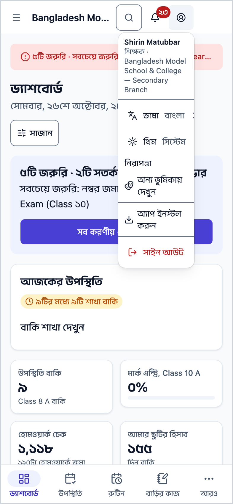

<!-- guide:meta
feature: start.phone
title: ফোনে খোলা ও অ্যাপ হিসেবে ইনস্টল
summary: ফোনের Chrome বা Safari-তে স্কুলের ঠিকানা খুলুন, আর হোম স্ক্রিনে SchoolManager রাখুন, যাতে এক চাপে খোলে।
roles: [ADMIN, EXECUTIVE, TEACHER, ACCOUNTANT, OFFICE_STAFF, EXAM_CONTROLLER, COMMITTEE, PARENT, STUDENT]
sources:
  - client-admin/src/components/staff-user-menu.tsx
  - client-admin/src/pwa/manifest.ts
  - client-admin/src/routes/_staff.tsx
  - ui/src/pwa/use-install-prompt.ts
  - ui/src/pwa/install-prompt-store.ts
  - ui/src/pwa/ios-install-sheet.tsx
  - e2e/pwa/installability.spec.ts
labels: [nav:installPrompt.*, nav:userMenu.label, nav:openMenuLabel, nav:items.more]
helpIds: [start.phone, start.phone.action.install]
devices: [phone]
entry: [public]
keywords: [ফোন, মোবাইল, অ্যাপ, ইনস্টল, হোম স্ক্রিন, ক্রোম, আইফোন, phone, mobile, install app, home screen, Chrome, iPhone, Safari]
appVersion: 0.1.0 (c08a9eb19)
owner: tareq89
lastVerified: 2026-10-24
knownIssues:
  - { id: ios-sheet-old-name, checked: 2026-10-24, issue: 2950 }
-->

# ফোনে খোলা ও অ্যাপ হিসেবে ইনস্টল

ফোনের Chrome বা Safari-তে স্কুলের ঠিকানা খুলুন, আর হোম স্ক্রিনে SchoolManager রাখুন, যাতে এক চাপে খোলে।

**যেতে হবে:** অ্যান্ড্রয়েড ফোনে **Google Chrome**, আইফোনে **Safari**। সাইন ইনের পর উপরে ডান দিকের **অ্যাকাউন্ট মেনু** থেকে **অ্যাপ ইনস্টল করুন**।
**শুরুর আগে:** স্কুলের ঠিকানা (অ্যাডমিন দেন), আর একবার [সাইন ইন করা](sign-in.md)।

SchoolManager ব্রাউজারে চলে; প্লে স্টোর বা অ্যাপ স্টোর থেকে নামাতে হয় না। **ইনস্টল** মানে হোম স্ক্রিনে একটি আইকন রাখা: আইকনে চাপলে ব্রাউজারের ঠিকানার ঘর ছাড়া, পুরো স্ক্রিন জুড়ে অ্যাপটি খোলে।

[অ্যান্ড্রয়েডে ইনস্টল](#task-main) · [আইফোনে ইনস্টল](#task-iphone) · [সমস্যা ও সমাধান](#trouble)

**এই পাতায় যা আছে**

- [এই পাতায় যেভাবে আসবেন](#arrive)
- [অ্যান্ড্রয়েড ফোনে খুলুন ও ইনস্টল করুন](#task-main)
- [ইনস্টল হয়েছে কি না বুঝবেন কীভাবে](#confirm)
- [অন্য পরিস্থিতিতে](#other)
  - [আইফোনে](#task-iphone)
  - [অ্যাপের মেনুতে ইনস্টলের বোতাম না থাকলে](#task-chrome-menu)
  - [ফোনে অ্যাপ চালানো](#task-use)
- [সমস্যা ও সমাধান](#trouble)
- [কে কী করতে পারেন](#roles)
- [জানা সমস্যা](#known-issues)
- [আরও জানুন](#more)

---

## এই পাতায় যেভাবে আসবেন 

**প্রথম দিন:** স্কুল এসএমএস বা ইমেইলে ঠিকানা বা আমন্ত্রণের লিংক পাঠায়। ফোনে লিংকটি খুললে তা ফোনের মূল ব্রাউজারে খোলে। আইফোনে সেটি Safari না হলে ঠিকানাটি কপি করে Safari-তে খুলুন।

**কম্পিউটারে আগে থেকেই ব্যবহার করলে:** একই ঠিকানা ফোনে খুলুন, একই ফোন নম্বর বা ইমেইল দিয়ে [সাইন ইন](sign-in.md) করুন।

---

## অ্যান্ড্রয়েড ফোনে খুলুন ও ইনস্টল করুন 

1. ফোনে **Chrome** খুলুন। উপরের ঠিকানার ঘরে স্কুলের ঠিকানা লিখে খুলুন।

   → **সাইন ইন** পাতা আসে।

2. [সাইন ইন](sign-in.md) করুন।

   → অ্যাপের প্রথম পাতা খোলে। নিচে কয়েকটি বোতাম, উপরে বাম দিকে **☰** (মেনু খুলুন), উপরে ডান দিকে খোঁজার বোতাম, বিজ্ঞপ্তির ঘণ্টা আর **অ্যাকাউন্ট মেনু**।

3. উপরে ডান দিকের **অ্যাকাউন্ট মেনু** (মানুষের ছবির গোল বোতাম) চাপুন।

   → মেনু খোলে। নিচের দিকে **অ্যাপ ইনস্টল করুন** থাকে।

4. **অ্যাপ ইনস্টল করুন** চাপুন।

   → Chrome নিজের একটি ছোট জানালা দেখায়, ইনস্টল করবেন কি না জানতে চায়।

5. Chrome-এর জানালায় **ইনস্টল** (বা **Install**) চাপুন।

   → কয়েক সেকেন্ডে হোম স্ক্রিনে **SchoolManager** আইকন আসে।

<!-- image pending: img/phone-02-chrome-dialog.png (width 300) — Chrome-এর ইনস্টল জানালা। Playwright Chrome-এর নিজের জানালা ধরতে পারে না; আসল ফোন বা অ্যান্ড্রয়েড এমুলেটর থেকে নিতে হবে -->

> **মনে রাখুন:** ইনস্টল শুধু এই ফোনে আইকন রাখে। আপনার তথ্য স্কুলের সিস্টেমেই থাকে; আইকন মুছলে কিছু হারায় না, আবার Chrome-এ ঠিকানা খুলে কাজ করা যায়।

---

## ইনস্টল হয়েছে কি না বুঝবেন কীভাবে 

ইনস্টল স্কুলের সিস্টেমে কিছু জমা দেয় না, তাই এখানে তিন অবস্থার তালিকা নেই। ইনস্টল হলে:

- হোম স্ক্রিনে (বা সব অ্যাপের তালিকায়) **SchoolManager** আইকন থাকে।
- আইকনে চাপলে অ্যাপ পুরো স্ক্রিনে খোলে; উপরে ব্রাউজারের ঠিকানার ঘর থাকে না।
- ইনস্টল করা অ্যাপে **অ্যাকাউন্ট মেনু**তে আর **অ্যাপ ইনস্টল করুন** দেখায় না।

**যাচাই করতে চাইলে:** হোম স্ক্রিনের আইকন থেকে অ্যাপটি খুলুন, আর **অ্যাকাউন্ট মেনু**তে আপনার নাম দেখুন। সাইন ইন চাইলে আরেকবার [সাইন ইন](sign-in.md) করুন।

**আইকন না এলে:** [সমস্যা ও সমাধান](#trouble) দেখুন।

---

## অন্য পরিস্থিতিতে 

### আইফোনে 

আইফোনে ইনস্টলের জানালা নেই; শেয়ার বোতাম দিয়ে হোম স্ক্রিনে রাখতে হয়।

1. **Safari**-তে স্কুলের ঠিকানা খুলে [সাইন ইন](sign-in.md) করুন।
2. **অ্যাকাউন্ট মেনু** চাপুন, তারপর **অ্যাপ ইনস্টল করুন** চাপুন।

   → **এই অ্যাপটি ইনস্টল করুন** লেখা একটি কার্ড আসে, দুটি ধাপ সহ।

3. Safari-এর টুলবারে **শেয়ার** বোতাম (উপরের দিকে তীর-চিহ্ন দেওয়া বাক্স) চাপুন।
4. তালিকা থেকে **হোম স্ক্রিনে যোগ করুন** (**Add to Home Screen**) চাপুন, তারপর উপরে ডান দিকে **যোগ করুন** (**Add**) চাপুন।

   → হোম স্ক্রিনে **SchoolManager** আইকন আসে।

<!-- image pending: img/phone-03-iphone-share.png (width 300) — Safari-এর শেয়ার তালিকায় Add to Home Screen। আসল আইফোন থেকে নিতে হবে -->

**আইফোনে Chrome ব্যবহার করলে:** অ্যাপের মেনুতে **অ্যাপ ইনস্টল করুন** দেখায় না। Chrome-এর ঠিকানার ঘরের পাশের **শেয়ার** বোতাম চেপে **হোম স্ক্রিনে যোগ করুন** (**Add to Home Screen**) বেছে নিন।

### অ্যাপের মেনুতে ইনস্টলের বোতাম না থাকলে 

**অ্যাপ ইনস্টল করুন** তখনই দেখায়, যখন ব্রাউজার ইনস্টলের সুযোগ দেয়। না দেখালে Chrome-এর নিজের মেনু থেকে করুন:

1. Chrome-এ উপরে ডান দিকের **⋮** চাপুন।
2. **অ্যাপ ইনস্টল করুন** (**Install app**) চাপুন। কোনো কোনো ফোনে এর নাম **হোম স্ক্রিনে যোগ করুন** (**Add to Home screen**)।
3. যে জানালা আসে, সেখানে **ইনস্টল** বা **যোগ করুন** চাপুন।

   → হোম স্ক্রিনে **SchoolManager** আইকন আসে।

Chrome-এর মেনুতেও না থাকলে অ্যাপটি সম্ভবত আগেই ইনস্টল করা আছে; সব অ্যাপের তালিকায় **SchoolManager** খুঁজুন।

**শুধু বুকমার্ক রাখতে চাইলে:** Chrome-এর **⋮** চেপে উপরের **☆** চাপুন। পরের বার Chrome-এর বুকমার্ক থেকে খুলতে পারবেন।

### ফোনে অ্যাপ চালানো 

ফোনে বাম দিকের মেনু লুকানো থাকে। কাজের জায়গা:

| যা খুঁজছেন          | ফোনে কোথায়                                                                                    |
| ------------------- | ---------------------------------------------------------------------------------------------- |
| প্রতিদিনের পাতা     | স্ক্রিনের নিচের বোতামগুলো; বাকিগুলো **আরও**-তে                                                 |
| পুরো মেনু           | উপরে বাম দিকে **☰**                                                                           |
| কোনো পাতা খোঁজা     | উপরে ডান দিকের খোঁজার বোতাম ([যেকোনো পাতা খুঁজে পাওয়া](find-anything.md))                     |
| ভাষা, থিম, সাইন আউট | উপরে ডান দিকে **অ্যাকাউন্ট মেনু** ([ভাষা বদলানো](language.md), [নিজের অ্যাকাউন্ট](account.md)) |

---

## সমস্যা ও সমাধান 

| আপনি যা দেখছেন                          | কী করবেন                                                                                                   | কে সাহায্য করতে পারেন |
| --------------------------------------- | ---------------------------------------------------------------------------------------------------------- | --------------------- |
| মেনুতে **অ্যাপ ইনস্টল করুন** নেই        | অ্যাপ হয়তো আগেই ইনস্টল করা, বা ব্রাউজার এখনো সুযোগ দেয়নি। [Chrome-এর মেনু থেকে করুন](#task-chrome-menu)। | —                     |
| আইফোনে মেনুতে **অ্যাপ ইনস্টল করুন** নেই | আপনি Chrome বা অন্য ব্রাউজারে আছেন। [শেয়ার বোতাম দিয়ে করুন](#task-iphone), বা Safari-তে খুলুন।           | —                     |
| আইকন থেকে খুললে আবার সাইন ইন চাইছে      | ইনস্টল করা অ্যাপ ব্রাউজার থেকে আলাদা খুলতে পারে। আরেকবার [সাইন ইন](sign-in.md) করুন।                       | —                     |
| ঠিকানা খুলছে না                         | ঠিকানাটি অ্যাডমিনের পাঠানো লেখার সাথে মিলিয়ে নিন, আর ইন্টারনেট দেখুন।                                     | স্কুলের অ্যাডমিন      |

এ নিয়ে আরও সাহায্য: [সমস্যা হলে কী করবেন](../help/troubleshooting.md#phone)।

---

## কে কী করতে পারেন 

| ভূমিকা    | ফোনে খুলতে পারেন | ইনস্টল করতে পারেন |
| --------- | ---------------- | ----------------- |
| সব ভূমিকা | হ্যাঁ            | হ্যাঁ             |

শিক্ষক ও কর্মীরা ফোনে কর্মীদের অ্যাপ পান, অভিভাবক ও শিক্ষার্থীরা পোর্টাল। ইনস্টলের ধাপ দুটিতেই এক।

---

## জানা সমস্যা 

সংস্করণ ০.১.০-এ যাচাই করা, ২০২৬-১০-২৪। ঠিক হলে এই অংশ থেকে সরিয়ে দেওয়া হবে।

| সমস্যা                                                                                    | কার, কখন                  | তথ্য সংরক্ষিত? | আপাতত কী করবেন                                               |
| ----------------------------------------------------------------------------------------- | ------------------------- | -------------- | ------------------------------------------------------------ |
| আইফোনের **এই অ্যাপটি ইনস্টল করুন** কার্ডে অ্যাপের নাম "বিদ্যালয়" লেখা, SchoolManager নয় | আইফোনে Safari ব্যবহারকারী | প্রযোজ্য নয়   | কিছু করতে হবে না। হোম স্ক্রিনের আইকনে নাম **SchoolManager**। |

---

## আরও জানুন 

<strong>ইনস্টল কীভাবে কাজ করে</strong> — কোন ফোনে কোন পথ

<figure>
  
</figure>

- অ্যান্ড্রয়েডে Chrome ইনস্টলের জানালা দেয়; অ্যাপের মেনু সেই জানালাই খোলে।
- আইফোনে জানালা নেই; Safari বা Chrome-এর **শেয়ার** থেকে **হোম স্ক্রিনে যোগ করুন**।
- ইনস্টল করা অ্যাপ আর ব্রাউজারের ঠিকানা একই অ্যাপ; তথ্য একই জায়গায়।

**সম্পর্কিত পাতা**

- [**সাইন ইন করা**](sign-in.md) — ফোনে প্রথমবার ঢোকা।
- [**ভাষা বদলানো**](language.md) — ফোনে ভাষা অ্যাকাউন্ট মেনুতে।
- [**নিজের অ্যাকাউন্ট**](account.md) — হারানো ফোন থেকে সাইন আউট।
- [**যেকোনো পাতা খুঁজে পাওয়া**](find-anything.md) — ফোনে খোঁজার বোতাম।

---

_সংস্করণ ০.১.০ · শেষ যাচাই ২০২৬-১০-২৪_
