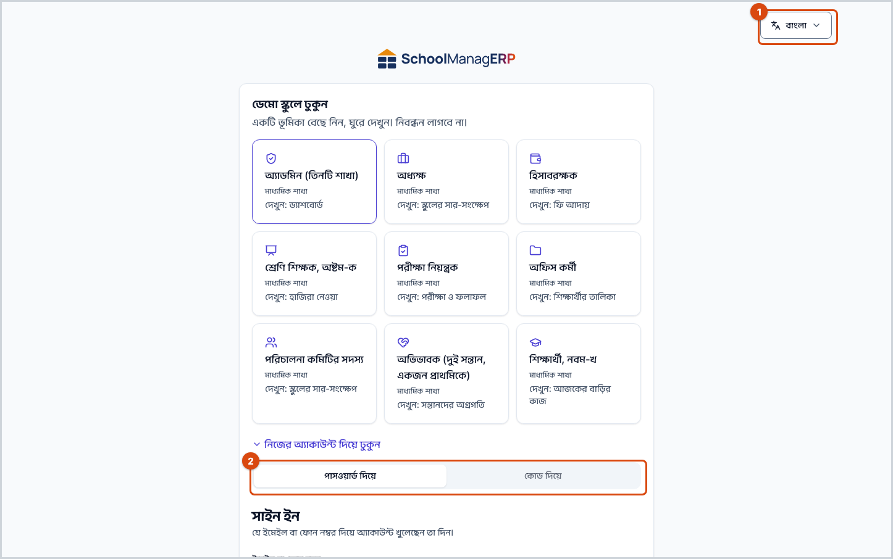
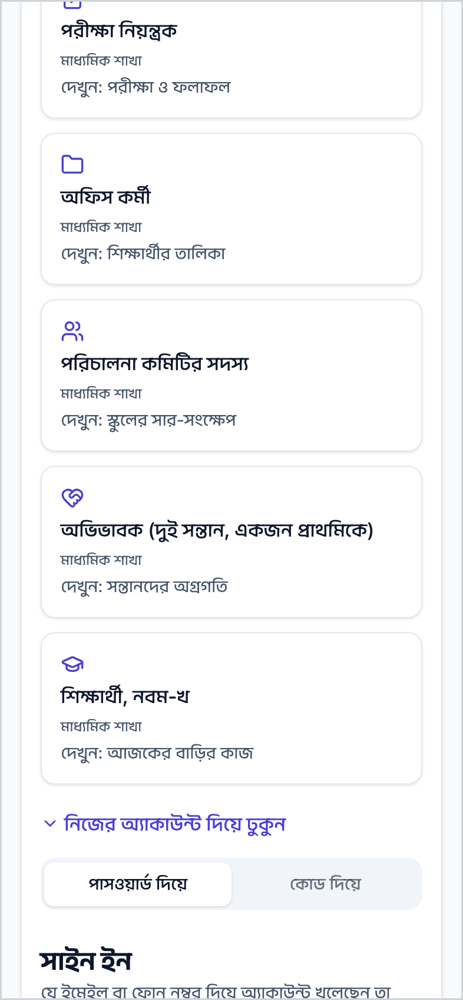

<!-- guide:meta
feature: start.signIn
title: সাইন ইন করা
summary: ফোন নম্বর বা ইমেইল দিয়ে SchoolManager-এ ঢুকুন, প্রথমবার পাসওয়ার্ড দিন, আর ভুলে গেলে নতুন পাসওয়ার্ড নিন।
roles: [ADMIN, EXECUTIVE, TEACHER, ACCOUNTANT, OFFICE_STAFF, EXAM_CONTROLLER, COMMITTEE, PARENT, STUDENT]
sources:
  - client-admin/src/routes/login.tsx
  - client-admin/src/routes/activate.tsx
  - client-admin/src/routes/forgot-password.tsx
  - client-admin/src/routes/reset-password.tsx
  - client-admin/src/routes/select-school.tsx
  - client-admin/src/features/first-password/first-password-step.tsx
  - client-admin/src/features/demo/test-environment-notice.tsx
  - ui/src/components/otp-sign-in-form.tsx
  - ui/src/components/set-password-form.tsx
  - ui/src/components/school-picker.tsx
  - shared/src/auth/password-rules.ts
labels:
  [
    auth:heading,
    auth:identifier.*,
    auth:password.*,
    auth:submit.*,
    auth:errors.*,
    auth:tabs.*,
    auth:otp.*,
    auth:login.*,
    auth:firstPassword.*,
    auth:setPassword.*,
    auth:passwordRules.*,
    auth:activate.*,
    auth:forgot.*,
    auth:help.*,
    demo:testInbox.*,
    auth:reset.*,
    auth:schoolPicker.*,
    auth:selectSchool.*,
    nav:userMenu.signOut,
    nav:tenantBar.switchSchoolOrRole,
  ]
helpIds: [start.signIn, start.signIn.action.submit, start.signIn.field.identifier]
devices: [desktop, phone]
entry: [public]
keywords: [সাইন ইন, লগইন, পাসওয়ার্ড, কোড, ওটিপি, পাসওয়ার্ড ভুলে গেছি, sign in, login, password, OTP, forgot password]
appVersion: 0.1.0 (c08a9eb19)
owner: tareq89
lastVerified: 2026-10-24
knownIssues: []
-->

# সাইন ইন করা

ফোন নম্বর বা ইমেইল দিয়ে SchoolManager-এ ঢুকুন, প্রথমবার পাসওয়ার্ড দিন, আর ভুলে গেলে নতুন পাসওয়ার্ড নিন।

**যেতে হবে:** স্কুলের দেওয়া ঠিকানাটি ব্রাউজারে খুলুন। সাইন ইন করা না থাকলে **সাইন ইন** পাতাই প্রথমে আসে।
**শুরুর আগে:** স্কুলের অ্যাডমিন আপনাকে অ্যাপে যোগ করেছেন, আর আপনার ফোন নম্বর বা ইমেইল স্কুলের কাছে আছে। না থাকলে অ্যাডমিনকে বলুন।

যে ফোন নম্বর বা ইমেইল দিয়ে স্কুল আপনাকে যোগ করেছে, সেটিই আপনার **অ্যাকাউন্ট**। একই অ্যাকাউন্ট দিয়ে কম্পিউটার আর ফোন, দুই জায়গাতেই ঢোকা যায়।

[পাসওয়ার্ড দিয়ে সাইন ইন](#task-main) · [প্রথমবার, কোড দিয়ে](#task-code) · [পাসওয়ার্ড ভুলে গেলে](#task-forgot) · [সমস্যা ও সমাধান](#trouble)

**এই পাতায় যা আছে**

- [এই পাতায় যেভাবে আসবেন](#arrive)
- [পাসওয়ার্ড দিয়ে সাইন ইন করুন](#task-main)
- [সাইন ইন হয়েছে কি না বুঝবেন কীভাবে](#confirm)
- [অন্য পরিস্থিতিতে](#other)
  - [প্রথমবার, বা পাসওয়ার্ড ছাড়া: কোড দিয়ে সাইন ইন](#task-code)
  - [আমন্ত্রণের লিংক পেলে](#task-invite)
  - [পাসওয়ার্ড ভুলে গেলে](#task-forgot)
  - [একাধিক স্কুলে থাকলে](#task-school)
  - [গুগল বা ফেসবুক দিয়ে](#task-social)
- [সমস্যা ও সমাধান](#trouble)
- [কে কী করতে পারেন](#roles)
- [আরও জানুন](#more)

---

## এই পাতায় যেভাবে আসবেন 

**ব্রাউজার থেকে:** স্কুলের ঠিকানা খুললে সাইন ইন পাতা আসে। অন্য কোনো পাতার লিংক খুললেও আগে সাইন ইন পাতা আসে; সাইন ইন করার পর অ্যাপ আপনাকে সেই পাতাতেই নিয়ে যায়।

**আমন্ত্রণের এসএমএস বা ইমেইল থেকে:** স্কুল আপনাকে যোগ করলে একটি লিংক পাঠায়। লিংকে চাপুন, তারপর [আমন্ত্রণের লিংক পেলে](#task-invite) দেখুন।

**সাইন আউট করার পর:** অ্যাকাউন্ট মেনুর **সাইন আউট** চাপলে আবার এই পাতা আসে ([নিজের অ্যাকাউন্ট](account.md))।

---

## পাসওয়ার্ড দিয়ে সাইন ইন করুন 

1. স্কুলের ঠিকানাটি ব্রাউজারে খুলুন।

   → **সাইন ইন** পাতা আসবে। উপরে দুটি ট্যাব: **পাসওয়ার্ড দিয়ে** আর **কোড দিয়ে**। **পাসওয়ার্ড দিয়ে** আগে থেকেই বেছে নেওয়া থাকে।

2. **ইমেইল বা ফোন নম্বর** ঘরে আপনার ফোন নম্বর (যেমন `01712345678`) বা ইমেইল লিখুন।
3. **পাসওয়ার্ড** ঘরে পাসওয়ার্ড লিখুন। ঠিক লিখেছেন কি না দেখতে ঘরের পাশের **পাসওয়ার্ড দেখান** চাপুন।
4. **সাইন ইন করুন** চাপুন।

   → অ্যাপের প্রথম পাতা খোলে: শিক্ষক ও কর্মীদের জন্য **ড্যাশবোর্ড**, অভিভাবক ও শিক্ষার্থীদের জন্য পোর্টাল। একাধিক স্কুলে থাকলে আগে **স্কুল নির্বাচন করুন** পাতা আসে ([একাধিক স্কুলে থাকলে](#task-school))।

**ফোনে** একই চার ধাপ। পাতাটি পুরো স্ক্রিন জুড়ে দেখায়; ভাষা বদলানোর বোতাম উপরে ডান দিকে।

> **মনে রাখুন:** স্কুলের বা অন্যের কম্পিউটারে কাজ শেষ হলে অ্যাকাউন্ট মেনু থেকে **সাইন আউট** চাপুন। না চাপলে পরের জন আপনার অ্যাকাউন্টে থেকে যেতে পারেন।

---

## সাইন ইন হয়েছে কি না বুঝবেন কীভাবে 

সাইন ইন কিছু জমা দেয় না, তাই এখানে তিন অবস্থার তালিকা নেই। সাইন ইন হলে:

- সাইন ইন পাতা চলে যায়, আর অ্যাপের প্রথম পাতা খোলে।
- উপরে ডান দিকের **অ্যাকাউন্ট মেনু** (মানুষের ছবির গোল বোতাম) চাপলে সবার উপরে আপনার নাম, তার নিচে আপনার ভূমিকা আর স্কুলের নাম দেখা যায়।

**যাচাই করতে চাইলে:** অ্যাকাউন্ট মেনুতে নাম আর স্কুল মিলিয়ে নিন। ভুল স্কুল দেখালে [একাধিক স্কুলে থাকলে](#task-school) দেখুন।

**সাইন ইন পাতা থেকে না সরলে:** ঘরের নিচে বা উপরে একটি লাল বার্তা থাকে। [সমস্যা ও সমাধান](#trouble)-এ সেই বার্তাটি খুঁজুন। আপনার লেখা ইমেইল বা ফোন নম্বর ঘরে থেকে যায়।

---

## অন্য পরিস্থিতিতে 

### প্রথমবার, বা পাসওয়ার্ড ছাড়া: কোড দিয়ে সাইন ইন 

পাসওয়ার্ড না থাকলে বা মনে না পড়লে ফোন বা ইমেইলে আসা কোড দিয়ে ঢোকা যায়।

1. **সাইন ইন** পাতায় **কোড দিয়ে** ট্যাব চাপুন। (অথবা **পাসওয়ার্ড দিয়ে** ট্যাবের নিচে **প্রথমবার এসেছেন? কোড দিয়ে সাইন ইন করুন** চাপুন।)
2. **মোবাইল নম্বর বা ইমেইল** ঘরে নম্বর বা ইমেইল লিখে **কোড পাঠান** চাপুন।

   → **কোড লিখুন** পাতা আসে। নম্বর বা ইমেইলটি কোনো অ্যাকাউন্টে থাকলে সেখানে একটি ৬-সংখ্যার কোড যায়।

3. **৬-সংখ্যার কোড** ঘরে কোডটি লিখে **সাইন ইন করুন** চাপুন।

   → এই প্রথম কোড দিয়ে ঢুকলে **একটি পাসওয়ার্ড দিন** কার্ড আসে (নিচে দেখুন)। আগে পাসওয়ার্ড দেওয়া থাকলে সোজা অ্যাপের প্রথম পাতা খোলে।

কোড না এলে ৬০ সেকেন্ড পর **কোড আবার পাঠান** চাপা যায়। ভুল নম্বর দিলে **অন্য নম্বর বা ইমেইল ব্যবহার করুন** চাপুন।

**একটি পাসওয়ার্ড দিন** কার্ডে **নতুন পাসওয়ার্ড** আর **পাসওয়ার্ড নিশ্চিত করুন** ঘরে একই পাসওয়ার্ড লিখুন। ঘরের নিচে নিয়মগুলো দেখায়; সব নিয়ম মিললে তবেই **পাসওয়ার্ড সেট করুন** চাপা যায়।

| কার জন্য                | পাসওয়ার্ডের নিয়ম                                                                                                |
| ----------------------- | ----------------------------------------------------------------------------------------------------------------- |
| শিক্ষক, কর্মী, অ্যাডমিন | কমপক্ষে ৮টি অক্ষর, একটি বড় হাতের ইংরেজি অক্ষর (A-Z), একটি ছোট হাতের (a-z), একটি সংখ্যা, একটি চিহ্ন (যেমন ! বা @) |
| অভিভাবক ও শিক্ষার্থী    | কমপক্ষে ৮টি অক্ষর আর একটি সংখ্যা                                                                                  |

| আপনি চাপলেন                                             | কী হবে                                                                                   | পাসওয়ার্ড জমা হলো? |
| ------------------------------------------------------- | ---------------------------------------------------------------------------------------- | ------------------- |
| **পাসওয়ার্ড সেট করুন**                                 | পাসওয়ার্ড জমা হয়, অ্যাপের প্রথম পাতা খোলে। পরের বার **পাসওয়ার্ড দিয়ে** ঢুকতে পারবেন। | হ্যাঁ               |
| **এখন থাক** (শুধু অভিভাবক ও শিক্ষার্থী)                 | পাসওয়ার্ড ছাড়াই অ্যাপ খোলে। পরের বারও কোড দিয়ে ঢুকতে হবে।                             | না                  |
| **অন্য অ্যাকাউন্টে সাইন ইন করুন** (শুধু শিক্ষক ও কর্মী) | সাইন আউট হয়ে সাইন ইন পাতায় ফেরে। অন্যের অ্যাকাউন্টে ভুল করে ঢুকলে এটি চাপুন।           | না                  |

শিক্ষক ও কর্মীদের পাসওয়ার্ড দিতেই হয়: পাতা রিলোড করলে বা নতুন ট্যাব খুললেও এই কার্ড ফিরে আসে, যতক্ষণ না পাসওয়ার্ড দেন। ব্যতিক্রম: অ্যাকাউন্টে গুগল বা ফেসবুক যুক্ত থাকলে পাসওয়ার্ড বাধ্যতামূলক নয়।

### আমন্ত্রণের লিংক পেলে 

1. এসএমএস বা ইমেইলের লিংকে চাপুন।

   → **আপনার লিংক যাচাই করা হচ্ছে…** দেখায়, তারপর **স্বাগতম, (আপনার নাম) — (স্কুলের নাম)** লেখা কার্ড আসে।

2. **নতুন পাসওয়ার্ড** আর **পাসওয়ার্ড নিশ্চিত করুন** ঘরে একই পাসওয়ার্ড লিখুন (নিয়ম উপরের টেবিলে)।
3. **পাসওয়ার্ড সেট করুন** চাপুন।

   → অ্যাকাউন্ট চালু হয়, আর অ্যাপের প্রথম পাতা খোলে। পরের বার থেকে [পাসওয়ার্ড দিয়ে সাইন ইন করুন](#task-main)।

লিংকে সমস্যা হলে কার্ডে কারণ লেখা থাকে: **এই লিংকের মেয়াদ শেষ হয়ে গেছে।**, **এই লিংকটি ইতিমধ্যে ব্যবহার করা হয়েছে।**, **এই লিংকটি আর কার্যকর নয়।** বা **এই লিংকটি সঠিক নয়।** তখন নিচের **ইমেইল বা ফোন নম্বর** ঘরে নম্বর বা ইমেইল লিখে **নতুন লিংক পাঠান** চাপুন, অথবা যিনি আমন্ত্রণ পাঠিয়েছেন তাঁর কাছে নতুন লিংক চান।

### পাসওয়ার্ড ভুলে গেলে 

1. **সাইন ইন** পাতায় **পাসওয়ার্ড ভুলে গেছেন?** চাপুন।
2. **ইমেইল বা ফোন নম্বর** ঘরে লিখে **কোড বা লিংক পাঠান** চাপুন।

   → ফোন নম্বর দিলে **কোড লিখুন** পাতা আসে। ইমেইল দিলে **সেই ইমেইলে অ্যাকাউন্ট থাকলে একটি রিসেট লিংক পাঠানো হয়েছে।** দেখায়।

3. **ফোনে কোড এলে:** **৬-সংখ্যার কোড** ঘরে লিখে **চালিয়ে যান** চাপুন। **ইমেইলে লিংক এলে:** লিংকে চাপুন।

   → **নতুন পাসওয়ার্ড দিন** পাতা আসে।

4. **নতুন পাসওয়ার্ড** আর **পাসওয়ার্ড নিশ্চিত করুন** ঘরে লিখে **পাসওয়ার্ড সেট করুন** চাপুন।

   → নতুন পাসওয়ার্ড জমা হয়, আর আপনি সাইন ইন অবস্থায় অ্যাপের প্রথম পাতায় পৌঁছান। আলাদা করে আবার সাইন ইন করতে হয় না।

কোড ভুল হলে বা মেয়াদ পার হলে **কোডটি ভুল অথবা মেয়াদ শেষ হয়ে গেছে।** দেখায়, আর কোড লেখার পাতায় ফিরিয়ে নেয়। ইমেইলের লিংক কাজ না করলে **এই লিংকের মেয়াদ শেষ হয়ে গেছে অথবা ইতিমধ্যে ব্যবহার করা হয়েছে।** দেখায়; **নতুন লিংক চান** চেপে আবার শুরু করুন।

### একাধিক স্কুলে থাকলে 

একই অ্যাকাউন্ট দুই বা তার বেশি স্কুলে (বা একই স্কুলে দুই ভূমিকায়) থাকলে সাইন ইনের পর **স্কুল নির্বাচন করুন** পাতা আসে।

1. যে স্কুলে এখন কাজ করবেন, তার কার্ডে চাপুন। কার্ডে স্কুলের নাম আর আপনার ভূমিকা লেখা থাকে।
2. **চালিয়ে যান** চাপুন।

   → সেই স্কুলের প্রথম পাতা খোলে।

পরে স্কুল বদলাতে: অ্যাকাউন্ট মেনুতে **স্কুল বা ভূমিকা পরিবর্তন করুন** চাপুন ([নিজের অ্যাকাউন্ট](account.md))। ভুল অ্যাকাউন্টে ঢুকলে পাতার নিচে **অন্য অ্যাকাউন্টে সাইন ইন করুন** চাপুন।

কোনো স্কুলের আমন্ত্রণ অপেক্ষায় থাকলে এই পাতার উপরেই **স্কুলের আমন্ত্রণ** কার্ড দেখায়; সেখান থেকে **গ্রহণ করুন** বা **বাতিল করুন** চাপা যায়।

### গুগল বা ফেসবুক দিয়ে 

স্কুল চালু করলে সাইন ইন পাতার উপরে **গুগল দিয়ে চালিয়ে যান** বা **ফেসবুক দিয়ে চালিয়ে যান** বোতাম থাকে। বোতাম না থাকলে আপনার স্কুলে এটি চালু নেই; পাসওয়ার্ড বা কোড দিয়ে ঢুকুন।

এই বোতাম শুধু তখনই কাজ করে, যখন গুগল বা ফেসবুক অ্যাকাউন্টটি আগে থেকে আপনার SchoolManager অ্যাকাউন্টে যুক্ত। যুক্ত না থাকলে সাইন ইন পাতায় ফিরে লেখা আসে **এই অ্যাকাউন্টটি এখনো যুক্ত করা হয়নি। কোড দিয়ে সাইন ইন করুন, তারপর আপনার অ্যাকাউন্ট পেজ থেকে যুক্ত করুন।** যুক্ত করার ধাপ [নিজের অ্যাকাউন্ট](account.md) পাতায়।

---

### ডেমো সাইটে কোড ও বার্তা কোথায় যায়? 

ডেমো সাইট ও স্টেজিং সাইটে আসলে কিছুই পাঠানো হয় না। কোনো ফোন বা ইমেইলে কোড যায় না। সব কোড ও বার্তা জমা হয় **টেস্ট ইনবক্সে**। প্রতিটি পাতার ওপরে একটি চিকন বার সেটা জানিয়ে দেয়।

1. যেমন করেন তেমনই কোড চান: **মোবাইল নম্বর বা ইমেইল** ঘরে নম্বর লিখে **কোড পাঠান** চাপুন।
2. পাতার ওপরের বারে, অথবা কোডের ঘরের নিচের লাইনে, **টেস্ট ইনবক্স খুলুন** চাপুন।

   → নতুন ট্যাবে টেস্ট ইনবক্স খোলে। সবচেয়ে নতুন বার্তা থাকে সবার ওপরে।

3. বার্তা থেকে ৬-সংখ্যার কোডটি দেখে আগের ট্যাবে ফিরে **৬-সংখ্যার কোড** ঘরে লিখুন এবং **সাইন ইন** চাপুন।

বারটি বিরক্ত করলে **লুকান** চাপুন। সেটি ওপরে ছোট একটি বোতাম হয়ে থাকে, যা চাপলে এখনও টেস্ট ইনবক্স খোলে। সাধারণ স্কুলের সাইটে এই বার বা টেস্ট ইনবক্স থাকে না, কোড সত্যিকারের ফোন বা ইমেইলে যায়।

---

## সমস্যা ও সমাধান 

| আপনি যা দেখছেন                                                                        | কী করবেন                                                                                                                               | কে সাহায্য করতে পারেন |
| ------------------------------------------------------------------------------------- | -------------------------------------------------------------------------------------------------------------------------------------- | --------------------- |
| **ইমেইল/ফোন অথবা পাসওয়ার্ড সঠিক নয়।**                                               | নম্বর বা ইমেইল আর পাসওয়ার্ড আবার দেখে লিখুন। মনে না পড়লে [পাসওয়ার্ড ভুলে গেলে](#task-forgot)।                                       | —                     |
| **সঠিক ইমেইল অথবা ১১ সংখ্যার ফোন নম্বর দিন।**                                         | ফোন নম্বর ০ দিয়ে শুরু করে পুরো ১১ সংখ্যা লিখুন, যেমন `01712345678`।                                                                   | —                     |
| **অনেকবার চেষ্টা করা হয়েছে। … সেকেন্ড পর আবার চেষ্টা করুন।**                         | বার্তায় লেখা সময় অপেক্ষা করে আবার চেষ্টা করুন।                                                                                       | —                     |
| **এই অ্যাকাউন্ট কোনো স্কুলের সাথে যুক্ত নেই। …**                                      | অ্যাকাউন্ট আছে, কিন্তু কোনো স্কুলে যোগ করা নেই।                                                                                        | স্কুলের অ্যাডমিন      |
| **আপনি এখনো কোনো স্কুলে নেই**                                                         | একই কারণ। অ্যাডমিনকে বলুন আপনাকে যোগ করতে।                                                                                             | স্কুলের অ্যাডমিন      |
| **নম্বর, ইমেইল অথবা কোডটি সঠিক নয়।**                                                 | কোডটি আবার দেখে লিখুন। না মিললে **কোড আবার পাঠান** চেপে নতুন কোড নিন।                                                                  | —                     |
| কোড আসছে না                                                                           | নম্বরটি ঠিক কি না দেখুন। কয়েকবার চেষ্টার পরও না এলে এক ঘণ্টা পরে আবার চেষ্টা করুন। ইমেইলে স্প্যাম ফোল্ডার দেখুন।                      | স্কুলের অ্যাডমিন      |
| **এই অ্যাকাউন্টটি স্থগিত করা হয়েছে।** (শুধু আমন্ত্রণ-লিংক খুললে যে পাতা আসে, সেখানে) | স্কুল আপনার অ্যাকাউন্ট বন্ধ রেখেছে, তাই আমন্ত্রণটি কাজে লাগানো যাবে না। স্কুলের অফিসে যোগাযোগ করুন। সাইন ইনের পাতায় এই বার্তা আসে না। | স্কুলের অ্যাডমিন      |
| **এই লিংকের মেয়াদ শেষ হয়ে গেছে।**                                                   | আমন্ত্রণের লিংক হলে [আমন্ত্রণের লিংক পেলে](#task-invite), রিসেটের লিংক হলে [পাসওয়ার্ড ভুলে গেলে](#task-forgot)।                       | স্কুলের অ্যাডমিন      |
| **পাসওয়ার্ড সেট করুন** চাপা যাচ্ছে না                                                | ঘরের নিচের নিয়মগুলোর সব মেলেনি, বা দুই ঘরের পাসওয়ার্ড মেলেনি (**পাসওয়ার্ড দুটি মিলছে না।**)।                                        | —                     |
| **আরও ছোট পাসওয়ার্ড দিন — সর্বোচ্চ ৭২টি ইংরেজি অক্ষর বা ২৪টি বাংলা অক্ষর।**          | পাসওয়ার্ডটি ছোট করুন।                                                                                                                 | —                     |
| **কিছু একটা ভুল হয়েছে। আবার চেষ্টা করুন।**                                           | ইন্টারনেট দেখে আবার চেষ্টা করুন। বারবার হলে অ্যাডমিনকে জানান।                                                                          | স্কুলের অ্যাডমিন      |

এ নিয়ে আরও সাহায্য: [সমস্যা হলে কী করবেন](../help/troubleshooting.md#signin)।

---

## কে কী করতে পারেন 

| ভূমিকা                                                                                                     | সাইন ইনের পর কোথায় যান | কোড দিয়ে প্রথমবার ঢুকলে পাসওয়ার্ড              | পাসওয়ার্ডের নিয়ম                          |
| ---------------------------------------------------------------------------------------------------------- | ----------------------- | ------------------------------------------------ | ------------------------------------------- |
| অ্যাডমিন, একাডেমিক কো-অর্ডিনেটর, শিক্ষক, হিসাবরক্ষক, অফিস সহকারী, পরীক্ষা নিয়ন্ত্রক, পরিচালনা পর্ষদ সদস্য | **ড্যাশবোর্ড**          | দিতেই হবে (গুগল বা ফেসবুক যুক্ত থাকলে বাধ্য নয়) | ৮ অক্ষর, বড়-ছোট হাতের অক্ষর, সংখ্যা, চিহ্ন |
| অভিভাবক, শিক্ষার্থী                                                                                        | পোর্টাল                 | ইচ্ছা হলে; **এখন থাক** চেপে পরে দেওয়া যায়      | ৮ অক্ষর আর একটি সংখ্যা                      |

---

## আরও জানুন 

<strong>সাইন ইন কীভাবে কাজ করে</strong> — কোন পথে কোন পাতা আসে

<figure>
  
</figure>

- পাসওয়ার্ড বা কোড, দুই পথেই শেষে একই জায়গা: একটি স্কুল হলে সোজা অ্যাপ, একাধিক হলে **স্কুল নির্বাচন করুন**।
- কোড দিয়ে প্রথমবার ঢুকলে পাসওয়ার্ড চাওয়া হয়; শিক্ষক ও কর্মীদের জন্য তা বাধ্যতামূলক।
- পাসওয়ার্ড রিসেট বা আমন্ত্রণের পর আলাদা করে সাইন ইন লাগে না।

<strong>ঘরগুলোর সংক্ষিপ্ত সাহায্য (? বোতাম)</strong>

<!-- guide:generated:fields:auth -->

| ঘর                 | কী লিখবেন                                                                              | বাধ্যতামূলক? |
| ------------------ | -------------------------------------------------------------------------------------- | ------------ |
| টেস্ট ইনবক্স       | এটি টেস্ট সাইট, তাই কোড আপনার ফোন বা ইমেইলে যাবে না। কোডটি টেস্ট ইনবক্সে পাবেন:        | না           |
| ইমেইল বা ফোন নম্বর | যে ইমেইল বা ১১ সংখ্যার ফোন নম্বর দিয়ে আপনার অ্যাকাউন্ট খোলা হয়েছে, যেমন 01712345678। | হ্যাঁ        |

<!-- /guide:generated -->

**সম্পর্কিত পাতা**

- [**ফোনে খোলা ও অ্যাপ হিসেবে ইনস্টল**](phone.md) — ফোনের ব্রাউজারে ঠিকানা খোলা আর হোম স্ক্রিনে রাখা।
- [**ভাষা বদলানো**](language.md) — সাইন ইন পাতার উপরের ভাষার বোতাম।
- [**নিজের অ্যাকাউন্ট**](account.md) — সাইন আউট, অন্য ডিভাইস থেকে সাইন আউট, গুগল বা ফেসবুক যুক্ত করা।
- [**যেকোনো পাতা খুঁজে পাওয়া**](find-anything.md) — সাইন ইনের পর দ্রুত পাতা খোলা।

---

_সংস্করণ ০.১.০ · শেষ যাচাই ২০২৬-১০-২৪_
