# Welcome to SchoolManager

**Less paperwork, more time for your school.**

Whether you are a head teacher, teacher, accountant or guardian, this guide is for you. It shows how SchoolManager makes your daily work easier, and where to start with your own tasks.

[Who are you?](#who) · [A head teacher's morning](#morning) · [How the dashboard helps](#dashboard) · [How to read this guide](#how-to-read)

---

## Today's headaches 

In many schools the work is still on paper:

- The attendance register, which a teacher fills in by hand every day.
- The fee ledger and receipt book, where finding who paid how much takes time.
- The marks register, where the head teacher has to ask teachers one by one whether marks were submitted.
- Notices, where nobody is sure whether they reached the guardian.

SchoolManager brings these jobs into one place. You don't hunt for registers; the information you need comes to you.

---

## A head teacher's morning 

Say you reach school and open SchoolManager on your phone or computer. After you [sign in](start/sign-in.md), the first page is the **Dashboard**.

1. You see a bar called **Open your to-do list**. It shows how many urgent items, warnings and reminders you have. Tap it and the **Your to-do** list opens. <!-- backs: attention.bar.openLabel, attention.modal.title -->
2. Below it, the **Student attendance today** card shows what share of students came today and which sections still haven't taken attendance. <!-- backs: widget.attendance-today -->
3. The **Teachers and staff** card shows how many staff are present today and how many are on leave. <!-- backs: widget.staff-today -->
4. The **Collection this month** card shows how much of this month's bills has been collected, compared with last month. <!-- backs: widget.collection-month -->
5. The **At-risk students** card names students who have two or more warning signs at once, such as continuous absence. <!-- backs: widget.at-risk-students -->

So without opening a register, you can see how the school is doing and where to look. These cards appear for the Admin and the Academic coordinator; some also appear for the Office staff or the Accountant. Whoever the school gives that role to sees them.

---

## How the dashboard helps 

Each role's dashboard puts that role's most urgent work first. To arrange the cards your own way, use the **Customise** button. <!-- backs: dashboard.page.customise -->

| Role | What comes first on the dashboard |
| ------ | ------ |
| Teacher | **My routine today**, **Attendance left to take** (which sections haven't had attendance taken), **Mark deadlines** (which marks are due, and by when) <!-- backs: widget.my-routine-today, widget.my-pending-sections, widget.my-mark-deadlines --> |
| Accountant | **Collection today**, **Unpaid bills by age**, **Reminders waiting** (fee reminders ready to send) <!-- backs: widget.collection-today, widget.dues-ageing, widget.reminders-pending --> |
| Admin | The state of the school: attendance, staff, collection, mark entry, and the **At-risk students** who need attention <!-- backs: widget.attendance-today, widget.staff-today, widget.collection-month, widget.mark-entry-progress, widget.at-risk-students --> |

### How leaders see whether everyone is using the system 

A school runs well when everyone does their part in the system. So the people who run the school can see these things:

- **Attendance not taken:** if a section's attendance isn't taken on time, the Admin, the Academic coordinator and the teacher concerned get an alert. The **Student attendance today** card also shows which sections are left. <!-- backs: alert attendance.not_taken, widget.attendance-today -->
- **Marks overdue:** the Academic coordinator and the Exam controller can see which section is late submitting marks. If it stays late for a long time, the alert becomes urgent. The **Mark entry** card shows which class is furthest behind. <!-- backs: alert exams.marks_overdue, widget.mark-entry-progress -->
- **Teachers and staff:** who is present today and who is on leave. <!-- backs: widget.staff-today -->

Nobody has to phone around to ask. Everyone's work gets done on time, and the whole school improves steadily.

---

## Your data is safe 

Each school's data is kept separate; one school cannot see another's. A teacher sees only the sections assigned to them. If someone enters a wrong password again and again, sign-in is blocked for a while. If a user is suspended or removed, their current session ends. <!-- backs: docs/architecture/08-security.md rules 2, 8; sign-in lockout and tenant separation: 08-security.md, 02-auth-and-multitenancy.md --> To learn more, see [Signing in](start/sign-in.md).

---

## Works in Bangla, works on your phone 

SchoolManager works in both Bangla and English. To switch, see [Changing the language](start/language.md). There is no separate app to download; open your school's address in your phone's browser, and you can add it to your home screen if you like. See [Opening on a phone and installing as an app](start/phone.md).

---

## Who are you? 

Find your role. Each role will get its own page; for now, open the [Roles](roles/README.md) page.

| You are | What you see first | Your page |
| ---- | ---------------- | ---------- |
| Head teacher / principal (in the Admin or Academic coordinator role) | School attendance, collection and at-risk students <!-- backs: widget.attendance-today, widget.collection-month, widget.at-risk-students --> | [Roles](roles/README.md) <!-- target: roles/admin.md, 42.6.03 --> |
| Teacher | Today's routine, attendance left to take, mark deadlines <!-- backs: widget.my-routine-today, widget.my-pending-sections, widget.my-mark-deadlines --> | [Roles](roles/README.md) <!-- target: roles/teacher.md --> |
| Accountant | Today's collection, unpaid bills by age <!-- backs: widget.collection-today, widget.dues-ageing --> | [Roles](roles/README.md) <!-- target: roles/accountant.md --> |
| Office staff | Admissions today, students added today, incomplete guardian details <!-- backs: widget.admissions-today, widget.students-added-today, widget.guardians-incomplete --> | [Roles](roles/README.md) <!-- target: roles/office-staff.md --> |
| Exam controller | Mark entry, results, seat plans <!-- backs: widget.mark-entry-progress, widget.results-state, widget.seat-plan-status --> | [Roles](roles/README.md) <!-- target: roles/exam-controller.md --> |
| Committee member | Enrolment, attendance, finances, pass rate <!-- backs: widget.committee-enrollment, widget.committee-attendance, widget.committee-finance, widget.committee-pass-rate --> | [Roles](roles/README.md) <!-- target: roles/committee.md --> |
| Parent | You are told if your child is absent today, fees are overdue, or results are published <!-- backs: alert child.absent_today, alert fees.overdue_family, alert results.published --> | [Roles](roles/README.md) <!-- target: roles/parent.md --> |
| Student | Homework due today, an exam tomorrow, results published <!-- backs: alert homework.due_today, alert exams.tomorrow, alert results.published --> | [Roles](roles/README.md) <!-- target: roles/student.md --> |

---

## How to read this guide 

Every page is laid out the same way, so once you have read one, the rest feel easy.

- **Step-by-step instructions.** In each step, the exact words on the screen are in bold, and a line starting with "→" tells you what you will see next.
- **Pictures.** Important steps have a screenshot beside them, with numbered markers.
- **Diagrams.** How a task works is shown in the picture under "Learn more".
- **Word meanings.** If a word is new to you, see the [Glossary](help/glossary.md).

If you can't find a page, see [Finding any page](start/find-anything.md).

<!-- image pending: img/welcome-01-dashboard-admin.png, img/welcome-02-dashboard-teacher.png, img/welcome-phone-01-teacher.png (screenshot capture currently crashes; shot by e2e/docs/tours/welcome.tour.ts) -->

<strong>SchoolManager at a glance</strong>

<strong>A day at school</strong>

## Start here

New to SchoolManager? Open [Getting started](start/README.md).
