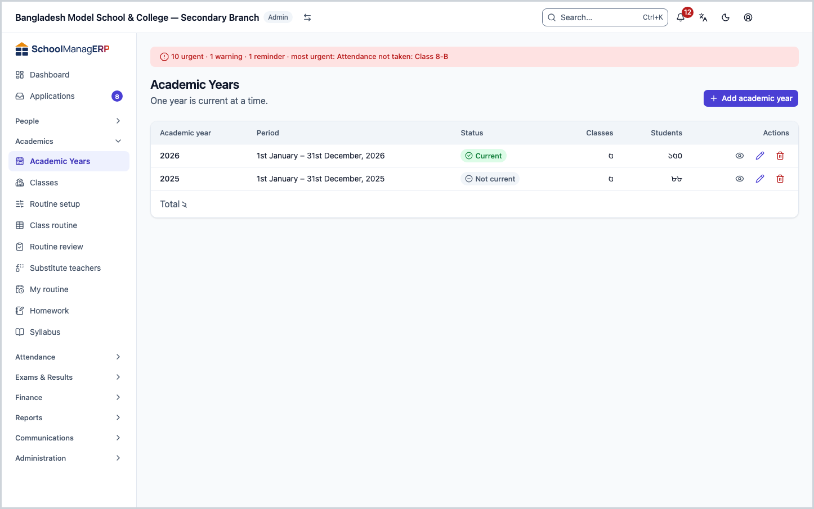
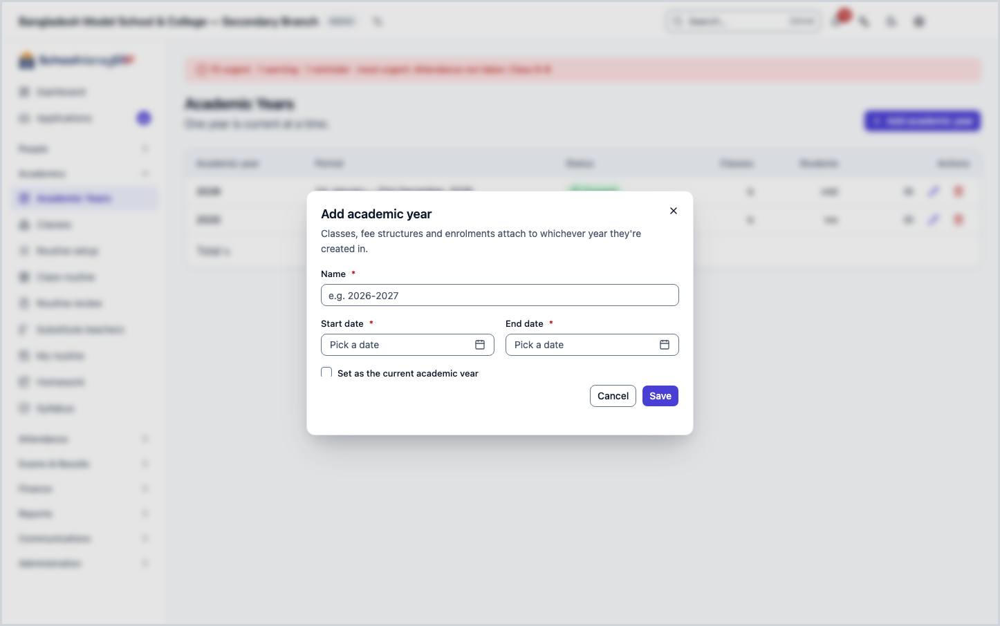

<!-- guide:meta
feature: academics.academicYears
title: Creating and managing academic years
summary: Add academic years, set which one is current, arrange the terms of a year, and delete a year nobody uses.
roles: [ADMIN]
sources:
  - client-admin/src/routes/_staff/academic-years/index.tsx
  - client-admin/src/routes/_staff/academic-years/$academicYearId.tsx
  - client-admin/src/routes/_staff/academic-years/-year-form-dialog.tsx
  - client-admin/src/routes/_staff/academic-years/-set-current-dialog.tsx
  - client-admin/src/routes/_staff/academic-years/-delete-year-dialog.tsx
  - client-admin/src/routes/_staff/academic-years/-detail/terms-tab.tsx
  - client-admin/src/routes/_staff/academic-years/-detail/classes-tab.tsx
  - client-admin/src/routes/_staff/academic-years/-detail/fee-structures-tab.tsx
  - client-admin/src/routes/_staff/academic-years/-detail/tab-query-state.tsx
  - server/src/modules/academics/academic-year.controller.ts
  - server/src/modules/academics/academic-year.service.ts
labels:
  [
    academicYears:list.*,
    academicYears:form.*,
    academicYears:deleteDialog.*,
    academicYears:setCurrentDialog.*,
    academicYears:detail.*,
    nav:items.academicYears,
    nav:groups.academics,
    common:accessDenied.*,
  ]
helpIds:
  [
    academics.academicYears,
    academics.academicYears.action.add,
    academics.academicYears.action.setCurrent,
    academics.academicYears.action.delete,
    academics.academicYears.action.addTerm,
    academics.academicYears.field.isCurrent,
    academics.academicYears.field.dates,
  ]
devices: [desktop]
entry: [sidebar, palette]
keywords:
  [শিক্ষাবর্ষ, সেশন, চলমান বর্ষ, চলতি বছর, টার্ম, সেমিস্টার, নতুন বছর, academic year, session, current year, term, semester]
appVersion: 0.1.0 (1798f8b1f)
owner: tareq89
lastVerified: 2026-10-24
knownIssues: []
-->

# Creating and managing academic years

Add academic years, set which one is running now, arrange the terms of a year, and delete a year you created by mistake.

**Where to go:** in the left menu, **Academics → Academic years**. Do the work on this page on a computer.
**Before you start:** you must be the school Admin ([who can do what](#roles)). Keep the start date and end date of the year ready.

Almost everything in the school lives inside an academic year: [classes](classes.md), fee structures, admissions, exams. Only one year is **current** at a time. When you create a new class or view a list, the app usually picks the current year first. So when a new year begins, remember to make it the current one.

[Add an academic year](#task-main) · [Set the current year](#task-current) · [Arrange terms](#task-terms) · [Delete](#task-delete) · [Problems and fixes](#trouble)

**On this page**

- [How to reach this page](#arrive)
- [Add an academic year](#task-main)
- [How to tell the year was added](#confirm)
- [Other situations](#other)
  - [Change the current academic year](#task-current)
  - [Change the name or dates](#task-edit)
  - [Add and arrange terms](#task-terms)
  - [Delete an academic year](#task-delete)
  - [The year page: the tabs](#task-detail)
- [Problems and fixes](#trouble)
- [Who can do what](#roles)
- [Learn more](#more)

---

## How to reach this page 

**From the left menu:** press **Academics → Academic years**. Start from step 1 below.

**From the search box:** in the search box at the top (Ctrl+K), type **Add academic year** and pick it. → The list of academic years opens, and the **Add academic year** dialog is already open. Start from step 3 below. Search rules: [Finding any page](../start/find-anything.md).

---

## Add an academic year 

1. In the left menu, press **Academics → Academic years**.

   → At the top is the title **Academic Years**, and below it "One year is current at a time." The list columns are: **Academic year**, **Period**, **Status**, **Classes**, **Students**. If there is no year yet, it says **No academic years yet**, with an **Add the first academic year** button.

2. At the top of the page, press **Add academic year**.

   → The **Add academic year** dialog opens: "Classes, fee structures and enrolments attach to whichever year they're created in."

3. In the **Name** field, type the name of the year, for example `2026-2027` or `2027`.

   → If you leave it empty, it shows **Name is required**.

4. Pick the **Start date** and the **End date**.

   → Both are needed; without them it shows **Start and end dates are required**. If the end date is not after the start date, it shows **End date must be after the start date**.

5. If this year is the one running now, tick **Set as the current academic year**.

   → A warning appears under the box: whichever year is current now will no longer be current. Press **Yes, set as current** and the tick is set; press **Cancel** and the tick is not set.

6. Press **Save**.

   → The dialog closes and the new year appears in the list. If you ticked the box, its **Status** cell shows the current mark, and the mark disappears from the year that was current before.

> **Remember:** creating a year does not create classes. Next, add this year's classes on the [Classes](classes.md) page. The full setup order: [Steps to set up the school](../admin/setup-order.md#step-2).

---

## How to tell the year was added 

An academic year is saved only when you are online; it cannot be kept on the device and sent later. So there is no **Saved on this device** state here.

| State                           | How to tell                                           | What next                           |
| ------------------------------- | ----------------------------------------------------- | ----------------------------------- |
| **Changed on screen only**      | The dialog is open and filled in, but has not closed  | Press **Save**                      |
| **Reached the school's system** | The dialog has closed and the new year is in the list | Done. Now add [classes](classes.md) |

**To check:** reload the page. If the year is in the list, it is in the system. Press its name and compare the dates against **Period** on the year page.

**If no message comes:** see [Problems and fixes](#trouble). The details you typed are still in the dialog.

---

## Other situations 

### Change the current academic year 

Do this when a new year begins. Only one year is current at a time.

1. In the list, press the name of the new year.

   → The year page opens.

2. At the top of the page, press **Set as current**. (If the year is already current, the button is not there.)

   → The **Set as current academic year** dialog opens.

| You pressed        | What happens                                                                                            | Saved? |
| ------------------ | ------------------------------------------------------------------------------------------------------- | ------ |
| **Set as current** | This year becomes current; the previous current year is no longer current. Old-year data is not deleted | Yes    |
| **Cancel**         | Nothing changes                                                                                         | No     |

> **Remember:** changing the current year does not move students into the new year by themselves. Moving students up to the next class is a separate job.

If it fails, the dialog shows **Failed to set the current academic year**.

### Change the name or dates 

1. At the end of the year's row in the list, press **Edit**. (There is also an **Edit** at the top of the year page.)

   → The **Edit academic year** dialog opens with the old details filled in.

2. Change the **Name**, **Start date** or **End date**, then press **Save**.

   → The dialog closes and the list shows the new details.

If you change something and press **Cancel** or click outside the dialog, the app asks whether to discard the changes.

### Add and arrange terms 

A term is a part of the year, for example **First term** and **Second term**. Exams and results are grouped by these parts. The tab name can show **Terms**, **Semesters** or **Trimesters**, depending on your school's settings.

1. On the year page, open the **Terms** tab.

   → The list of terms: **No.**, **Name**, **Period**, **Length** (in weeks). If there are none, it says **No terms defined for this academic year**.

2. Press **Add term**.

   → The **Add term** dialog opens.

3. Give a **Name**, **Start date** and **End date**, then press **Save**.

   → The term appears in the list. If the dates fall outside the year, it shows **Term dates must fall within the academic year (…)**. If the dates overlap another term, it shows **"{name}" overlaps an existing term in this academic year**.

4. To change the order, press the **Move up** or **Move down** arrow on the row.

   → The order changes at once. If it does not, it shows **Could not change the order**.

To change or delete a term, press **Edit** or **Delete** at the end of the row. Before deleting, you must confirm in the **Delete term** dialog; a deleted term cannot be brought back.

### Delete an academic year 

Only a year made by mistake and still empty can be deleted. Do not delete old years; they only need to be not current.

1. At the end of the year's row in the list, press **Delete**. (It is also in the **More actions** menu at the top of the year page.)

   → The **Delete academic year** dialog opens: Delete "{name}"? This cannot be undone.

2. Press **Delete**.

| You pressed | What happens                                                                                                  | Saved? |
| ----------- | ------------------------------------------------------------------------------------------------------------- | ------ |
| **Delete**  | The year leaves the list and cannot be brought back. If you delete from the year page, you return to the list | Yes    |
| **Cancel**  | Nothing changes                                                                                               | No     |

**A year that cannot be deleted:** the current year, and a year that still has classes, fee structures, student enrolments, exams, student bills, staff evaluations (ACR) or any other record linked to it. Its terms do not block a delete; they go with the year. Then the dialog says why. For the current year: **This is the current year. Make another year current first.** For a year with data it names what is inside, for example **This year still has classes and exams. Remove them first.** For other records: **This year is still used by other records. Remove or move them first.** If it is current, first [set another year as current](#task-current). If it has data inside, keep the year.

### The year page: the tabs 

Press the year's name in the list, or **View**, to open its page. At the top are the name, whether it is current, and the **Period**, **Classes**, **Students** and **Fee structures** counts.

| Tab                | What is in it                                                                                              |
| ------------------ | ---------------------------------------------------------------------------------------------------------- |
| **Classes**        | This year's classes (**Name**, **Grade**). Press **View** to open the [class page](classes.md#task-detail) |
| **Fee Structures** | This year's fee structures: **Name**, **Type**, **Class** (**Whole school** if for everyone), **Amount**   |
| **Terms**          | The parts of the year; [Add and arrange terms](#task-terms)                                                |

---

## Problems and fixes 

| What you see                                                                                                                     | What to do                                                                                               | Who can help |
| -------------------------------------------------------------------------------------------------------------------------------- | -------------------------------------------------------------------------------------------------------- | ------------ |
| **You don't have access to this page.**                                                                                          | Only the Admin sees this page. Press **Back to dashboard**.                                              | Admin        |
| **Failed to load academic years**                                                                                                | Check the internet and reload the page.                                                                  | Admin        |
| **Failed to save academic year**                                                                                                 | Check the internet and press **Save** again. What you typed stays.                                       | Admin        |
| **End date must be after the start date**                                                                                        | Give an end date that is some day after the start.                                                       | Admin        |
| **This is the current year. …**, **This year still has … Remove them first.** or **This year is still used by other records. …** | See [Delete an academic year](#task-delete). Usually it is right to keep the year.                       | Admin        |
| **Failed to delete academic year**                                                                                               | Check the internet and press **Delete** again.                                                           | Admin        |
| **Term dates must fall within the academic year (…)**                                                                            | Give term dates inside the year's dates in the brackets, or first [change the year's dates](#task-edit). | Admin        |
| **"{name}" overlaps an existing term in this academic year**                                                                     | Give dates that do not clash with the term named in the message.                                         | Admin        |
| **Failed to save term**                                                                                                          | Check the internet and try again.                                                                        | Admin        |
| **Could not change the order**                                                                                                   | Reload the page and press the arrow again.                                                               | Admin        |
| A new class or a list shows the old year                                                                                         | [Set the new year as current](#task-current).                                                            | Admin        |

If a page or button is missing, see [Why can't I see this?](../help/cant-see-this.md).

---

## Who can do what 

| Role                                                                                                 | See the list and year page | Add, edit, set current, delete a year | Add and change terms |
| ---------------------------------------------------------------------------------------------------- | -------------------------- | ------------------------------------- | -------------------- |
| Admin                                                                                                | Yes                        | Yes                                   | Yes                  |
| Academic coordinator, teacher, accountant, office assistant, exam controller, governing board member | No                         | No                                    | No                   |

For other roles, **Academic years** is not in the left menu. If they open the page, they see **You don't have access to this page.**

---

## Learn more 

<strong>The parts of the page</strong> — top to bottom

1. **Academic Years** — the title and "One year is current at a time."
2. **Add academic year** — the button at the top of the page.
3. **List** — **Academic year**, **Period**, **Status**, **Classes**, **Students**; at the end of each row, **View**, **Edit**, **Delete**.

<strong>What the fields mean</strong>

<!-- guide:generated:fields:academicYears -->

| Field                            | What to enter                                                                                                  | Required? |
| -------------------------------- | -------------------------------------------------------------------------------------------------------------- | --------- |
| Name                             | The name of the year, for example 2026-2027.                                                                   | Yes       |
| Start date                       | The first day of the year.                                                                                     | Yes       |
| End date                         | The last day of the year; it must be after the start date.                                                     | Yes       |
| Set as the current academic year | Tick it and this year becomes current, and the mark leaves the other current year. You must confirm if ticked. | No        |
| Term name                        | For example First term.                                                                                        | Yes       |
| Term start and end dates         | Inside the year's dates, not clashing with another term.                                                       | Yes       |
| Start and end dates              | The first and last day of the year. The last day must be after the first.                                      | Yes       |

<!-- /guide:generated -->

<strong>How academic years work</strong> — terms, classes and fees inside a year

<figure>
  
  <figcaption><em>What is inside an academic year</em></figcaption>
</figure>

- One year is current at a time. When you make a new year current, the old one stops being current, but its data stays.
- A class is tied to one year; it cannot be moved to another year later. More: [How everything in the school fits together](../admin/how-it-works.md#task-structure).
- A term is a part of the year; exams and results are grouped by term.

**Related pages**

- [**Classes**](classes.md) — arrange classes, sections and subjects inside a year.
- [**Steps to set up the school**](../admin/setup-order.md) — which job comes after which.
- [**How everything in the school fits together**](../admin/how-it-works.md) — a picture of year, class and section.
- [**Syllabus and study plans**](syllabus.md) — study plans run inside an academic year.
- [**Ready-made curriculum**](../administration/curriculum-preset.md) — In a brand-new school, choose a ready-made curriculum and create the academic year, classes, subjects.
- [**Setting up grading scales**](../exams-results/grading-scales.md) — Set which percentage of marks gives which grade and GPA for each academic year.
- [**Setting up fee structures**](../finance/fee-structures.md) — Write down which fee costs how much for each academic year.

---

_Version 0.1.0 · Last checked 2026-10-24_
