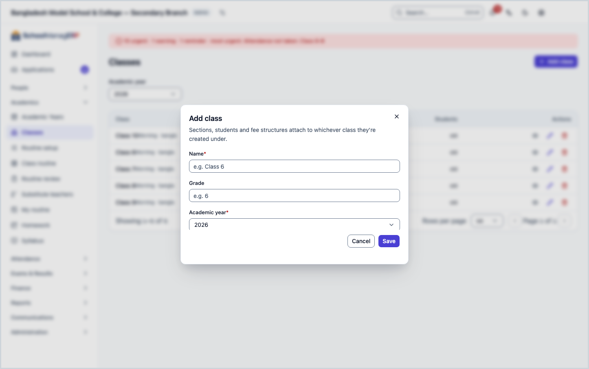
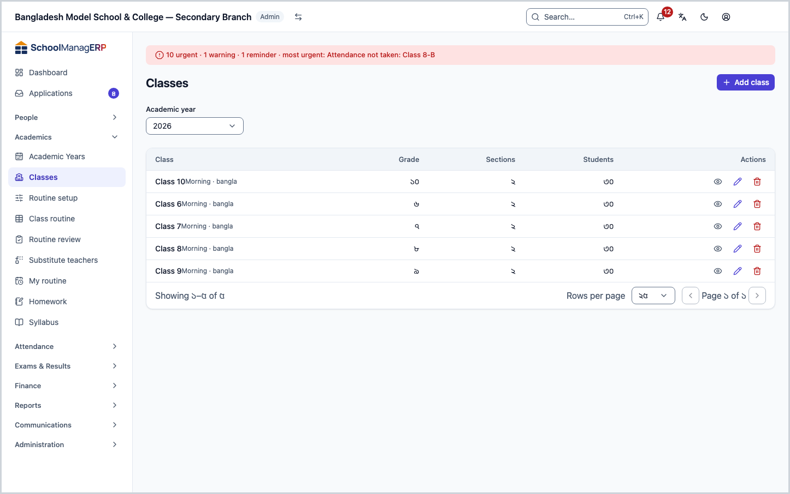

<!-- guide:meta
feature: academics.classes
title: Arranging classes, sections and subjects
summary: Add classes to an academic year, open sections in a class, attach subjects, and give sections their teachers.
roles: [ADMIN]
sources:
  - client-admin/src/routes/_staff/classes/index.tsx
  - client-admin/src/routes/_staff/classes/$classId.tsx
  - client-admin/src/routes/_staff/classes/-class-form-dialog.tsx
  - client-admin/src/routes/_staff/classes/-delete-class-dialog.tsx
  - client-admin/src/routes/_staff/classes/-section-form-dialog.tsx
  - client-admin/src/routes/_staff/classes/-delete-section-dialog.tsx
  - client-admin/src/routes/_staff/classes/-sections-panel.tsx
  - client-admin/src/routes/_staff/classes/-attach-subject-dialog.tsx
  - client-admin/src/routes/_staff/classes/-remove-subject-dialog.tsx
  - client-admin/src/routes/_staff/classes/-assign-teacher-dialog.tsx
  - client-admin/src/routes/_staff/classes/-dialog-kit.tsx
  - client-admin/src/routes/_staff/classes/-detail/sections-tab.tsx
  - client-admin/src/routes/_staff/classes/-detail/students-tab.tsx
  - client-admin/src/routes/_staff/classes/-detail/fee-structures-tab.tsx
  - client-admin/src/routes/_staff/classes/-detail/teachers-tab.tsx
  - client-admin/src/routes/_staff/classes/-detail/subjects-tab.tsx
  - client-admin/src/routes/_staff/classes/-detail/homework-tab.tsx
  - client-admin/src/routes/_staff/classes/-detail/performance-tab.tsx
  - client-admin/src/routes/_staff/classes/-detail/tab-query-state.tsx
  - server/src/modules/classes/classes.controller.ts
  - server/src/modules/classes/classes.service.ts
labels:
  [
    classes:list.*,
    classes:classForm.*,
    classes:sectionForm.*,
    classes:deleteClassDialog.*,
    classes:deleteSectionDialog.*,
    classes:sections.*,
    classes:detail.*,
    classes:subjects.*,
    classes:subjectAttachForm.*,
    classes:removeSubjectDialog.*,
    classes:assignTeacherForm.*,
    classes:assignmentType.*,
    classes:assignDialog.*,
    nav:items.classes,
    nav:groups.academics,
    common:accessDenied.*,
  ]
helpIds:
  [
    academics.classes,
    academics.classes.action.add,
    academics.classes.action.delete,
    academics.classes.action.addSection,
    academics.classes.action.deleteSection,
    academics.classes.action.attachSubject,
    academics.classes.action.assignTeacher,
    academics.classes.field.grade,
    academics.classes.field.shift,
    academics.classes.field.version,
    academics.classes.field.group,
    academics.classes.field.capacity,
    academics.classes.action.edit,
  ]
devices: [desktop]
entry: [sidebar, palette]
keywords:
  [শ্রেণি, ক্লাস, শাখা, সেকশন, শিফট, ভার্সন, গ্রুপ, বিষয়, শ্রেণি শিক্ষক, ধারণক্ষমতা, class, section, shift, version, group, subject, class teacher]
appVersion: 0.1.0 (1798f8b1f)
owner: tareq89
lastVerified: 2026-10-24
knownIssues: []
-->

# Arranging classes, sections and subjects

Add classes to an academic year, open sections in each class, attach subjects, and give sections their teachers.

**Where to go:** in the left menu, **Academics → Classes**. Do the work on this page on a computer.
**Before you start:** you must be the school Admin ([who can do what](#roles)). At least one [academic year](academic-years.md) must already exist.

A class lives inside one academic year, for example **Class 6** in the year **2027**. Inside a class are **sections**, for example **A** and **B**. Students are enrolled in a section, not directly in the class. So after you create a class, you must open at least one section.

[Add a class](#task-main) · [Open sections](#task-sections) · [Attach subjects](#task-subjects) · [Give teachers](#task-teachers) · [Problems and fixes](#trouble)

**On this page**

- [How to reach this page](#arrive)
- [Add a class](#task-main)
- [How to tell the class was added](#confirm)
- [Other situations](#other)
  - [Open sections](#task-sections)
  - [What shift, version and group are](#task-labels)
  - [Attach subjects](#task-subjects)
  - [Give a section its teachers](#task-teachers)
  - [Filter the list](#task-find)
  - [Edit a class](#task-edit)
  - [Delete a section or a class](#task-delete)
  - [The class page: the tabs](#task-detail)
- [Problems and fixes](#trouble)
- [Who can do what](#roles)
- [Learn more](#more)

---

## How to reach this page 

**From the left menu:** press **Academics → Classes**. Start from step 1 below.

**From the search box:** in the search box at the top (Ctrl+K), type **Add class** and pick it. → The list of classes opens, and the **Add class** dialog is already open. Start from step 3 below. Search rules: [Finding any page](../start/find-anything.md).

**From the academic year page:** on the **Classes** tab of the [academic year](academic-years.md#task-detail) page, press **View** on a class to open that class's page directly.

---

## Add a class 

1. In the left menu, press **Academics → Classes**.

   → At the top is the title **Classes**. The list has the columns **Class**, **Grade**, **Sections**, **Students**. At first it shows only the classes of the current academic year.

2. At the top of the page, press **Add class**.

   → The **Add class** dialog opens.

3. In the **Name** field, type the name of the class, for example `Class 6`.

   → If you leave it empty, it shows **Name is required**.

4. If you like, type the class number in the **Grade** field, for example `6`.

   → The grade puts the classes in order. If you give zero, a negative number or a fraction, it shows **Grade must be a positive whole number**.

5. In the **Academic year** field, pick the year. The year the list was filtered to is already picked.

   → If you pick no year, it shows **Academic year is required**. A class cannot be moved to another year later, so pick the right year.

6. If your school has more than one shift or version, the **Shift** and **Version** fields also show. Pick them if needed; if not, leave **Not set**. What they are: [What shift, version and group are](#task-labels).

7. Press **Save**.

   → The dialog closes and the new class appears in the list. If you gave a shift or version, it is written small under the name, for example **Morning · Bangla**. The **Sections** column shows zero.

> **Remember:** you cannot enrol anyone in a class without a section. Right now, press the class name and [open a section](#task-sections).

---

## How to tell the class was added 

Class details are saved only when you are online; they cannot be kept on the device and sent later. So there is no **Saved on this device** state here.

| State                           | How to tell                                            | What next                       |
| ------------------------------- | ------------------------------------------------------ | ------------------------------- |
| **Changed on screen only**      | The dialog is open and filled in, but has not closed   | Press **Save**                  |
| **Reached the school's system** | The dialog has closed and the new class is in the list | [Open sections](#task-sections) |

**To check:** reload the page. If the class does not show, look at the **Academic year** filter at the top and see whether the right year is picked.

**If no message comes:** see [Problems and fixes](#trouble). The details you typed are still in the dialog.

---

## Other situations 

### Open sections 

1. In the list, press the name of the class.

   → The class page opens, with the **Sections** tab in front. It says "Students enrol into a specific section within this class." If there is no section, it says **No sections yet**.

2. Press **Add section**.

   → The **Add section** dialog opens.

3. Type the **Section name**, for example `A`.

   → If you leave it empty, it shows **Section name is required**.

4. If you like, give a **Capacity**, for example `40`. If your school has more than one group, a **Group** field also shows, for example **Science**.

   → Capacity is only a number shown in the list; the app does not stop you enrolling more students than that. If you give zero or a fraction, it shows **Capacity must be a positive whole number**.

5. Press **Save**.

   → The section appears in the list: **Section**, (**Group** if there are groups), **Capacity**, **Enrolled**. If you gave no capacity, it shows **—**.

To change a section, press **Edit** at the end of its row; the dialog's title is **Edit section**.

### What shift, version and group are 

All three are optional labels. A field shows only if the school's settings have at least two names for it; with only one name, the field stays hidden.

| Label       | Goes on | Example                                                                                                                 |
| ----------- | ------- | ----------------------------------------------------------------------------------------------------------------------- |
| **Shift**   | Class   | Classes in the morning and at midday in one school: separate **Class 6** classes for the **Morning** and **Day** shifts |
| **Version** | Class   | The same class in two mediums: a **Bangla** version and an **English** version                                          |
| **Group**   | Section | In Class 9, section **A** is **Science**, section **B** is **Business Studies**                                         |

When the shift or version differs, two classes with the same name can exist in the same year. Where the names are set and how to change them: [If you want to change the names of shifts, versions or groups](../admin/how-it-works.md#task-rename-labels). The whole picture: [Academic year, class, section](../admin/how-it-works.md#task-structure).

### Attach subjects 

1. On the class page, open the **Subjects** tab.

   → The **Subjects** list: **Subject**, **Code**, **Optional**. If there are none, it says **No subjects offered yet**.

2. Press **Add subject**.

   → The **Add subject** dialog opens. The **Subject** list shows the school's active subjects with name and code; ones already attached do not show.

3. Pick the **Subject**. If not everyone studies it, tick **Optional subject**.

   → If you pick no subject, it shows **Subject is required**.

4. Press **Add**.

   → The subject appears in the list; if it is optional, an **Optional** mark sits beside it.

To take a subject off, press **Remove** on its row, then press **Remove** in the **Remove subject** dialog. This cannot be undone; if needed, you must add it again.

### Give a section its teachers 

To pick a teacher, the person must already have a teacher profile ([give a teacher profile](../people/staff.md#task-teacher)).

1. On the class page, open the **Teachers** tab.

   → A separate card for each section, showing who has which duty. If nobody is there, it says **No teachers assigned to this section**. If there is no section at all, it says **This class has no sections yet**.

2. On the section's card, press **Assign**.

   → The **Assign teacher** dialog opens.

3. Pick the **Teacher**. From **Assignment type** pick **Class teacher**, **Assistant class teacher** or **Subject teacher**. If you pick **Subject teacher**, you must also give the **Subject**.

   → If the section already has a class teacher and you pick someone new as **Class teacher**, a warning shows: **{name} will be replaced as class teacher**.

4. Press **Assign**.

   → The teacher appears in the card's list, with the duty under the name (for example **Subject teacher · Maths**).

To take someone off, press **Remove** beside the name, then press **Remove** in the **Remove this teacher?** dialog. You can assign them again later. All classes' duties in one place: [Teacher assignments](../people/teaching-assignments.md).

### Filter the list 

| Field             | What to pick                                                                                                |
| ----------------- | ----------------------------------------------------------------------------------------------------------- |
| **Academic year** | If you pick none, the current year. To see another year, or all years together, pick **All academic years** |
| **Shift**         | One shift, or **All shifts**. The field shows only if the school has two or more shifts                     |
| **Version**       | One version, or **All versions**. It shows only if there are two or more versions                           |

If nothing matches, it shows **No classes match these filters**. Filters are only for viewing; they change nothing.

### Edit a class 

1. At the end of the class's row in the list, press **Edit**. (There is also an **Edit** at the top of the class page.)

   → The **Edit class** dialog opens. It has no **Academic year** field; the year cannot be changed.

2. Change the **Name**, **Grade**, **Shift** or **Version**, then press **Save**. If you clear the grade and leave it empty, the grade is removed.

### Delete a section or a class 

Only a section or class made by mistake and still empty can be deleted.

**To delete a section:** on the Sections tab, press **Delete** at the end of the row. In the **Delete section** dialog, press **Delete**.

**To delete a class:** in the list, press **Delete** at the end of the row (it is also at the top of the class page). In the **Delete class** dialog, press **Delete**.

| You pressed | What happens                                                                                                    | Saved? |
| ----------- | --------------------------------------------------------------------------------------------------------------- | ------ |
| **Delete**  | The section or class goes and cannot be brought back. If you delete from the class page, you return to the list | Yes    |
| **Cancel**  | Nothing changes                                                                                                 | No     |

**A section that cannot be deleted:** one that still has students or ever had them (the records of students who left are counted too), or that has records such as attendance, marks or routine. Then it shows **This section still has students, so it can't be deleted. Move them to another section first.** A section's teacher assignments do not block a delete; they go with the section.

**A class that cannot be deleted:** one that has students or sections, or records such as exams, fee structures or homework. Then the dialog names the reason:

| Reason                                      | The dialog shows                                                                                                | Buttons                      |
| ------------------------------------------- | --------------------------------------------------------------------------------------------------------------- | ---------------------------- |
| It has students                             | **This class still has students. Move them to another class first.**                                            | **Move students**, **Close** |
| No students, but it has sections            | **This class still has sections. Delete the sections first.**                                                   | **Close**                    |
| Other records (for example exams, homework) | **This class is still used by {records}. Remove or move them first.**, for example "used by exams and homework" | **Close**                    |

**Move students** opens the class's **Students** tab. There is no chance to press **Delete** again, because it would be blocked again.

### The class page: the tabs 

Press the class name in the list, or **View**, to open its page. At the top are the name, and the **Grade**, **Academic year**, (**Shift**, **Version** if there are any) and the number of **Sections**.

| Tab                | What is in it                                                                                                                    |
| ------------------ | -------------------------------------------------------------------------------------------------------------------------------- |
| **Sections**       | The list of sections; [Open sections](#task-sections)                                                                            |
| **Students**       | This class's students: **Name**, **Roll**, **Section**, **Status**; press **View** for the [student page](../people/students.md) |
| **Fee Structures** | This class's fee structures: **Name**, **Type**, **Amount**                                                                      |
| **Teachers**       | Teachers by section; [Give a section its teachers](#task-teachers)                                                               |
| **Subjects**       | The class's subjects; [Attach subjects](#task-subjects)                                                                          |
| **Homework**       | **Assignments**, **Completion**, **Defaulters**, **Syllabus completion**                                                         |
| **Performance**    | A summary of exam marks; only a person who has permission to see marks sees it                                                   |

---

## Problems and fixes 

| What you see                                                                                                    | What to do                                                                                                                                                                                                                                   | Who can help |
| --------------------------------------------------------------------------------------------------------------- | -------------------------------------------------------------------------------------------------------------------------------------------------------------------------------------------------------------------------------------------- | ------------ |
| **You don't have access to this page.**                                                                         | Only the Admin sees this page. Press **Back to dashboard**.                                                                                                                                                                                  | Admin        |
| **Failed to load classes**                                                                                      | Check the internet and reload the page.                                                                                                                                                                                                      | Admin        |
| **Academic year is required**, and the **Academic year** list is empty                                          | First [add an academic year](academic-years.md#task-main).                                                                                                                                                                                   | Admin        |
| **Failed to save class**                                                                                        | Check the internet. See whether a class with the same name, shift and version already exists in the same year (capital and small letters count as the same; the name of a deleted class can be used again); if so, change the name or shift. | Admin        |
| **Failed to save section**                                                                                      | Check the internet and press **Save** again. See whether a section with the same name already exists in this class (capital and small letters count as the same, so `a` clashes with `A`).                                                   | Admin        |
| **This class still has students. …**, **This class still has sections. …** or **This class is still used by …** | See [Delete a section or a class](#task-delete). Usually it is right to keep the class.                                                                                                                                                      | Admin        |
| **This section still has students, so it can't be deleted. Move them to another section first.**                | Move the students to another section ([Students](../people/students.md)), or keep the section.                                                                                                                                               | Admin        |
| **Failed to delete class** or **Failed to delete section**                                                      | Check the internet and press **Delete** again.                                                                                                                                                                                               | Admin        |
| **Failed to attach subject**                                                                                    | Check the internet and press **Add** again.                                                                                                                                                                                                  | Admin        |
| **This teacher is already a class teacher or assistant class teacher of this section**                          | One person cannot be both class teacher and assistant of the same section. Pick the other type or another teacher.                                                                                                                           | Admin        |
| **This teacher is already assigned to this section for this subject**                                           | You do not need to give it again. Check on the **Teachers** tab.                                                                                                                                                                             | Admin        |
| **Failed to assign teacher**                                                                                    | Check the internet and press **Assign** again.                                                                                                                                                                                               | Admin        |
| The teacher you want is not in the **Teacher** list                                                             | First [give them a teacher profile](../people/staff.md#task-teacher).                                                                                                                                                                        | Admin        |
| The class is not in the list                                                                                    | In the **Academic year** filter at the top, pick the right year or **All academic years**.                                                                                                                                                   | Admin        |
| The **Shift** or **Group** field is not showing                                                                 | The field does not show unless the settings have at least two names. Add names: [Shift, version or group](../admin/how-it-works.md#task-rename-labels).                                                                                      | Admin        |

---

## Who can do what 

| Role                                                                                                 | See the list and class page | Add, change, delete classes, sections, subjects | Give and remove section teachers |
| ---------------------------------------------------------------------------------------------------- | --------------------------- | ----------------------------------------------- | -------------------------------- |
| Admin                                                                                                | Yes                         | Yes                                             | Yes                              |
| Academic coordinator, teacher, accountant, office assistant, exam controller, governing board member | No                          | No                                              | No                               |

For other roles, **Classes** is not in the left menu. If they open the page, they see **You don't have access to this page.** A teacher sees their own sections on their own pages, not here.

---

## Learn more 

<strong>The parts of the page</strong> — top to bottom

1. **Classes** — the title.
2. **Add class** — the button at the top of the page.
3. **Filter row** — **Academic year**, and if present, **Shift** and **Version**.
4. **List** — **Class**, **Grade**, **Sections**, **Students**; at the end of each row, **View**, **Edit**, **Delete**.

<strong>What the fields mean</strong>

<!-- guide:generated:fields:classes -->

| Field            | What to enter                                                                                         | Required? |
| ---------------- | ----------------------------------------------------------------------------------------------------- | --------- |
| Name (class)     | The name of the class, for example Class 6.                                                           | Yes       |
| Grade            | The class number, for example 6; a positive whole number. Used to put classes in order.               | No        |
| Academic year    | Which year the class belongs to. You can pick it only when adding; it does not change later.          | Yes       |
| Shift            | For example Morning or Day. It shows only if the school has two or more shifts.                       | No        |
| Version          | For example Bangla or English. It shows only if there are two or more versions.                       | No        |
| Section name     | For example A.                                                                                        | Yes       |
| Capacity         | How many can sit in the section, for example 40. Only for display; it does not stop extra enrolments. | No        |
| Group            | For example Science. It shows only if there are two or more groups.                                   | No        |
| Subject          | One of the school's active subjects.                                                                  | Yes       |
| Optional subject | Tick it if not everyone studies it.                                                                   | No        |
| Teacher          | Someone who has a teacher profile.                                                                    | Yes       |
| Assignment type  | Class teacher, Assistant class teacher or Subject teacher.                                            | Yes       |

<!-- /guide:generated -->

<strong>How classes work</strong> — from year to section, then students and teachers

<figure>
  
  <figcaption><em>From class to sections, students and teachers</em></figcaption>
</figure>

<figure>
  
  <figcaption><em>Shift and version are labels on a class; group is a label on a section</em></figcaption>
</figure>

- Students enrol in a section. So after a class comes a section, then [students](../people/students.md).
- A teacher sees a section only when they are given a duty in it. Then they can take that section's [attendance](../attendance/attendance.md).
- The full setup order: [Steps to set up the school](../admin/setup-order.md#step-3).

**Related pages**

- [**Academic years**](academic-years.md) — the year a class lives in.
- [**Teacher assignments**](../people/teaching-assignments.md) — the duties of teachers across all classes in one place.
- [**Students**](../people/students.md) — enrol students in a section.
- [**Steps to set up the school**](../admin/setup-order.md) — which job comes after which.
- [**Giving homework**](homework.md) — give homework to a section.
- [**Seeing your own class on one page**](my-class.md) — a class teacher sees the section on one page.
- [**Syllabus and study plans**](syllabus.md) — study plans for the subjects of a section.
- [**Ready-made curriculum**](../administration/curriculum-preset.md) — In a brand-new school, choose a ready-made curriculum and create the academic year, classes, subjects.
- [**Creating and setting up exams**](../exams-results/exams.md) — Add an exam for a class, set the parts and marks of each subject, give a schedule, and follow the exam from marks submission to published.
- [**Setting up grading scales**](../exams-results/grading-scales.md) — Set which percentage of marks gives which grade and GPA for each academic year.
- [**Setting up fee structures**](../finance/fee-structures.md) — Write down which fee costs how much for each academic year.

---

_Version 0.1.0 · Last checked 2026-10-24_
