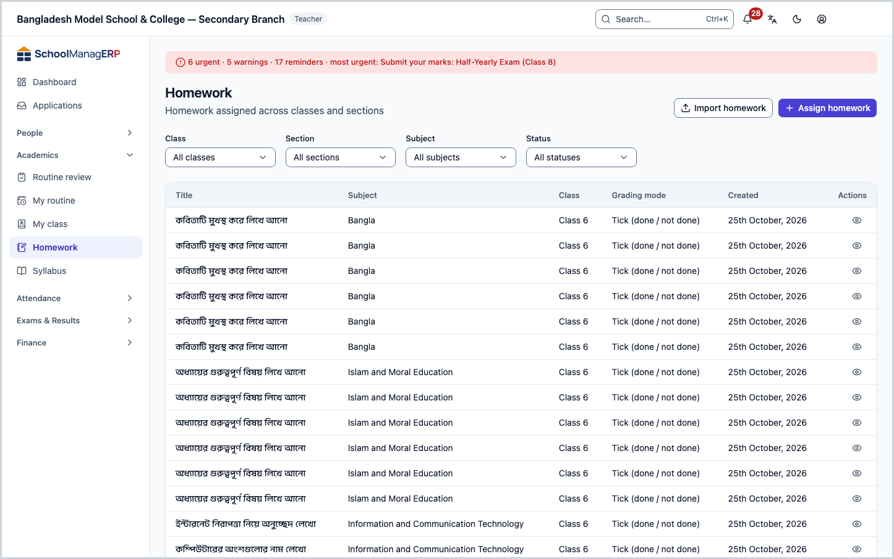
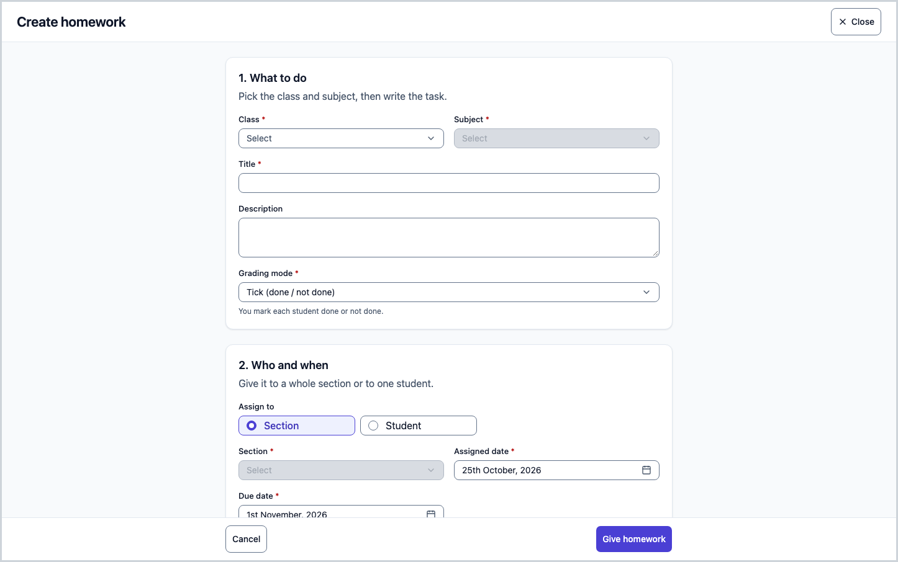
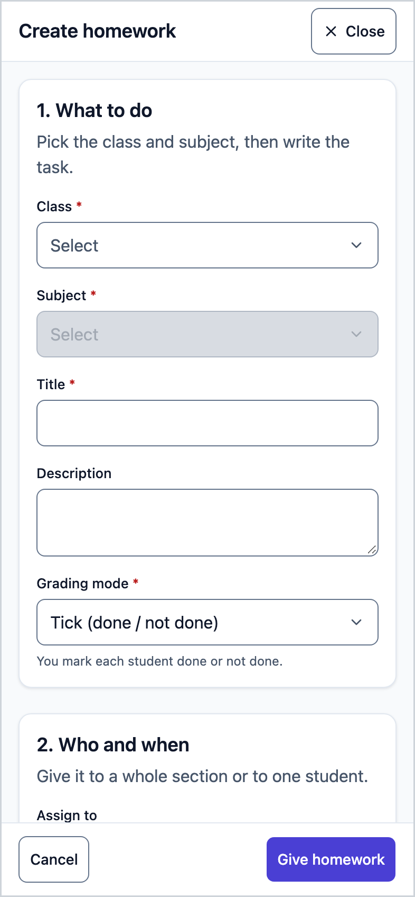
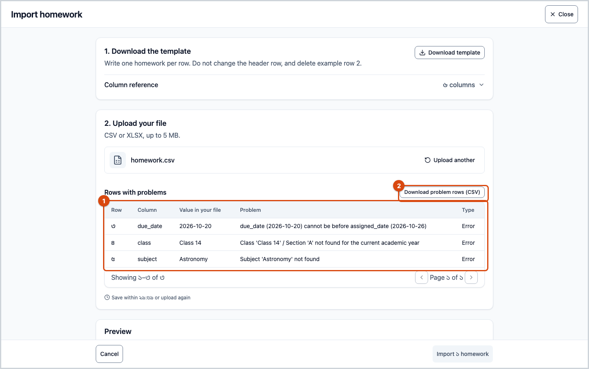
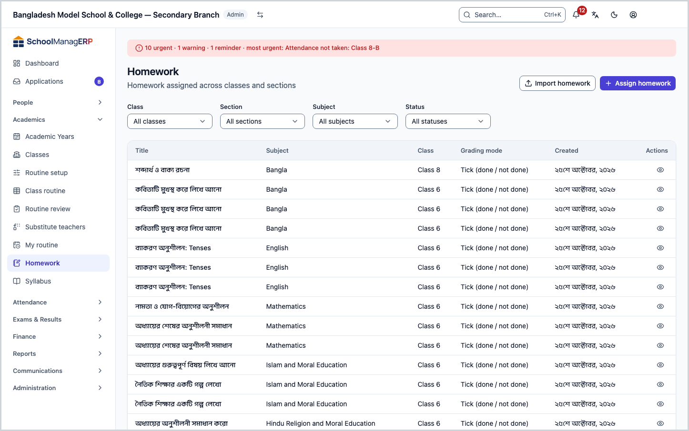

<!-- guide:meta
feature: academics.homework
title: Giving homework
summary: Create homework for a class and subject, give it to a section or one student, give the same homework to more sections, change or deactivate what was given, check each student's work, and import many homework from a file at once.
roles: [ADMIN, TEACHER]
sources:
  - client-admin/src/routes/_staff/academics/homework/index.tsx
  - client-admin/src/routes/_staff/academics/homework/new.tsx
  - client-admin/src/routes/_staff/academics/homework/$homeworkId.tsx
  - client-admin/src/routes/_staff/academics/homework/import.tsx
  - client-admin/src/routes/_staff/academics/homework/-assign-homework-form.tsx
  - client-admin/src/routes/_staff/academics/homework/-submission-grid.tsx
  - server/src/modules/homework/homework.controller.ts
  - server/src/modules/homework/homework.service.ts
  - server/src/modules/homework/homework-access.service.ts
  - server/src/modules/homework/homework-submission.service.ts
  - server/src/modules/homework/homework-bulk-upload.controller.ts
  - server/src/modules/homework/homework-bulk-upload.service.ts
  - server/src/modules/homework/homework-bulk-upload.parser.ts
labels:
  [
    homework:list.*,
    homework:detail.*,
    homework:grid.*,
    homework:form.*,
    homework:import.*,
    bulkImport:*,
    nav:items.homework,
    nav:groups.academics,
    common:accessDenied.*,
  ]
helpIds:
  [
    academics.homework,
    academics.homework.action.assign,
    academics.homework.action.assignAgain,
    academics.homework.action.import,
    academics.homework.field.gradingMode,
    academics.homework.field.target,
    academics.homework.field.dueDate,
  ]
devices: [desktop, phone]
entry: [sidebar, palette, dashboard:homework-to-check, dashboard:homework-submission-rate, page:academics.myClass]
keywords:
  [বাড়ির কাজ, হোমওয়ার্ক, অ্যাসাইনমেন্ট, শেষ তারিখ, মূল্যায়ন পদ্ধতি, আমদানি, এক্সেল, homework, assignment, classwork, due date, import, excel, csv]
appVersion: 0.1.0 (e424f8fc4)
owner: tareq89
lastVerified: 2026-10-24
knownIssues: []
-->

# Giving homework

Create homework for one subject of one class, then give it to a whole section or to one student.

**Where to go:** in the left menu, **Academics → Homework**. It also works on a phone; the list then shows as cards.
**Before you start:** the class must have sections and subjects ([classes, sections and subjects](classes.md)). If you are a teacher, you must have a duty in that class's section ([teacher assignments](../people/teaching-assignments.md)).

**Homework** works in two steps. First the homework itself: which class, which subject, what to write, and how it is graded. Then **giving it**: which section or student gets it, the date it is given and the due date. One homework can be given to several sections, each time with its own dates.

[Give homework](#task-main) · [Give it to more sections](#task-assign-again) · [Check work](#task-check) · [Import from a file](#task-import) · [Problems and fixes](#trouble)

**On this page**

- [How to reach this page](#arrive)
- [Give homework](#task-main)
- [How to tell the homework was given](#confirm)
- [Other situations](#other)
  - [Give homework to one student](#task-student)
  - [Give the same homework to more sections](#task-assign-again)
  - [Import homework from an Excel or CSV file](#task-import)
  - [Which grading mode to pick](#task-grading)
  - [Filter the list](#task-find)
  - [See a homework's page](#task-detail)
  - [Change, move the due date or deactivate](#task-change)
  - [Check students' work](#task-check)
- [Problems and fixes](#trouble)
- [Who can do what](#roles)
- [Learn more](#more)

---

## How to reach this page 

**From the left menu:** press **Academics → Homework**. Start from step 1 below.

**From the search box:** in the search box at the top (Ctrl+K), type **Homework** and pick it. Search rules: [Finding any page](../start/find-anything.md).

**From the dashboard:** on a teacher's **Homework to check** card, **See submissions** opens the **Check work** list of the first homework on the card ([check students' work](#task-check)). An admin's homework submission rate card opens this list. About the cards: [Dashboard cards](../dashboard/widgets.md).

**From My class:** a class teacher sees the section's total, completed and defaulter counts on the **Homework** card of [My class](my-class.md#task-cards). To give homework, come to this page.

---

## Give homework 

1. In the left menu, press **Academics → Homework**.

   → At the top is the **Homework** heading, with **Homework assigned across classes and sections** below it. The list has the columns **Title**, **Subject**, **Class**, **Grading mode**, **Created**, newest first. If there is nothing, you see **No homework yet**.

2. At the top of the page, press **Assign homework**.

   → The **Create homework** page opens, in two parts: **1. What to do** and **2. Who and when**.

3. In **1. What to do**, pick the **Class**, then the **Subject**.

   → The **Subject** list shows only the subjects attached to that class. If you change the class, the subject, section and student are cleared and you must pick them again. If you skip them, you see **Pick a class.** or **Pick a subject.**

4. Write the **Title**, for example `Exercise 3.2, questions 1 to 5`. If you like, write more in **Description**.

   → If the title is empty you see **Write a title.** The description is optional.

5. Pick the **Grading mode**: **Tick (done / not done)**, **Partial completion** or **Marks**. **Tick** is selected at the start. Which one when: [Which grading mode to pick](#task-grading).

6. In **2. Who and when**, keep **Section** in **Assign to**, and pick a section in the **Section** field.

   → If you skip it, you see **Pick a section.** To give it to one student instead: [Give homework to one student](#task-student).

7. Check the **Assigned date** and the **Due date**. At the start the assigned date is today and the due date is seven days later.

   → If the due date is before the assigned date, you see **Due date must be on or after the assigned date.** The same day is fine.

8. At the bottom, press **Give homework**.

   → The homework is created and given to the section, and its own page opens directly.

**On a phone** the page opens full screen; the fields come one below the other, with the **Give homework** button at the bottom.

> **Remember:** nothing is saved until you press **Give homework**. If you press **Cancel** midway, the app asks whether to throw away what you wrote.

---

## How to tell the homework was given 

Homework is saved only when you are online; it cannot be kept on the device and sent later. So the **Saved on this device** state does not exist here.

| State                           | How to tell                                                        | What next               |
| ------------------------------- | ------------------------------------------------------------------ | ----------------------- |
| **Changed on screen only**      | The **Create homework** page is open and the fields are filled in  | Press **Give homework** |
| **Reached the school's system** | The homework's own page has opened, with your title as its heading | Done                    |

**To double-check:** go back to the **Homework** list. The new homework is at the top. If you pick the section in the **Section** filter, it shows there too.

**If no page opens:** see [Problems and fixes](#trouble). What you typed is still in the fields.

---

## Other situations 

### Give homework to one student 

For example, someone fell behind because they were ill and needs separate work.

1. In **2. Who and when**, pick **Student** in **Assign to**.
2. Pick the **Section** first, then the **Student**.

   → The **Student** list shows only students of that section. If you skip it, you see **Pick a student.**

3. Check the dates and press **Give homework**.

   → Only that student gets the homework.

### Give the same homework to more sections 

To give the same homework to another section of the same class, or to another student, you do not need to write it again.

1. In the list, press **View** on the homework's row.
2. At the top of the homework's page, press **Assign to section or student**.

   → A form opens with the same fields, and the homework's title and class at the top. You cannot change the class or subject; you can only pick another section or student of the same class.

3. Fill in **Assign to**, **Section** (or **Student**), **Assigned date** and **Due date**.
4. Press **Assign**.

   → The form closes and you see **Assigned. Due {date}.**

| You press  | What happens                                        | Saved? |
| ---------- | --------------------------------------------------- | ------ |
| **Assign** | The homework is given to the new section or student | Yes    |
| **Cancel** | The form closes, nothing changes                    | No     |

### Import homework from an Excel or CSV file 

To give many homework to many sections at once, such as a whole week's, import them from one file. Each row of the file is one homework, given to one section.

**1. Download the template**

1. Above the **Homework** list, press **Import homework**.

   → The **Import homework** page opens, in three parts: **1. Download the template**, **2. Upload your file**, **3. Result**.

2. Press **Download template**.

   → A file named `homework-import-template.csv` downloads. The first row has the column headers and the second row has an example.

**2. Fill in the file**

3. Open the file in Excel or Google Sheets. Do not change the first-row headers, and delete the example row.
4. Write one homework per row. What goes in each column is also shown in the page's **Column reference**.

| Column header   | What to write                                                                                  | Required? |
| --------------- | ---------------------------------------------------------------------------------------------- | --------- |
| `class`         | The name of a class of the current academic year, as written in the app, for example `Class 5` | Yes       |
| `section`       | A section of that class, for example `A`                                                       | Yes       |
| `subject`       | The name of one of the school's subjects, for example `Mathematics`                            | Yes       |
| `assigned_date` | The date given, in year-month-day order, for example `2026-10-01`                              | Yes       |
| `due_date`      | The due date, in the same order, for example `2026-10-05`; it cannot be before the date given  | Yes       |
| `description`   | A short note about the task, for example `Exercise 3.2`; may be left empty                     | No        |

The file has no column for the title or the grading mode. For every imported homework the app makes the title itself from the subject and the assigned date, for example **Mathematics — 2026-10-01**, and the grading mode is **Tick (done / not done)**.

5. Save the file as CSV or XLSX. The file must not be over 5 MB, and may have at most 2000 rows besides the header row.

**3. Upload and look at the problems**

6. In **2. Upload your file**, press **Choose file** and pick the file.

   → You see **File received. Checking it now.** The app checks every row: whether the class and section exist in the current year, whether the subject exists, whether the dates are right, and, if you are a teacher, whether you have a duty for that section and subject.

7. Look at the result.

   → If everything is fine, the **Preview** part shows a **No problems** mark, a line such as **12 homework will be created.**, and the first 20 rows (**Class · Section · Subject**, **Assigned date**, **Due date**).

   → If any row has a problem, a **Rows with problems** table appears: **Row** (which row of the file), **Column**, **Value in your file**, **Problem**, **Type**. The import button below stays disabled.

**4. Fix the problem rows**

8. Press **Download problem rows (CSV)** to download the list of problems; it helps to keep it beside you.
9. Fix those rows in your own file. Common causes:

   - The class or section name does not match the name in the app, or the class is not of the current academic year.
   - Two classes have the same name and the same section, so the app could not tell which you meant (for example `Class 6` / `A` in two shifts). It works once an admin gives one of them a different name.
   - The subject name does not match, or there are two subjects with the same name.
   - The due date is before the assigned date, or a date is not in year-month-day order.
   - If you are a teacher: you have no duty for that section and subject.

10. Press **Import another file**, and upload the whole corrected file again.

> **Remember:** if even one row has a problem, no homework is imported. Upload the whole file again, not just the wrong rows; the good rows from before will not be created twice, because nothing was saved the first time.

**5. Confirm the import**

11. If there are no problems, press **Import {number} homework** at the bottom. After the check, a time shows beside it, such as **Save within 29:40 or upload again**; after 30 minutes you must upload again.

→ In the **3. Result** part you see a **Done** mark and a line such as **12 homework created.** A message also appears at the top.

12. Press **Back to homework**.

→ The new homework appears in the list.

| You press                    | What happens                                                  | Saved? |
| ---------------------------- | ------------------------------------------------------------- | ------ |
| **Import {number} homework** | All the homework in the file is created and given to sections | Yes    |
| **Import another file**      | This file is dropped, and you can pick a new file             | No     |
| **Cancel**                   | The app asks, then returns to the list                        | No     |

<figure>
  
  <figcaption><em>Import: if even one row is wrong, nothing is saved</em></figcaption>
</figure>

### Which grading mode to pick 

| Mode                       | When to pick it                                           |
| -------------------------- | --------------------------------------------------------- |
| **Tick (done / not done)** | You will mark each student only done or not done.         |
| **Partial completion**     | You will mark each student not done, partly done or done. |
| **Marks**                  | You will give each student a mark.                        |

The mode cannot be changed after the homework is created. You give the tick, completion or marks student by student in [Check work](#task-check).

### Filter the list 

| Field       | What to pick                                                                                |
| ----------- | ------------------------------------------------------------------------------------------- |
| **Class**   | One class, or **All classes**                                                               |
| **Section** | One section of the chosen class, or **All sections**. Changing the class clears the section |
| **Subject** | One subject, or **All subjects**                                                            |
| **Status**  | **Active**, **Deactivated** or **Superseded**, or **All statuses**                          |

Filters are for viewing only; they change nothing.

### See a homework's page 

Pressing **View** in the list opens the homework's page. At the top is the title, with **Subject**, **Class**, **Grading mode** and **Created**. Below is the **Description**; if there is none, **No description.** At the top is the **Assign to section or student** button ([give the same homework to more sections](#task-assign-again)).

Below the description is the **Who has this homework** card. Each row is one section (**Section A**) or one student (**Rahima Akter · Section B**), with **Assigned date**, **Due date** and **Status** (**Active**, **Deactivated** or **Superseded**). Active rows come first. If it was given to nobody yet, it shows **Not given to anyone yet**.

The buttons on a row depend on its status:

| Row status      | Buttons on the row                                       |
| --------------- | -------------------------------------------------------- |
| **Active**      | **Check work**, **Due date**, **Change**, **Deactivate** |
| **Deactivated** | **Check work**, **Reactivate**                           |
| **Superseded**  | **Check work** only                                      |

A teacher sees only the rows of their own sections.

### Change, move the due date or deactivate 

All three work on one row of the **Who has this homework** card.

**Move the due date:** press **Due date** on the row. The **Change the due date** box opens. Pick the new date and press **Save**. You see **Due date is now {date}.** Work already handed in stays. The due date cannot be before the assigned date (**Due date must be on or after the assigned date.**).

**Give it to someone else:** press **Change** on the row. The **Change this assignment** box opens with the row's section or student and dates filled in. Pick the new section or student and dates, then press **Save**. You see **Changed. Due {date}.**

> **Remember:** **Change** does not edit the old row. The old row stays in the list as **Superseded**, and a new **Active** row is made. Work already handed in stays with the old row; the students of the new row start from nothing.

**Deactivate:** press **Deactivate** on the row, then **Deactivate** again in the question box. Students and parents stop seeing the homework, and no one can hand it in. Work already handed in is kept. You see **Deactivated.**

**Reactivate:** on a **Deactivated** row, press **Reactivate**, then **Reactivate** in the question box. Students and parents see it again and can hand it in until the due date. You see **Active again.**

> **Remember:** **Change** is only for **Active** rows. To give a **Deactivated** row to someone else, press **Reactivate** first. A section or student can have only one **Active** row of the same homework. If it already has one, **Reactivate** or **Give homework** fails; use **Due date** on the row it already has, or **Deactivate** that row first.

**Do parents hear about it?** If the school has **Text guardians when homework is assigned** switched on in [Settings](../administration/settings.md), guardians also get a text when you move a due date, deactivate a row, or give the homework to someone else. The new section or student gets the "new homework" text, and the old one is told it was withdrawn. Pressing **Reactivate** sends no text. If the school has that checkbox off, no text goes.

| You press                       | What happens                                                     | Saved? |
| ------------------------------- | ---------------------------------------------------------------- | ------ |
| **Save** (Due date)             | Only the due date of that row changes                            | Yes    |
| **Save** (Change)               | The old row becomes **Superseded**, a new **Active** row is made | Yes    |
| **Deactivate** / **Reactivate** | The row's status changes; handed-in work stays                   | Yes    |
| **Cancel** or closing the box   | Nothing changes                                                  | No     |

### Check students' work 

Here you give each student the tick, the completion or the marks, depending on the homework's [grading mode](#task-grading).

1. On the homework's page, in the **Who has this homework** card, press **Check work** on a row.

   → A full-page list opens, titled **Check work · Section A** (or the student's name). Who is on it: for a section row, every active student of the section; for a student row, that one student. Anyone who already has work on the row stays on it, even after moving. A **Superseded** row adds nobody new; it lists only those who already have work on it. Each student shows the roll number, the name and a badge: **Not submitted**, **Submitted**, **Partial** or **Done**.

2. Mark each student:

   | Grading mode               | What you do on each row                                                                                       |
   | -------------------------- | ------------------------------------------------------------------------------------------------------------- |
   | **Tick (done / not done)** | Tick the box of each student who did it                                                                       |
   | **Partial completion**     | Pick **Done**, **Partial** or **Not done**                                                                    |
   | **Marks**                  | Type a whole number from 0 to 9,999; leave it empty if no marks yet. Typing marks also makes the row **Done** |

3. Press **Save** at the bottom. One **Save** sends every row you changed.

   → You see **Saved.** The badges show the new state.

- **Save** stays disabled until you change something.
- If a student uploaded work and you untick them or pick **Not done**, the row goes back to **Submitted**, not **Not submitted**: their upload stays.
- If you close the list with unsaved changes, the app asks first.
- A teacher can open only the rows of their own sections and subjects.

---

---

## Problems and fixes 

| What you see                                                                                                                                                                | What to do                                                                                                                                                                                                                                                                            | Who can help |
| --------------------------------------------------------------------------------------------------------------------------------------------------------------------------- | ------------------------------------------------------------------------------------------------------------------------------------------------------------------------------------------------------------------------------------------------------------------------------------- | ------------ |
| **Couldn't load homework.**                                                                                                                                                 | Check your internet and reload the page.                                                                                                                                                                                                                                              | Admin        |
| **Something went wrong. Please try again.**                                                                                                                                 | Check your internet and press again. If you are a teacher: check that you have a duty for the class-subject or section you picked ([teacher assignments](../people/teaching-assignments.md)). The class list shows every class, but saving works only for classes you have a duty in. | Admin        |
| **Homework was created, but assigning it failed. Try again from its detail page:**                                                                                          | The homework exists; it just did not reach the section. Press **Go to homework**, then [assign it to a section or student](#task-assign-again). Do not create it again, or there will be two.                                                                                         | Admin        |
| **Homework not found.** or a "not found" page                                                                                                                               | The link is old, or the homework is outside your duties. Open it from the list.                                                                                                                                                                                                       | Admin        |
| The list is empty, as a teacher                                                                                                                                             | You have no section duty in the current academic year. Tell an admin.                                                                                                                                                                                                                 | Admin        |
| The **Subject** list is empty                                                                                                                                               | No subject is attached to the class. [Attach a subject](classes.md#task-subjects).                                                                                                                                                                                                    | Admin        |
| **This file type isn't supported — choose a .csv or .xlsx file**                                                                                                            | Save the file as CSV or XLSX.                                                                                                                                                                                                                                                         | —            |
| **This file is too large — choose a smaller file**                                                                                                                          | It is over 5 MB. Split the file in two.                                                                                                                                                                                                                                               | —            |
| **Import failed.**                                                                                                                                                          | Check your internet and upload again. Check that the first-row headers are as in the template, and that there are not more than 2000 rows.                                                                                                                                            | Admin        |
| **We could not read this file. …**, **Some columns are missing. Use the sample file's columns.**, **This file has too many rows. …** or **This file has no rows in it. …**  | The whole file could not be checked. Do what the sentence says: save it again as .xlsx or .csv, keep the template's first-row headers, or split it into smaller files. Then upload again.                                                                                             | —            |
| **This check expired — upload the file again**                                                                                                                              | 30 minutes have passed since the check. Upload the same file again and confirm.                                                                                                                                                                                                       | —            |
| **You don't have access to this page.**                                                                                                                                     | This page is only for admins and teachers. Press **Back to dashboard**.                                                                                                                                                                                                               | Admin        |
| **Could not load who has this homework.**                                                                                                                                   | Press **Retry**. Check your internet.                                                                                                                                                                                                                                                 | Admin        |
| **This row was already changed. The list is up to date now.**                                                                                                               | Someone changed or moved this row a moment ago. Look at the list again; the old row is now **Superseded**.                                                                                                                                                                            | —            |
| **Something went wrong. Please try again.** after **Give homework**, **Change** or **Reactivate**, and the list already shows an **Active** row for that section or student | That section or student already has this homework as an **Active** row (the app answers "This homework is already assigned to that target"). Use **Due date** on that row, or **Deactivate** it first.                                                                                | —            |
| **Could not load the students' work.**                                                                                                                                      | Press **Retry**. Check your internet.                                                                                                                                                                                                                                                 | Admin        |
| **This list cannot be opened. It may be for a section you do not teach.**                                                                                                   | The link is old, or the row is outside your duties. Press **Close** and open **Check work** from the homework's page.                                                                                                                                                                 | Admin        |
| **This list changed while you were working. It is up to date now; check it and save again.**                                                                                | Your marks were not saved. Look at the list, mark again and press **Save**.                                                                                                                                                                                                           | —            |
| **Marks must be a whole number from 0 to 9,999.**                                                                                                                           | Fix the marks on that row. Nothing was saved.                                                                                                                                                                                                                                         | —            |
| **No students here yet**                                                                                                                                                    | The section has no active student, and nobody handed in work. Add students to the section first.                                                                                                                                                                                      | Admin        |

---

## Who can do what 

| Role                                                                              | List and homework page                              | Create and give homework                          | Change, deactivate, check work                         | Import from a file                                |
| --------------------------------------------------------------------------------- | --------------------------------------------------- | ------------------------------------------------- | ------------------------------------------------------ | ------------------------------------------------- |
| Admin                                                                             | Yes, all of the school's homework                   | Yes, to any class and section                     | Yes, every row                                         | Yes, to any section                               |
| Teacher                                                                           | Only homework of class-subjects they have duties in | Only to sections and subjects they have duties in | Only rows of sections and subjects they have duties in | Only to sections and subjects they have duties in |
| Academic coordinator, Accountant, Office assistant, Exam controller, Board member | No                                                  | No                                                | No                                                     | No                                                |

**An admin** sees all of the school's homework, and can give homework to, and import it for, any class, section or student.

**A teacher** sees and gives only according to their own duties in the current academic year. A **class teacher** or **assistant class teacher** can give homework of any subject to their own section; a **subject teacher** only of their own subject, to their own section. Giving to another section is not saved, and in an import that row shows up as a problem. In the list they do not see homework of class-subjects that other teachers have the duty for.

**Every other role** does not see **Homework** in the left menu. Opening the page shows **You don't have access to this page.** Students and guardians see their own homework in their own apps, not on this page.

---

## Learn more 

<strong>Parts of the page</strong> — top to bottom

1. **Homework** — the heading, with **Homework assigned across classes and sections** below it.
2. **Import homework** and **Assign homework** — the buttons at the top.
3. **The filter row** — **Class**, **Section**, **Subject**, **Status**.
4. **The list** — **Title**, **Subject**, **Class**, **Grading mode**, **Created**; **View** at the end of each row.

<strong>What the fields mean</strong>

<!-- guide:generated:fields:homework -->

| Field         | What to enter                                                                             | Required?                |
| ------------- | ----------------------------------------------------------------------------------------- | ------------------------ |
| Class         | Which class the homework is for. It does not change later.                                | Yes                      |
| Subject       | One subject attached to the class. It does not change later.                              | Yes                      |
| Title         | A short name for the homework, for example Exercise 3.2.                                  | Yes                      |
| Description   | What to do, in detail.                                                                    | No                       |
| Grading mode  | Tick, partial completion or marks. Tick at the start. It does not change later.           | Yes                      |
| Assign to     | A whole section, or one student.                                                          | Yes                      |
| Section       | A section of the class. Even to pick a student, pick the section first.                   | Yes                      |
| Student       | One student of the section. It shows only when giving to a student.                       | When giving to a student |
| Assigned date | The date it is given. Today at the start.                                                 | Yes                      |
| Due date      | The date it must be done by. Seven days later at the start; not before the assigned date. | Yes                      |

<!-- /guide:generated -->

<strong>How homework works</strong> — create the homework, then give it

<figure>
  
  <figcaption><em>One homework can be given to many sections</em></figcaption>
</figure>

- A homework belongs to a class and a subject; the section or student comes when it is given. So the same homework can be given to several sections of the same class, but not to another class.
- A class teacher sees their section's total, completed and defaulter homework in [My class](my-class.md#task-cards). An admin sees them by class in the **Homework** tab of the [class page](classes.md#task-detail).

**Related pages**

- [**Classes, sections and subjects**](classes.md) — add subjects and sections to a class.
- [**Teacher assignments**](../people/teaching-assignments.md) — which teacher has which section and subject.
- [**My class**](my-class.md) — a summary of the class teacher's section.
- [**Syllabus and study plans**](syllabus.md) — a class-subject's topics and each section's study plan.
- [**Homework (parent and student)**](../portal/homework.md) — what parents and students see.

---

_Version 0.1.0 · Last checked 2026-10-24_
