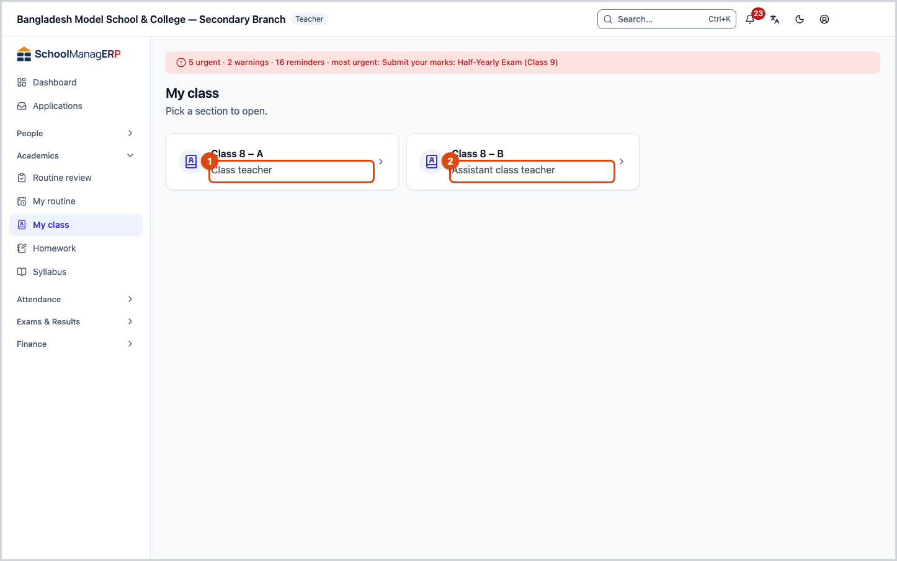
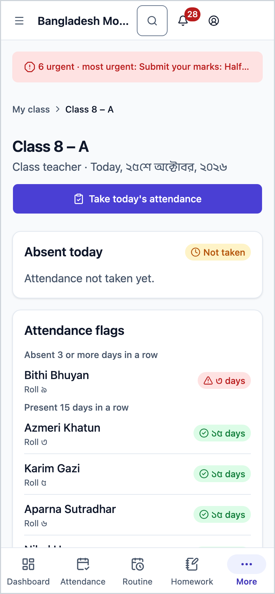
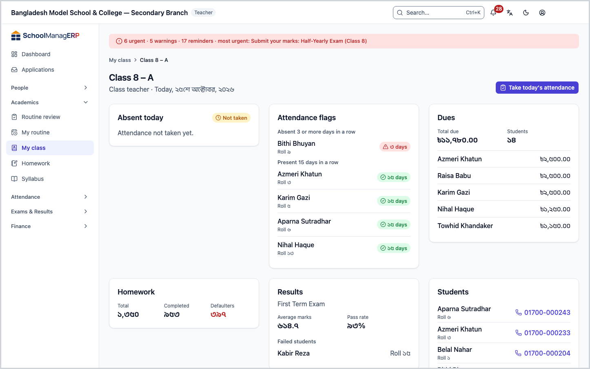

<!-- guide:meta
feature: academics.myClass
title: Seeing your own class on one page
summary: See today's absentees, attendance flags, dues, homework, results and the student list of the section you are class teacher of, and take attendance in one tap.
roles: [TEACHER]
sources:
  - client-admin/src/routes/_staff/my-class/index.tsx
  - client-admin/src/routes/_staff/my-class/$sectionId.tsx
  - client-admin/src/routes/_staff/my-class/-cards.tsx
  - client-admin/src/routes/_staff/my-class/-arrival-add-dialog.tsx
  - server/src/modules/classes/my-class.controller.ts
  - server/src/modules/classes/teacher-scope.service.ts
labels:
  [
    myClass:*,
    nav:items.myClass,
    nav:groups.academics,
    common:accessDenied.*,
  ]
helpIds:
  [
    academics.myClass,
    academics.myClass.action.takeAttendance,
  ]
devices: [desktop, phone]
entry: [sidebar, palette, dashboard:class-teacher-streaks]
keywords:
  [আমার শ্রেণি, শ্রেণি শিক্ষক, সহকারী শ্রেণি শিক্ষক, আমার শাখা, অনুপস্থিত, বকেয়া, ফলাফল, my class, class teacher, homeroom, form master, my section]
appVersion: 0.1.0 (e424f8fc4)
owner: tareq89
lastVerified: 2026-10-24
knownIssues: []
-->

# Seeing your own class on one page

See everything you need today for the section you are class teacher of, on one page, and take today's attendance in one tap.

**Where to go:** in the left menu, **Academics → My class**. The page is the same on a phone; the cards stack one below the other.
**Before you start:** an admin must have made you **Class teacher** or **Assistant class teacher** of a section in the current academic year ([give a section its teachers](classes.md#task-teachers)). If you are only a subject teacher, this page stays empty.

**My class** is an at-a-glance sheet for your own section, for example **Class 6 – A**. Nothing is written or changed here; you only look. To act, follow a card to the page it points to, such as the attendance sheet.

[Open your section page](#task-main) · [Take attendance](#task-attendance) · [Read the cards](#task-cards) · [Problems and fixes](#trouble)

**On this page**

- [How to reach this page](#arrive)
- [Open your section page](#task-main)
- [How to tell you opened the right section](#confirm)
- [Other situations](#other)
  - [Take today's attendance](#task-attendance)
  - [What the six cards say](#task-cards)
  - [Call a guardian](#task-call)
  - [If you have more than one section](#task-many)
- [Problems and fixes](#trouble)
- [Who can do what](#roles)
- [Learn more](#more)

---

## How to reach this page 

**From the left menu:** press **Academics → My class**. Start from step 1 below.

**From the search box:** in the search box at the top (Ctrl+K), type **Open my class**, or **Take my class's attendance** to go straight to attendance. With only one section, the second opens today's attendance sheet directly; with more than one, you pick the section first. Search rules: [Finding any page](../start/find-anything.md).

**From the dashboard:** press the **My class streaks** card to open this page for that section. About the card: [Dashboard cards](../dashboard/widgets.md).

---

## Open your section page 

1. In the left menu, press **Academics → My class**.

   → With only one section, its page opens directly; go to step 3. With two or more, under the **My class** heading you see **Pick a section to open.** and one card per section. With none, you see **No section yet**.

2. Press the card of the section you want. The card shows the class and section name (for example **Class 6 – A**) and your duty below it, **Class teacher** or **Assistant class teacher**.

   → The section page opens.

3. Look at the top of the page.

   → The heading is the section name. Below it are your duty and today's date, for example **Class teacher · Today, 24 October 2026**. On the right is the **Take today's attendance** button, already focused.

4. Read the six cards below: **Absent today**, **Attendance flags**, **Dues**, **Homework**, **Results**, **Students**. What each means: [What the six cards say](#task-cards).

   → Three columns on a computer, one column on a phone.

**On a phone** the cards come one below the other in the same order, and the **Take today's attendance** button is full width.

> **Remember:** this page is view-only. Pressing something here saves nothing; the work happens on the page it takes you to.

---

## How to tell you opened the right section 

Nothing is saved on this page, so there is no three-state table here. Just check:

- The heading has your section's name, for example **Class 6 – A**.
- The line below has your duty and today's date (**Today**) correct.
- The **Students** card shows names you know.

**To double-check:** reload the page. The card figures always come fresh from the server.

**If a card does not appear:** see [Problems and fixes](#trouble). When one card fails, the others still show.

---

## Other situations 

### Take today's attendance 

1. At the top of the section page, press **Take today's attendance**.

   → Today's attendance sheet for this section opens.

2. Mark attendance and submit. The steps: [Take attendance](../attendance/attendance.md#task-main).

3. Come back to this page.

   → The **Absent today** card now lists the absentees with the total beside it, for example **2 absent**.

### What the six cards say 

Each card loads on its own. If one fails, it shows **Could not load this card.** with a **Try again** button; the other cards still show.

| Card                 | What it shows                                                                                                                                                                                                                                           | When empty                       |
| -------------------- | ------------------------------------------------------------------------------------------------------------------------------------------------------------------------------------------------------------------------------------------------------- | -------------------------------- |
| **Absent today**     | Who is absent today, with name and roll, the first 5. The total is beside it. With more than 5, **See all** opens today's attendance sheet. If nobody has marked anything today, a **Not taken** badge shows and the text **Attendance not taken yet.** | **No one is absent today.**      |
| **Attendance flags** | Students in three groups: **Absent 3 or more days in a row**, **Late 3 or more days in a row**, **Present 15 days in a row**. Beside each, the number of days, for example **4 days**                                                                   | **No flags right now.**          |
| **Dues**             | The **Total due** amount and how many **Students** owe. Below, the 5 who owe the most                                                                                                                                                                   | **No dues.**                     |
| **Homework**         | Three counts for this section's homework: **Total**, **Completed**, **Defaulters**. Shown in red when defaulters is more than zero                                                                                                                      | **No homework yet.**             |
| **Results**          | The class's latest published exam: its name, **Average marks** and **Pass rate**. If anyone failed, a **Failed students** list, the first 5                                                                                                             | **No results yet.**              |
| **Students**         | The first 5 by name, with roll and the main guardian's phone. With more than 5, **See all** opens the [students](../people/students.md) list filtered to this section                                                                                   | **No students in this section.** |

Homework in detail: [Homework](homework.md). **See all** on the **Dues** card appears only for someone with permission to collect fees; a teacher does not have it, so a teacher sees only the first 5 there.

### Answer arrival notice requests 

A guardian can ask to be told when their child reaches school. You decide how often. The **Arrival notices** card on your section page shows the requests, with a **{n} waiting** mark when some need an answer.

1. Under **Waiting**, find the student and guardian. For each one press **Once** (one message the next time the child arrives), **Every school day**, or **Not now**.

   → A request you accept moves under **On**, with a mark: **Once** or **Every school day**.

2. To change it later, press **Change to every school day** or **Change to once** on the row. **Stop** on the row turns it off. After a **Once** message has gone, the mark says **Done**.

If the card says **Set by school**, an admin fixed it and you cannot change it. If it says **No guardian has asked for arrival notices yet.**, there is nothing to answer. Under a guardian's name, **The guardian turned off all notifications. Nothing is sent.** means they switched every notification off. If the school has turned arrival notices off in Settings, a change shows **Arrival notices are turned off at this school.**

### Add a guardian yourself 

1. On the **Arrival notices** card press **Add yourself**.
2. Choose the **Student** and the **Guardian**, and under **How often** choose how often.
3. Press **Add**.

   → **Arrival notice turned on**. The guardian now sits under **On**. If the student has no guardian, it says **This student has no guardian yet.**

### Call a guardian 

1. On the **Students** card, press the phone number beside a student's name.

   → On a phone, the call screen opens directly. On a computer, it tries to open the computer's phone app, if there is one.

If **No phone** is shown instead of a number, no guardian of that student has a phone on record. Tell the office; numbers are added on the [Guardians](../people/guardians.md) page.

### If you have more than one section 

The section picker shows one card per section, ordered by the class grade. To switch sections, press **My class** in the left menu again and pick another card.

Only sections of the current academic year appear. Last year's sections are not shown here.

---

## Problems and fixes 

| What you see                                                                              | What to do                                                                                                                                                                                                 | Who can help |
| ----------------------------------------------------------------------------------------- | ---------------------------------------------------------------------------------------------------------------------------------------------------------------------------------------------------------- | ------------ |
| **No section yet** and **You are not a class teacher of any section yet — ask an admin.** | Ask an admin to make you **Class teacher** or **Assistant class teacher** of a section in the current year ([give a section its teachers](classes.md#task-teachers)). A subject teacher gets nothing here. | Admin        |
| **Could not load your sections.**                                                         | Check your internet and press **Try again**.                                                                                                                                                               | Admin        |
| **Could not load this section.**                                                          | Check your internet and press **Try again**.                                                                                                                                                               | Admin        |
| **Could not load this card.**                                                             | Press **Try again** on that card. The other cards are fine.                                                                                                                                                | Admin        |
| A "not found" style page for a section                                                    | The link is for a section you are not class teacher of, or one that does not exist. Open **My class** from the left menu.                                                                                  | Admin        |
| **Not taken** on the **Absent today** card                                                | Nobody has marked today's sheet yet. [Take today's attendance](#task-attendance).                                                                                                                          | —            |
| **You don't have access to this page.**                                                   | This page is for teachers only. Press **Back to dashboard**.                                                                                                                                               | Admin        |

---

## Who can do what 

| Role                                                                                     | Can see this page | Which sections they see                                                         |
| ---------------------------------------------------------------------------------------- | ----------------- | ------------------------------------------------------------------------------- |
| Teacher                                                                                  | Yes               | Only sections where they are class teacher or assistant class teacher this year |
| Admin, Academic coordinator, Accountant, Office assistant, Exam controller, Board member | No                | —                                                                               |

**A teacher** sees **My class** in the left menu. They see only the sections where they are **Class teacher** or **Assistant class teacher**, and only of the current academic year. They do not see sections where they are only a subject teacher, another teacher's sections, or last year's sections; opening a link to another section shows a "not found" page. On the **Dues** card they see the figures, but cannot use **See all** to reach the full dues list.

**Every other role** (Admin included) does not see **My class** in the left menu. Opening the page shows **You don't have access to this page.** An admin sees a section's details on the [Classes](classes.md#task-detail) page.

---

## Learn more 

<strong>Parts of the page</strong> — top to bottom

1. **Heading** — the class and section name, with your duty and today's date below.
2. **Take today's attendance** — the button at the top right.
3. **Absent today**, **Attendance flags**, **Dues** — the first row of cards.
4. **Homework**, **Results**, **Students** — the second row of cards.

<strong>How My class works</strong> — from duty to page

<figure>
  
  <figcaption><em>One section, one page: attendance on top, six cards below</em></figcaption>
</figure>

<figure>
  
  <figcaption><em>What opens depending on how many sections you have</em></figcaption>
</figure>

- The sections on this page come from the **Class teacher** and **Assistant class teacher** duties. Where duties are given: [Teacher assignments](../people/teaching-assignments.md).
- Attendance flags come from the attendance sheets; if no sheet has been taken, the card stays empty.

**Related pages**

- [**Attendance**](../attendance/attendance.md) — fill today's sheet.
- [**Homework**](homework.md) — give homework to a section.
- [**Classes**](classes.md) — an admin gives a section its class teacher here.
- [**Students**](../people/students.md) — all students of the section.
- [**Syllabus and study plans**](syllabus.md) — your section's study plans and who is behind.

---

_Version 0.1.0 · Last checked 2026-10-24_
