<!-- guide:meta
feature: academics.myCoordination
title: Seeing what is still not done in the classes you coordinate
summary: As a class or subject coordinator, see which sections have no attendance today, whose marks are still pending and who teaches what, and send those teachers one reminder.
roles: [TEACHER]
sources:
  - client-admin/src/routes/_staff/my-coordination/index.tsx
  - client-admin/src/routes/_staff/my-coordination/-cards.tsx
  - client-admin/src/routes/_staff/my-coordination/-notify-dialog.tsx
  - server/src/modules/classes/coordination.controller.ts
  - server/src/modules/classes/coordination.service.ts
labels:
  [
    coordination:*,
    nav:items.myCoordination,
    nav:groups.academics,
    common:accessDenied.*,
  ]
helpIds:
  [
    academics.myCoordination,
  ]
devices: [desktop, phone]
entry: [sidebar, palette]
keywords:
  [আমার সমন্বয়, সমন্বয়ক, শ্রেণি সমন্বয়ক, বিষয় সমন্বয়ক, আজকের হাজিরা, নম্বর বাকি, শিক্ষকদের জানান, my coordination, coordinator, class coordinator, subject coordinator]
appVersion: 0.1.0
owner: tareq89
lastVerified: 2026-10-31
knownIssues: []
-->

# Seeing what is still not done in the classes you coordinate

If you are a **Class coordinator** or a **Subject coordinator**, this page shows, for each of your classes, what is still not done today, and lets you remind the teachers.

**Where to go:** in the left menu, **Academics → My coordination**.
**Before you start:** an admin must have made you a coordinator of at least one class of this year ([make a teacher a coordinator](../people/teaching-assignments.md#task-coordinators)). Otherwise the page says **You are not a coordinator of any class yet — ask an admin.**

[Read your classes](#task-main) · [Notify teachers](#task-notify) · [Problems and fixes](#trouble)

**On this page**

- [How to reach this page](#arrive)
- [Read your classes](#task-main)
- [How to tell the page is up to date](#confirm)
- [Other situations](#other)
  - [Notify teachers](#task-notify)
  - [Look at another day](#task-date)
- [Problems and fixes](#trouble)
- [Who can do what](#roles)
- [Learn more](#more)

---

## How to reach this page 

**From the left menu:** press **Academics → My coordination**.

**From the search box:** in the search box at the top (Ctrl+K), type **Open my coordination**, or **Notify teachers** to open the reminder straight away. Search rules: [Finding any page](../start/find-anything.md).

---

## Read your classes 

1. In the left menu, press **Academics → My coordination**.

   → One card per class you coordinate. A subject coordinator's card says the subject, for example **Mathematics only**.

2. Read **Today's attendance**. Each section has one row: **Taken** (and by whom) or **Not taken**.

   → Press a row to open that section's attendance sheet. You can read it; you cannot change it.

3. Read **Marks pending**. Each row is an exam, subject and section whose marks are not submitted yet, with the teacher's name.

   → Press a row to open that mark sheet (read only). A subject coordinator sees only their subject's sheets.

4. Read **Teachers**: who teaches which sections and subjects in this class.

   → **See students** at the top of the card opens the student list of the class.

> **Remember:** this page only shows. A coordinator never changes marks or attendance.

---

## How to tell the page is up to date 

Nothing is saved on this page. Just check:

- The **Date** above the cards is the day you want.
- A section that a teacher has just submitted shows **Taken** after you reload the page.
- A mark sheet leaves **Marks pending** once its teacher submits it.

---

## Other situations 

### Notify teachers 

1. Press **Notify teachers** on a class card (on a phone, the button at the bottom of the screen).

   → The **Notify teachers** dialog opens. Every teacher of the class is already ticked.

2. Untick anyone you do not want to remind.

3. Write the **Message**, for example "Please submit Term 1 marks by Thursday." (up to 500 characters).

4. Press **Send**.

   → **Reminder sent to 2 teachers.** Each ticked teacher gets one reminder in their alerts. It stays for 7 days.

### Look at another day 

Change the **Date** above the cards. **Today's attendance** then shows that day's sheets. **Marks pending** counts exams whose last sitting is on or before that day.

---

## Problems and fixes 

| What you see                                                      | What to do                                                                                     | Who can help |
| ----------------------------------------------------------------- | ---------------------------------------------------------------------------------------------- | ------------ |
| **You are not a coordinator of any class yet — ask an admin.**    | Ask an admin to [make you a coordinator](../people/teaching-assignments.md#task-coordinators). | Admin        |
| **Could not load your classes.**                                  | Check your internet and press **Try again**.                                                   | Admin        |
| **None of the chosen teachers teach the classes you coordinate.** | Tick at least one teacher of the class and press **Send** again.                               | —            |
| **You don't have access to this page.**                           | This page is for teachers only. Press **Back to dashboard**.                                   | Admin        |

---

## Who can do what 

| Role                                                                                     | Can see this page | What they see                              |
| ---------------------------------------------------------------------------------------- | ----------------- | ------------------------------------------ |
| Teacher                                                                                  | Yes               | Only the classes they coordinate this year |
| Admin, Academic coordinator, Accountant, Office assistant, Exam controller, Board member | No                | —                                          |

**A teacher** sees **My coordination** in the left menu even if they coordinate nothing; then the page is empty. Coordinators also get **Attendance not taken** (from the warning step) and **Marks overdue** alerts for their classes: [Seeing and settling alerts](../dashboard/alerts.md).

**An admin** already sees every class; they give and remove coordinators on [Teacher assignments](../people/teaching-assignments.md#task-coordinators).

---

## Learn more 

<strong>How My coordination works</strong>

<figure>
  
  <figcaption><em>One page: what is not done, and who to remind</em></figcaption>
</figure>

**Related pages**

- [**Teacher assignments**](../people/teaching-assignments.md) — who coordinates which class.
- [**My class**](my-class.md) — the class teacher's own section page.

---

_Version 0.1.0 · Last checked 2026-10-31_
