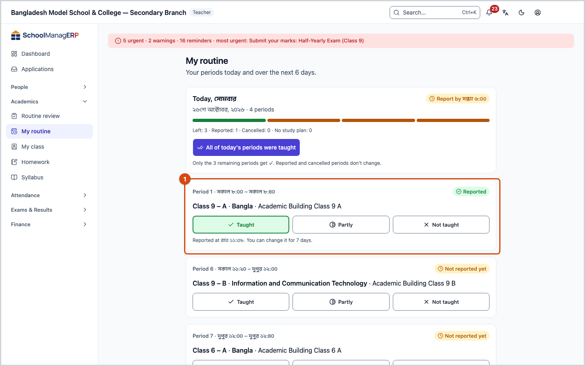
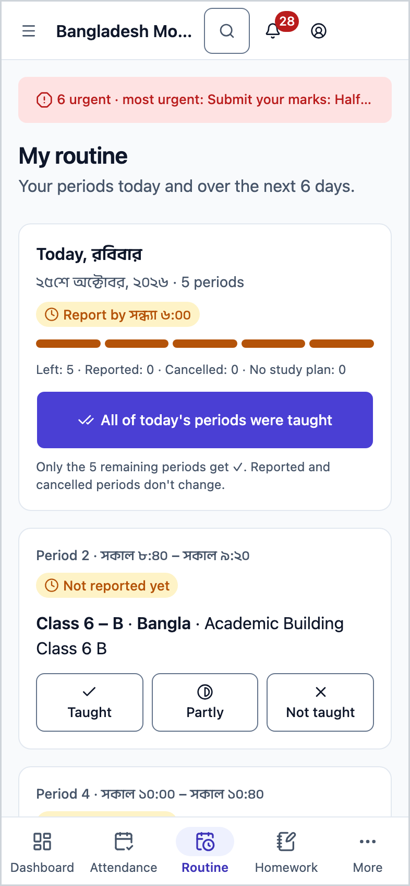

<!-- guide:meta
feature: academics.myRoutine
title: Seeing your routine and reporting periods
summary: Teachers see their own periods for today and the next days, see whom they are covering for, and report whether each period was taught.
roles: [ADMIN, TEACHER, EXECUTIVE, OFFICE_STAFF, EXAM_CONTROLLER]
sources:
  - client-admin/src/routes/_staff/routines/my.tsx
  - client-admin/src/routes/_staff/routines/-marking/dates.ts
  - client-admin/src/routes/_staff/routines/-marking/due-banner.tsx
  - client-admin/src/routes/_staff/routines/-marking/day-summary-card.tsx
  - client-admin/src/routes/_staff/routines/-marking/period-card.tsx
  - client-admin/src/routes/_staff/routines/-marking/not-taught-dialog.tsx
  - client-admin/src/routes/_staff/routines/-marking/next-days.tsx
  - client-admin/src/nav-tree.ts
  - client-admin/src/action-registry.ts
  - server/src/modules/routines/resolve-routine.controller.ts
  - server/src/modules/routines/resolve-routine.service.ts
  - server/src/modules/study-plans/lesson-deliveries.service.ts
labels:
  [
    routines:myRoutine.*,
    routines:marking.*,
    routines:agenda.*,
    nav:items.myRoutine,
    nav:groups.academics,
    nav:bottomNavCells.routine,
  ]
helpIds:
  [
    academics.myRoutine,
    academics.myRoutine.action.allTaught,
    academics.myRoutine.action.reportPast,
    academics.myRoutine.field.lessonStatus,
    academics.myRoutine.field.notTaughtReason,
  ]
devices: [desktop, phone]
entry: [sidebar, palette, page:dashboard]
keywords:
  [my routine, routine, today's periods, report periods, taught, substitute, lesson, timetable, today, agenda]
appVersion: 0.1.0 (e81ef857f)
owner: tareq89
lastVerified: 2026-10-24
knownIssues: []
-->

# Seeing your routine and reporting periods

See which of your periods are when, and in which section, today and over the next few days, and report whether each period was taught.

**Go to:** **Academics → My routine** in the left menu. On a phone, the **Routine** button at the bottom of the screen (for teachers).
**Before you start:** your account must have a teacher profile ([Adding and managing staff](../people/staff.md#task-teacher)), and the school's routine must have been sent for review or published ([Reviewing and publishing the routine](routine-review.md)).

This page is your own **day's routine**: one card for each of today's periods, and the next days below. If there is a study plan, you report after each period whether it was **Taught**, **Partly** or **Not taught**. We call this "reporting a period".

[Report today's periods](#task-main) · [All in one go](#task-all) · [Report an earlier day](#task-past) · [Next days](#task-next) · [Problems and fixes](#trouble)

**On this page**

- [How you get here](#arrive)
- [See and report today's periods](#task-main)
- [How to know it was reported](#confirm)
- [Other situations](#other)
  - [Report all of today's periods in one go](#task-all)
  - [Report a period as not taught](#task-not-taught)
  - [Report yesterday's or an earlier day's periods](#task-past)
  - [Substitute or cancelled periods](#task-cover)
  - [See the periods of the next days](#task-next)
- [Problems and fixes](#trouble)
- [Who can do what](#roles)
- [Learn more](#more)

---

## How you get here 

**From the left menu or the button at the bottom of the phone:** press **Academics → My routine**, or on a phone press **Routine** at the bottom. Start at step 1 below.

**From search:** in the search box at the top (Ctrl+K) type **Open my routine** or **Mark today's lessons** and choose it. → This page opens, on today. How search works: [Find any page](../start/find-anything.md).

**From the dashboard:** on a teacher's [dashboard](../dashboard/dashboard.md), the **My routine today** card shows today's periods; from the card you can go to My routine to see the whole week. (The name of the card's button has not been tried in the app.)

---

## See and report today's periods 

1. Press **Academics → My routine** in the left menu. On a phone, press **Routine** at the bottom.

   → **My routine** at the top: "Your periods today and over the next 6 days." Below it is the **Today, {weekday}** card: how many periods, **Report by {time}**, and how many are left, reported, cancelled and without a study plan.

2. Look at each period's card: at the top **Period {number} · {time}**, on the right its state (**Not reported yet**, **Reported** and so on). Below it is section · subject · room, and if there is a study plan, **Today's lesson**: "Lesson {number}: {title}".

3. After the period, press one of three buttons at the bottom of the card: **Taught**, **Partly** or **Not taught**.

   → Pressing **Taught** or **Partly** saves at once; the card shows **Reported** and below it "Reported at {time}. You can change it for 7 days." If you chose **Partly**, it says **Same lesson continues**. Pressing **Not taught** asks for a reason: [Report a period as not taught](#task-not-taught).

> **Remember:** there is no separate submit button; pressing the button reports it. If you get it wrong, press another button within 7 days to change it. A period without a study plan needs no report.

A period with no study plan shows **No study plan** on its card and the text "This section has no study plan for {subject} yet, so nothing to report." If you have permission, there is also a **Make a study plan** button.

---

## How to know it was reported 

Reporting a period is saved only when you are online. You cannot keep it on the phone and send it later, so there is no **Saved on this device** state here.

| State                           | How you can tell                                                                                                             | What next                                                    |
| ------------------------------- | ---------------------------------------------------------------------------------------------------------------------------- | ------------------------------------------------------------ |
| **Changed on screen only**      | The **Why wasn't the period taught?** dialog is open, or after you pressed a button the card still says **Not reported yet** | Submit with a reason, or check your internet and press again |
| **Reached the school's system** | The card says **Reported** and "Reported at {time}"                                                                          | Done                                                         |

**To check:** reload the page. If the card says **Reported** and the button you chose is marked, it is in the system.

**If it was not reported:** the card shows **Couldn't save. Try again.** and goes back to how it was. Check your internet and press again.

---

## Other situations 

### Report all of today's periods in one go 

1. On the **Today, {weekday}** card, press **All of today's periods were taught**. (The button shows only for today, and only while a period is left.)

   → **Taught** is set on the remaining periods only. Below it says: "Only the {number} remaining periods get ✓. Reported and cancelled periods don't change."

### Report a period as not taught 

1. On the card, press **Not taught**.

   → The **Why wasn't the period taught?** dialog opens; at the top it says that today's lesson moves to the next period.

2. From **Reason**, pick one: **Teacher absent**, **School closed**, **Exam** or **Other**.

3. If you pick **Other**, write one line in **What happened**. (Optional for the others.)

   → The submit button stays off if you have not picked a reason, or have written nothing for **Other**.

4. Press **Report as not taught**.

   → The dialog closes, and the card shows **Reported** and **Lesson moved — It will be in the next period**.

### Report yesterday's or an earlier day's periods 

If periods from an earlier day have not been reported, a warning appears at the top of today's page, for example **{number} periods from yesterday not reported**. Below it says how many more school days must pass before the head teacher and admin are told, or **The head teacher and admin have been told.**

1. In the warning, press **Report yesterday's periods** (or **Report {weekday}'s periods**).

   → That day's cards open; at the top **{weekday}, {date}** and **Back to today**.

2. Press a button on each card as before ([step 3](#task-main)).

3. At the end, press **Back to today**.

You can report or change periods up to 7 days back from today. This page does not open a day older than that; a link to an older day opens today instead. If a card's buttons are off, it says **Only an admin can change this now.**

### Substitute or cancelled periods 

- If the Admin makes you a [substitute teacher](routine-substitutions.md) for someone, that day's card says **Covering for {name}**.
- If a period is cancelled, the card says **Not taught · cancelled**: "The period was cancelled in the routine, so it was reported for you. Nothing to do."
- If you were on approved leave, it says **Not taught · on leave**: "You were on approved leave, so it was reported for you."
- No periods come on holidays and weekly off days; the day says **No periods.** How holidays are worked out: [Off days in the calendar](../people/calendar.md#task-offdays).

### See the periods of the next days 

1. Go to the **Next days** section at the bottom of the page.

   → Only the days that have periods: **{weekday}, {date}**, and below it "{number} periods · first {section}".

2. Press a day.

   → That day's periods open: period, section, subject, and the lesson name if there is one. Press again to close.

> **Remember:** you cannot report a coming day's periods from here; you can only look.

---

## Problems and fixes 

| What you see                                                          | What to do                                                                                                                                 | Who can help |
| --------------------------------------------------------------------- | ------------------------------------------------------------------------------------------------------------------------------------------ | ------------ |
| **No routine for you**                                                | Your account has no teacher profile. If you are a teacher, ask the Admin to give you a [teacher profile](../people/staff.md#task-teacher). | Admin        |
| **No routine published yet**                                          | The school's routine is still a draft. You will see it once the Admin [sends it for review or publishes it](routine-review.md).            | Admin        |
| **No periods.**                                                       | You have no period today, or today is a holiday. If that seems wrong, tell the Admin.                                                      | Admin        |
| **Could not load your routine. Check your connection and try again.** | Check your internet and press **Try again**.                                                                                               | —            |
| **Couldn't save. Try again.**                                         | Check your internet and press the button again.                                                                                            | —            |
| **Only an admin can change this now.**                                | That card cannot be reported by you. Ask the Admin to change it.                                                                           | Admin        |
| A period is in the wrong section or at the wrong time                 | If the routine is published, press **Request a change** on [Routine review](routine-review.md#task-request).                               | Admin        |

---

## Who can do what 

| Role                                                | See their own periods                                                           | Report periods                                                 |
| --------------------------------------------------- | ------------------------------------------------------------------------------- | -------------------------------------------------------------- |
| Teacher                                             | Yes, while the routine is in review or published                                | Yes, up to 7 days back from today                              |
| Admin                                               | If they have a teacher profile; if not, a **See class routines** button appears | If they have a teacher profile, up to 7 days back on this page |
| Academic coordinator, Office staff, Exam controller | If they have a teacher profile, while the routine is in review or published     | If they have a teacher profile                                 |
| Accountant, Committee member                        | Do not see the page                                                             | No                                                             |

Students and guardians see the published routine in their own portal.

---

## Learn more 

<strong>Parts of the page</strong> — top to bottom

1. If an earlier day is pending, the warning and **Report yesterday's periods**.
2. The **Today, {weekday}** card — how many periods, the reporting deadline, the counts, **All of today's periods were taught**.
3. The card for each period — section, subject, room, today's lesson, **Taught** / **Partly** / **Not taught**.
4. **Next days**.

<strong>A teacher's day in My routine</strong>

<figure>
  
  <figcaption><em>Seeing and reporting periods</em></figcaption>
</figure>

- Even while the routine is **In review**, teachers see their own periods here, so mistakes can be caught before publishing.
- The **Report by {time}** deadline comes from the school's study plan setting; without a setting, it is 6 pm.

<strong>Short help for the boxes (the (?) button)</strong>

<!-- guide:generated:fields:routines -->

| Field                                 | What to enter                                                                                                                                         | Required?                           |
| ------------------------------------- | ----------------------------------------------------------------------------------------------------------------------------------------------------- | ----------------------------------- |
| Lesson status                         | For each period, choose Taught, Partly or Not taught. Not taught asks you for a reason.                                                               | Yes                                 |
| Reason (not taught)                   | Teacher absent, School closed, Exam or Other. Write one line when you choose Other. The lesson moves to the next period.                              | Yes, when not taught                |
| Teachers                              | One or more teachers for this period.                                                                                                                 | Yes                                 |
| Recurrence                            | Weekly, Biweekly (every other week; pick Week 1 or Week 2) or Monthly (pick the 1st, 2nd, 3rd, 4th, 5th or last occurrence of that day in the month). | Yes                                 |
| Gap between periods (minutes)         | 0 to 120. A new period row starts this many minutes after the one before it ends.                                                                     | No                                  |
| Most periods a teacher takes in a day | 1 or more; leave empty for no limit. Going over this limit stops the routine from saving.                                                             | No                                  |
| Most periods in a row                 | 1 or more; leave empty for no limit. Going over it still saves; it only shows a warning.                                                              | No                                  |
| Cancel the period                     | Tick it when nobody teaches the period on that date. The weekly routine itself does not change.                                                       | No                                  |
| Substitute teacher                    | Who teaches the period on that date. It cannot be the teacher already assigned, or someone with another class at that time.                           | Yes, unless the period is cancelled |
| Shift name                            | The shift's name, for example Morning or Day.                                                                                                         | Yes                                 |
| Day starts at                         | When the school day starts in this shift. A new shift starts with 8:00.                                                                               | Yes                                 |
| Day ends at                           | When the school day ends in this shift. It must be later than the start. A new shift starts with 16:00.                                               | Yes                                 |
| Room no.                              | The room's number or name, for example 101. Required.                                                                                                 | Yes                                 |

<!-- /guide:generated -->

**Related pages**

- [**Reviewing and publishing the routine**](routine-review.md) — send change requests about your own periods from there.
- [**Recording a substitute teacher**](routine-substitutions.md) — whom the Admin gave in place of whom shows on the card here.

---

_Version 0.1.0 · Last checked 2026-10-24_
