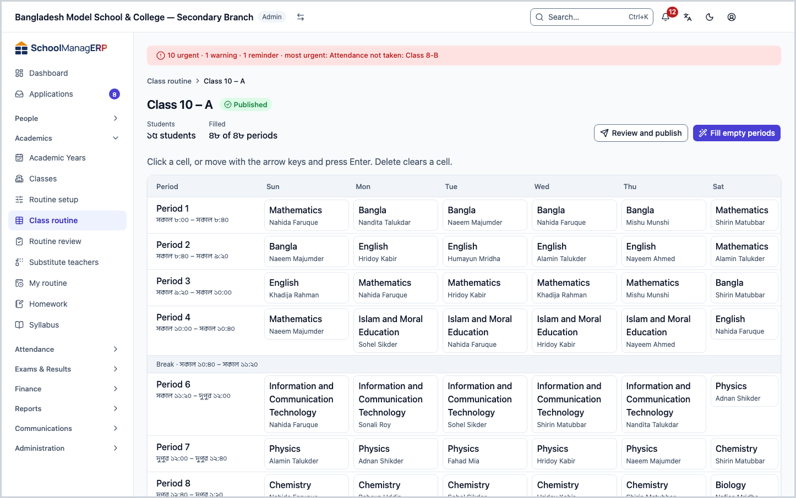
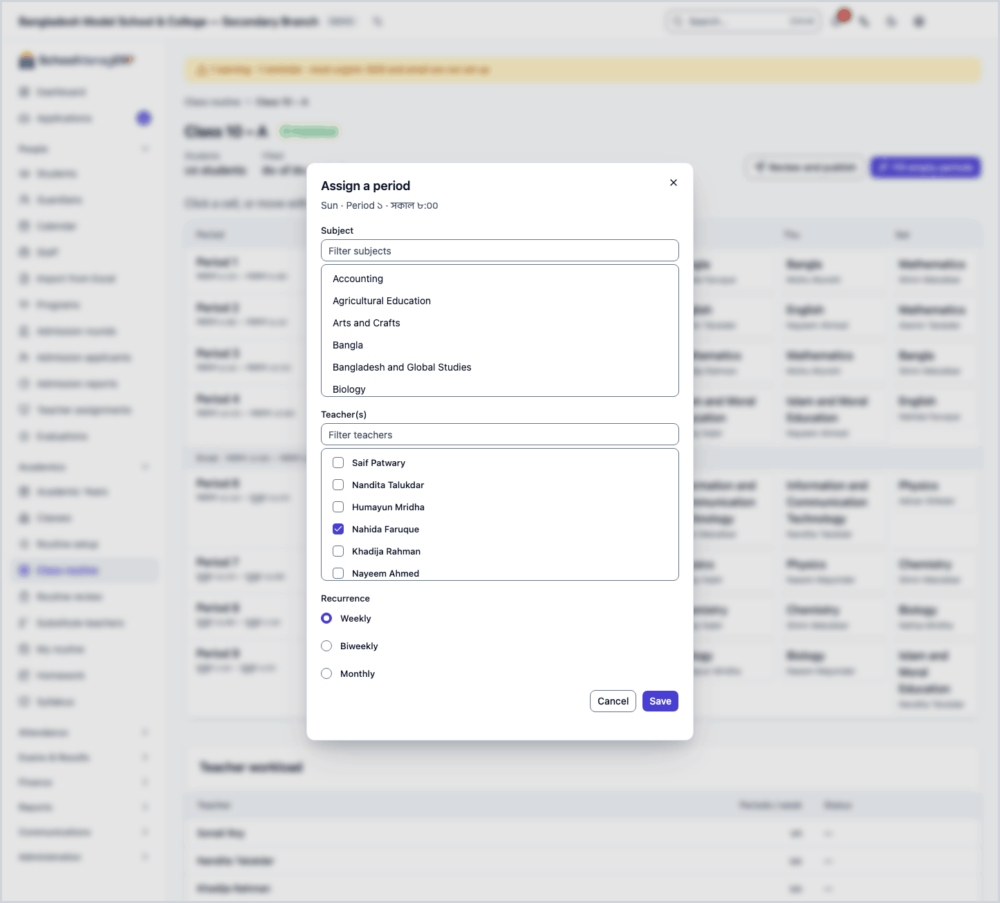

<!-- guide:meta
feature: academics.routineBuilder
title: Arranging a class's weekly routine
summary: Place subjects and teachers in each section's weekly routine table, see rule clashes, fill empty cells in one go, and check teacher workload.
roles: [ADMIN]
sources:
  - client-admin/src/routes/_staff/routines/index.tsx
  - client-admin/src/routes/_staff/routines/$sectionId.tsx
  - client-admin/src/routes/_staff/routines/-builder-day-list.tsx
  - client-admin/src/routes/_staff/routines/-cell-picker.tsx
  - client-admin/src/routes/_staff/routines/-conflict-list.tsx
  - client-admin/src/routes/_staff/routines/-fill-assist-dialog.tsx
  - client-admin/src/routes/_staff/routines/-workload-panel.tsx
  - client-admin/src/route-permissions.ts
  - server/src/modules/routines/routine-slots.controller.ts
  - server/src/modules/routines/routine-slots.service.ts
  - server/src/modules/routines/constraint-check.ts
  - server/src/modules/routines/greedy-fill.service.ts
  - server/src/modules/routines/workload.service.ts
  - server/src/modules/routines/routine.service.ts
labels:
  [
    routines:builderList.*,
    routines:builder.*,
    routines:grid.*,
    routines:cellPicker.*,
    routines:conflictList.*,
    routines:workloadPanel.*,
    routines:fillAssist.*,
    routines:review.stateLabel.*,
    nav:items.routineBuilder,
    nav:groups.academics,
  ]
helpIds:
  [
    academics.routineBuilder,
    academics.routineBuilder.action.fillAssist,
    academics.routineBuilder.field.teachers,
    academics.routineBuilder.field.recurrence,
    academics.routineBuilder.action.review,
  ]
devices: [desktop]
entry: [sidebar, palette]
keywords:
  [routine, class routine, weekly routine, period, grid, teacher, subject, workload, timetable, builder]
appVersion: 0.1.0 (e81ef857f)
owner: tareq89
lastVerified: 2026-10-24
knownIssues: []
-->

# Arranging a class's weekly routine

In each section's weekly routine, place which subject is taught in which period on which day, and by whom.

**Go to:** **Academics → Class routine** in the left menu. Do the work on this page on a computer; the table is made for a big screen.
**Before you start:** be the school's Admin ([who can do what](#roles)). These must already exist:

- Shifts and their period times: [**Routine setup**](routine-setup.md).
- Classes and sections, and a shift for the class (set on the class page).
- A routine for the current academic year. If there is none, opening a section shows **No routine yet**; press **Create routine** there, and a new **Draft** routine is made.
- Teachers given duties for the section and subject: [**Giving teachers class and section duties**](../people/teaching-assignments.md). You can place a teacher without a duty, but a warning appears, and **Fill empty periods** picks only teachers who have the duty.

On this page you work on one **routine table** per section. The table's columns are the days of the week (except the school's weekly off days) and its rows are periods. Each cell holds one subject and one or more teachers. The routines of all the school's sections together make one routine, and its state (**Draft**, **In review**, **Published**) is shown above the table.

[Fill a cell](#task-main) · [Fill empty cells in one go](#task-fill) · [Clear a cell](#task-clear) · [Clashes and warnings](#task-conflicts) · [Problems and fixes](#trouble)

**On this page**

- [Place a period in a cell](#task-main)
- [How to know it was saved](#confirm)
- [Other situations](#other)
  - [Clashes and warnings](#task-conflicts)
  - [A period every two weeks or once a month](#task-recurrence)
  - [Fill empty cells in one go](#task-fill)
  - [Change or clear a cell](#task-clear)
  - [Changing a published routine](#task-published)
  - [See teacher workload](#task-workload)
- [Problems and fixes](#trouble)
- [Who can do what](#roles)
- [Learn more](#more)

---

## Place a period in a cell 

1. Press **Academics → Class routine** in the left menu.

   → The **Class routine** page opens: "Pick a class, open a section, then arrange its weekly routine." Below it is the list of sections of the first class: **Section**, **Students**.

2. In **Class**, pick the class.

   → That class's sections appear in the list.

3. Press the section's name, or **Arrange routine** at the end of the row.

   → At the top: **{class} – {section}**, the routine's state, **Students** and **Filled** ("… of … periods"). Below it is the **Weekly routine table**. An empty cell says **Empty**, and a break row says **Break**.

4. Press the empty cell for the day and period you want to fill. (You can also move with the arrow keys and press Enter.)

   → The **Assign a period** dialog opens, with day · period · time at the top.

5. From the **Subject** list, pick a subject. In a long list, type in **Filter subjects** to find it.

6. From the **Teacher(s)** list, pick one or more teachers.

   → **Save** stays off until you have picked a subject and at least one teacher.

   If you want, pick a room under **Room (optional)**. Rooms come from [Routine setup](routine-setup.md#task-rooms); if you pick none, it stays **No room**.

7. Under **Recurrence**, keep **Weekly** in most cases. (For the others, see [A period every two weeks or once a month](#task-recurrence).)

8. Press **Save**.

   → The dialog closes, the **Saved** message appears, and the cell shows the subject and the teacher's name. The **Filled** count goes up by one.

> **Remember:** nothing reaches the system until you press **Save**. While the routine is a **Draft**, no teacher, student or guardian sees it in their own routine; to show it to everyone, publish it from the [**Routine review**](routine-review.md) page.

Instead of pressing a cell, you can also move to it and type a letter. The dialog opens and starts a subject search with that letter.

---

## How to know it was saved 

Routine cells are saved only when you are online. So there is no **Saved on this device** state here.

| State                           | How you can tell                                                                      | What next                                            |
| ------------------------------- | ------------------------------------------------------------------------------------- | ---------------------------------------------------- |
| **Changed on screen only**      | The **Assign a period** dialog is open, with a subject and teacher picked             | Press **Save**                                       |
| **Reached the school's system** | The **Saved** message appeared, and the cell shows the subject and the teacher's name | Done. When every section is done, send it for review |

**To check:** go back to **Class routine** and open the section again. If the name is in the cell, it is in the system. Or open the [**Routine review**](routine-review.md) page, pick the section in the **Class and section** filter, and look for the period.

**If no message appears:** if the open dialog shows **This can't be saved**, see [Clashes and warnings](#task-conflicts); for any other message, see [Problems and fixes](#trouble). What you picked in the open dialog is not lost.

---

## Other situations 

### Clashes and warnings 

When you save, the routine is checked against the rules. There are two kinds of result:

**Hard rules (the save is refused):** the reason is shown inside the open dialog under the title **This can't be saved**. The dialog stays open; change your picks and press **Save** again.

| Message                                                                          | What it means                                                                       |
| -------------------------------------------------------------------------------- | ----------------------------------------------------------------------------------- |
| **A period can't go into a break.**                                              | The row is a break ([Routine setup](routine-setup.md#task-periods))                 |
| **A teacher on this period is already teaching another section at this time.**   | The teacher is placed in another section at the same time                           |
| **A teacher on this period is already teaching at {branch} on {day}, {period}.** | The teacher teaches at another campus (branch) of your institution at the same time |
| **This section already has a period at this time.**                              | The cell is already filled                                                          |
| **This room is already in use at this time.**                                    | Another period uses the same room at the same time                                  |
| **This would put a teacher over their daily period limit.**                      | The daily limit in the [routine rules](routine-setup.md#task-rules)                 |

**Soft rules (the save goes through, with a warning):** the dialog closes, **Saved** appears, and a **Heads up** title above the table lists the warning. The cell carries a warning mark.

| Message                                                           | What to do                                                                                         |
| ----------------------------------------------------------------- | -------------------------------------------------------------------------------------------------- |
| **This teacher isn't assigned to this subject for this section.** | If it is right, give them the duty on the [teacher duties](../people/teaching-assignments.md) page |
| **A teacher would teach more periods in a row than the limit.**   | Move it to another period if you like; otherwise leave it as it is                                 |

### A period every two weeks or once a month 

1. In the **Assign a period** dialog, under **Recurrence**, pick **Biweekly** or **Monthly**.

   → A **Which week** field appears.

2. For **Biweekly**, pick **Week 1** or **Week 2**; for **Monthly**, pick one of **Occurrence 1** to **Occurrence 4**. This decides in which week the period happens.

3. Press **Save**.

   → The table cell shows **Biweekly** or **Monthly**.

Weeks are counted from the start date of the academic year. Whether two periods from different weeks can sit in the same cell has not been tried in the app.

### Fill empty cells in one go 

1. Above the section's table, press **Fill empty periods**.

   → The **Fill remaining periods** dialog opens: "Preview only — nothing is saved until you confirm. Already-filled cells are never touched." Below it is the list of suggestions: day · period, and subject · teachers.

2. Look through the list. Suggestions use only teachers who have been given this section's subject on the [teacher duties](../people/teaching-assignments.md) page; a teacher with fewer periods comes first.

   → If there is nothing, it shows **Nothing left to fill.**

3. Press **Fill {number} periods**.

   → The dialog closes and the new periods appear in the table.

| You press                 | What happens                                                                                                                                  | Saved?               |
| ------------------------- | --------------------------------------------------------------------------------------------------------------------------------------------- | -------------------- |
| **Fill {number} periods** | The suggestions are saved one by one. If one is stopped midway, the reason is shown; those already done stay, and the rest stay in the dialog | Yes, as many as done |
| **Cancel**                | Nothing changes                                                                                                                               | No                   |

### Change or clear a cell 

**To change:** press a filled cell. The dialog opens with the earlier subject and teachers picked. Change them and press **Save**. The change takes effect from today; for earlier days the old period stays.

A change is refused, with **This period has substitutions or open change requests. Resolve them first, or edit from a later date.**, when:

- the period has a [substitute teacher](routine-substitutions.md) recorded for today or a later day, or
- the period was placed today and a teacher's change request about it is still open.

Delete those substitutions first ([remove a substitution](routine-substitutions.md#task-correct)), or settle the request ([accept or reject a change request](routine-review.md#task-resolve)). Then change the cell again.

**To clear:** move to the cell with the keyboard and press Delete.

→ The cell becomes **Empty** with no question asked, and the **Period cleared** message appears. If **Could not clear this period — try again.** appears, the period stays; check your internet and press Delete again.

> **Remember:** there is no undo after Delete. If you clear one by mistake, place it again. While the routine is a **Draft** or **In review**, the period is deleted completely. In a **Published** routine, a period that has already been running is not deleted; it ends as of yesterday, so that earlier days stay correct.

### Changing a published routine 

After a routine is published, you can still place, change and clear cells from this page. Then:

- A change takes effect from the school's date today; you cannot change an earlier date.
- The routine can no longer go back to **Draft**.
- If someone is absent for one day only, do not change the routine; record a [**Substitute teacher**](routine-substitutions.md).

### See teacher workload 

Below the table is the **Teacher workload** section: each teacher's **Periods / week** and **Status**. A teacher who goes over the [daily limit](routine-setup.md#task-rules) on any day has **over daily limit** next to their name. At the top it says how many teachers have no periods assigned, and at the bottom **Total … periods**. This is the count for the whole routine, not just this section.

---

## Problems and fixes 

| What you see                                                                                              | What to do                                                                                                                                                                              | Who can help |
| --------------------------------------------------------------------------------------------------------- | --------------------------------------------------------------------------------------------------------------------------------------------------------------------------------------- | ------------ |
| **No classes yet**                                                                                        | Press **Go to classes** and add a class and its sections first.                                                                                                                         | Admin        |
| **No sections**                                                                                           | Press **Open class** and add sections to the class.                                                                                                                                     | Admin        |
| **This class has no shift**                                                                               | Press **Open class** and give the class a shift. If there is no shift, do [Routine setup](routine-setup.md) first.                                                                      | Admin        |
| **No routine yet**                                                                                        | Press **Create routine**. A new **Draft** routine is made for the current academic year. If **Could not create the routine — try again.** appears, check your internet and press again. | Admin        |
| **Which section?**                                                                                        | You came from an old link. Press **Class routine** and open the section from the list.                                                                                                  | Admin        |
| **Section not found.**                                                                                    | The section may have been removed. Press **Class routine** and pick it again.                                                                                                           | Admin        |
| **Couldn't load the classes. Check your connection and try again.**                                       | Check your internet and try again.                                                                                                                                                      | Admin        |
| **Could not save — try again.**                                                                           | Check your internet and press **Save** again.                                                                                                                                           | Admin        |
| **This period has substitutions or open change requests. Resolve them first, or edit from a later date.** | Delete the period's substitutions for today and later, or settle the open change request. See [Change or clear a cell](#task-clear).                                                    | Admin        |
| **This can't be saved**                                                                                   | See the reason written below it: [Clashes and warnings](#task-conflicts).                                                                                                               | Admin        |
| **Couldn't work out the periods to fill. Close this and try again.**                                      | Close the dialog and press **Fill empty periods** again.                                                                                                                                | Admin        |
| **This routine table needs a wider screen — try landscape or a bigger window.**                           | Open it on a computer, or make the window bigger.                                                                                                                                       | —            |
| Friday and Saturday (or some other day) are missing from the table                                        | That is a weekly off day of the school. To change it, see [Off days in the calendar](../people/calendar.md#task-offdays).                                                               | Admin        |
| You cannot find someone in the teacher list                                                               | Check whether they have a teacher profile: [Adding and managing staff](../people/staff.md#task-teacher).                                                                                | Admin        |

---

## Who can do what 

| Role                                                                                       | View and arrange the class routine |
| ------------------------------------------------------------------------------------------ | ---------------------------------- |
| Admin                                                                                      | Yes                                |
| Academic coordinator, Teacher, Accountant, Office staff, Exam controller, Committee member | No                                 |

People without permission do not have **Class routine** in their left menu. A teacher sees their own routine on the [**My routine**](my-routine.md) page.

---

## Learn more 

<strong>Parts of the page</strong> — top to bottom

1. **{class} – {section}** — the title, the routine's state, **Students**, **Filled**.
2. **Review and publish** and **Fill empty periods** — the two buttons at the top.
3. **Weekly routine table** — day × period.
4. **Teacher workload** — the period count for each teacher.

<strong>Keyboard</strong>

Arrow keys: move from cell to cell · Enter: open a cell · Delete: clear a cell · Any letter: open the cell and search subjects with that letter.

<strong>What happens when you fill a cell</strong>

<figure>
  
  <figcaption><em>Filling a cell and checking the rules</em></figcaption>
</figure>

<strong>The whole routine job at a glance</strong> — from setup to substitute teachers

<figure>
  
  <figcaption><em>From building a routine to substitute teachers</em></figcaption>
</figure>

1. [Routine setup](routine-setup.md): shifts, period times, rules.
2. This page: the table of each section.
3. [Routine review](routine-review.md): send it for review, then publish.
4. Teachers see it on the [My routine](my-routine.md) page.
5. If someone is absent, a [substitute teacher](routine-substitutions.md).

<strong>Short help for the boxes (the (?) button)</strong>

<!-- guide:generated:fields:routines -->

| Field                                 | What to enter                                                                                                                                         | Required?                           |
| ------------------------------------- | ----------------------------------------------------------------------------------------------------------------------------------------------------- | ----------------------------------- |
| Lesson status                         | For each period, choose Taught, Partly or Not taught. Not taught asks you for a reason.                                                               | Yes                                 |
| Reason (not taught)                   | Teacher absent, School closed, Exam or Other. Write one line when you choose Other. The lesson moves to the next period.                              | Yes, when not taught                |
| Teachers                              | One or more teachers for this period.                                                                                                                 | Yes                                 |
| Recurrence                            | Weekly, Biweekly (every other week; pick Week 1 or Week 2) or Monthly (pick the 1st, 2nd, 3rd, 4th, 5th or last occurrence of that day in the month). | Yes                                 |
| Gap between periods (minutes)         | 0 to 120. A new period row starts this many minutes after the one before it ends.                                                                     | No                                  |
| Most periods a teacher takes in a day | 1 or more; leave empty for no limit. Going over this limit stops the routine from saving.                                                             | No                                  |
| Most periods in a row                 | 1 or more; leave empty for no limit. Going over it still saves; it only shows a warning.                                                              | No                                  |
| Cancel the period                     | Tick it when nobody teaches the period on that date. The weekly routine itself does not change.                                                       | No                                  |
| Substitute teacher                    | Who teaches the period on that date. It cannot be the teacher already assigned, or someone with another class at that time.                           | Yes, unless the period is cancelled |
| Shift name                            | The shift's name, for example Morning or Day.                                                                                                         | Yes                                 |
| Day starts at                         | When the school day starts in this shift. A new shift starts with 8:00.                                                                               | Yes                                 |
| Day ends at                           | When the school day ends in this shift. It must be later than the start. A new shift starts with 16:00.                                               | Yes                                 |
| Room no.                              | The room's number or name, for example 101. Required.                                                                                                 | Yes                                 |

<!-- /guide:generated -->

**Related pages**

- [**Setting up shifts, period times, rooms and rules for the routine**](routine-setup.md) — the table's periods and the rules come from here.
- [**Reviewing and publishing the routine**](routine-review.md) — send the arranged routine for review and publish it.
- [**Recording a substitute teacher**](routine-substitutions.md) — for a one-day absence, give a substitute instead of changing the routine.
- [**Giving teachers class and section duties**](../people/teaching-assignments.md) — which teacher teaches which subject in which section; Fill empty periods picks teachers from here.
- [**Taking attendance**](../attendance/attendance.md) — per-period attendance needs the routine.
- [**Routine**](../portal/routine.md) — how guardians and students see the routine.

---

_Version 0.1.0 · Last checked 2026-10-24_
