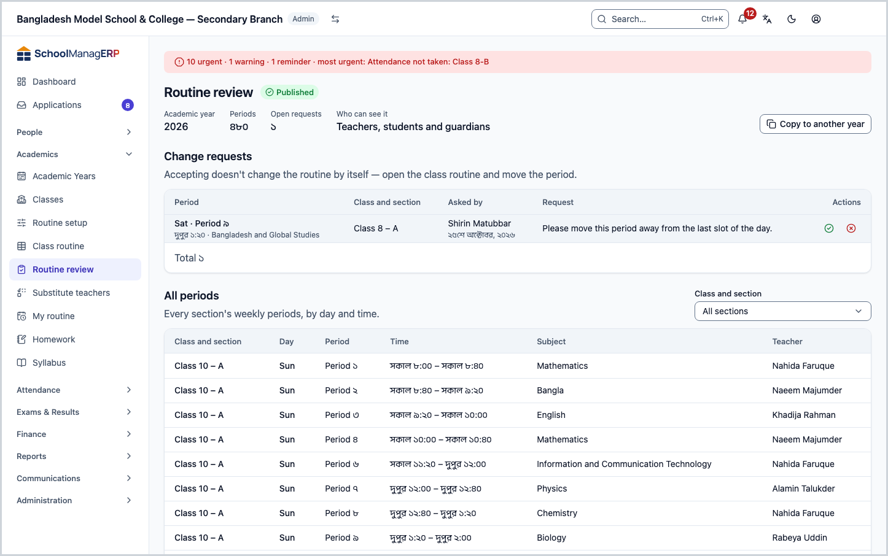
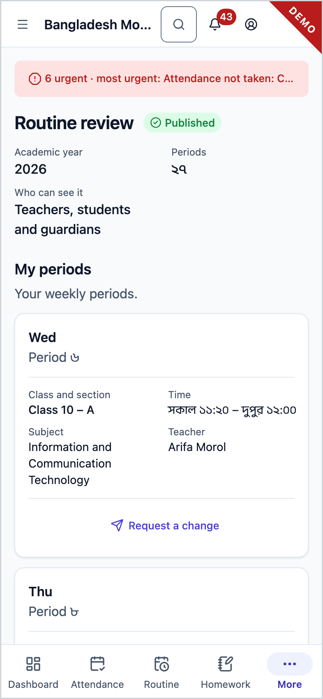
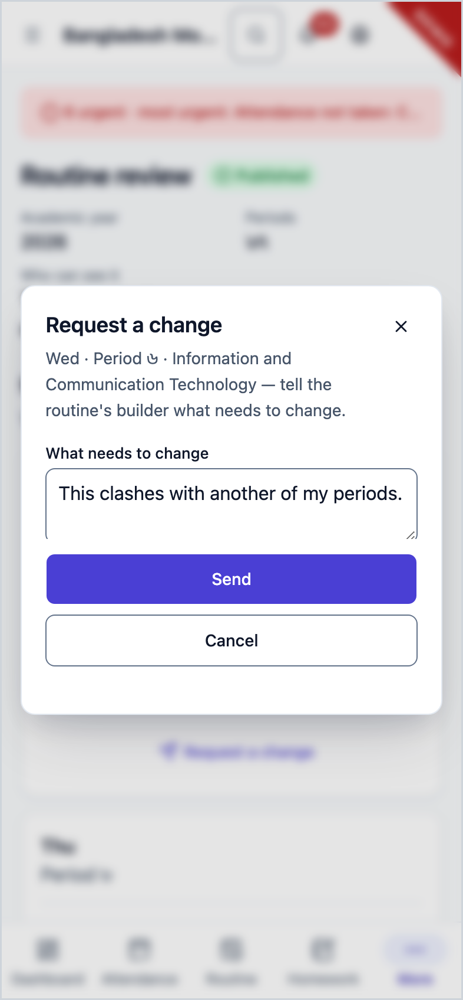

<!-- guide:meta
feature: academics.routineReview
title: Reviewing and publishing the routine
summary: See every period of the arranged routine in one list, send it for review so teachers can look, publish it, handle teachers' change requests, and copy the routine to another academic year.
roles: [ADMIN, TEACHER, EXECUTIVE, OFFICE_STAFF, EXAM_CONTROLLER]
sources:
  - client-admin/src/routes/_staff/routines/review.tsx
  - client-admin/src/routes/_staff/routines/-publish-dialog.tsx
  - client-admin/src/routes/_staff/routines/-change-request-dialog.tsx
  - client-admin/src/routes/_staff/routines/-change-request-list.tsx
  - client-admin/src/route-permissions.ts
  - client-admin/src/nav-tree.ts
  - shared/src/enums/permissions.ts
  - server/src/modules/routines/routine-slots.controller.ts
  - server/src/modules/routines/routine-state.service.ts
  - server/src/modules/routines/change-requests.controller.ts
  - server/src/modules/routines/change-requests.service.ts
  - server/src/modules/routines/copy-routine.service.ts
  - server/src/modules/routines/resolve-routine.service.ts
labels:
  [
    routines:review.*,
    routines:publishDialog.*,
    routines:changeRequestDialog.*,
    routines:changeRequestList.*,
    routines:agenda.periodLabel,
    nav:items.routineReview,
    nav:groups.academics,
  ]
helpIds:
  [
    academics.routineReview,
    academics.routineReview.action.submitForReview,
    academics.routineReview.action.publish,
    academics.routineReview.action.copyYear,
    academics.routineReview.action.requestChange,
    academics.routineReview.action.resolveRequest,
  ]
devices: [desktop, phone]
entry: [sidebar, palette, page:academics.routineBuilder]
keywords:
  [routine, review, publish, draft, change request, copy, academic year, copy year]
appVersion: 0.1.0 (e81ef857f)
owner: tareq89
lastVerified: 2026-10-24
knownIssues: []
-->

# Reviewing and publishing the routine

Send the arranged routine for review so teachers can look at it, then publish it for everyone. Teachers see their own periods here and send change requests from here.

**Go to:** **Academics → Routine review** in the left menu. Do the publishing on a computer; teachers can also see their own periods on a phone.
**Before you start:** the current academic year's routine must have at least some periods placed: [**Arranging a class's weekly routine**](routine-builder.md). Only the Admin sends it for review and publishes it ([who can do what](#roles)).

This page works on the current academic year's **routine**. A routine has three states:

| State         | Who can see it (as the page says)     | Can it go back?            |
| ------------- | ------------------------------------- | -------------------------- |
| **Draft**     | Only the people who build the routine | —                          |
| **In review** | Teachers, each their own periods      | Yes, **Withdraw to draft** |
| **Published** | Teachers, students and guardians      | No, never                  |

[Publish](#task-main) · [Change request (teacher)](#task-request) · [Handle requests](#task-resolve) · [Copy to another year](#task-copy) · [Problems and fixes](#trouble)

**On this page**

- [How you get here](#arrive)
- [Send the routine for review and publish it](#task-main)
- [How to know it was published](#confirm)
- [Other situations](#other)
  - [Withdraw from review to draft](#task-withdraw)
  - [See the list of all periods](#task-list)
  - [Teacher: ask for a change](#task-request)
  - [Accept or reject a change request](#task-resolve)
  - [Copy to another academic year](#task-copy)
- [Problems and fixes](#trouble)
- [Who can do what](#roles)
- [Learn more](#more)

---

## How you get here 

**From the left menu:** press **Academics → Routine review**. Start at step 1 below.

**From search:** in the search box at the top (Ctrl+K) type **Routine review** and choose it. How search works: [Find any page](../start/find-anything.md).

**From Class routine:** above a section's table, press **Review and publish** ([Class routine](routine-builder.md)). → This page opens, with the periods of all sections; start at step 2 below. If there is no routine, the **Open routine review** button on the section page also brings you here.

---

## Send the routine for review and publish it 

1. Press **Academics → Routine review** in the left menu.

   → **Routine review** at the top, with the state next to it (for example **Draft**). The facts: **Academic year**, **Periods**, **Who can see it**. Below is the **All periods** list.

2. Look through the **All periods** list to check that every section is filled ([See the list of all periods](#task-list)).

3. At the top, press **Submit for review**.

   → The **Updated** message appears. The state becomes **In review**, and **Who can see it** says "Teachers, each their own periods". Teachers now see their own periods on the [My routine](my-routine.md) page. Students and guardians still do not.

4. Ask the teachers to look. If it is right, press **Publish** at the top.

   → The **Publish this routine** dialog opens: "Once published, the routine can't go back to draft. To change something later, edit it in the class routine from a new date."

5. In the dialog, press **Publish**.

   → The **Published** message appears. The state becomes **Published**, and **Who can see it** says "Teachers, students and guardians". The **Change requests** section appears on the page.

| You press   | What happens                                                                                                             | Saved? |
| ----------- | ------------------------------------------------------------------------------------------------------------------------ | ------ |
| **Publish** | The routine opens to everyone; students and guardians also see it in the portal. It can never go back to draft or review | Yes    |
| **Cancel**  | Nothing changes; the routine stays **In review**                                                                         | No     |

> **Remember:** publishing cannot be undone. But even after publishing, you can still change cells from today's date in the [Class routine](routine-builder.md#task-published). For a one-day absence, give a [substitute teacher](routine-substitutions.md) instead of changing the routine.

---

## How to know it was published 

Work on this page happens only when you are online. So there is no **Saved on this device** state here.

| State                           | How you can tell                                                                    | What next                       |
| ------------------------------- | ----------------------------------------------------------------------------------- | ------------------------------- |
| **Changed on screen only**      | The **Publish this routine** dialog is open                                         | Press **Publish** in the dialog |
| **Reached the school's system** | The **Published** or **Updated** message appeared, and the state at the top changed | Done                            |

**To check:** reload the page. If the state at the top says **Published**, the routine is published. Ask a teacher to open their [My routine](my-routine.md) and look.

**If no message appears:** if **Could not update — try again.** or **Could not publish — try again.** appears, the state has not changed; reload to check, then press again. None of the routine's periods is lost.

---

## Other situations 

### Withdraw from review to draft 

While the routine is **In review**, press **Withdraw to draft** at the top.

→ The **Updated** message appears and the state becomes **Draft**. Teachers no longer see periods in My routine. The periods are not deleted. A published routine does not have this button.

### See the list of all periods 

The Admin sees the **All periods** list: **Class and section**, **Day**, **Period**, **Time**, **Subject**, **Teacher**. The list is sorted by class and section, then day, then period; it shows 25 on a page.

1. On the right, pick one section from the **Class and section** field.

   → Only that section's periods. To see everything again, pick **All sections**.

If there is nothing, it shows **No periods yet** and an **Open class routine** button.

### Teacher: ask for a change 

On this page a teacher sees only **My periods** ("Your weekly periods."). Once the routine is published, they can object to one of their own periods.

1. Press **Academics → Routine review** in the left menu. (On a phone, open the menu and go to the same place.)

   → The **My periods** list. If the routine is not published yet, a note at the top says: **Change requests can only be raised once the routine is published.**

2. At the end of the row of the period you want to talk about, press **Request a change**.

   → The **Request a change** dialog opens, with day · period · subject at the top.

3. In **What needs to change**, write it, for example "This clashes with another of my periods." (Up to 500 characters.)

   → If the field is empty, **Send** stays off.

4. Press **Send**.

   → The **Sent** message appears and the dialog closes.

| You press  | What happens                                                                                    | Saved? |
| ---------- | ----------------------------------------------------------------------------------------------- | ------ |
| **Send**   | The request goes to the Admin's **Change requests** list. The routine does not change by itself | Yes    |
| **Cancel** | Nothing is sent                                                                                 | No     |

> **Remember:** sending a request does not change the routine; the Admin decides.

### Accept or reject a change request 

Once the routine is published, the Admin's page has a **Change requests** section, and **Open requests** in the facts at the top shows how many.

1. Look at the requests in the list: **Period**, **Class and section**, **Asked by**, **Request**.

   → If there are none, it shows **No open requests**.

2. At the end of the row, press **Accept** or **Reject**.

   → A dialog opens: **Accept this request?** or **Reject this request?**

3. If you want, write a **Note for the teacher (optional)**.

4. In the dialog, press **Accept** or **Reject**.

   → The **Resolved** message appears, and the request leaves the list.

| You press  | What happens                                                               | Saved? |
| ---------- | -------------------------------------------------------------------------- | ------ |
| **Accept** | The request is closed as "accepted". The routine does not change by itself | Yes    |
| **Reject** | The request is closed as "rejected"                                        | Yes    |
| **Cancel** | The request stays open                                                     | No     |

> **Remember:** "Accepting doesn't change the routine by itself — open the class routine and move the period." After accepting, change the cell in the [Class routine](routine-builder.md#task-clear). A request that has been resolved cannot be reopened.

### Copy to another academic year 

Instead of arranging the new academic year's routine from nothing, copy this year's.

1. At the top, press **Copy to another year**.

   → A dialog of the same name opens: "Every period of this routine is copied into a new draft for the year you pick. Periods whose section or subject doesn't exist in that year are left out and counted."

2. From **Copy to**, pick the year. (The current year is not in the list.)

3. Press **Copy**.

   → The message **Copied — {number} periods left out** appears.

| You press  | What happens                                                                       | Saved? |
| ---------- | ---------------------------------------------------------------------------------- | ------ |
| **Copy**   | A new **Draft** routine is made for that year. This year's routine stays as it was | Yes    |
| **Cancel** | Nothing changes                                                                    | No     |

A year that already has a routine cannot be copied into; **Could not copy — try again.** appears. This page always shows the current academic year's routine; you will see the copied routine once that year becomes current.

---

## Problems and fixes 

| What you see                                                             | What to do                                                                                                                                                                | Who can help   |
| ------------------------------------------------------------------------ | ------------------------------------------------------------------------------------------------------------------------------------------------------------------------- | -------------- |
| **No routine yet**                                                       | The current academic year's routine has not been created. | Admin          |
| **No periods for you**                                                   | Your account has no teacher profile. If you are a teacher, ask the Admin to give you a [teacher profile](../people/staff.md#task-teacher).                                | Admin          |
| **My periods** is empty                                                  | You have not been given any period yet, or the routine is a draft. Ask the Admin.                                                                                         | Admin          |
| **Change requests can only be raised once the routine is published.**    | Come back after the routine is published.                                                                                                                                 | Admin          |
| **Could not load the routine. Check your connection and try again.**     | Check your internet and press **Try again**.                                                                                                                              | —              |
| **Could not update — try again.**                                        | Reload the page; someone else may have changed the state in the meantime. Then try again.                                                                                 | Admin          |
| **Could not publish — try again.**                                       | Reload and check whether the state is **In review**. If it is, press **Publish** again.                                                                                   | Admin          |
| **Could not send — try again.**                                          | Check your internet and press **Send** again. What you wrote stays in the field.                                                                                          | Admin          |
| **Could not load change requests. Check your connection and try again.** | Reload the page.                                                                                                                                                          | Admin          |
| **Could not resolve — try again.**                                       | Reload; someone else may have resolved it already.                                                                                                                        | Admin          |
| **Could not copy — try again.**                                          | Check whether the year you picked already has a routine. If it does, the copy will not work.                                                                              | Admin, support |

---

## Who can do what 

| Role                                                | What they see on this page                                                                          | Send for review, publish, copy, handle requests | Send a change request                            |
| --------------------------------------------------- | --------------------------------------------------------------------------------------------------- | ----------------------------------------------- | ------------------------------------------------ |
| Admin                                               | All periods of all sections                                                                         | Yes                                             | No (they can change it themselves)               |
| Teacher                                             | Only their own periods                                                                              | No                                              | Yes, once the routine is published               |
| Academic coordinator, Office staff, Exam controller | Their own periods if they have a teacher profile; otherwise nothing | No                                              | If they have a teacher profile, after publishing |
| Accountant, Committee member                        | Do not see the page                                                                                 | No                                              | No                                               |

People without permission do not have **Routine review** in their left menu.

---

## Learn more 

<strong>Parts of the page</strong> — as the Admin sees it

1. **Routine review** — the title, the state, and **Academic year**, **Periods**, **Open requests**, **Who can see it**.
2. The buttons at the top — **Copy to another year**, and, depending on the state, **Submit for review**, or **Withdraw to draft** and **Publish**.
3. **Change requests** — only on a published routine.
4. **All periods** — the list, with the **Class and section** filter.

<strong>The three states of a routine and who sees it</strong>

<figure>
  
  <figcaption><em>Draft, In review, Published</em></figcaption>
</figure>

- Students and guardians see a published routine in the portal.
- No periods take place on the calendar's holidays: [Off days in the calendar](../people/calendar.md#task-offdays).

**Related pages**

- [**Arranging a class's weekly routine**](routine-builder.md) — periods are placed and changed there.
- [**Seeing your routine and reporting periods**](my-routine.md) — teachers see their routine there, during review and after publishing.

---

_Version 0.1.0 · Last checked 2026-10-24_
