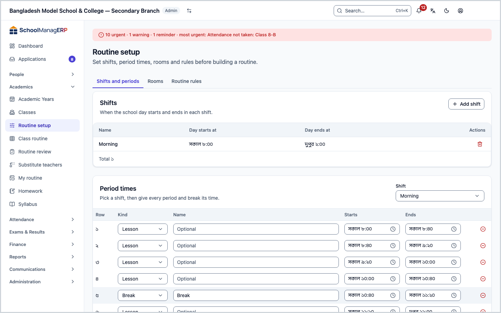
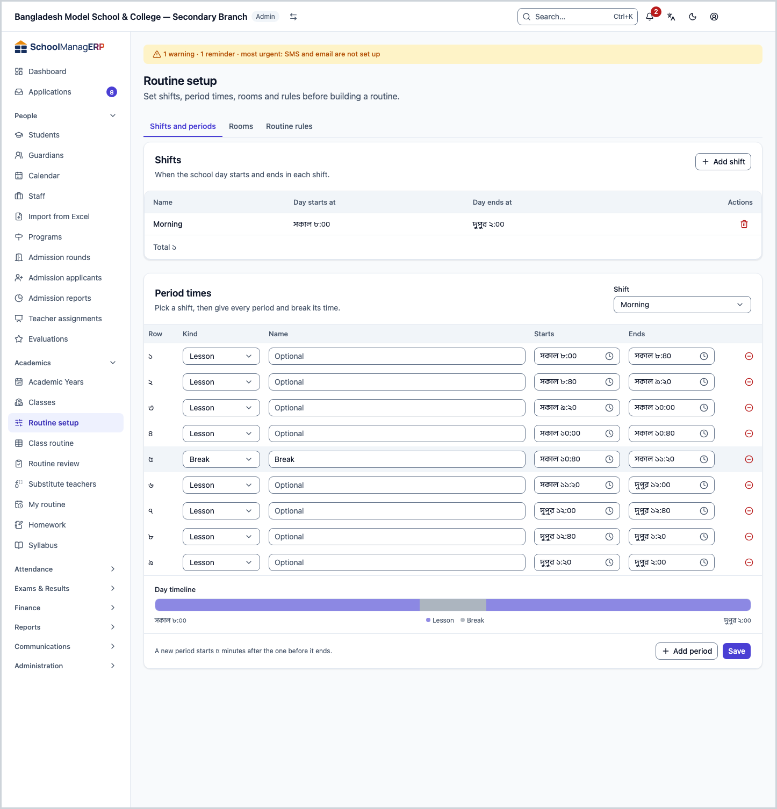

<!-- guide:meta
feature: academics.routineSetup
title: Setting up shifts, period times, rooms and rules for the routine
summary: Before you build routines, set the school's shifts, the period and break times of each shift, the list of rooms and the routine rules.
roles: [ADMIN]
sources:
  - client-admin/src/routes/_staff/routines/setup.tsx
  - client-admin/src/routes/_staff/routines/-setup/shifts-panel.tsx
  - client-admin/src/routes/_staff/routines/-setup/period-slots-panel.tsx
  - client-admin/src/routes/_staff/routines/-setup/rooms-panel.tsx
  - client-admin/src/routes/_staff/routines/-setup/routine-settings-panel.tsx
  - client-admin/src/route-permissions.ts
  - server/src/modules/routines/shifts.controller.ts
  - server/src/modules/routines/shifts.service.ts
  - server/src/modules/routines/period-slots.service.ts
  - server/src/modules/routines/rooms.controller.ts
  - server/src/modules/routines/rooms.service.ts
  - server/src/modules/routines/constraint-check.ts
labels:
  [
    routines:setupPage.*,
    routines:shiftsPanel.*,
    routines:periodSlotsPanel.*,
    routines:roomsPanel.*,
    routines:settingsPanel.*,
    routines:save.*,
    routines:delete.*,
    nav:items.routineSetup,
    nav:groups.academics,
  ]
helpIds:
  [
    academics.routineSetup,
    academics.routineSetup.action.deleteShift,
    academics.routineSetup.action.savePeriods,
    academics.routineSetup.field.changeover,
    academics.routineSetup.field.maxPeriodsPerDay,
    academics.routineSetup.field.maxConsecutive,
    academics.routineSetup.field.shiftName,
    academics.routineSetup.field.shiftStart,
    academics.routineSetup.field.shiftEnd,
    academics.routineSetup.field.roomNumber,
  ]
devices: [desktop]
entry: [sidebar, palette]
keywords:
  [routine, routine setup, shift, period, break, room, rules, period times, timetable]
appVersion: 0.1.0 (e81ef857f)
owner: tareq89
lastVerified: 2026-10-24
knownIssues: []
-->

# Setting up shifts, period times, rooms and rules for the routine

Before you build routines, set when the school day starts and ends, when each period runs, which rooms classes are held in, and how many periods one teacher can take in a day.

**Go to:** **Academics → Routine setup** in the left menu. Do the work on this page on a computer.
**Before you start:** be the school's Admin ([who can do what](#roles)). Have the school's timetable (which bell rings when) at hand.

This page has three tabs: **Shifts and periods**, **Rooms** and **Routine rules**. What you set here is what builds the table on the [**Class routine**](routine-builder.md) page: each row of the table is one period. A [shift](../help/glossary.md#shift) is one part of the school day, such as the morning shift or the day shift.

[Add a shift](#task-main) · [Set period times](#task-periods) · [Add a room](#task-rooms) · [Routine rules](#task-rules) · [Problems and fixes](#trouble)

**On this page**

- [Add a shift](#task-main)
- [How to know it was saved](#confirm)
- [Other situations](#other)
  - [Set the period times of a shift](#task-periods)
  - [Add a room](#task-rooms)
  - [Set the routine rules](#task-rules)
  - [Change a shift or a room](#task-edit)
  - [Delete a shift or a room](#task-delete)
- [Problems and fixes](#trouble)
- [Who can do what](#roles)
- [Learn more](#more)

---

## Add a shift 

1. Press **Academics → Routine setup** in the left menu.

   → The title **Routine setup** at the top, and below it "Set shifts, period times, rooms and rules before building a routine." The **Shifts and periods** tab is open.

2. In the **Shifts** section, press **Add shift**.

   → The **Add shift** dialog opens.

3. In **Name**, type the name of the shift, for example `Morning`.

   → If you leave it empty, it shows **Enter a shift name.**

4. Set **Day starts at** and **Day ends at**. A new dialog already has 8:00 and 16:00 filled in.

   → If the end time is before the start time, it shows **The day must end after it starts.** and the **Add** button stays off.

5. Press **Add**.

   → The dialog closes and the new shift appears in the **Shifts** list: **Name**, **Day starts at**, **Day ends at**.

> **Remember:** adding a shift does not build a routine. Next, [set the period times of the shift](#task-periods), and give each class a shift from the class page. A class with no shift shows **This class has no shift** on the class routine.

---

## How to know it was saved 

Nothing on this page can be kept on a phone or computer and sent later. It is saved only when you are online. So there is no **Saved on this device** state here.

| State                           | How you can tell                                                                               | What next                 |
| ------------------------------- | ---------------------------------------------------------------------------------------------- | ------------------------- |
| **Changed on screen only**      | The shift or room dialog is still open; or you changed a period row but did not press **Save** | Press **Add** or **Save** |
| **Reached the school's system** | The shift or room is in the list; for periods or rules, the **Saved** message appeared         | Done                      |

**To check:** reload the page. If the shifts, period rows, rooms and rule numbers are as you left them, they are in the system.

**If no message appears:** see [Problems and fixes](#trouble). The period rows stay on screen; as long as you stay on the page you can press **Save** again.

---

## Other situations 

### Set the period times of a shift 

1. On the **Shifts and periods** tab, go to the **Period times** section below. In **Shift**, pick the shift.

   → You see a timeline of the shift's day and the list of period rows. If there are no rows, it says: "This shift has no periods yet. Press Add period." If there is no shift at all, it shows **Add a shift first**.

2. Press **Add period**.

   → A new row appears. The first row starts at the shift's **Day starts at**; each next row starts a few minutes after the one before it ends (the minutes come from the [routine rules](#task-rules)). Each new row is 40 minutes long.

3. In each row, pick the **Kind**: **Lesson** or **Break**. If you want, give a **Name** (for example `Tiffin`; optional). Then set **Starts** and **Ends**.

   → If a row's time is wrong, a red note appears under the row: **Ends before it starts.**, **Keep it inside the shift (…).** or **Starts before the row above ends.** While that is so, **Save** stays off.

4. To drop a wrong row, press the remove button next to the row. The other rows are renumbered by themselves.

5. Press **Save**.

   → The **Saved** message appears.

> **Remember:** nothing reaches the system until you press **Save**. If you try to leave without saving, the app warns you. You cannot place a period of the class routine in a **Break** row.

You can change the times later too, even after periods are placed in the class routine. Under the rows it says: **Changing a time also changes it on past days.** But if you remove a row, or turn a **Lesson** row into a **Break**, and that period is already used in a routine or in lesson records, it does not save: **A period you removed or made a break is used in a routine or in lesson records. Put it back. If only the class routine uses it, you can clear it from the routine first.**

### Add a room 

1. Press the **Rooms** tab.

   → The **Rooms** list. If there is nothing yet, it shows **No rooms yet**.

2. Press **Add room**.

   → The **Add room** dialog opens.

3. Type the **Room no.** (required). If you want, also give the **Building** and the **Capacity** (1 or more).

4. Press **Add**.

   → The dialog closes and **Room {number}** appears in the list.

> **Remember:** the list of rooms is also used for exam seat plans.

### Set the routine rules 

1. Press the **Routine rules** tab.

   → It says: "These limits are checked while you build a routine." There are three fields:

   | Field                                     | What to enter                                                                            |
   | ----------------------------------------- | ---------------------------------------------------------------------------------------- |
   | **Gap between periods (minutes)**         | 0 to 120. A new period row starts this many minutes after the one before it ends         |
   | **Most periods a teacher takes in a day** | 1 or more; leave empty for no limit. Going over this limit stops the routine from saving |
   | **Most periods in a row**                 | 1 or more; leave empty for no limit. Going over it still saves; it only shows a warning  |

2. Change the numbers and press **Save**.

   → The **Saved** message appears. If you enter a wrong number, the field shows **Enter a whole number of at least 1, or leave it empty for no limit.** or **Enter a whole number from 0 to 120.**

> **Remember:** a new rule is checked only against periods you place or change from now on. Periods already placed do not move by themselves. (Read from the code; not tried in the app.)

### Change a shift or a room 

1. In the **Shifts** list or the **Rooms** list, press **Edit** at the end of the row.

   → The **Edit shift** or **Edit room** dialog opens, with the earlier details filled in.

2. Change the name, the times, or the room's details, and press **Save**.

   → The dialog closes and the list shows the change.

A shift's day cannot be made shorter than its periods. If a period would fall outside the new times, it shows **Some periods of this shift fall outside these times. Change the period times first.**

### Delete a shift or a room 

1. In the **Shifts** list or the **Rooms** list, press **Delete** at the end of the row.

   → A dialog opens with **Delete {name}?** or **Delete room {number}?**: once deleted, it cannot be brought back.

| You press  | What happens                                                                                            | Saved? |
| ---------- | ------------------------------------------------------------------------------------------------------- | ------ |
| **Delete** | The shift or room leaves the list. If it is in use, it is not deleted and a message appears (see below) | Yes    |
| **Cancel** | Nothing changes                                                                                         | No     |

- A shift that still has period rows cannot be deleted: **This shift still has period times, so it can't be deleted. Remove its rows under Period times first.**
- A room used in a routine or in an exam seat plan cannot be deleted: **Periods in the routine use this room, so it can't be deleted. Move those periods to another room first.** (The same text appears for seat plans.)

---

## Problems and fixes 

| What you see                                                                            | What to do                                                                                                                            | Who can help |
| --------------------------------------------------------------------------------------- | ------------------------------------------------------------------------------------------------------------------------------------- | ------------ |
| **You don't have access to this page.**                                                 | Only the Admin can set up the routine. Ask the Admin.                                                                                 | Admin        |
| **Couldn't add the shift. Try again.**                                                  | Check your internet and press **Add** again. What you typed stays in the dialog.                                                      | Admin        |
| **This name isn't valid. Check it and try again.**                                      | Type a different name.                                                                                                                | Admin        |
| **Some rows have a time problem. Fix the red notes and save again.**                    | Fix the time of the rows with red notes, then press **Save**.                                                                         | Admin        |
| **A period you removed or made a break is used in a routine or in lesson records. …**   | Put the row back as it was. If only the class routine uses it, clear it there first ([Class routine](routine-builder.md#task-clear)). | Admin        |
| **Some periods of this shift fall outside these times. Change the period times first.** | Make the shift's day wider, or first change the [period times](#task-periods).                                                        | Admin        |
| **Couldn't save the period times. Try again.**                                          | Check your internet and press **Save** again. The rows stay on screen.                                                                | Admin        |
| **Couldn't add the room. Try again.**                                                   | Check your internet and try again.                                                                                                    | Admin        |
| **Couldn't save the rules. Check the numbers and try again.**                           | Check that the numbers are within the limits, then press **Save** again.                                                              | Admin        |
| **Couldn't delete the shift. Try again.** or **Couldn't delete the room. Try again.**   | Check your internet and press **Delete** again.                                                                                       | Admin        |

---

## Who can do what 

| Role                                                                                       | View and change Routine setup |
| ------------------------------------------------------------------------------------------ | ----------------------------- |
| Admin                                                                                      | Yes                           |
| Academic coordinator, Teacher, Accountant, Office staff, Exam controller, Committee member | No                            |

People without permission do not have **Routine setup** in their left menu.

---

## Learn more 

<strong>Parts of the page</strong> — the three tabs

1. **Shifts and periods** — at the top, the **Shifts** list and **Add shift**; below, **Period times**: pick a shift, the **Day timeline**, the list of rows, **Add period** and **Save**.
2. **Rooms** — the **Rooms** list (**Room no.**, **Building**, **Capacity**) and **Add room**.
3. **Routine rules** — three number fields and **Save**.

<strong>What the fields mean</strong>

<!-- guide:generated:fields:routines -->

| Field                                 | What to enter                                                                                                                                         | Required?                           |
| ------------------------------------- | ----------------------------------------------------------------------------------------------------------------------------------------------------- | ----------------------------------- |
| Lesson status                         | For each period, choose Taught, Partly or Not taught. Not taught asks you for a reason.                                                               | Yes                                 |
| Reason (not taught)                   | Teacher absent, School closed, Exam or Other. Write one line when you choose Other. The lesson moves to the next period.                              | Yes, when not taught                |
| Teachers                              | One or more teachers for this period.                                                                                                                 | Yes                                 |
| Recurrence                            | Weekly, Biweekly (every other week; pick Week 1 or Week 2) or Monthly (pick the 1st, 2nd, 3rd, 4th, 5th or last occurrence of that day in the month). | Yes                                 |
| Gap between periods (minutes)         | 0 to 120. A new period row starts this many minutes after the one before it ends.                                                                     | No                                  |
| Most periods a teacher takes in a day | 1 or more; leave empty for no limit. Going over this limit stops the routine from saving.                                                             | No                                  |
| Most periods in a row                 | 1 or more; leave empty for no limit. Going over it still saves; it only shows a warning.                                                              | No                                  |
| Cancel the period                     | Tick it when nobody teaches the period on that date. The weekly routine itself does not change.                                                       | No                                  |
| Substitute teacher                    | Who teaches the period on that date. It cannot be the teacher already assigned, or someone with another class at that time.                           | Yes, unless the period is cancelled |
| Shift name                            | The shift's name, for example Morning or Day.                                                                                                         | Yes                                 |
| Day starts at                         | When the school day starts in this shift. A new shift starts with 8:00.                                                                               | Yes                                 |
| Day ends at                           | When the school day ends in this shift. It must be later than the start. A new shift starts with 16:00.                                               | Yes                                 |
| Room no.                              | The room's number or name, for example 101. Required.                                                                                                 | Yes                                 |

<!-- /guide:generated -->

<strong>How routine setup works</strong> — from shift to the class table

<figure>
  
  <figcaption><em>From shift to the class routine table</em></figcaption>
</figure>

- Which days appear in the class routine table comes from the school's weekly off days: [Off days in the calendar](../people/calendar.md#task-offdays).
- Which shift a class gets is set on the class page.

<strong>The whole routine job at a glance</strong> — from setup to substitute teachers

<figure>
  
  <figcaption><em>From building a routine to substitute teachers</em></figcaption>
</figure>

<strong>Short help for the boxes (the (?) button)</strong>

<!-- guide:generated:fields:routines -->

| Field                                 | What to enter                                                                                                                                         | Required?                           |
| ------------------------------------- | ----------------------------------------------------------------------------------------------------------------------------------------------------- | ----------------------------------- |
| Lesson status                         | For each period, choose Taught, Partly or Not taught. Not taught asks you for a reason.                                                               | Yes                                 |
| Reason (not taught)                   | Teacher absent, School closed, Exam or Other. Write one line when you choose Other. The lesson moves to the next period.                              | Yes, when not taught                |
| Teachers                              | One or more teachers for this period.                                                                                                                 | Yes                                 |
| Recurrence                            | Weekly, Biweekly (every other week; pick Week 1 or Week 2) or Monthly (pick the 1st, 2nd, 3rd, 4th, 5th or last occurrence of that day in the month). | Yes                                 |
| Gap between periods (minutes)         | 0 to 120. A new period row starts this many minutes after the one before it ends.                                                                     | No                                  |
| Most periods a teacher takes in a day | 1 or more; leave empty for no limit. Going over this limit stops the routine from saving.                                                             | No                                  |
| Most periods in a row                 | 1 or more; leave empty for no limit. Going over it still saves; it only shows a warning.                                                              | No                                  |
| Cancel the period                     | Tick it when nobody teaches the period on that date. The weekly routine itself does not change.                                                       | No                                  |
| Substitute teacher                    | Who teaches the period on that date. It cannot be the teacher already assigned, or someone with another class at that time.                           | Yes, unless the period is cancelled |
| Shift name                            | The shift's name, for example Morning or Day.                                                                                                         | Yes                                 |
| Day starts at                         | When the school day starts in this shift. A new shift starts with 8:00.                                                                               | Yes                                 |
| Day ends at                           | When the school day ends in this shift. It must be later than the start. A new shift starts with 16:00.                                               | Yes                                 |
| Room no.                              | The room's number or name, for example 101. Required.                                                                                                 | Yes                                 |

<!-- /guide:generated -->

**Related pages**

- [**Class routine**](routine-builder.md) — use the periods set here to arrange each section's weekly routine.
- [**Making and publishing seat plans**](../exams-results/seat-plans.md) — Pick the subjects of an exam and the rooms to make who sits in which room and seat, change seats if needed, give rooms an invigilator.

---

_Version 0.1.0 · Last checked 2026-10-24_
