<!-- guide:meta
feature: academics.routineSubstitutions
title: Recording a substitute teacher
summary: When a teacher is absent, give a substitute teacher for a specific period on a specific day, or cancel the period; the weekly routine does not change. Filter the list of earlier substitutions.
roles: [ADMIN]
sources:
  - client-admin/src/routes/_staff/routines/substitutions.tsx
  - client-admin/src/routes/_staff/routines/-substitution-dialog.tsx
  - client-admin/src/route-permissions.ts
  - server/src/modules/routines/substitutions.controller.ts
  - server/src/modules/routines/substitutions.service.ts
  - server/src/modules/routines/teacher-busy.service.ts
  - server/src/modules/routines/resolve-routine.service.ts
labels:
  [
    routines:substitutionsPage.*,
    routines:substitutionDialog.*,
    routines:agenda.periodLabel,
    nav:items.routineSubstitutions,
    nav:groups.academics,
  ]
helpIds:
  [
    academics.routineSubstitutions,
    academics.routineSubstitutions.action.add,
    academics.routineSubstitutions.field.cancelled,
    academics.routineSubstitutions.field.substituteTeacher,
  ]
devices: [desktop]
entry: [sidebar, palette]
keywords:
  [substitute, substitution, substitute teacher, absent teacher, cancel period, cover, proxy, proxy class]
appVersion: 0.1.0 (e81ef857f)
owner: tareq89
lastVerified: 2026-10-24
knownIssues:
  - { id: substitution-no-delete, checked: 2026-10-24, issue: 2895 }
  - { id: substitute-busy-generic-error, checked: 2026-10-24, issue: 2896 }
  - { id: old-year-rows-dash, checked: 2026-10-24, issue: 2897 }
-->

# Recording a substitute teacher

When a teacher is absent on a day, give their period to another teacher, or cancel the period.

**Go to:** **Academics → Substitute teachers** in the left menu. Do the work on this page on a computer.
**Before you start:** be the school's Admin ([who can do what](#roles)). The current academic year's routine must have that section's periods placed: [**Arranging a class's weekly routine**](routine-builder.md).

This page works on the **list of substitute teachers**: who took whose period on which day, and which periods were cancelled. One substitution is for one period on one date only. The weekly routine stays as it was; to change a teacher for good, change the cell in the [Class routine](routine-builder.md#task-clear).

[Add a substitute teacher](#task-main) · [Cancel a period](#task-cancel) · [Filter the list](#task-filter) · [Problems and fixes](#trouble)

**On this page**

- [Add a substitute teacher](#task-main)
- [How to know it was recorded](#confirm)
- [Other situations](#other)
  - [Cancel a period](#task-cancel)
  - [Correct a wrong substitution](#task-correct)
  - [Filter the list](#task-filter)
- [Problems and fixes](#trouble)
- [Who can do what](#roles)
- [Known issues](#known-issues)
- [Learn more](#more)

---

## Add a substitute teacher 

1. Press **Academics → Substitute teachers** in the left menu.

   → **Substitute teachers** at the top, and below it "Who took whose period on which day, and which periods were cancelled." Below that are the filters and the list.

<!-- image pending: Substitute teachers page, with the Add substitute teacher button, the filters and the list marked, admin, desktop -->

2. At the top, press **Add substitute teacher**.

   → The **Record a substitute teacher** dialog opens: "Pick the date and the period. The weekly routine itself doesn't change." The **Date** field already has today's date.

3. If you need to, change the **Date**.

4. From the **Class and section** field, pick the section.

   → The list has only the sections that have a period running in their routine on that date.

5. From the **Period** field, pick the period. Next to each one it shows period · time · subject · teachers.

   → Only that weekday's periods appear. If there are none, it shows **This section has no period on {weekday}.**

6. From the **Substitute teacher** field, pick the person who will teach.

   → The period's own teachers are not in this list.

7. If you want, write a **Reason (optional)**, for example `Sick leave` (up to 280 characters).

<!-- image pending: the Record a substitute teacher dialog, with Date, Class and section, Period and Substitute teacher marked, admin, desktop -->

8. Press **Save**.

   → The dialog closes, the **Saved** message appears, a new row appears in the list, and its **Status** says **Covered**.

| You press  | What happens                                                                                                                                 | Saved? |
| ---------- | -------------------------------------------------------------------------------------------------------------------------------------------- | ------ |
| **Save**   | The period for that day goes to the substitute teacher. They see it on that day in [My routine](my-routine.md), marked "Covering for {name}" | Yes    |
| **Cancel** | Nothing is recorded                                                                                                                          | No     |

> **Remember:** nothing reaches the system until you press **Save**. The button stays off until you have picked a date, a period and a substitute teacher (or ticked cancel). If the substitute teacher is busy in another period at that time, it will not save.

---

## How to know it was recorded 

A substitution is saved only when you are online. So there is no **Saved on this device** state here.

| State                           | How you can tell                                           | What next                         |
| ------------------------------- | ---------------------------------------------------------- | --------------------------------- |
| **Changed on screen only**      | The **Record a substitute teacher** dialog is open         | Press **Save**                    |
| **Reached the school's system** | The **Saved** message appeared, and the row is in the list | Done. Tell the substitute teacher |

**To check:** put that day in the **Date** filter, or pick their name in the **Substitute teacher** filter. If the row appears, it is in the system.

**If no message appears:** look for red text under the field, then see [Problems and fixes](#trouble). What you picked in the dialog is not lost.

---

## Other situations 

### Cancel a period 

If nobody will teach:

1. Press **Add substitute teacher**. Pick the **Date**, the **Class and section** and the **Period** (steps 3–5 above).

2. Tick **Cancel the period — nobody teaches it**.

   → The **Substitute teacher** field goes away.

3. If you want, write a **Reason (optional)** and press **Save**.

   → In the list, the row's **Status** says **Period cancelled**. In the teacher's My routine, that day's period shows **Not taught · cancelled**, and they do not have to report the period themselves.

### Correct a wrong substitution 

Record it again with **Add substitute teacher** for the same date and the same period. The new one takes the place of the earlier one; you do not get two rows. You can turn a cancellation into a substitution, or a substitution into a cancellation, this way.

There is no button to delete a substitution completely: [Known issues](#known-issues).

### Filter the list 

| Filter                 | What to pick                                                                                |
| ---------------------- | ------------------------------------------------------------------------------------------- |
| **Date**               | Two dates, **From** and **To**                                                              |
| **Substitute teacher** | The person who taught. If you pick nobody, **All teachers**                                 |
| **Absent teacher**     | The person whose period it was. If you pick nobody, **All teachers**                        |
| **Class**              | One class. If you pick nobody, **All classes**                                              |
| **Section**            | You must pick a class first (**Pick a class first**); then one section, or **All sections** |

The columns of the list: **Date**, **Period**, **Class and section**, **Absent teacher**, **Substitute teacher**, **Status**, **Reason**. The newest date is first. If nothing matches, it shows **No substitute teachers**, and **Clear filters** removes all the filters.

> **Remember:** the filters are only for viewing; they change no record.

---

## Problems and fixes 

| What you see                                                                                                            | What to do                                                                                                                                                 | Who can help |
| ----------------------------------------------------------------------------------------------------------------------- | ---------------------------------------------------------------------------------------------------------------------------------------------------------- | ------------ |
| **There is no routine for this academic year yet.**                                                                     | Arrange the routine first: [Class routine](routine-builder.md).                                                                                            | Admin        |
| **Pick a date first.**                                                                                                  | Enter a date in the **Date** field.                                                                                                                        | Admin        |
| **This section has no period on {weekday}.**                                                                            | Check the date; the section's routine has no period on that weekday.                                                                                       | Admin        |
| **This period doesn't happen on the date you picked (it may run every other week or once a month). Pick another date.** | The period is biweekly or monthly; pick a date in a week when it happens.                                                                                  | Admin        |
| **Could not save — try again.**                                                                                         | Check your internet. If that is fine, the substitute teacher is probably busy in another period then; pick another teacher. [Known issues](#known-issues). | Admin        |
| **Couldn't load substitute teachers. Check your connection and try again.**                                             | Check your internet and try again.                                                                                                                         | Admin        |
| The section is not in the **Class and section** list                                                                    | No period of that section is running on that date. Check the date.                                                                                         | Admin        |
| "—" in place of the period or section in an old row                                                                     | The row is from an earlier academic year: [Known issues](#known-issues).                                                                                   | —            |

---

## Who can do what 

| Role                                                                                       | See the list of substitutions | Give a substitute or cancel a period |
| ------------------------------------------------------------------------------------------ | ----------------------------- | ------------------------------------ |
| Admin                                                                                      | Yes                           | Yes                                  |
| Academic coordinator, Teacher, Accountant, Office staff, Exam controller, Committee member | No                            | No                                   |

A substitute teacher sees their substitute period on the [**My routine**](my-routine.md) page. People without permission do not have **Substitute teachers** in their left menu.

---

## Known issues 

Checked against the code for version 0.1.0 on 2026-10-24. Not tried in the app. This section will drop an item once it is fixed.

| Problem                                                                                                                                                                 | Who, when                               | Is the data saved?          | What to do for now                                                                                     |
| ----------------------------------------------------------------------------------------------------------------------------------------------------------------------- | --------------------------------------- | --------------------------- | ------------------------------------------------------------------------------------------------------ |
| A substitution or cancellation, once recorded, cannot be deleted                                                                                                        | Admin, after recording something wrong  | Yes, the wrong record stays | Fix it by recording again for the same date and period ([Correct a wrong substitution](#task-correct)) |
| If the substitute teacher is busy at that time, or is the period's own teacher, only **Could not save — try again.** appears with no reason; trying again does not help | Admin, when giving a substitute         | No                          | Pick a different teacher                                                                               |
| In substitution rows from an earlier academic year, the period, section and absent teacher show "—"                                                                     | Admin, after a new academic year starts | Yes                         | Recognise the row by its date and substitute teacher                                                   |

---

## Learn more 

<strong>How substitution works</strong> — for one day only

<figure>
  
  <figcaption><em>A one-day substitution; the weekly routine does not change</em></figcaption>
</figure>

- You can give a substitute only for a day when the period really runs in the routine. For a biweekly or monthly period, picking the wrong week gets stuck.
- A substitution is refused if the substitute teacher is in another period at the same time.

**Related pages**

- [**Arranging a class's weekly routine**](routine-builder.md) — lasting changes are made there; here it is for one day only.
- [**Seeing your routine and reporting periods**](my-routine.md) — the substitute teacher sees that day's period there.
- [**Staff attendance and leave**](../attendance/staff-attendance.md) — a teacher on leave is what makes a substitute necessary.

---

_Version 0.1.0 · Last checked 2026-10-24_
