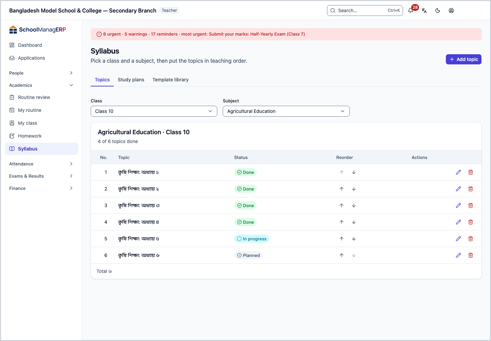
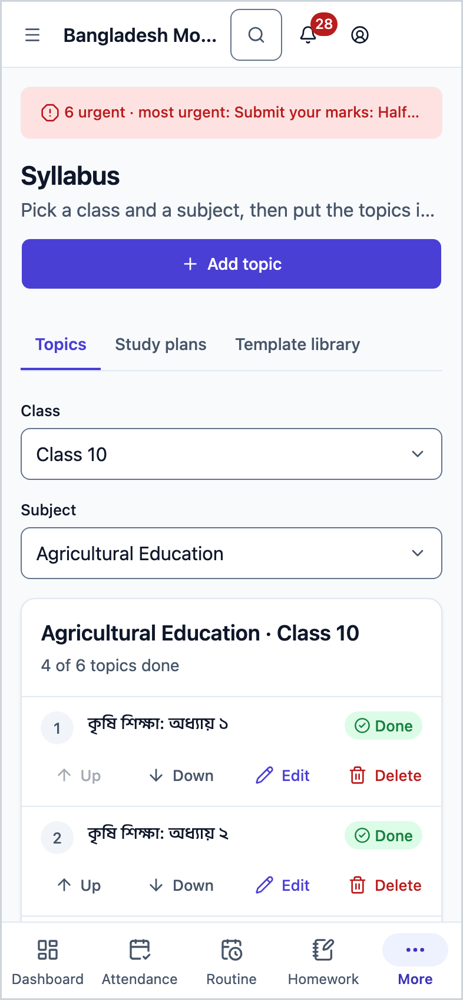
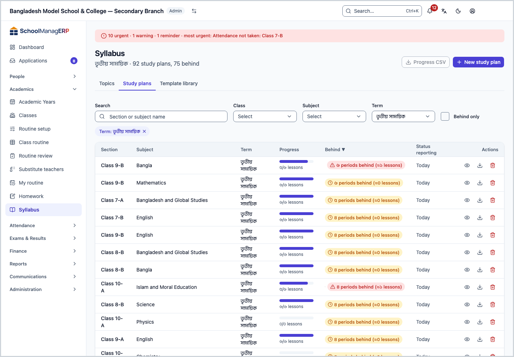
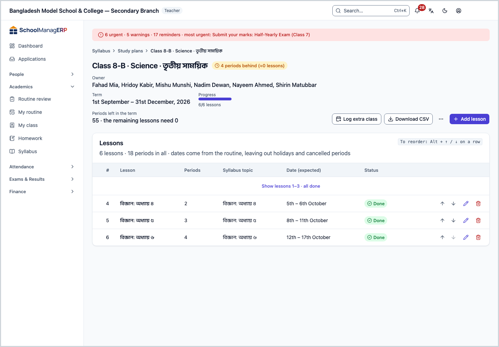
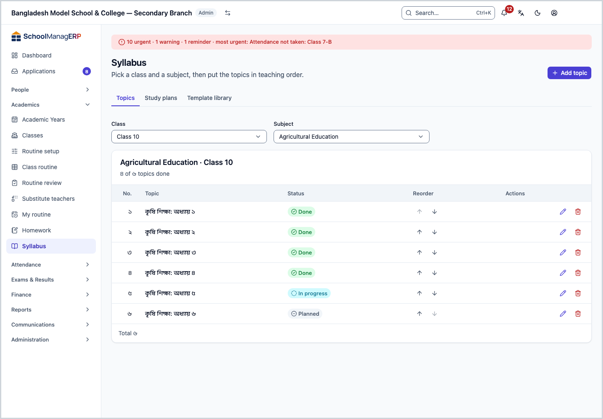

<!-- guide:meta
feature: academics.syllabus
title: Syllabus and study plans
summary: Put a class and subject's syllabus topics in order, make a study plan for each section's subject, and see which section is behind.
roles: [ADMIN, TEACHER, EXECUTIVE]
sources:
  - client-admin/src/routes/_staff/academics/syllabus/index.tsx
  - client-admin/src/routes/_staff/academics/syllabus/-topics-tab.tsx
  - client-admin/src/routes/_staff/academics/syllabus/-syllabus-topic-form.tsx
  - client-admin/src/routes/_staff/academics/syllabus/-plans-tab.tsx
  - client-admin/src/routes/_staff/academics/syllabus/-create-plan/create-plan-wizard.tsx
  - client-admin/src/routes/_staff/academics/syllabus/-library/library-tab.tsx
  - client-admin/src/routes/_staff/academics/study-plans/$planId.tsx
  - server/src/modules/homework/syllabus.controller.ts
  - server/src/modules/homework/syllabus.service.ts
  - server/src/modules/study-plans/study-plans.controller.ts
  - server/src/modules/study-plans/study-plans.service.ts
  - server/src/modules/study-plans/study-plan-templates.controller.ts
  - server/src/modules/study-plans/lesson-deliveries.service.ts
labels:
  [
    syllabus:list.*,
    syllabus:form.*,
    syllabus:tabs.*,
    syllabus:topics.*,
    studyPlans:list.*,
    studyPlans:create.*,
    studyPlans:library.*,
    studyPlans:detail.*,
    studyPlans:lesson.*,
    studyPlans:actions.*,
    studyPlans:extra.*,
    studyPlans:copy.*,
    studyPlans:markers.*,
    studyPlans:owner.*,
    nav:items.syllabus,
    nav:groups.academics,
    common:accessDenied.*,
  ]
helpIds:
  [
    academics.syllabus,
    academics.syllabus.action.deleteTopic,
    academics.syllabus.action.createPlan,
    academics.syllabus.action.deletePlan,
    academics.syllabus.action.copyToSection,
    academics.syllabus.field.topicStatus,
    academics.syllabus.field.term,
    academics.syllabus.field.periods,
    academics.syllabus.action.addTemplate,
    academics.syllabus.action.addTemplateCsv,
    academics.syllabus.action.copyToMine,
  ]
devices: [desktop, phone]
entry: [sidebar, palette]
keywords:
  [সিলেবাস, টপিক, বিষয়বস্তু, পাঠ পরিকল্পনা, পাঠ, পিছিয়ে, টেমপ্লেট, বাড়তি ক্লাস, পরীক্ষার সিলেবাস, syllabus, topic, study plan, lesson plan, template, behind]
appVersion: 0.1.0 (e424f8fc4)
owner: tareq89
lastVerified: 2026-10-24
knownIssues: []
-->

# Syllabus and study plans

Put what is taught in one subject of one class in order, and keep a plan of which lesson is taught when in each section.

**Where to go:** in the left menu, **Academics → Syllabus**. It also works on a phone.
**Before you start:** the class must have subjects and sections ([classes, sections and subjects](classes.md)). To see lesson dates, the class's routine must be published.

The page has three tabs. The **Topics** tab holds the syllabus of a class and subject: a list of contents, in order. The **Study plans** tab lists the lessons of every subject of every section; the dates come from the routine, so you can see which section is behind. The **Template library** tab holds the school's ready-made study plans, which you can copy to make a new plan.

[Add a topic](#task-main) · [Make a study plan](#task-plan-create) · [Arrange lessons in a plan](#task-plan-detail) · [Problems and fixes](#trouble)

**On this page**

- [How to reach this page](#arrive)
- [Add a topic to the syllabus](#task-main)
- [How to tell the topic was saved](#confirm)
- [Other situations](#other)
  - [Reorder, change the status of, or delete a topic](#task-topic-edit)
  - [Study plans: which section is behind](#task-plans)
  - [Make a new study plan](#task-plan-create)
  - [Arrange lessons on the plan page](#task-plan-detail)
  - [Extra class, copy to another section, exam marker](#task-plan-actions)
  - [The template library](#task-library)
- [Problems and fixes](#trouble)
- [Who can do what](#roles)
- [Learn more](#more)

---

## How to reach this page 

**From the left menu:** press **Academics → Syllabus**. The page opens on the **Topics** tab.

**From the search box:** in the search box at the top (Ctrl+K), type **Syllabus** and pick it. Search rules: [Finding any page](../start/find-anything.md).

**From a plan link:** if someone sends you the link to a study plan, that plan's page opens directly ([arrange lessons on the plan page](#task-plan-detail)).

---

## Add a topic to the syllabus 

1. In the left menu, press **Academics → Syllabus**.

   → At the top is the **Syllabus** heading, with **Pick a class and a subject, then put the topics in teaching order.** below it. The **Topics** tab is open, and you see **Pick a class and subject to see its syllabus.**

2. Pick the **Class** and the **Subject**.

   → The topic list of that class and subject appears below: **No.**, **Topic**, **Status**. At the top is the progress, for example **5 of 12 topics done**. If there is nothing, you see **No topics yet**.

3. At the top, press **Add topic**. The button does not appear until both class and subject are picked.

   → A small window named **Add topic** opens.

4. Write the **Name**, for example `Chapter 3: Fractions`. If you like, write a **Description**.

   → If the name is empty you see **Enter a topic name.**

5. Check the **Status**: **Planned**, **In progress** or **Done**. **Planned** is selected at the start.

6. Press **Save**.

   → The window closes and the new topic appears at the very end of the list.

**On a phone** the list shows as rows one below the other instead of a table; under each row are the buttons **Up**, **Down**, **Edit**, **Delete**.

> **Remember:** topics are for the whole class, not per section. A teacher can add topics only to a class-subject where they are the subject teacher ([who can do what](#roles)).

---

## How to tell the topic was saved 

The syllabus is saved only when you are online; it cannot be kept on the device and sent later.

| State                           | How to tell                                                                | What next      |
| ------------------------------- | -------------------------------------------------------------------------- | -------------- |
| **Changed on screen only**      | The **Add topic** window is open and the fields are filled in              | Press **Save** |
| **Reached the school's system** | The window is closed, the topic is in the list, the progress count went up | Done           |

**If the window does not close:** it shows **Something went wrong. Please try again.** See [Problems and fixes](#trouble).

---

## Other situations 

### Reorder, change the status of, or delete a topic 

- **To change the order:** press the **Up** or **Down** arrow on the row. The topic moves one place. If it does not, you see **Couldn't reorder topics. Try again.**
- **To change the status or name:** press **Edit**, change it in the **Edit topic** window, and press **Save**.
- **To delete:** press **Delete**. The app asks **Delete "{name}"? This can't be undone.** Press **Delete** again and it is gone.

| You press         | What happens                            | Can it be undone?             |
| ----------------- | --------------------------------------- | ----------------------------- |
| **Up** / **Down** | Swaps place with the neighbouring topic | Yes, press the opposite arrow |
| **Save**          | Changes the name, description or status | Yes, edit it again            |
| **Delete**        | The topic is deleted                    | No                            |

If study plans exist, small text under the topic shows in how many sections it has been taught, for example **Taught in 2 of 4 sections**.

### Study plans: which section is behind 

Press the **Study plans** tab. At the top it says, for example, **First term · 18 study plans, 3 behind**.

| Column               | What it shows                                                                                     |
| -------------------- | ------------------------------------------------------------------------------------------------- |
| **Section**          | Class and section                                                                                 |
| **Subject**          | The plan's subject                                                                                |
| **Term**             | Which term the plan is for, or **Whole year**                                                     |
| **Progress**         | How many lessons are done, for example **7/20 lessons**                                           |
| **Behind**           | **On track**, or for example **3 periods behind (≈2 lessons)**                                    |
| **Status reporting** | When periods were last reported: **Today**, **Yesterday**, or for example **3 days not reported** |

Filter with **Search** (section or subject name), **Class**, **Subject** and **Term** at the top. Tick **Behind only** to see only plans that are behind. An admin and an academic coordinator can pick a class and a term and press **Progress CSV** to download the progress as a file; if no class or term is picked, the button does not work.

When a lesson counts as "done": the teacher reports whether they taught in a period of their routine. If a teacher is on leave and there is no substitute, or a period is cancelled, the app records that period itself as "not taught". If a period is not reported, the teacher is reminded, and if it is very late the academic coordinator and the admin are told. How often and when depends on the school's settings; this has not been run in the app.

### Make a new study plan 

There is only one plan for each subject of each section in each term.

1. On the **Study plans** tab, press **New study plan** at the top.

   → **New study plan** opens, with the steps at the top: **Section · subject · term**, **How to start**, **Preview**, **Save**.

2. Pick the **Class**, **Section**, **Subject** and **Term** (if there are no terms, **Whole year**). Press **Next**.

   → If some lessons of this section-subject were left over from the last term, the app asks, for example **Add the 4 lessons left from last term?** If you say yes, they go at the start of the new plan.

3. Pick **Where do the lessons come from?**:
   - **Start empty** — you will write the lessons one by one later.
   - **From the library** — copy a school template and change it your way.
   - **From a CSV file** — upload a file written in Excel. To get a sample of the columns, press **Download a sample**. There are four columns: `title`, `periods`, `topic`, `notes`.

4. In the **Preview**, tick **Keep** for the lessons you want to keep. If there are many lessons, a line tells you about how many periods the term has and how many the lessons need.

5. Press **Save plan**.

   → The plan is created, and its page opens directly.

<figure>
  
  <figcaption><em>Nothing is saved until you press Save plan</em></figcaption>
</figure>

### Arrange lessons on the plan page 

Opening a plan from the list shows its page. At the top are **Owner** (which teacher), **Term**, **Progress** and **Periods left in the term**. Below is the **Lessons** list: **#**, **Lesson**, **Periods**, **Syllabus topic**, **Date (expected)**, **Status** (**Done**, **In progress**, **Upcoming**).

The app works out the dates itself, from the routine, leaving out holidays and cancelled periods. If the routine is not published, you see **Dates appear once the class routine is published.** If the term cannot hold a lesson, **Won't fit this term** shows beside it.

- **To add a lesson:** press **Add lesson**. Write the **Lesson title** and **Periods needed** (1 to 20); if you like, a **Syllabus topic** and **Notes or links**.
- **To change the order:** press the arrow on the row, or, with the row focused, Alt + ↑ / ↓.
- **To delete a lesson:** press **Delete lesson**. The app asks, and when it is deleted the lessons after it move up one place.

A plan can hold at most 400 lessons.

### Extra class, copy to another section, exam marker 

The buttons at the top of the plan page:

| Button                       | What it does                                                                                    | Who sees it                 |
| ---------------------------- | ----------------------------------------------------------------------------------------------- | --------------------------- |
| **Log extra class**          | Records a class taken outside the routine: **Date**, **Period**, **Note**                       | Whoever can change the plan |
| **Download CSV**             | Downloads the lesson list as a file; useful later for **From a CSV file**                       | Everyone                    |
| **Copy to another section**  | Copies the same lesson list to another section of the same year                                 | Whoever can change the plan |
| **Add to library**           | Keeps this lesson list in the library as a template                                             | Admin, academic coordinator |
| **Set exam syllabus marker** | Marks up to which lesson an exam's syllabus goes; the list shows **{exam} syllabus up to here** | Whoever can change the plan |
| **Change owner**             | Moves the plan's owner from **Routine's teacher** to **A specific teacher**                     | Admin only                  |
| **Delete plan**              | Deletes the lesson list; recorded periods stay                                                  | Whoever can change the plan |

- **Extra class:** a teacher cannot log a day older than 7 days; only an admin can. If the routine already has that subject in that period, it is not an extra class, and the app asks you to mark it from **My routine**.
- **Copy to another section:** a teacher can copy only to a section where they teach the subject. If that section already has a plan for this term, nothing is copied.
- **Delete plan:** the app asks **Delete the plan for {name}? Recorded periods stay; the lesson list is removed.** This cannot be undone from this app.

### The template library 

The **Template library** tab holds the school's study plan templates, arranged by class and subject code so they can be reused every year. Columns: **Subject · code**, **Template name**, **Lessons**, **Periods**, **Last updated**.

- **To look:** press **View** on a row to see its lessons.
- **To make your own plan:** press **Copy to my plan**. [New study plan](#task-plan-create) opens with the template already picked. The copy is separate; changing the template later does not change the copy.
- **To add a template** (admin, academic coordinator): press **Add template** and pick the **Source**, **From a study plan** or **From a CSV file**. Or press **Add from CSV** at the top. Two templates cannot have the same name.
- **To delete:** the app says that plans already copied keep their lessons.

---

## Problems and fixes 

| What you see                                                                               | What to do                                                                                                                                                                                                          | Who can help |
| ------------------------------------------------------------------------------------------ | ------------------------------------------------------------------------------------------------------------------------------------------------------------------------------------------------------------------- | ------------ |
| **Couldn't load syllabus topics.**                                                         | Check your internet and reload the page.                                                                                                                                                                            | Admin        |
| **Something went wrong. Please try again.** in the topic window                            | Check your internet. If you are a teacher: check whether you are the subject teacher for this class-subject ([teacher assignments](../people/teaching-assignments.md)). A class teacher alone cannot change topics. | Admin        |
| **Couldn't delete the topic. Try again.**                                                  | Check your internet and press again; if you are a teacher, check your duty as in the row above.                                                                                                                     | Admin        |
| **Couldn't load study plans.**                                                             | Check your internet and reload the page.                                                                                                                                                                            | Admin        |
| **{section} already has a plan for {subject} in {term}.**                                  | Do not make a new one; press **Open it**.                                                                                                                                                                           | —            |
| **You don't teach {subject} in {section}.**                                                | Whoever can make the plan is the teacher of that section-subject in the routine or duties. Tell an admin.                                                                                                           | Admin        |
| **{class} does not study {subject}.**                                                      | The subject is not attached to the class. [Attach a subject](classes.md#task-subjects).                                                                                                                             | Admin        |
| **The plan was created, but its lessons could not be applied. Open the plan to add them.** | The plan exists, the lessons do not. Go to the plan page and press **Add lesson**. Do not make it again.                                                                                                            | —            |
| **You can only change plans for the subjects you teach.**                                  | You can see it because you are the class teacher, but only the plan's owner can change it.                                                                                                                          | Admin        |
| **Only an admin can record a day older than 7 days.**                                      | Ask an admin to log the extra class.                                                                                                                                                                                | Admin        |
| **This period is already recorded for this day.**                                          | That period is already recorded; pick another period.                                                                                                                                                               | —            |
| **You don't have permission to view this study plan.**                                     | The plan is not for your section or subject.                                                                                                                                                                        | Admin        |
| **Study plan not found.** or a "not found" page                                            | The link is old, or the plan was deleted. Open it from the list.                                                                                                                                                    | Admin        |
| **Dates appear once the class routine is published.** in place of dates                    | The class routine is not published yet. Ask an admin to publish it.                                                                                                                                                 | Admin        |
| The **Study plans** list is empty, as a teacher                                            | You are not the owner of any plan, and not the class teacher of any section.                                                                                                                                        | Admin        |
| **You don't have access to this page.**                                                    | This page is only for admins, teachers, and executives (academic coordinators). Press **Back to dashboard**.                                                                                                        | Admin        |

---

## Who can do what 

| Role                                                        | Topics                                   | Study plans                                                                                      | Template library                |
| ----------------------------------------------------------- | ---------------------------------------- | ------------------------------------------------------------------------------------------------ | ------------------------------- |
| Admin                                                       | Sees all, changes all                    | Sees all, changes all, changes owner                                                             | Views, copies, adds and deletes |
| Teacher                                                     | Sees all; changes only their own subject | Sees those they own and those of sections they are class teacher of; changes only those they own | Views, copies                   |
| Academic coordinator                                        | Sees all, changes nothing                | Sees all, changes nothing                                                                        | Views, adds and deletes         |
| Accountant, Office assistant, Exam controller, Board member | No                                       | No                                                                                               | No                              |

**An admin** sees and changes the topics of all classes and the plans of all sections. Only an admin sees **Change owner**, and only an admin can log extra classes for days older than 7 days.

**A teacher** sees the topics of all classes, but can add, change or delete only in the class-subject where they are the subject teacher. In the study plans list they see two kinds of plans: those they own (the teacher of that section-subject in the routine; if there is no routine, the subject teacher's duty; or someone an admin has made owner), and all plans of sections they are class teacher of. They can change only the first kind. Opening a plan link for another section shows **You don't have permission to view this study plan.** They cannot add or delete templates.

**An academic coordinator** sees all topics and all plans, can download the progress CSV, and manages the template library (**Add template**, **Add to library**, delete). They cannot change topics or plans, make new plans, or press **Copy to my plan**; they do not see those buttons.

**Every other staff role** does not see **Syllabus** in the left menu. Opening the page shows **You don't have access to this page.** Students and guardians see the syllabus in their own apps, not on this page.

---

## Learn more 

<strong>Parts of the page</strong> — top to bottom

1. **Syllabus** — the heading, with small text below that depends on the tab.
2. **Buttons at the top** — **Add topic** on the **Topics** tab; **New study plan** and **Progress CSV** on the **Study plans** tab; **Add template** and **Add from CSV** in the library.
3. **Tabs** — **Topics**, **Study plans**, **Template library**.
4. **Inside a tab** — a picker or filters, then the list.

<strong>What the fields mean</strong>

<!-- guide:generated:fields:syllabus -->

| Field               | What to enter                                                         | Required? |
| ------------------- | --------------------------------------------------------------------- | --------- |
| Name (topic)        | The name of a part of the syllabus, for example Chapter 3: Fractions. | Yes       |
| Description (topic) | What the topic contains, in detail.                                   | No        |
| Status (topic)      | Planned, in progress or done. Planned at the start.                   | Yes       |
| Term                | Which term the plan is for. If there are no terms, the whole year.    | Yes       |
| Lesson title        | The name of one lesson, up to 200 characters.                         | Yes       |
| Periods needed      | How many periods the lesson takes to teach, 1 to 20.                  | Yes       |
| Syllabus topic      | Which topic the lesson belongs to.                                    | No        |
| Notes or links      | A note for yourself or a link, up to 2000 characters.                 | No        |

<!-- /guide:generated -->

<strong>How the syllabus works</strong> — from topics to lessons, from lessons to progress

<figure>
  
  <figcaption><em>Topics belong to the class, plans to the section</em></figcaption>
</figure>

- Topics belong to a class and subject; a plan belongs to a section, subject and term. So the four sections of one class have four separate plans, but only one topic list.
- Nobody writes lesson dates by hand. The app works them out from the routine's periods, holidays and cancelled periods, so when the routine changes, the dates change.
- A class teacher sees their section's summary in [My class](my-class.md); to give homework, see [Giving homework](homework.md).

**Related pages**

- [**Classes, sections and subjects**](classes.md) — add subjects and sections to a class.
- [**Academic years**](academic-years.md) — the year and its terms.
- [**Teacher assignments**](../people/teaching-assignments.md) — which teacher has which section and subject.
- [**Giving homework**](homework.md) — give homework to a section.
- [**My class**](my-class.md) — a summary of the class teacher's section.
- [**Syllabus (parent and student)**](../portal/syllabus.md) — how guardians and students see the syllabus.

---

_Version 0.1.0 · Last checked 2026-10-24_
