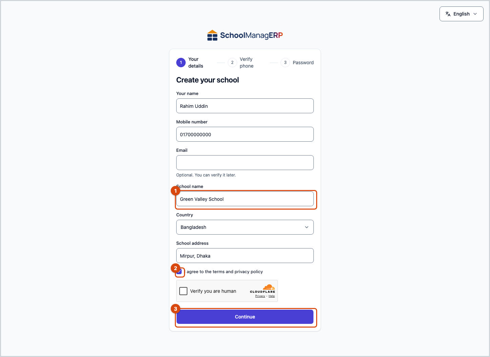

<!-- guide:meta
feature: admin.createSchool
title: Creating your school and the setup wizard
summary: Open your own school, verify your phone, then finish the first setup of your school in the setup wizard.
roles: [ADMIN]
sources:
  - client-admin/src/routes/register.tsx
  - client-admin/src/features/registration/register-flow.tsx
  - client-admin/src/features/registration/register-details-form.tsx
  - client-admin/src/features/registration/register-code-step.tsx
  - client-admin/src/features/registration/register-password-step.tsx
  - client-admin/src/features/onboarding/welcome-wizard.tsx
  - client-admin/src/features/onboarding/welcome-gate.ts
  - client-admin/src/features/onboarding/setup-checklist-card.tsx
labels:
  [
    register:title,
    register:steps.*,
    register:social.*,
    register:fields.*,
    register:terms,
    register:continue,
    register:otp.*,
    register:password.*,
    register:errors.*,
    register:validation.*,
    onboardingSetup:*,
    onboardingPeople:*,
    setupChecklist:title,
  ]
helpIds: [admin.createSchool, admin.createSchool.action.continue, admin.createSchool.action.verify]
devices: [desktop, phone]
entry: [public]
keywords: [create school, register, sign up, wizard, welcome, OTP, code, স্কুল খুলুন, নিবন্ধন, উইজার্ড]
appVersion: 0.1.0 (beb2d2e77)
owner: tareq89
lastVerified: 2026-10-24
knownIssues: []
-->

# Creating your school and the setup wizard

Open your own school, verify your mobile number, and follow the wizard to finish the first setup of your school.

**Where to go:** Before signing in. Add **/register** to the end of the app's address and open it. Get the address from the person who gave you the app. It is the same on a phone.
**Before you start:** Keep a Bangladesh mobile number with you, because a code will come to that number. If another school was already opened with that number or email, it will not work.

The person who opens a school becomes the **Admin** of that school. This page has three parts: the **Create your school** form, the **Set up your school** wizard, and the **Finish setting up your school** card that stays on the dashboard after the wizard.

[Create a school](#task-main) · [The wizard](#task-wizard) · [With Google or Facebook](#task-social) · [Problems and fixes](#trouble)

**On this page**

- [How you get here](#arrive)
- [Create a school](#task-main)
- [How to know your school was created](#confirm)
- [Other situations](#other)
  - [The setup wizard, step by step](#task-wizard)
  - [If you want to start with Google or Facebook](#task-social)
  - [When you sign in again later](#task-signin)
- [Problems and fixes](#trouble)
- [Who can do what](#roles)
- [Learn more](#more)

---

## How you get here 

**From the address directly**

1. Add **/register** to the end of the app's address and open it. → The **Create your school** page opens. Start from step 1 below.

**Coming back after Google or Facebook**

1. At the top of the form, press **Continue with Google** or **Continue with Facebook** and finish the steps there.
2. Come back to the app. → The page says "Continuing with Google" or "Continuing with Facebook". To fill in the rest, see [If you want to start with Google or Facebook](#task-social).

If you are already signed in, this page will not open. You go straight to the app.

---

## Create a school 

1. On the **Create your school** page, type **Your name**.

2. Type the **School name**, **Country**, **School address** and **Mobile number**. The **Email** is optional. You can verify it later.

   → The boxes are filled in.

3. Tick the box **I agree to the terms and privacy policy**.
4. If the page has a robot check (a box to show you are not a robot), finish it.
5. Press **Continue**.

   → The page title changes to **Enter the code we sent**. A 6-digit code goes to your number.

6. Type the code and press **Verify**.

   → If the code is right, you are signed in by yourself.

   If the code does not come, wait first. If it says "Send again in .. s", press **Send the code again** when the time is up. If the number is wrong, press **Change number**.

7. Sometimes the **Set your password** page comes. Type a password and press **Save and continue**. If the page has a **Not now** button, you can press it and carry on without a password.

   → The setup wizard opens, with the title **Set up your school**.

<!-- image pending: img/create-school-02-code.png — The code step: 1 the 6-digit code boxes, 2 Verify, 3 Send the code again -->

> **Remember:** The school is not opened until you press **Verify**. If you close the page, you must start again from step 1.

---

## How to know your school was created 

| State                           | How you know                                                                                                 | What next                                     |
| ------------------------------- | ------------------------------------------------------------------------------------------------------------ | --------------------------------------------- |
| **Reached the school's system** | After the code is verified (and after the password, if you set one), the **Set up your school** wizard opens | Finish the wizard, or press **Do this later** |

This is the only state that happens here.

**To check:** Close the page and open the app again, then [sign in](../start/sign-in.md). If you can get into your school, it has been created.

**If the wizard does not come:** see [Problems and fixes](#trouble).

---

## Other situations 

### The setup wizard, step by step 

The wizard has three steps at the top: **Set up**, **Add people**, **Done**.

1. On the **How do you want to set up your school?** page, choose one of the three ways.

   | You press                      | What happens                                                                                                                           | Saved?         |
   | ------------------------------ | -------------------------------------------------------------------------------------------------------------------------------------- | -------------- |
   | **Step by step** (**Easiest**) | You are asked a few questions. The name and logo are saved as you go, and a ready-made curriculum creates the classes when you pick it | Yes, as you go |
   | **From an Excel file**         | You download a file, fill it in and upload it                                                                                          | No, not yet    |
   | **I will do it later**         | You go to the **Add your people** page, where you can press **Next** without adding anyone                                             | No             |

2. If you chose **Step by step**, three pages come. At the bottom of each, press **Next**. To go back, press **Back**.
   - **Your school:** type the **School name (English)** and the **School name (Bangla)** (the Bangla name is optional). If you like, add a **School logo**. If you leave the English name empty, the message **Enter the school name.** appears.
   - **Classes and subjects:** pick a ready-made list, or press **Set up by hand**, or press **Skip this step**. If the school already has classes or students, a ready-made list cannot be applied.
   - **Sections:** for each class, set how many sections it has (the names A, B and so on are made for you), then press **Create sections**.

   → A message like "3 sections created" appears.

3. If you chose **From an Excel file**, there are three jobs: press **Download sample file**, fill the file in (each sheet has one example row), then press **Upload file**. If the file has problems, a message with the number appears, and **Download the list of problems** gives you the list. If it is fine, the **This is what will be created** list shows. Check it and press **Create these**.

   → The message **Your school has been set up.** appears.

4. On the **Add your people** page, add the students and the teachers and staff: **Add one by one** or **Upload Excel file**. If you do not want to do it now, just press **Next**. You can do it later from **People › Students** and **People › Staff**.
5. On the **Your school is ready** page, see how many classes, sections, students and staff were created. In the **What to do next** part there are **Set up fees**, **Invite guardians** and **Set up messages**. Press **Go to dashboard**.

   → The dashboard opens. Whatever is left from the wizard shows on the **Finish setting up your school** card.

If there is a **Want us to set it up for you? Talk to us** link at the bottom of the wizard, press it to get help.

> **Remember:** With **Step by step**, the name, logo and curriculum are saved as you go, and sections are created when you press **Create sections**. With Excel, nothing is created until you press **Create these**. An Excel file only adds new things. It does not change or delete anything you already have.

<!-- image pending: img/create-school-03-wizard-doors.png — The setup wizard: 1 the three ways, 2 the step bar at the top -->

The order to do the tasks in is on the [Setup order](setup-order.md) page.

### If you want to start with Google or Facebook 

1. At the top of the **Create your school** page, press **Continue with Google** or **Continue with Facebook**. If there is no button, fill in the normal form.

   → The Google or Facebook page opens.

2. Finish the steps there and come back to the app.

   → The message "Continuing with Google" appears. Your name and email may already be filled in.

3. Fill in the other boxes (school name, country, address, mobile number), and carry on from step 3 of [Create a school](#task-main).

### When you sign in again later 

Next time, come in through the normal [Signing in](../start/sign-in.md) page. The wizard comes only once: when the admin first opens the dashboard of an incomplete school. If you finish it, or press **Do this later** (the close button of the wizard, which also hides the card), it does not come again. After finishing, the rest of the work stays on the card on the dashboard.

---

## Problems and fixes 

| What you see                                                                                                                                   | What to do                                                                                  | Who can help |
| ---------------------------------------------------------------------------------------------------------------------------------------------- | ------------------------------------------------------------------------------------------- | ------------ |
| **This number is not supported yet. Use a Bangladesh mobile number.**                                                                          | Use a Bangladesh mobile number.                                                             | —            |
| **This number or email is already used for another school. Sign in instead.**                                                                  | [Sign in](../start/sign-in.md). You cannot open a second school with the same number.       | —            |
| **A trial school already exists for this number or email. Sign in instead.**                                                                   | Sign in.                                                                                    | —            |
| **You already have an account. Sign in to continue.**                                                                                          | Sign in.                                                                                    | —            |
| **Please complete the check to show you are not a robot.**                                                                                     | Finish the robot check box and press **Continue** again.                                    | —            |
| **The robot check could not load. Check your connection, turn off any blocker for this page, then reload.**                                    | Do what the message says: check your connection, turn off the blocker, open the page again. | —            |
| **That code is not right. Check it and try again.**                                                                                            | Look at the code and type it again.                                                         | —            |
| **That code has expired. Ask for a new one.**                                                                                                  | Press **Send the code again**.                                                              | —            |
| **Too many wrong tries. Please wait a while and try again.**                                                                                   | Wait a while and try again.                                                                 | —            |
| **You have asked for too many codes. Please go back and start again.**                                                                         | Press **Change number**, or open the page again and start over.                             | —            |
| **This sign-up has expired. Please start again.**                                                                                              | Fill in the form again. Your earlier details stay in the form.                              | —            |
| **Sign-up is not available right now. Please try again later.**                                                                                | Try again after a while.                                                                    | —            |
| **Signing up with that account did not work. Try again, or fill in the form below.**                                                           | Try again, or fill in the normal form.                                                      | —            |
| **Sign-up with that account was cancelled. You can fill in the form below instead.**                                                           | Fill in the normal form.                                                                    | —            |
| **Something went wrong. Please try again.**                                                                                                    | Try again.                                                                                  | —            |
| Under a box: **This field is required.**, **Enter a valid mobile number.**, **Enter a valid email address.** or **Please accept to continue.** | Fix that box.                                                                               | —            |
| The setup card is missing                                                                                                                      | See the problems list on the [Setup order](setup-order.md) page.                            | Admin        |

---

## Who can do what 

| Role          | Can create a school                               | The wizard and the setup card |
| ------------- | ------------------------------------------------- | ----------------------------- |
| Admin         | Yes. The person who opens the school is the admin | Yes                           |
| Everyone else | No. An admin adds them                            | No                            |

---

## Learn more 

<strong>From opening a school to the dashboard</strong>

<figure>
  
</figure>

- The number or email you used to open the school is your login.
- A person has only one login, and every branch is a separate school.
- A school that was already running before this wizard existed does not get the wizard or the setup card.

**Related pages**

- [**Setup order**](setup-order.md): the tasks after the wizard.
- [**How everything in your school fits together**](how-it-works.md): the structure of a school.

---

_Version 0.1.0 · Last verified 2026-10-24_
