<!-- guide:meta
feature: admin.howItWorks
title: How everything in your school fits together
summary: See in five pictures how branches, shifts, versions, groups, classes, sections, people, roles and fees connect.
roles: [ADMIN]
sources:
  - client-admin/src/features/onboarding/setup-checklist-card.tsx
  - client-admin/src/pages/settings/OrganisationSection.tsx
  - client-admin/src/pages/SchoolSettingsPage.tsx
  - shared/src/enums/permissions.ts
labels:
  [
    nav:groups.*,
    nav:tenantBar.*,
    nav:userMenu.schoolInvites,
    classes:list.shiftLabel,
    classes:list.versionLabel,
    classes:sectionForm.groupLabel,
    settings:organisation.*,
    settings:categories.school,
    setupChecklist:*,
  ]
helpIds: [admin.howItWorks]
devices: [desktop, phone]
entry: []
keywords: [structure, branch, shift, version, group, class, section, roles, fees, how it works, গঠন, শাখা, শিফট]
appVersion: 0.1.0 (beb2d2e77)
owner: tareq89
lastVerified: 2026-10-24
knownIssues: []
-->

# How everything in your school fits together

Before you set anything up, see how the parts of a school are arranged. Then it is easy to see why each step exists.

**Where to go:** This is not a page in the app. It is a page of this guide. Come here from the first page of the **For the admin** section.
**Before you start:** Nothing is needed. If you have not created your school yet, read [Creating your school and the setup wizard](create-school.md) first.

This page is about your **school**. A school is one institution with its own classes, students, staff and fees. Below are five pictures. After each picture there are a few short sentences and one example.

[A school and its branches](#task-branches) · [Academic year, class, section](#task-structure) · [Who sees what](#task-roles) · [The path of a fee](#task-money) · [One day of attendance](#task-attendance) · [Problems and fixes](#trouble)

**On this page**

- [Your school in five pictures](#task-main)
  - [A school and its branches](#task-branches)
  - [Academic year, class, section](#task-structure)
  - [Who sees what](#task-roles)
  - [The path of a fee](#task-money)
  - [One day of attendance](#task-attendance)
- [How to know your school is set up correctly](#confirm)
- [Other situations](#other)
  - [If you have only one school](#task-single-school)
  - [If you want to rename a shift, version or group](#task-rename-labels)
- [Problems and fixes](#trouble)
- [Who can do what](#roles)
- [Learn more](#more)

---

## Your school in five pictures 

The colours in the pictures show who does what. Orange boxes are the admin or accountant, blue boxes are the teacher, green boxes are the parent and student. Each box also has the role name written in it, so you do not need the colours.

### A school and its branches 

<figure>
  
</figure>

- **Every branch is a separate school.** It has its own classes, students, staff and fees. It can also keep its own **EIIN / registration number**.
- The students or fees of one school never mix with another school.
- A person has only one login. They can belong to more than one school.
- If you are in more than one school, use the **Switch school or role** menu at the top to move from one school to another.
- No school adds a person by itself. An invitation arrives, and the person joins only when they open the **Account menu** → **School invitations** and press **Accept**.

**Example:** Say you have a high school and a college branch. In the app these are two separate schools. Mr Rahim teaches in both. He has one login, but his staff details, attendance and leave are separate in each school.

### Academic year, class, section 

<figure>
  
</figure>

- Every **Class** in the school sits inside an **Academic year**. A school has only one current academic year at a time.
- Inside each class there are one or more **Sections**. A student is admitted to one particular section.
- **Shift** and **Version** are labels on a class. **Group** is a label on a section. All three are optional. If you do not use them, they stay **Not set**.
- In one academic year you cannot have two classes with the same name, shift and version. If the shift or version is different, two classes can have the same name.
- You decide the names yourself: **Settings** → **School** section, in the **Shift, version & group** part.
- A simple meaning of these words is in the [glossary](../help/glossary.md#shift).

**Example:** Say your school has a morning shift and a day shift. You add "Morning" and "Day" to the **Shifts** list. Now you can open "Class 9" twice in the same academic year: once for the morning shift and once for the day shift. In Class 9 section "A" the **Group** is "Science", and in section "B" it is "Business Studies".

### Who sees what 

<figure>
  
</figure>

- The school's information is kept in one place. A person's role decides how much of it they see.
- The Admin sets up the school: academic years, classes, staff, settings. These pages are for the admin only.
- A Teacher sees only the sections given to them on the [Teacher assignments](../help/glossary.md#teacher-assignment) page. If no section is given, they see no section.
- An Accountant sees the fee structure, fee bills and payments, and can also add students and guardians.
- A Parent and a Student see only their own information, in their own portal.
- There are more roles (for example Academic coordinator and Office staff). The list of all roles is in the Roles section.

**Example:** Say you give Mr Karim, the teacher of Class 9 section "A", that section. When he signs in he sees only the students and attendance of that section. The fee pages are not there for him. The mother of one student in that section sees only her own child's information in her own portal.

### The path of a fee 

<figure>
  
</figure>

- First the admin or accountant sets a fee structure: which class pays how much for which item.
- Then, when you create the fee bills, the dues are created in each student's name.
- When money is received, the accountant records the payment. A receipt is then created. In the app, the receipt is in the [**Invoices**](../finance/invoices.md) list.
- The parent opens **Fees and invoices** in their own portal to see the dues and the receipt.
- The path starts at the fee structure. Without a structure, no bill is created.

**Example:** Say the monthly tuition for Class 9 is 500 taka. You write it in the fee structure, then create the January fee bills. Riya now owes 500 taka. Riya's father pays 500 taka and the accountant records the payment. Riya's dues are zero, and a receipt is created.

### One day of attendance 

<figure>
  
</figure>

- Every section has one attendance sheet for each day. The teacher fills it in and submits it.
- From the submitted sheets, the [**Attendance reports**](../attendance/attendance-reports.md) and the monthly [**Attendance register**](../attendance/attendance-register.md) are created.
- If attendance is not taken on time, an alert goes to the teacher.
- A teacher can take attendance only when they have been given that section. So set up classes, sections and teacher assignments first.

**Example:** Say attendance for Class 9 section "A" was not taken on time. Mr Karim gets an alert. When he takes attendance and submits it, that day's sheet is added to the report and to the monthly register.

---

## How to know your school is set up correctly 

This page does not save anything. So none of the three states happen here. The place to see how far your school is set up is the dashboard.

**To check:** On the dashboard, open the **Finish setting up your school** card. It shows a number like "3 of 8 done". Each row says **Done** or **To do**. Press a row to open the page for that task. The order to do the whole list in is on the [Setup order](setup-order.md) page.

> **Remember:** When every row is **Done**, or when you press **Hide**, the card no longer shows.

---

## Other situations 

### If you have only one school 

The first picture is not for you. You will also not need the **Switch school or role** menu at the top. The other four pictures work the same way for your school.

### If you want to rename a shift, version or group 

1. In the left menu, press **Administration → Settings**.

   → The settings page opens.

2. In the **School** section, find the **Shift, version & group** part further down.

   → You see three lists: **Shifts**, **Versions** and **Groups**.

3. Press **Rename** next to the name you want to change.

   → A text box opens in place of the name.

4. Type the new name and press **Save** next to the box.

   → The new name shows in the list. But it has not gone to the school's system yet.

5. Press **Save** at the bottom of the section.

   → The **Saved** message appears. The new name shows in every class or section that had the old name.

> **Remember:** A rename does not reach the system until you press **Save** at the bottom of the section. You can rename only one name in a list at a time.

---

## Problems and fixes 

| What you see                                                                               | What to do                                                                                                                  | Who can help                             |
| ------------------------------------------------------------------------------------------ | --------------------------------------------------------------------------------------------------------------------------- | ---------------------------------------- |
| **"..." is still used by classes or sections, so it can't be removed. Rename it instead.** | Do not remove the name. Press **Rename**.                                                                                   | Admin                                    |
| The shift or version I want is not in the list when I add a class                          | First add the name at **Settings** → **School** → **Shift, version & group**. Then add the class.                           | Admin                                    |
| The students of one school do not show in my other school                                  | That is correct. Every branch is a separate school. Use the **Switch school or role** menu at the top to go to that school. | Admin                                    |
| A teacher sees no section at all                                                           | The teacher has not been given a section. See [Teacher assignment](../help/glossary.md#teacher-assignment).                 | Admin (the **Teacher assignments** page) |

---

## Who can do what 

| Role       | Can set up the school (classes, academic years, staff, settings)                   | What they see                      |
| ---------- | ---------------------------------------------------------------------------------- | ---------------------------------- |
| Admin      | Yes                                                                                | Everything                         |
| Teacher    | No                                                                                 | The sections given to them         |
| Accountant | No, only the fee structure, fee bills, payments, and adding students and guardians | Students, fees, payments, invoices |
| Parent     | No                                                                                 | Their own child's information      |
| Student    | No                                                                                 | Their own information              |

For the other roles, see the **Roles** section (→ `../roles/README.md`).

---

## Learn more 

<strong>Why every branch is a separate school</strong>

- The students, fees and accounts of one school cannot mix with another school.
- Every branch can keep its own **EIIN / registration number**.
- Shift, version and group are only labels inside one school. They are not used to mean a branch.

**Related pages**

- [**Creating your school and the setup wizard**](create-school.md): opening a school and the first setup.
- [**Setup order**](setup-order.md): which task to do in which order.
- [**Creating and managing academic years**](../academics/academic-years.md): make the year that everything else sits in.

---

_Version 0.1.0 · Last verified 2026-10-24_
