<!-- sub-page of admin.scenarios; no guide:meta because features.json lists one page for the feature; no video (D48) -->

# Set up a school and college with three branches

Set up Class 9 to Class 12 in three branches, with Science, Commerce and Humanities groups, using three Excel files.

Take **Sabujbagh School and College** (an example institution, not a real one). It has three branches in three places. Each branch has Class 9 to Class 12, and each class has three sections for the three groups: Science, Commerce and Humanities. If your institution looks like this, this page is for you.

<figure>
  
</figure>

---

## What the Excel file sets up

The file has 9 sheets. The `_meta` sheet identifies the file; do not change it. Sheet names are in English in the file; the app shows its own names for them.

| Sheet            | Name in the app | Rows |
| ---------------- | --------------- | ---- |
| `academic_years` | Academic years  | 1    |
| `classes`        | Classes         | 4    |
| `sections`       | Sections        | 12   |
| `subjects`       | Subjects        | 8    |
| `users`          | Users           | 2    |
| `guardians`      | Guardians       | 24   |
| `students`       | Students        | 24   |
| `fee_structures` | Fee structures  | 4    |

These numbers are for **one** file; all three files are alike. Class 9 to Class 12; each class has 3 sections, S, C and H, whose groups are Science, Commerce and Humanities. Each section has 2 students. The academic year name is written as two years joined together (the current year and the next). Over the three files: 12 classes, 36 sections, 72 students and 12 fee rows. Registration numbers start with SC1-, SC2- or SC3- depending on the file. A registration number can exist only once in the whole app, so the numbers in the three files are kept apart.

**Subjects:** 8: BAN Bangla, ENG English, MATH Mathematics, SCI Science, SOC Bangladesh and Global Studies, PHY Physics, ACC Accounting, CIV Civics.

**Users** sheet: two example staff, one teacher and one accountant (emails `@guide.example`). Every name is an example: students are "Demo Student ...", guardians are "Demo Guardian ...", phone numbers start at 01700000001. The "Monthly tuition" fee for each class is 500.00, also an example. The academic year is for the current period; its dates are in the `academic_years` sheet.

---

## Step by step

1. Download three files, one for each branch (the links are in the [Download the file](#download) part below).

2. Open each file in Excel and replace the example data with your own:
   - Student and guardian names and phone numbers.
   - The two example staff: add your own staff, or delete those two rows.
   - Fee amounts (500.00 is only an example).
   - The subject list, if yours is different.
   - Check the dates in the `academic_years` sheet.

   > **Remember:** the cells point at each other. In the `sections` and `students` sheets, the `class`, `academic_year` and `section` columns hold the class name, year, shift and version written together (for example, in the high-school file: `Class 6|...|Morning|Bangla`). If you rename a class, shift, version or year, use Excel's **Find and Replace** and press **Replace All** across the whole file so every sheet still matches. Do not touch the `id` columns.

3. Upload each file into a separate school. Here every branch is a separate school ([A school and its branches](../how-it-works.md#task-branches)). Use `school-and-college-branch-1.xlsx` in the school of branch 1, `school-and-college-branch-2.xlsx` in the school of branch 2, and `school-and-college-branch-3.xlsx` in the school of branch 3. In each school's own setup wizard, choose **From an Excel file**, then press **Upload file** ([The setup wizard, step by step](../create-school.md#task-wizard)). Look at the **This is what will be created** list, then press **Create these**. To move from one school to another, use the **Switch school or role** menu at the top.

   → In each school, the message **Your school has been set up.** appears.

   > **We do not know:** we could not find in the app how an admin opens the second and third branch schools by themselves. Ask the SchoolManager team to open the schools for you.

4. After that, do these by hand (the app does not do them for you):
   - Set the real fee amounts: [Step 7: Fee structure](../setup-order.md#step-7).
   - Staff and their roles, and which teacher teaches which class: [Step 6: Staff and roles](../setup-order.md#step-6).
   - The class routine: [Step 8: Routine](../setup-order.md#step-8).
   - Open **Administration → Settings**, then the **School** section, then the **Shift, version & group** part. If a shift, version or group name from the file is not there, add it. We could not verify whether the names appear there by themselves after the file is uploaded.

> **If the wizard does not come back:** the wizard comes only once. If you closed it earlier with **Do this later**, it does not return. We could not verify whether there is another way to upload this file later. Ask the SchoolManager team (the link at the bottom of the wizard: **Want us to set it up for you? Talk to us**). Do not use the restore option in Settings → Backup: it replaces the school's current data with the data in the file.

---

## Download the file 

- [school-and-college-branch-1.xlsx](../../admin-setup/scenarios/files/school-and-college-branch-1.xlsx)
- [school-and-college-branch-2.xlsx](../../admin-setup/scenarios/files/school-and-college-branch-2.xlsx)
- [school-and-college-branch-3.xlsx](../../admin-setup/scenarios/files/school-and-college-branch-3.xlsx)

---

## Related pages

- [Sample schools: which one is yours?](../scenarios.md)
- [Creating your school and the setup wizard](../create-school.md)
- [The order to set up your school](../setup-order.md)
- [How everything in your school fits together](../how-it-works.md)

---

_Version 0.1.0 · Last verified 2026-10-24_
