<!-- guide:meta
feature: administration.admissionWidgets
title: Admission on the school website
summary: Switch the three admission sections of the school website on or off, choose when a round shows, and know what a guardian sees.
roles: [ADMIN]
sources:
  - site/src/themes/basic/sections/admissions.astro
  - site/src/themes/basic/sections/admission-result.astro
  - site/src/themes/basic/sections/admission-lists.astro
  - server/src/modules/website/public/feeds/admissions.feed.ts
  - client-admin/src/features/admission/desk/RoundWizard.tsx
labels: [admission-desk:wizard.alwaysShow, admission-desk:wizard.alwaysShowHint, admission-desk:wizard.siteEditor, admission-desk:wizard.siteTitle]
helpIds: [administration.admissionWidgets]
devices: [desktop]
entry: [page:administration.website]
keywords: [website, widget, admission, apply button, result, lists, always show]
appVersion: 0.1.0 (fb8af6c63)
owner: tareq89
lastVerified: 2026-11-16
knownIssues: []
-->

# Admission on the school website

The school website has three admission sections. You choose which ones show, and when a round shows.

**Go to:** **Administration → Website**, then the **Pages** tab, then the **Admissions** page.
**Before you start:** be an Admin ([who can do what](#roles)). The website must be published: [Website](website.md#task-publish).

[Switch a section](#task-main) · [Show only while a round is open](#task-always) · [What a guardian sees](#task-guardian) · [Problems and fixes](#trouble)

<figure>
  
  <figcaption><em>What decides what the website shows</em></figcaption>
</figure>

---

## How you get here 

**From the website page:** open [Website](website.md#task-admission) and the section **Admission on the website**. **From a round:** in the round wizard, step **Publish**, press **Choose where it shows on the website**.

---

## Switch a section 

1. Open **Administration → Website → Pages → Admissions**.
2. Switch each section on or off:

   | Section | What a guardian gets | Starts |
   | --- | --- | --- |
   | **Admissions** | Your text and an **Apply** button for each round, with its **Last date**. | On |
   | **Check admission result** | A box for roll number and phone. | Off |
   | **Admission lists** | The published lists, with roll numbers. | Off |

3. Press **Save draft**, then **Publish** on the **Overview** tab.

   → The sections appear on the website's Admissions page.

> **Remember:** switch on **Check admission result** and **Admission lists** only when you publish results ([Publishing admission results](../people/admission-publish.md)).

---

## How to tell it worked 

Open the website's `/admission` page. The **Apply** button of each open round is there.

---

## Other situations 

### Show only while a round is open 

In the round wizard, step **Publish**, the box **Always show on the website** is off by default: "Off: shown only while the round is open." The round then shows between its first and last date. Turn it on to show the round outside those dates too.

### What a guardian sees 

- **Apply** opens the form of the round; steps are in [Admission rounds](../people/admission-intakes.md#task-site).
- **Check admission result** shows the result and the admit card.
- **Admission lists** shows roll numbers, never names, unless you switched on **List with names**.
- While a round is open the home page also shows **Admission open — apply now**. It goes away alone.

---

## Problems and fixes 

| What you see | What to do | Who can help |
| --- | --- | --- |
| A round does not show | Check its dates, or switch on **Always show on the website**. | Admin |
| **No list has been published yet** | Publish a list: [Publishing admission results](../people/admission-publish.md). | Admin |
| The section is missing | Switch it on in the **Admissions** page and publish the website. | Admin |

---

## Who can do what 

| Role | Switch sections |
| --- | --- |
| Admin | Yes |
| Other roles | No |

---

## Learn more 

<strong>The same page on the Website page</strong>

[Website](website.md#task-admission) lists the three sections in short. This page explains the choices.

**Related pages**

- [**Website**](website.md) — edit and publish the whole website.
- [**Admission rounds**](../people/admission-intakes.md) — the round and the guardian's steps.
- [**Publishing admission results**](../people/admission-publish.md) — fill the lists section.

---

_Version 0.1.0 · Last checked 2026-11-16_
