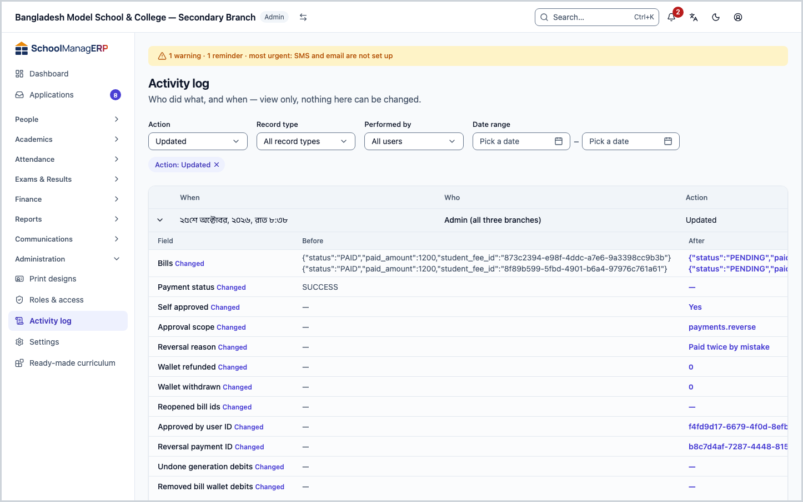

<!-- guide:meta
feature: administration.auditLogs
title: Activity log
summary: See who created, changed or deleted what in the school, and who signed in, from newest to oldest; filter to find things, and open a row to compare before and after. The record can only be viewed, never changed.
roles: [ADMIN]
sources:
  - client-admin/src/routes/_staff/audit-logs/index.tsx
  - client-admin/src/routes/_staff/audit-logs/-diff-panel.tsx
  - client-admin/src/routes/_staff/audit-logs/-humanize.ts
  - server/src/modules/audit/audit.controller.ts
  - server/src/modules/audit/audit.service.ts
  - server/src/modules/audit/redact.util.ts
labels: [auditLogs:*, nav:items.auditLogs, nav:groups.administration]
helpIds: [administration.auditLogs, administration.auditLogs.action.expand, administration.auditLogs.field.performedBy]
devices: [desktop]
entry: [sidebar, palette]
keywords:
  [কার্যক্রমের রেকর্ড, নিরীক্ষা, অডিট, কে বদলেছে, ইতিহাস, সাইন ইন, audit log, audit trail, history, who changed]
appVersion: 0.1.0 (63bfc7884)
owner: tareq89
lastVerified: 2026-10-25
knownIssues: []
-->

# Activity log

See in one list who did what in the school, and when.

**Go to:** **Administration → Activity log** in the left menu. View this page on a computer.
**Before you start:** be an Admin. The menu of other roles does not have this page ([who can do what](#roles)).

When someone creates, changes or deletes a record in the app, or signs in, the school's system writes down one line. This page shows those lines. The page is view-only: there is no button on it that changes anything, and once a record is written, nobody can change or delete it.

[View the log](#task-main) · [Find one action](#task-filter) · [Compare before and after](#task-diff) · [Problems and fixes](#trouble)

**On this page**

- [View the log](#task-main)
- [How to know you found the right record](#confirm)
- [Other situations](#other)
  - [Find one particular action](#task-filter)
  - [See what changed, before and after](#task-diff)
- [Problems and fixes](#trouble)
- [Who can do what](#roles)
- [Learn more](#more)

---

## View the log 

1. Press **Administration** in the left menu, then press **Activity log**.

   → The title **Activity log** at the top, and below it "Who did what, and when — view only, nothing here can be changed." Then the filters and the list. Each row has: **When**, **Who**, **Action**, **What**, **What happened**.

2. The newest action is at the very top. To see older actions, go to the next page at the bottom.

   → At first a page has 25 rows. You can change how many rows show per page from the bottom, up to 100.

**How to read the rows**

| Column            | What it shows                                                                                                                         |
| ----------------- | ------------------------------------------------------------------------------------------------------------------------------------- |
| **When**          | Date and time, in the school's time zone (not your phone's or computer's).                                                            |
| **Who**           | The name of the person who did it. The name stays even if the staff member is removed later. If no person did it, it says **System**. |
| **Action**        | For example **Created**, **Updated**, **Deleted**, **Signed in**, **Sign-in failed**, **Payment recorded**, **Settings changed**.     |
| **What**          | The kind of record and its name, for example **Student: …**. If there is no name, only the kind.                                      |
| **What happened** | One plain line, for example **3 details changed.**                                                                                    |

---

## How to know you found the right record 

This page does not save anything; it shows directly what is in the school's system. So there is no "on the screen but not saved" state here.

| What you see                  | What it means                                            | What next                                               |
| ----------------------------- | -------------------------------------------------------- | ------------------------------------------------------- |
| A row for the action you want | The action really happened, at that time, by that person | Open the row and compare [before and after](#task-diff) |
| **No activity found**         | No action matches these filters                          | Press **Clear all filters**, or widen the dates         |

---

## Other situations 

### Find one particular action 

Example: "Who changed a student's details last week?"

1. In **Record type**, choose **Student**.
2. In **Action**, choose **Updated**.
3. In **Date range**, set a **From date** and a **To date**.

   → The list gets shorter at once. The whole of the To date is included.

4. To see one person's actions, choose their name in **Performed by**.

To clear all the filters at once, press **Clear all filters**. The filters are kept in the page address, so if you bookmark the address, the same list opens later.

### See what changed, before and after 

1. Press the open arrow beside the row.

   → **Field changes** opens under the row: **Field**, **Before**, **After**. Next to each field that changed it says **Changed**.

2. To see the fields that did not change too, press **Show … unchanged fields**.

For an event such as a sign-in or a reminder, no field changes. Then it says: "This entry records an event, not an edit, so no field values changed."

> **Remember:** passwords, tokens and secret keys are blanked out before the record is written. In their place the **Before** or **After** column shows `[REDACTED]`, never the real value.

---

## Problems and fixes 

| What you see                                                   | What to do                                                                                                                                  | Who can help |
| -------------------------------------------------------------- | ------------------------------------------------------------------------------------------------------------------------------------------- | ------------ |
| **Couldn't load the audit trail.**                             | Reload the page. Check your internet connection.                                                                                            | —            |
| **Nothing has been recorded for this school yet.**             | This is normal in a new school. A row appears as soon as someone does something.                                                            | —            |
| **Nothing matches these filters. Change them and look again.** | Press **Clear all filters**, or widen the date range.                                                                                       | —            |
| A staff member's name is not in the **Performed by** list      | The list holds the first 100 users. If the name is missing, filter by date and record type and look in the **Who** column.                  | Admin        |
| **System** in the **Who** column                               | No person did it; the school's system did it itself (for example an automatic job).                                                         | —            |
| You want to delete or fix a wrong record                       | You cannot; records are deliberately unchangeable. Fix the original data; that will also show up as a new row.                              | —            |
| You do not see a row about your own evaluation or about you    | This is on purpose: nobody sees the rows about their own evaluation (ACR) or about a staff incident written about them, not even the Admin. | —            |

<!-- unverified: how long records are kept (retention) was not found in the code; no deletion rule is written, so the page states no time limit. -->

---

## Who can do what 

| Role                                            | See this page | See the **Activity** panel of one record | Change or delete records |
| ----------------------------------------------- | ------------- | ---------------------------------------- | ------------------------ |
| Admin                                           | Yes           | Yes                                      | No, nobody can           |
| Accountant, Academic coordinator, Teacher       | No            | Yes, for a record they can see           | No                       |
| Office staff, Exam controller, Committee member | No            | No                                       | No                       |

Only the Admin sees the list for the whole school. A few roles can see the history of one record only, on that record's page (for example one student's). A row from another school never appears in this list.

---

## Learn more 

<strong>The parts of the page</strong> — Activity log

1. The title **Activity log** and the "view only" line. No buttons.
2. The filters — **Action**, **Record type**, **Performed by**, **Date range** (**From date**, **To date**).
3. The list — **When**, **Who**, **Action**, **What**, **What happened**; you cannot sort by a column, the order is always newest to oldest.
4. An open row — **Field changes**: **Field**, **Before**, **After**.
5. Page controls and the number of rows per page.

<strong>How the record builds up</strong> — written, locked and viewed

<figure>
  
  <figcaption><em>How the activity log builds up</em></figcaption>
</figure>

- **It cannot be changed:** the school's database has a lock that stops records from being changed or deleted. No role in the app can get past it.
- **Only your own school:** every row belongs to one school; the list brings only your school's rows.
- **Order:** always newest to oldest. The list cannot be sorted another way, so the real order of the records is never shown wrongly.

<strong>Short help for the boxes (the (?) button)</strong>

<!-- guide:generated:fields:auditLogs -->

| Field        | What to enter                                                                                                                                       | Required? |
| ------------ | --------------------------------------------------------------------------------------------------------------------------------------------------- | --------- |
| Performed by | Show only what one person did. The list holds the first 100 users; if a name is missing, filter by date and record type and look in the Who column. | No        |

<!-- /guide:generated -->

**Related pages**

- [**Roles and permissions**](roles.md) — what each role can do.
- [**Staff**](../people/staff.md) — the people whose names appear in the **Who** column.
- [**Ready-made curriculum**](curriculum-preset.md) — what gets created when you apply one.

- [**Changing the school's settings**](settings.md) — the school settings

---

_Version 0.1.0 · Last checked 2026-10-25_
