<!-- guide:meta
feature: administration.curriculumPreset
title: Ready-made curriculum
summary: In a brand-new school, choose a ready-made curriculum and create the academic year, classes, subjects, grading scale and exam templates in one go. It cannot be added if the school already has classes, subjects, students or exams, and once added you cannot undo it yourself.
roles: [ADMIN]
sources:
  - client-admin/src/routes/_staff/curriculum-preset.tsx
  - client-admin/src/pages/curriculum-preset/CurriculumPresetPage.tsx
  - client-admin/src/pages/curriculum-preset/PresetCards.tsx
  - client-admin/src/pages/curriculum-preset/PresetPreviewSheet.tsx
  - client-admin/src/pages/curriculum-preset/ApplyOptionsForm.tsx
  - client-admin/src/pages/curriculum-preset/ConfirmApplyDialog.tsx
  - client-admin/src/pages/curriculum-preset/BlockedState.tsx
  - client-admin/src/pages/curriculum-preset/AppliedSummary.tsx
  - client-admin/src/components/PresetWarningBanner.tsx
  - server/src/modules/presets/presets.controller.ts
  - server/src/modules/presets/preset-apply.controller.ts
  - server/src/modules/presets/preset-apply.service.ts
  - server/src/modules/presets/preset-blockers.ts
  - server/src/modules/presets/preset-reset.service.ts
  - server/src/modules/presets/packs/index.ts
labels:
  [
    curriculumPreset:*,
    presetWarning:*,
    presetReset:*,
    nav:items.curriculumPreset,
    nav:groups.administration,
  ]
helpIds:
  [
    administration.curriculumPreset,
    administration.curriculumPreset.action.apply,
    administration.curriculumPreset.field.stages,
    administration.curriculumPreset.field.confirmName,
  ]
devices: [desktop]
entry: [sidebar, palette]
keywords:
  [তৈরি শিক্ষাক্রম, শিক্ষাক্রম, কারিকুলাম, এনসিটিবি, মাদ্রাসা, নতুন স্কুল, শ্রেণি তৈরি, curriculum, preset, NCTB, setup]
appVersion: 0.1.0 (63bfc7884)
owner: tareq89
lastVerified: 2026-10-25
knownIssues: []
-->

# Ready-made curriculum

Add classes, subjects, exams and grading to a new school in one go.

**Go to:** **Administration → Ready-made curriculum** in the left menu. Do this work on a computer.
**Before you start:** be an Admin. The school must be brand new: it must have no academic year, class, subject, student, exam, grading scale or exam structure. To see the order of setting up a school, read [**Setting up your school, step by step**](../admin/setup-order.md).

A **ready-made curriculum** is a package set up in advance: academic year, classes, subjects, class subjects, terms, grading scale, exam templates and certificate templates. When you apply it, everything is created together. You can do this only once in a school, and you cannot undo it yourself.

[Add a curriculum](#task-main) · [If it cannot be added](#task-blocked) · [If you added it by mistake](#task-reset) · [Problems and fixes](#trouble)

**On this page**

- [Add a ready-made curriculum](#task-main)
- [How to know it was added](#confirm)
- [Other situations](#other)
  - [See what is inside before you apply](#task-preview)
  - [If the school already has data](#task-blocked)
  - [If the wrong curriculum was added](#task-reset)
  - [If you change something that came from the curriculum](#task-edit)
- [Problems and fixes](#trouble)
- [Who can do what](#roles)
- [Learn more](#more)

---

## Add a ready-made curriculum 

1. Press **Administration** in the left menu, then press **Ready-made curriculum**.

   → **Ready-made curriculum** at the top, and below it "Add classes, subjects, exams and grading to a new school in one go." Three steps: **Choose a curriculum**, **Options**, **Confirm**.

2. In the **Choose a curriculum** step, press **Choose** on one card. The cards are: **Bangladesh NCTB curriculum**, **Alia Madrasa**, **Qawmi Madrasa**, Cambridge International, and **Blank / custom setup**.

   → The card says **Chosen**. If the card says **Not verified**, read the [warning below](#unverified).

3. Press **Next**. In the **Options** step, look at **Stages to set up**.

   → Every stage is ticked. Untick a stage you do not need. You must keep at least one.

4. If the curriculum has versions, choose at least one from **Versions to set up**. At first none is ticked.
5. Look at **Start year**. The current year is filled in; the first academic year is created for this year.
6. Press **Next**. In the **Confirm** step, read the summary, for example "… — stages: …, start year 2026."
7. Press **Use this curriculum**.

   → A window opens: **Apply …?** In red: "This cannot be undone by you — only a platform administrator can reset it."

8. In the **Type "…" to confirm** field, type the name shown in the window exactly. The name is in English, for example `Bangladesh NCTB curriculum`.

   → Only when the name matches fully can you press **Apply**.

9. Press **Apply**.

   → The page changes: **Curriculum applied**, and under it the **What was created** list.

<!-- image pending: Ready-made curriculum page; 1 · the three steps 2 · one curriculum card and the preview 3 · the Not verified mark 4 · Stages to set up 5 · Start year 6 · Use this curriculum; admin, desktop -->

> **Warning:** A curriculum marked **Not verified** has not been checked against the official curriculum. Its subjects, marks or grading scale may be wrong. Look at the [preview](#task-preview) before you apply, and afterwards check the [**Grading scales**](../exams-results/grading-scales.md) and the [**Exam structures**](../exams-results/exam-templates.md). At present only **Blank / custom setup** is verified.

---

## How to know it was added 

| State                           | How you can tell                                                                                                             | What next                                           |
| ------------------------------- | ---------------------------------------------------------------------------------------------------------------------------- | --------------------------------------------------- |
| **Chosen only on the screen**   | The steps are open, or the confirm window is open                                                                            | Type the name and press **Apply**                   |
| **Reached the school's system** | **Curriculum applied**; the curriculum's name, version, **Applied on …** and the number of each thing under **What was created** | Open [**Classes**](../academics/classes.md) and look |

This page does not keep anything separately on a phone or computer, so there is no "saved on this device" state. Everything happens together or not at all: if it stops halfway, nothing is left half-created.

**If the window says "Could not apply the curriculum. Please try again.":** reload the page. If it shows **Curriculum applied**, the work is done. If not, try again.

---

## Other situations 

### See what is inside before you apply 

Press **Preview** on the card. A panel opens at the side: **Stages**, **Classes**, **Groups**, **Subjects by class**, **Grading scale** (for example "80–100% — A+"), **Exam templates** and **Certificates**. If there is no grading scale, it says "No grading scale. Your school sets it." Looking at the preview creates nothing.

### If the school already has data 

The page shows **A ready-made curriculum can no longer be added to this school**, and the **Already in your school** list, for example **Classes** with 4 and **Students** with 120.

If the school has any one of these, a curriculum can no longer be added: academic year, class, subject, student, exam, grading scale, exam structure. Then carry on with them in your own way: [**Academic years**](../academics/academic-years.md), [**Classes**](../academics/classes.md), [**Grading scales**](../exams-results/grading-scales.md).

### If the wrong curriculum was added 

You cannot undo it yourself. Only a platform administrator (who runs all the schools, and is nobody at your school) can press **Undo ready-made curriculum**. They must write a reason, 10 to 500 characters; the reason is kept in the [**Activity log**](audit-logs.md).

Undoing deletes: academic years, terms, classes, sections, subjects, class subjects, grading scales and their bands, exam templates and their parts, and the ready-made curriculum settings. Certificate templates it created are kept.

Undoing is possible only when the school has none of these: students, enrolments, exams, fee structures, homework, syllabus topics, routines or routine slots, calendar events, promotion lists, attendance sessions, teacher assignments, admission rounds, recurring fee schedules, fine rules. So if you notice a mistake, tell platform support before you start any other work.

### If you change something that came from the curriculum 

On the pages for class subjects, exam structures or grading scales, a warning line shows: "This comes from your ready-made curriculum. Changing it can affect future results and reports. Results already published will not change." You can change it; the line is only a reminder.

---

## Problems and fixes 

| What you see                                                        | What to do                                                                                                            | Who can help |
| ------------------------------------------------------------------- | --------------------------------------------------------------------------------------------------------------------- | ------------ |
| **A ready-made curriculum can no longer be added to this school**   | The school already has data. See [If the school already has data](#task-blocked).                                     | Admin        |
| You cannot press **Apply**                                          | Type the English name shown in the window exactly, with capital and small letters.                                    | —            |
| You cannot press **Next**                                           | Choose at least one stage; if there are versions, at least one version; and a **Start year** between 2000 and 2100.   | —            |
| **Choose at least one stage.**                                      | Tick one under **Stages to set up**.                                                                                  | —            |
| **Choose at least one version.**                                    | Tick one under **Versions to set up**.                                                                                | —            |
| **Could not load the ready-made curricula.**                        | Press **Try again**.                                                                                                  | —            |
| **Could not apply the curriculum. Please try again.**               | Reload the page and see whether it was added; if not, try again.                                                      | Admin        |
| Someone else created a class or subject while you were applying     | The window may close and show **A ready-made curriculum can no longer be added to this school**. Then carry on in your own way. | Admin   |

---

## Who can do what 

| Role                                                                                                       | See the page and add a curriculum | Undo an added curriculum |
| ---------------------------------------------------------------------------------------------------------- | --------------------------------- | ------------------------ |
| Admin                                                                                                      | Yes, once, in a new school        | No                       |
| Accountant, Academic coordinator, Teacher, Exam controller, Office staff, Committee member                 | No                                | No                       |

Only the platform administrator, who is not a staff member of any school, can undo it. The menu of other roles does not have **Ready-made curriculum**.

---

## Learn more 

<strong>The parts of the page</strong> — Ready-made curriculum

1. The title **Ready-made curriculum** and the one-line description.
2. The row of steps — **Choose a curriculum**, **Options**, **Confirm**.
3. The curriculum card — name, **Stages: …**, **Versions: …**, the **Not verified** mark, **Choose** and **Preview**.
4. **Options** — **Stages to set up**, **Versions to set up**, **Start year**.
5. The **Use this curriculum** button, then the window where you type the name to confirm.

<!-- image pending: Ready-made curriculum, the five parts marked with numbers, the NCTB card chosen; admin, desktop -->

<strong>What the fields mean</strong>

<!-- guide:generated:fields:curriculumPreset -->
<!-- /guide:generated -->

<strong>How the ready-made curriculum works</strong> — new school, once, cannot be undone

<figure>
  
  <figcaption><em>When a ready-made curriculum can be added</em></figcaption>
</figure>

- **"New school" means:** none of academic years, classes, subjects, students, exams, grading scales and exam structures exist. Deleted records are not counted.
- **The school's system checks too:** whatever the page shows, at the moment you apply, the school's system looks again to see whether the school is new. If it is not, nothing is created.
- **What is created:** settings, academic years, classes, subjects, class subjects, terms, grading scales and bands, exam templates and their parts, certificate templates. The number of each thing created is in the **What was created** list.
- **Teachers, students and fees are not created.** Add them yourself later.

**Related pages**

- [**Setting up your school, step by step**](../admin/setup-order.md) — what comes after what in a new school.
- [**Academic years**](../academics/academic-years.md) and [**Classes**](../academics/classes.md) — what is created from here.
- [**Grading scales**](../exams-results/grading-scales.md) and [**Exam structures**](../exams-results/exam-templates.md) — check them after applying.
- [**Activity log**](audit-logs.md) — who did what, and when.

---

_Version 0.1.0 · Last checked 2026-10-25_
