<!-- guide:meta
feature: administration.modulesWords
title: Modules and words
summary: Choose your institution kind, turn parts of the system On or Off, hide a part from some roles, and change what your school calls a class, section, student, guardian or teacher.
roles: [ADMIN]
sources:
  - client-admin/src/pages/settings/ModulesWordsSection.tsx
  - client-admin/src/pages/settings/modules-words/
  - client-admin/src/components/module-off-state.tsx
  - client-admin/src/features/onboarding/guided/curriculum-step.tsx
  - shared/src/presets/institution-kinds.ts
  - shared/src/enums/module-key.ts
  - server/src/modules/presets/institution-kind.service.ts
  - server/src/modules/presets/institution-kind.controller.ts
labels:
  [
    settings:modulesWords.*,
    settings:help.modulesWords.*,
    settings:categories.modulesWords,
    common:moduleOff.*,
    onboardingSetup:guided.curriculum.kind.*,
  ]
helpIds: []
devices: [desktop]
entry: [sidebar, palette]
keywords: [modules, words, institution kind, coaching, madrasa, batch, course, turn off, who can't see it, মডিউল, শব্দ, প্রতিষ্ঠানের ধরন, ব্যাচ, কোর্স, চালু, বন্ধ]
appVersion: 0.1.0 (ea26f2b97)
owner: tareq89
lastVerified: 2026-11-14
knownIssues:
  - { id: portal-hidden-module-load-error, checked: 2026-11-14, issue: 4127 }
-->

# Modules and words

Choose which parts of the system your school uses, and what your school calls things.

**Go to:** **Administration → [Settings](settings.md)**, then the category **Modules & words**. Or press Ctrl+K and type **Turn modules on or off**, **Change words** or **Choose institution kind**. View this page on a computer.
**Before you start:** be an Admin. The category does not show for any other role.

A **module** is one part of the system, such as **Fees** or **Homework**. A module is **On** or **Off**. When a module is Off, nobody in your school sees it. **Words** are the names your school uses for a class, a section, a student, a guardian and a teacher. A coaching centre may say **Course** and **Batch** where a school says **Class** and **Section**.

The category has three parts: the **Institution kind** cards at the top, then the tabs **Modules** and **Words**. Your students, fees and other data are never changed or deleted here.

[Choose an institution kind](#task-main) · [Turn a module On or Off](#task-modules) · [Hide a module from some roles](#task-hide) · [Change a word](#task-words) · [Problems and fixes](#trouble)

**On this page**

- [Choose an institution kind](#task-main)
- [How to know it was saved](#confirm)
- [Other situations](#other)
  - [Turn a module On or Off](#task-modules)
  - [Hide a module from some roles](#task-hide)
  - [Change a word](#task-words)
  - [Where your words show today](#task-where)
  - [When a module is Off](#task-off)
  - [In the setup wizard](#task-wizard)
- [Problems and fixes](#trouble)
- [Who can do what](#roles)
- [Known issues](#known-issues)
- [Learn more](#more)

---

## Choose an institution kind 

An **institution kind** is a ready set of Off modules and words for one kind of institution. You always see what will change before anything changes.

1. Open **Administration → Settings → Modules & words**.

   → You see eight cards under **Institution kind**: "Choose your institution kind. You see what changes first, then you apply it."

2. Press the card that fits your institution.

   → A preview page opens with the title **Institution kind: (name)**. It says "This is only a preview. Nothing has changed yet." and "Your students, fees and other data, platform locks and "Who can't see it" stay as they are."

3. Read the lists **Will be On**, **Will be Off** and **Words that will change** (with **Now** and **Will be** side by side).
4. Press **Apply**. To leave without changing anything, press **Cancel**.

   → **(Name) applied** appears.

| Kind                    | Shown with                                | What Apply changes                                                                                                                                        |
| ----------------------- | ----------------------------------------- | --------------------------------------------------------------------------------------------------------------------------------------------------------- |
| **Primary school**      | Class 1 to 5                              | Turns **Seat plans** and **Evaluations** Off                                                                                                              |
| **Secondary school**    | Class 6 to 10                             | Nothing. It keeps every module On and the stock words                                                                                                     |
| **College**             | Class 11 and 12                           | Nothing. **Not verified yet**                                                                                                                             |
| **Alia madrasa**        | Dakhil and Alim                           | Nothing                                                                                                                                                   |
| **Qawmi madrasa**       | Hifz and Kitab sections                   | Nothing. **Not verified yet**                                                                                                                             |
| **English medium**      | O level and A level                       | Nothing                                                                                                                                                   |
| **Coaching centre**     | Batches, regular classes and monthly fees | Turns [**Fines**](../finance/fines.md), **Programs**, **Evaluations** and **Seat plans** Off. **Class** becomes **Course**, **Section** becomes **Batch** |
| **Technical institute** | Trade and practical work                  | Nothing. **Not verified yet**                                                                                                                             |

**Not verified yet** means the kind has not been checked with a real institution of that kind. You can still apply it, but read the preview with care.

What Apply does and does not do:

- It changes only the switches and words the kind lists, and only where your school is different now. If you already match, the preview says "Your modules and words already match (name). There is nothing to apply." and the button says **Nothing to apply**.
- Today every kind that changes a switch turns modules **Off**, so Apply does not turn any module On.
- It keeps what the platform turned off or locked, your **Who can't see it** choices, every word it does not list, and all your data.
- You can apply a kind again later. Anything you turned On again that the kind switches Off goes Off again.

<figure>
  
  <figcaption><em>How institution kind, modules and words fit together</em></figcaption>
</figure>

---

## How to know it was saved 

| What you see                                                      | What it means                                             | What next                        |
| ----------------------------------------------------------------- | --------------------------------------------------------- | -------------------------------- |
| **(Name) applied**                                                | The kind is applied                                       | —                                |
| **(Module) turned Off** (or **On**) with an **Undo** button       | The switch is saved. There is no Save button for a switch | Press **Undo** to go back        |
| **Words saved**                                                   | Your words are saved                                      | —                                |
| **Not saved — try again** under a module or at the Words **Save** | Nothing changed                                           | Check the internet and try again |
| **Could not apply this. Nothing was changed. Try again.**         | The kind was not applied                                  | Press **Apply** again            |

**To check:** open a page that uses the word, for example **People → Students**, or open **Modules** again and read the switch.

---

## Other situations 

### Turn a module On or Off 

1. Open the tab **Modules**.

   → You see 17 modules in four groups: **Study**, **Money**, **People** and **Communication**. Each has a name, one line about it, a **Who can't see it** button and an **On** / **Off** switch.

   | Group             | Modules                                                                                                     |
   | ----------------- | ----------------------------------------------------------------------------------------------------------- |
   | **Study**         | Attendance, Exams and results, Seat plans, Evaluations, Homework, Syllabus, Study plans, Routines, Programs |
   | **Money**         | Fees, Fines                                                                                                 |
   | **People**        | Staff attendance, Admissions, Applications                                                                  |
   | **Communication** | Notice board, Messages and SMS, Website                                                                     |

2. Press the switch of the module.

   → It saves at once. A message like **Fines turned Off** appears with **Undo**.

Students, Classes and Sections, Staff and Users, Settings and the Dashboard are always On. They are not in the list.

Under a module's name a short note tells you who decides:

| Note                                                  | Meaning                                                                                                                                               |
| ----------------------------------------------------- | ----------------------------------------------------------------------------------------------------------------------------------------------------- |
| **Your institution**                                  | You decide. Use the switch                                                                                                                            |
| **Platform turned it off**                            | Biddaloy turned it Off for your school. You cannot turn it On                                                                                         |
| **This cannot be turned off.** **Platform locked it** | Biddaloy keeps it On for your school. You cannot turn it Off                                                                                          |
| **Platform locked it**                                | Biddaloy keeps it Off for your school. You cannot turn it On                                                                                          |
| **Off because (module) is Off**                       | It needs another module. [**Fines**](../finance/fines.md) need **Fees**, **Seat plans** need **Exams and results**, **Study plans** need **Routines** |

When the platform decides, the switch and the **Who can't see it** button are greyed.

### Hide a module from some roles 

Use this when a module should stay On but some people should not see it, for example Fines hidden from teachers.

1. On a module's row, press **Who can't see it**.

   → A window opens: "Who can't see it — (module)". It says "People you pick will not see (module) in the menu or anywhere else."

2. Tick the roles that should not see it, then press **Save**.

   → The window closes. The button now says **Hidden from 2 roles** (with your number).

**Admin** is not in the list. "Admins can always see it." You cannot hide a module from yourself.

### Change a word 

1. Open the tab **Words**.

   → You see five rows: **Class**, **Section**, **Student**, **Guardian** and **Teacher**. Each row shows the word now and three boxes: **English (one)**, **English (many)** and **Bangla**.

2. Type your word in all three boxes of a row. For example, for **Section**: **Batch**, **Batches** and **ব্যাচ**.

   → Under the row, **shows as:** shows an example, such as **3 Batches**.

3. To use a suggestion, press its button in the row, for example **কোর্স / Course**. It fills the three boxes. You can still edit them.
4. Press **Save**. There is one **Save** for all rows.

   → **Words saved**. Menus and page titles change at once, without reloading.

Rules:

- Use 1 to 40 characters, with no < or >. Otherwise you see "Use 1 to 40 characters, with no < or >."
- Fill all three boxes of a row, or clear the whole row to go back to the stock word. A half-cleared row shows "Fill all three words, or clear the whole row to go back to the stock word" and **Save** stays shut.
- A row you do not touch keeps its stock word.

### Where your words show today 

Your words show in the page text of the screens your staff use, and in some prints and SMS. Not every screen is ready yet.

| Where                                                                                                    | Shows your word?                                         |
| -------------------------------------------------------------------------------------------------------- | -------------------------------------------------------- |
| The text of 29 groups of screens, such as students, classes, attendance, exams, fees, homework, programs | Yes                                                      |
| Menu names for people and groups, such as **Students**, **Guardians**, **Staff** and **Classes**         | Yes                                                      |
| Printed captions of **Class** and **Section**                                                            | Only on print designs created after you changed the word |
| The absence notice SMS and the homework SMS (your word for **Guardian**)                                 | Yes                                                      |
| The rest of the menu text, the dashboard and the teacher-assignments pages                               | No, they still show the stock words                      |
| Other screens                                                                                            | Not yet. A page can mix your word and the stock word     |

This guide always writes the stock words. If your school renamed **Section** to **Batch**, your screen says **Batch** where this guide says **section**.

### When a module is Off 

Everything that belongs to the module goes away for the people who cannot see it:

- its menu item and its entries in the Ctrl+K search;
- its tabs inside other pages, and its dashboard widgets;
- its report links;
- its pages in the parent and student portal.

If someone opens a hidden address anyway (a bookmark or an old link) in the staff app, they see **This part is not turned on for your institution**.

| Who               | What they see on that page                                           |
| ----------------- | -------------------------------------------------------------------- |
| Admin             | A **Turn on** button that opens **Modules & words**                  |
| Anyone else       | **Ask your admin**                                                   |
| Parent or student | A load error instead of this page. See [Known issues](#known-issues) |

Turning a module Off never deletes its data. Turn it On again and everything is back.

### In the setup wizard 

In the **Set up your school** wizard, the curriculum step shows the same **Institution kind** cards. See [Creating your school and the setup wizard](../admin/create-school.md#task-wizard) and [Ready-made curriculum](curriculum-preset.md).

---

## Problems and fixes 

| What you see                                         | What to do                                                                                                    | Who can help     |
| ---------------------------------------------------- | ------------------------------------------------------------------------------------------------------------- | ---------------- |
| **Could not load the institution kinds. Try again.** | Press the retry button and check the internet                                                                 | Admin            |
| **Could not show this preview. Try again.**          | Close the preview and open the card again                                                                     | Admin            |
| **Could not load the modules. Try again.**           | Check the internet, then open the tab again                                                                   | Admin            |
| A switch is grey                                     | Read the note under the name. **Platform turned it off** or **Platform locked it** means Biddaloy decides     | Biddaloy support |
| **Modules & words** is not in the Settings list      | Only the Admin sees it                                                                                        | Admin            |
| A menu item or page went missing                     | Its module may be Off, or hidden from your role. Ask your Admin to check **Modules** and **Who can't see it** | Admin            |
| **This part is not turned on for your institution**  | Admin: press **Turn on**. Others: **Ask your admin**                                                          | Admin            |
| A page still shows the old word                      | That screen is not ready yet. See [Where your words show today](#task-where)                                  | —                |
| **Save** on the Words tab will not press             | Check for a half-cleared row or a message about 1 to 40 characters                                            | Admin            |

---

## Who can do what 

| Role                                                                                       | Open Modules & words | Choose a kind, switch modules, change words |
| ------------------------------------------------------------------------------------------ | -------------------- | ------------------------------------------- |
| Admin                                                                                      | Yes                  | Yes                                         |
| Accountant, Academic coordinator, Teacher, Exam controller, Office staff, Committee member | No                   | No                                          |

"Who can't see it" hides a module from the roles you tick. It never hides a module from the Admin. See [Roles and permissions](roles.md).

---

## Known issues 

Checked on version 0.1.0, 2026-11-14. This part is removed when it is fixed.

| Problem                                                                                                                                                       | Who, when                                             | Data saved? | What to do now                                                               |
| ------------------------------------------------------------------------------------------------------------------------------------------------------------- | ----------------------------------------------------- | ----------- | ---------------------------------------------------------------------------- |
| In the parent and student portal, the address of a part that is Off shows a load error, not **This part is not turned on for your institution** (issue #4127) | A parent or student who opens an old link or bookmark | Yes         | Go back and use the portal menu. The part is not in the menu while it is Off |

---

## Learn more 

<strong>What the fields mean</strong>

This table is written by hand. The automatic field tables skip these texts.

| Field            | What it means                                                                                                  |
| ---------------- | -------------------------------------------------------------------------------------------------------------- |
| Source note      | Shows who decides if this module is On. If the platform turned it off or locked it, you cannot change it here. |
| Who can't see it | Pick the roles that should not see this module. Admins always see it.                                          |
| Bangla word      | The Bangla word. Leave it empty to keep the usual word.                                                        |
| Apply            | Apply changes your modules and words to match the institution kind. Your data stays as it is.                  |

**Related pages**

- [Changing the school's settings](settings.md)
- [Ready-made curriculum](curriculum-preset.md)
- [Roles and permissions](roles.md)
- [Creating your school and the setup wizard](../admin/create-school.md)
