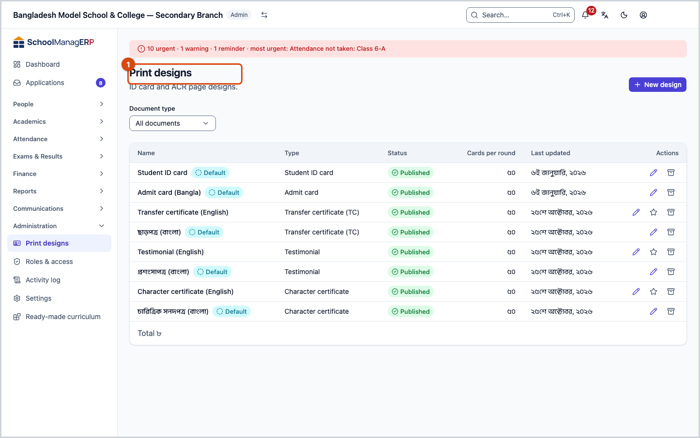

<!-- guide:meta
feature: administration.printTemplates
title: Printing ID cards, certificates and exam papers
summary: Make a print design from a ready-made one, publish it and make it the default; check the preview and print on your own printer; when a card is lost and revoked, its QR code no longer shows as valid.
roles: [ADMIN, ACCOUNTANT, OFFICE_STAFF, EXAM_CONTROLLER]
sources:
  - client-admin/src/routes/_staff/print-templates/index.tsx
  - client-admin/src/routes/_staff/print-templates/$templateId.edit.tsx
  - client-admin/src/routes/_staff/print/document.tsx
  - client-admin/src/routes/_staff/print/preview.tsx
  - client-admin/src/routes/v/$token.tsx
  - client-admin/src/components/print/preview/print-preview.tsx
  - client-admin/src/components/print/preview/run-print.ts
  - client-admin/src/components/print/history/revoke-dialog.tsx
  - ui/src/components/print/print-document/build-print-document.tsx
  - server/src/modules/print/templates/
  - server/src/modules/print/jobs/
  - server/src/modules/print/printers/
  - server/src/modules/print/verify/
labels:
  [
    printTemplates:*,
    printEditor:publish.*,
    printEditor:topbar.*,
    printEditor:fields.*,
    printEditor:help.*,
    printPreview:*,
    certificates:fields.*,
    certificates:help.*,
    examDocuments:fields.*,
    examDocuments:help.*,
    printHistory:actions.*,
    printHistory:revoke.*,
    verify:*,
    nav:items.printTemplates,
    nav:items.printables,
    nav:groups.administration,
  ]
helpIds:
  [
    administration.printTemplates,
    administration.printTemplates.action.create,
    administration.printTemplates.action.publish,
    administration.printTemplates.action.makeDefault,
    administration.printTemplates.action.archive,
    administration.printTemplates.action.print,
    administration.printTemplates.action.confirmRound,
    administration.printTemplates.field.kind,
    administration.printTemplates.field.design,
    administration.printTemplates.field.printer,
    administration.printTemplates.field.batchSize,
  ]
devices: [desktop]
entry: [sidebar, palette]
keywords:
  [print, printing, design, template, ID card, certificate, admit card, QR, revoke, publish, default, printer]
appVersion: 0.1.0 (1064129d3)
owner: tareq89
lastVerified: 2026-10-25
knownIssues: []
-->

# Printing ID cards, certificates and exam papers

Decide once how a card or certificate looks, then print it for one person, a few people or a whole section.

**Where to go:** in the left menu, **Administration → Print designs**. Do the design and printing work on a computer; on a phone the app says **Open this on a computer**.
**Before you start:** to make designs you must be an Admin. To print you need at least one printer added ([Printers and calibration](print-templates/printers-and-calibration.md)).

A **print design** is the look of one kind of document: the background picture, and where the name, photo, class and QR code go. Each document type (for example Student ID card, Transfer certificate (TC), Admit card) has its own designs. Everything that gets printed is recorded, so you can reprint later and revoke a lost card.

[Make a design](#task-main) · [Check the preview and print](#preview-print) · [Check a card by its QR code](#qr-check) · [Problems and fixes](#trouble)

**On this page**

- [Make your first design from a ready-made one](#task-main)
- [How to know the design is made](#confirm)
- [Other situations](#other)
  - [Check the preview and print](#preview-print)
  - [Change a design and publish it again](#task-edit)
  - [Make another design the default](#task-default)
  - [Archive a design](#task-archive)
  - [Check a card by its QR code, and revoke a lost card](#qr-check)
- [Problems and fixes](#trouble)
- [Who can do what](#roles)
- [Learn more](#more)

---

## Make your first design from a ready-made one 

This is the whole path up to the first ID card. If no printer is added yet, first [add a printer](print-templates/printers-and-calibration.md).

1. In the left menu open **Administration → Print designs**.

   → The **Print designs** list opens. If it is empty, it says **Start from a design**.

2. Press **New design**.

   → The **New design** window opens.

3. Choose a **Document type**, for example **Student ID card**.
4. Under **Choose a design** press one of the ready-made designs. A card can be portrait or landscape, **Classic** or **Modern**.
5. Give it a **Name**, for example "Student ID 2027". You can rename it later.
6. Press **Create and open editor**.

   → The editor opens with the design in place. The top bar says **Saved**. The design is still **Draft only** and is not used for printing.

7. If you like, change the design ([Designer's guide](print-templates/designer-guide.md)). Then press **Publish v1** at the top.

   → The app asks **Publish v1?**

8. Press **Publish**.

   → The message **Published v1** appears. If this document type has no default design yet, the app asks **Make this the default?** — press **Make this the default**.

9. Now open a student's page, press **Print ID card**, and [check the preview and print](#preview-print).

> **Remember:** until you publish, the design is not used in any print. The editor saves by itself, but only the published version goes into printing.

---

## How to know the design is made 

| State                           | How you know                                                                                  | What next                    |
| ------------------------------- | --------------------------------------------------------------------------------------------- | ---------------------------- |
| **Only changed on screen**      | The top of the editor says **Unsaved changes…** or **Saving…**                                | Wait until it says **Saved** |
| **Reached the school's system** | The top says **Saved**; in the list, the **Status** column says **Draft only**                | Publish it                   |
| **Ready to print**              | The message **Published v…**; in the list **Published**, and **Default** if it is the default | Done, you can print now      |

**To check:** open **Administration → Print designs** and look at the design's **Status** and its **Default** mark.

**If no message appears:** see [Problems and fixes](#trouble). If the editor says **Couldn't save**, press **Retry**; if you try to leave, the app warns you first.

---

## Other situations 

### Check the preview and print 

ID card printing starts from a student's or staff member's page ([Printing ID cards](print-templates/id-cards.md)). Certificates and exam papers have their own pages: [Certificates](print-templates/certificates.md), [Exam documents](print-templates/exam-documents.md). Wherever you start, you end up on **Print preview**.

1. Look at **Design**. The default design is chosen at first.
2. Under **Printer** choose **Choose a printer**. You must choose the printer yourself; the reason is [here](print-templates/printers-and-calibration.md#why-printer).

   → The printer type sets the page size: with a **Card printer** one page is one card; with an **Office printer** one A4 page holds several cards. Exam papers are always A4.

3. If a card has a **Check** mark, look at the list above (for example **No photo**, **Text does not fit**). Fix it and come back, or press **Print this round anyway**.
4. Press **Print**.

   → **Opening the print window…** appears, then the browser's print window opens. There, choose the same printer, set **Margins: None** and **Scale: 100%** ([print window settings](print-templates/printers-and-calibration.md)).

5. When the cards come out, the app asks **Did all … cards print correctly?**

| You press            | What happens                                                        | Recorded? |
| -------------------- | ------------------------------------------------------------------- | --------- |
| **Yes, all printed** | The round is recorded as printed and the next round opens           | Yes       |
| **Some failed…**     | Tick the cards that did not print correctly, then print those again | Yes       |

→ **Recorded.** appears. When all rounds are done you go back to where you started.

> **Remember:** pressing **Print** creates the print record straight away, before any paper comes out. So answer the question, so that the history stays right. Once printing starts, the **Design** can no longer be changed.

**If the print lands in the wrong place** (cut at the edge, shifted to one side, too small or too big): check that the browser's **Scale** is 100%, then [calibrate the printer](print-templates/printers-and-calibration.md).

### Change a design and publish it again 

1. In the list, in the design's row, press **Edit design**.
2. Make your changes. Wait until the top says **Saved**.
3. Press **Publish v…**, then **Publish**.

   → **Published v…**. From now on new prints use this version. Earlier prints stay on their own version, so reprinting an old card gives the old look.

### Make another design the default 

The **Default** design is the one chosen at first when you print. Each document type has exactly one default.

1. In the list, in the design's row, press **Make default**.

   → The app asks **Make … the default?**

2. Confirm.

   → The **Default** mark moves to this row and leaves the old default. Only a published design can be made the default.

### Archive a design 

1. In the list, in the design's row, press **Archive**.

   → The app asks **Archive …?**: **It will no longer be offered when printing. Past prints keep their record.**

| You press   | What happens                                        | Changed? |
| ----------- | --------------------------------------------------- | -------- |
| **Archive** | The design leaves the list and is no longer offered | Yes      |
| **Cancel**  | Nothing changes                                     | No       |

The default design cannot be archived directly; first make another design the default.

### Check a card by its QR code, and revoke a lost card 

Every printed card has its own QR code. Anyone can scan it with a phone and the **Verify document** page (`/v/<code>`) opens, with no sign-in. The page is readable on a small phone screen (unverified).

- A genuine card shows **Valid document**, with **Document**, **Holder**, **School**, **Issued on**, **Copy**, and for certificates **Serial number**.
- A revoked card shows **This document has been revoked** and the revoke date.
- It never shows the photo, ID number, class or phone number. ACRs are never checked on this page.
- If the code is wrong or incomplete, it says **We could not find this document**.

**Revoke a lost card** (Admin only):

1. In the left menu open [**Reports → Print & documents**](../reports/printables.md).
2. In the card's row press **Revoke**.
3. Write a **Reason** (required, up to 280 characters; staff see it, the public does not).
4. Press **Revoke card**.

   → The message **Card revoked** appears. From now on, scanning the QR code shows the card as revoked. If a new card is needed, print again; the new copy has its own QR code.

> **Remember:** there is no button to undo a revoke. Match the **Copy** number to be sure you pick the right card.

---

## Problems and fixes 

| What you see                                                           | What to do                                                                                             | Who can help |
| ---------------------------------------------------------------------- | ------------------------------------------------------------------------------------------------------ | ------------ |
| **No design for this document yet**                                    | Press **Create one from a suggestion**, or ask an Admin to publish a design                            | Admin        |
| **Add your first printer to be able to print.**                        | Press **Add your first printer** ([Printers](print-templates/printers-and-calibration.md))             | Admin        |
| **Your browser blocked the print window. …**                           | Allow pop-ups for this site, then press **Print** again                                                | You          |
| **Could not start printing. Nothing was printed.**                     | Try again in a little while                                                                            | You          |
| **Confirm the current round before the next one unlocks.**             | Answer the question **Did all … cards print correctly?**                                               | You          |
| **This is the default design. Make another design the default first.** | Publish another design and **Make default**, then archive this one                                     | Admin        |
| **A design with this name already exists.**                            | Give it another name                                                                                   | You          |
| The publish button cannot be pressed, **Wait for saving to finish…**   | Wait for **Saved**, or fix the list under **Fix these before publishing:**                             | You          |
| The print is shifted or cut on the paper                               | Set **Scale 100%** and **Margins None**, then [calibrate](print-templates/printers-and-calibration.md) | Admin        |
| Printing a staff card says you have no permission                      | A staff card also needs permission to see staff HR details; ask an Admin                               | Admin        |
| When scanning a QR code: **Too many checks — try again in a minute.**  | Wait a minute and scan again                                                                           | You          |

More help with this: [What to do when something goes wrong](../help/troubleshooting.md#print).

---

## Who can do what 

| Role                 | Make, publish, make default, archive designs; add printers | Print ID cards and exam papers                  | Issue certificates | See print history | Revoke cards |
| -------------------- | ---------------------------------------------------------- | ----------------------------------------------- | ------------------ | ----------------- | ------------ |
| Admin                | Yes                                                        | Yes                                             | Yes                | Yes               | Yes          |
| Accountant           | No                                                         | ID cards only (not staff cards); exam papers no | No                 | No                | No           |
| Office staff         | No                                                         | ID cards only (not staff cards); exam papers no | Yes                | Yes               | No           |
| Exam controller      | No                                                         | Yes (not staff cards)                           | No                 | Yes               | No           |
| Academic coordinator | No                                                         | No                                              | Yes                | Yes               | No           |

The QR check page is open to everyone, no sign-in needed.

---

## Learn more 

<strong>Parts of the page</strong> — the Print designs list

1. The **Print designs** heading and the **New design** button.
2. The **Document type** filter (**All documents**).
3. The list — **Name**, **Type**, **Status** (**Published** / **Draft only**), **Cards per round**, **Last updated**, and **Actions**: **Edit design**, **Make default**, **Archive**.

<strong>What the fields mean</strong>

**New design window**

<!-- guide:generated:fields:printTemplates -->

| Field           | What to enter                                                                                                                     | Required? |
| --------------- | --------------------------------------------------------------------------------------------------------------------------------- | --------- |
| Document type   | What the design is for, for example Student ID card or Transfer certificate (TC). It cannot be changed later.                     | Yes       |
| Choose a design | A ready-made design to start from. You can change everything in the editor afterwards.                                            | Yes       |
| Name            | A name only your school sees in this list, for example Student ID 2027. Two designs cannot share a name. You can rename it later. | Yes       |

<!-- /guide:generated -->

**Editor: page and text**

<!-- guide:generated:fields:printEditor -->

| Field                   | What to enter                                                                                                                                        | Required? |
| ----------------------- | ---------------------------------------------------------------------------------------------------------------------------------------------------- | --------- |
| Paper                   | The size of one card or page: CR80 card portrait, CR80 card landscape, or your own size in mm.                                                       | No        |
| Sides                   | Front only, or front and back.                                                                                                                       | No        |
| Cards per round         | How many cards print in one round before the app asks if they all came out right. Up to 200. Heavy designs print more reliably in smaller rounds.    | No        |
| Text on reprints        | Printed from the 2nd copy on, for example "Copy {n}" or "Duplicate". Leave empty if you do not want it.                                              | No        |
| If the text is too long | What happens when a name or other text does not fit its box: shrink it, wrap it to more lines, cut it off, or print it and warn you before printing. | No        |
| Smallest size (pt)      | Text shrinks down to this size and no further. Leave empty for the default.                                                                          | No        |

<!-- /guide:generated -->

**Print preview**

<!-- guide:generated:fields:printPreview -->

| Field           | What to enter                                                                                                                                                                                          | Required? |
| --------------- | ------------------------------------------------------------------------------------------------------------------------------------------------------------------------------------------------------ | --------- |
| Design          | Which published design the cards use. The default design is chosen at first. It cannot change once printing starts.                                                                                    | Yes       |
| Printer         | The printer these cards go to. Its saved settings (card or office printer, position fix) decide the page size and where things land on the paper. Choose the same printer in the browser print window. | Yes       |
| Cards per round | How many cards print in one round. Print and confirm a round to unlock the next.                                                                                                                       | No        |

<!-- /guide:generated -->

[**Issuing certificates**](print-templates/certificates.md)

<!-- guide:generated:fields:certificates -->

| Field                | What to enter                                                                                                                                      | Required? |
| -------------------- | -------------------------------------------------------------------------------------------------------------------------------------------------- | --------- |
| Which certificate?   | The certificate to issue. A transfer certificate needs a recorded transfer or withdrawal first.                                                    | Yes       |
| Certificate language | The whole certificate prints in this one language. At first it is the school default.                                                              | No        |
| Serial number        | Shown for you to check; you do not type it. The number belongs to this certificate as soon as you press Print. Closing before that uses no number. | No        |
| Printer              | The printer the certificate goes to. Add one in printing settings first.                                                                           | Yes       |

<!-- /guide:generated -->

**Exam papers**

<!-- guide:generated:fields:examDocuments -->

| Field                        | What to enter                                                            | Required? |
| ---------------------------- | ------------------------------------------------------------------------ | --------- |
| Which admit cards            | Everyone, only those whose card is not printed yet, or one section.      | Yes       |
| Rank by                      | Class position or section position decides who gets a merit certificate. | Yes       |
| How many top students (1–50) | How many students from the top get a certificate, from 1 to 50.          | Yes       |

<!-- /guide:generated -->

<strong>How printing works</strong> — designs, versions, prints and checks

<figure>
  
  <figcaption><em>From design to printed card and QR check</em></figcaption>
</figure>

- **Versions do not change:** every publish makes a new numbered version. Each print stays with the version it was printed on.
- **Record first, then print:** when you press **Print**, the print record is made first; if no record is made, nothing prints.
- **Every copy has its own QR:** printing again gives a new copy number and a new QR. Revoking one copy revokes only that copy.

**Related pages**

- [**Designer's guide**](print-templates/designer-guide.md) — change a design in the editor, and the sizes for artwork.
- [**Printers and calibration**](print-templates/printers-and-calibration.md) — add a printer, get the print in the right place.
- [**Printing ID cards**](print-templates/id-cards.md) — one person, a few people or a whole class, and reprinting.
- [**Exam documents**](print-templates/exam-documents.md) — admit cards, seat lists, marks sheets, result certificates.
- [**Certificates**](print-templates/certificates.md) — transfer certificates, testimonials; serial numbers and the register.
- [**Students**](../people/students.md) — ID card printing starts from the student's page.
- [**Staff**](../people/staff.md) — the staff card from the staff member's page.
- [**Print & documents**](../reports/printables.md) — print history, reprint and revoke
- [**Changing the school's settings**](settings.md) — the school settings

---

_Version 0.1.0 · last verified 2026-10-25_
