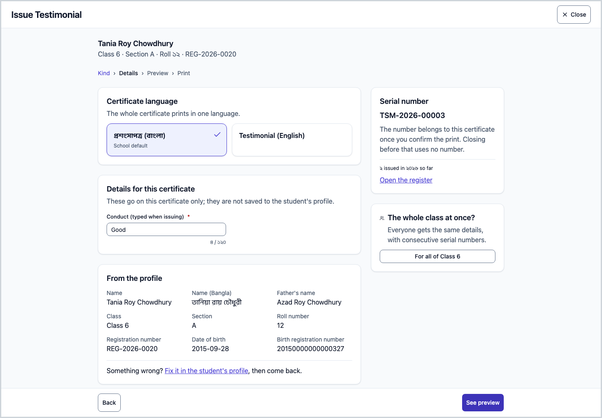
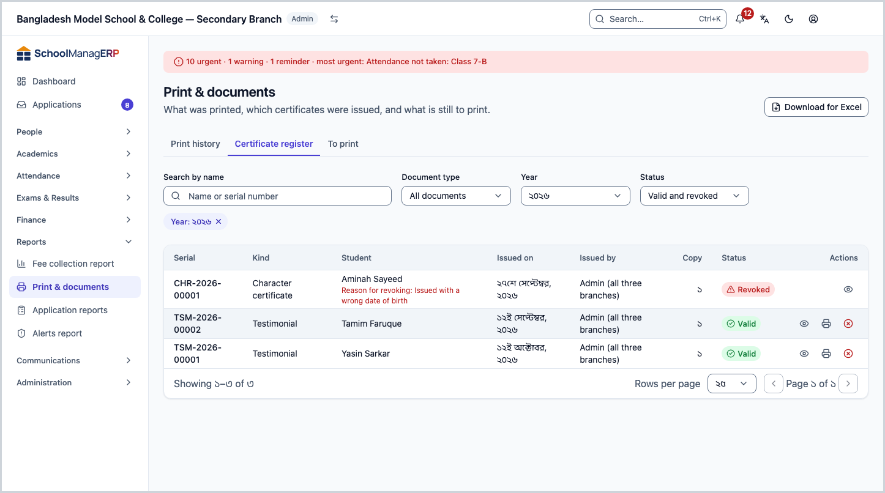

<!-- guide:meta
feature: administration.printCertificates
title: Issuing certificates
summary: Issue a student certificate with its own serial number, reprint it as a duplicate, and revoke it so the QR check shows revoked.
roles: [ADMIN, EXECUTIVE, OFFICE_STAFF]
sources:
  - client-admin/src/routes/_staff/print/document.tsx
  - client-admin/src/components/print/history/revoke-dialog.tsx
  - server/src/modules/print/jobs/
  - server/src/modules/print/verify/
labels:
  [
    certificates:fields.*,
    certificates:help.*,
    printHistory:revoke.*,
    verify:*,
  ]
helpIds: [administration.printCertificates]
devices: [desktop]
entry: []
keywords:
  [certificate, serial number, duplicate, revoke, QR, issue]
appVersion: 0.1.0 (f3b2a529e)
owner: tareq89
lastVerified: 2026-10-25
knownIssues: []
-->

# Issuing certificates

Issue a certificate to one student or a whole class: **Transfer certificate (TC)**, **Testimonial**, **Character certificate**, **Study certificate** or **Participation certificate**. Every certificate gets a serial number and goes into the register, so you can find, reprint or revoke it later.

**Where to go:** a student's page ([Students](../../people/students.md)) → **Documents** tab → **Issue certificate**. From any page you can also press **Ctrl+K** and type **Issue a certificate**.
**Before you start:** you need a published design for the kind of certificate ([Print designs](../print-templates.md)) and at least one printer ([Printers and calibration](printers-and-calibration.md)). If an NCTB, Aliya or Qawmi curriculum preset has been applied, the designs for the transfer certificate, testimonial and character certificate are already there (unverified).

[One certificate](#task-main) · [Serial number](#serial) · [Whole class](#bulk) · [Reprint](#reprint) · [Revoke](#revoke) · [Problems and fixes](#trouble)

**On this page**

- [Issue a certificate to one student](#task-main)
- [How to know the certificate is issued](#confirm)
- [Other situations](#other)
  - [Who can get which certificate](#eligible)
  - [Serial number](#serial)
  - [A whole class at once](#bulk)
  - [Reprint: a duplicate](#reprint)
  - [Certificate register](#register)
  - [Revoke a certificate](#revoke)
- [Problems and fixes](#trouble)
- [Who can do what](#roles)
- [Learn more](#more)

---

## Issue a certificate to one student 

The window has four steps: **Kind**, **Details**, **Preview**, **Print**.

1. On the student's page, in the **Documents** tab, press **Issue certificate**.

   → The **Issue a certificate** window opens, with the question **Which certificate?**

2. **Kind:** choose the certificate. A kind that cannot be issued now is grey and says why ([Who can get which certificate](#eligible)). Press **Next**.
3. **Details:**
   - Choose the **Certificate language**, Bangla or English. The whole certificate prints in one language; **School default** is chosen at first.
   - Fill in the boxes under **Details for this certificate**. They go on this certificate only and are not saved to the student's profile.
   - Under **From the profile** check the name and class. If something is wrong, press **Fix it in the student's profile**, correct it, then come back here.
   - Under **Serial number** check the **Next** number. You do not type it.

4. Press **See preview**. See the certificate as it will print, then **Next**.
5. **Print:** choose a **Printer** and press **Print** ([why you choose it yourself](printers-and-calibration.md#why-printer)).

   → The browser's print window opens. When printing is done, the app asks whether everything printed correctly; answer it.

   → **1 certificate issued** and **Serials …** appear. Press **Close**.

> **Remember:** the moment you press **Print**, the serial number becomes this certificate's. If you close the window before that, no number is used.

---

## How to know the certificate is issued 

| State                           | How you know                                                                                                        | What next            |
| ------------------------------- | ------------------------------------------------------------------------------------------------------------------- | -------------------- |
| **Only changed on screen**      | You are looking at the preview, you have not pressed **Print** yet                                                  | Print                |
| **Reached the school's system** | The question whether everything printed correctly has appeared                                                      | Answer it            |
| **Done**                        | **… certificates issued**; the **Documents** tab's **Issued certificates** list has a row with **Status** **Valid** | Give the certificate |

**To check:** scan the certificate's QR code; the **Verify document** page shows **Valid document** ([Check a card by its QR code](../print-templates.md#qr-check)). The page has only the document type, the holder's name, school, issue date, copy and serial number.

---

## Other situations 

### Who can get which certificate 

| Certificate                   | Who gets it                                                | What it shows if not                                                       |
| ----------------------------- | ---------------------------------------------------------- | -------------------------------------------------------------------------- |
| **Transfer certificate (TC)** | Someone whose leaving (transfer or withdrawal) is recorded | **Record a transfer or withdrawal first.** and a **Record leaving** button |
| **Testimonial**               | A current or graduated student                             | **Only for current or graduated students.**                                |
| **Study certificate**         | A current student                                          | **Only for current students.**                                             |
| **Character certificate**     | Any student                                                | —                                                                          |
| **Participation certificate** | Any student                                                | —                                                                          |

If there is no published design of the kind, it shows **No published template yet.** and a **Create a template** button. If a student leaves and is later admitted again, a transfer certificate can no longer be issued; the latest event counts.

### Serial number 

A serial number looks like `TSM-2026-00009`: the certificate code, the year and a five-digit running number.

| Certificate               | Code  |
| ------------------------- | ----- |
| Transfer certificate (TC) | `TC`  |
| Testimonial               | `TSM` |
| Character certificate     | `CHR` |
| Study certificate         | `STD` |
| Participation certificate | `PRT` |
| Result certificate        | `RES` |
| Merit certificate         | `MRT` |

- If the school sets a **School short code (optional)** (Settings → **Printing** → **Documents and certificates**; 2–8 capital letters or digits) it goes in front: `DAHS-TC-2026-00007`.
- Numbers run separately for each kind and each year, from 1. The year is taken from the Dhaka date of the day of issue.
- The number of a revoked certificate is never given to anyone else.
- No more than 99999 certificates of one kind can be issued in a year.

### A whole class at once 

Every certificate except the transfer certificate can be issued to a whole class in one go.

1. Open the window from any one student's page and choose the kind.
2. In the **Details** step, under **The whole class at once?**, press **For all of …**.

   → It shows **… students**. Those who cannot get this certificate are listed under **… students cannot get this certificate and were left out:**.

3. Give the same details for everyone, then preview and print as before.

   → Serial numbers are given one after another in roll order; at the end **Serials … – …** appears.

If a class has more than 1000 students it says **This class is too big to issue at once. Issue in smaller groups.** With many certificates the printing happens in rounds; answer the question after each round.

### Reprint: a duplicate 

From **Reports → Print & documents** → **Certificate register** (or **Print history**), press **Reprint** in the row.

- The new copy has the **same serial number**; the copy number goes up.
- A duplicate always prints the label **Duplicate** (**প্রতিলিপি / DUPLICATE** in the Bangla version of the app), even when the design's label is empty, so nobody mistakes it for the original.
- A revoked certificate cannot be reprinted.

### Certificate register 

The **Certificate register** tab of [**Reports → Print & documents**](../../reports/printables.md) holds every certificate issued, revoked ones too: serial, kind, student, date and status. Filter by kind and year. Press **Download for Excel** to get a CSV file that opens in Excel (up to 10,000 rows).

### Revoke a certificate 

Only an Admin can do this.

1. In **Reports → Print & documents** → **Certificate register**, in the certificate's row press **Revoke**.

   → A **Revoke …** window opens. The warning says "card", but it does the same for a certificate.

2. Write a **Reason** (required, up to 280 characters; staff see it, the public does not).
3. Press **Revoke card**.

   → The register shows the certificate as **Revoked**, with the reason. Scanning the QR code shows **This document has been revoked** and the revoke date; the reason is not shown.

> **Remember:** there is no button to undo a revoke. If the wrong certificate is revoked, issue a new one; it gets a new serial number.

---

## Problems and fixes 

| What you see                                                | What to do                                                                                                          | Who can help |
| ----------------------------------------------------------- | ------------------------------------------------------------------------------------------------------------------- | ------------ |
| **Issue certificate** is missing from the **Documents** tab | You need permission to issue certificates; ask an Admin                                                             | Admin        |
| **Record a transfer or withdrawal first.**                  | Press **Record leaving** and enter the transfer or withdrawal ([Students](../../people/students.md))                | Admin        |
| **No published template yet.**                              | Press **Create a template**, or ask an Admin to publish a design ([Print designs](../print-templates.md#task-main)) | Admin        |
| **Add a printer in Settings first.**                        | Press **Open printing settings** ([add a printer](printers-and-calibration.md#task-main))                           | Admin        |
| **This class is too big to issue at once. …**               | Issue one by one, or in small groups                                                                                | You          |
| **Reprint** is missing in the register                      | The certificate is revoked, or you have no permission to issue certificates                                         | Admin        |
| **Could not revoke this card.**                             | Try again                                                                                                           | Admin        |
| The print is shifted or cut on the paper                    | [Fix the measurements](printers-and-calibration.md#calibrate)                                                       | Admin        |

More help with this: [What to do when something goes wrong](../../help/troubleshooting.md#print).

---

## Who can do what 

| Role                 | Issue, reprint | See the register | Revoke |
| -------------------- | -------------- | ---------------- | ------ |
| Admin                | Yes            | Yes              | Yes    |
| Office staff         | Yes            | Yes              | No     |
| Academic coordinator | Yes            | Yes              | No     |
| Accountant           | No             | No               | No     |
| Exam controller      | No             | Yes              | No     |

The QR check page is open to everyone, no sign-in needed.

---

## Learn more 

<strong>How certificates, serial numbers and duplicates fit together</strong>

<figure>
  
  <figcaption><em>Certificates: issue, duplicate, revoke</em></figcaption>
</figure>

- One serial number belongs to one certificate; a duplicate is a new copy of that number, not a new certificate.
- Result certificates and merit certificates are printed from the exam page, but they get a serial number too (`RES`, `MRT`) ([Exam documents](exam-documents.md#after)).

**Related pages**

- [**Print designs**](../print-templates.md) — the main page; [check a card by its QR code](../print-templates.md#qr-check).
- [**Printers and calibration**](printers-and-calibration.md) — add a printer, fix the measurements.
- [**Exam documents**](exam-documents.md) — result and merit certificates.
- [**Printing ID cards**](id-cards.md) — student and staff cards.
- [**Designer's guide**](designer-guide.md) — certificate designs.
- [**Students**](../../people/students.md) — the **Documents** tab, recording leaving.
- [**Print & documents**](../../reports/printables.md) — print history, reprint and revoke

---

_Version 0.1.0 · last verified 2026-10-25_
